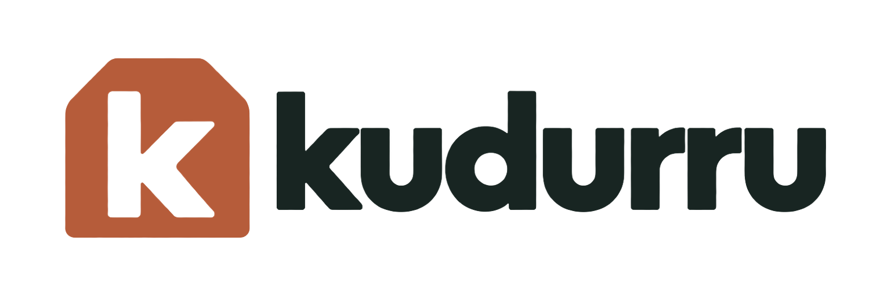

# kudurru

<picture>
  <source media="(prefers-color-scheme: dark)" srcset="branding/assets/kudurru-logo-mixed-paper.png">
  
</picture>

> A **kudurru** (koo-DOO-roo) was a Babylonian boundary stone that recorded a land grant and the rights attached to it. The name reflects what a DNS zone represents: authority over a defined space. The original stone was kept in a temple, while the landholder held a clay copy—a fitting inspiration for authoritative DNS and the copies shared through zone transfers. Our release names follow that story: **stone**, **clay copies**, **temple**.

**kudurru** is a Kubernetes-native DNS server that also runs as a single Docker container. v0.1.0, **“stone,”** brings authoritative zones, a resolver that forwards or resolves from the root servers with DNSSEC validation, blocking and a dashboard together in one source-available Go binary. These projects helped shape its design:

| Inspiration | From | What it means in kudurru v0.1.0 |
|---|---|---|
| API-first design and one binary | [Gravity](https://github.com/BeryJu/gravity) | Every node runs the resolver, API and dashboard; Kubernetes replicas share configuration through the apiserver |
| Authoritative DNS and encrypted transports | [Technitium](https://technitium.com/dns/) | Primary and forward zones, SOA serial management, AXFR/IXFR out, NOTIFY out, TSIG on UDP/TCP/DoT, DoT/DoH/DoQ/DoH3 and per-zone query ACLs |
| Private recursion | [Unbound](https://nlnetlabs.nl/projects/unbound/about/) | Opt-in recursive upstream groups: QNAME minimization, DNSSEC validation from the root trust anchors, private and special-use names answered locally, no client subnet sent; forwarding stays the default |
| A clear view of DNS activity | [Pi-hole](https://pi-hole.net/) | Stat tiles, 24 h charts, a query log that explains *why* each answer was given, one-click allow/deny and views across nodes |
| Powerful blocking | [blocky](https://github.com/0xERR0R/blocky) / [AdGuard Home](https://github.com/AdguardTeam/AdGuardHome) | hosts, domain, adblock and regex lists; client groups; per-group policies and schedules; zero-allocation matchers with a benchmark regression gate |
| Load balancing at the edge | [dnsdist](https://dnsdist.org) | An optional kudurru supervisor renders, validates and runs dnsdist; authenticated PROXYv2 preserves client IPs on the backend hop |
| Virtual IPs on bare metal | [keepalived](https://www.keepalived.org) | A kudurru supervisor renders and runs keepalived (VRRPv3, authenticated, `nopreempt`) so the VIP follows dnsdist health |

kudurru combines **Kubernetes CRDs as the source of truth in a cluster**, **OIDC sign-in and role-based access control** (viewer, auditor, operator, zone-admin and admin, with zone-scoped permissions), and **an integration framework with an external-dns webhook provider**. OIDC, scoped roles and integrations need a license key; eligible personal users can request one for free. The Cloudflare split-horizon sink and UniFi inventory source are planned for v0.2. See [access](docs/architecture/access.md), [licensing](LICENSING.md) and the [roadmap](#roadmap).

> **v0.1.0 — “stone” · 18 October 2026.** Read the [release notes](https://github.com/robertherbaugh/kudurru/releases/tag/v0.1.0) and [changelog](CHANGELOG.md) for the first release's scope and known limitations. The [architecture tour](docs/architecture/README.md#built-and-not-built) distinguishes implemented features from future plans.

## Dashboard


*Demo data from the [administrator guide](docs/guide/admin/03-watch-the-network.md#read-the-dashboard).
The query log explains each answer; node scope selects one node or all nodes.*

## How it fits together


The [architecture tour](docs/architecture/README.md) walks through it with a
diagram per topic: a query's journey, policies and blocking, block lists,
upstreams and the cache, zones, the store, deployment shapes, access and
observability.

Principles that shaped it (the full list is in the [design record](dev-docs/design-record.md#1-vision--principles)):

- **One object model, one `Store` interface, zero consensus code in v0.1.** In Kubernetes the apiserver is the replicated store; in Docker it is embedded SQLite. Follower mode (v0.2) and raft (v1.0) arrive behind the same interface.
- **One owner per object.** Objects record who manages them (API, a file, an integration, Kubernetes); writes from another source are rejected.
- **Serve from memory; degrade, never stop.** The query path never touches the store and keeps answering from the last good snapshot when the store is unreachable.
- **GPL stays in its own container.** dnsdist and keepalived are supervised, never linked.
- **Secure by default.** Generic Settings keeps privileged host keys read-only. The dedicated DHCP setup API requires explicit ownership and a restart to activate changes; host interfaces and capabilities remain deployment tasks. OIDC logins with no matching role binding are refused, never silently admin.

## Deployment shapes

| Shape | Source of truth | HA for answers | HA for config writes | Version |
|---|---|---|---|---|
| `docker run` / compose, single node | `state.db` on a volume | none (optional dnsdist for transports and cache) | n/a | v0.1.0 |
| Kubernetes, multi-replica | CRDs in the apiserver | every pod serves from memory, survives apiserver outages | apiserver HA | v0.1.0 |
| Kubernetes, standalone ("Pi-hole on k3s") | `state.db` on a PVC | none | n/a | v0.1.0 |
| Compose HA, static twins | identical file-managed config distributed to independent SQLite nodes, dnsdist and keepalived | all nodes | distribute files to every node | v0.1.0 |
| Compose HA, follower mode | primary's `state.db`, pulled by followers | all nodes | primary, fenced promote | v0.2 |
| Compose HA, raft | replicated `state.db` | all nodes | any node | v1.0 |

## Quick start

Single instance, following the [Docker guide](docs/deploy/docker.md):

```sh
mkdir -p kudurru/secrets && cd kudurru
openssl rand -base64 32 > secrets/encryption_key
openssl rand -base64 18 > secrets/admin_password
docker run -d --name kudurru --restart unless-stopped \
  -p 53:53/udp -p 53:53/tcp -p 8080:8080 \
  -v kudurru-data:/var/lib/kudurru \
  -v "$PWD/secrets:/run/secrets:ro" \
  -e KUDURRU_ENCRYPTION_KEY_FILE=/run/secrets/encryption_key \
  -e KUDURRU_ADMIN_PASSWORD_FILE=/run/secrets/admin_password \
  ghcr.io/robertherbaugh/kudurru:0.2.0 serve
dig @127.0.0.1 example.com
```

Open `https://<host>:8080/` and sign in as `admin` with the password in
`secrets/admin_password`. The first start creates a self-signed certificate.
Keep a safe copy of the encryption key. See [Install and first sign-in](docs/guide/admin/02-install-and-sign-in.md)
for host preparation and the first dashboard.

Kubernetes, starting with one replica and no license key:

```sh
kubectl create namespace kudurru-system
kubectl label namespace kudurru-system pod-security.kubernetes.io/enforce=restricted
helm install kudurru-crds oci://ghcr.io/robertherbaugh/charts/kudurru-crds --version 0.2.0
helm install kudurru oci://ghcr.io/robertherbaugh/charts/kudurru --version 0.2.0 \
  --namespace kudurru-system --set replicaCount=1
kubectl get dnszones
```

For two or more replicas, add a license key as described in the
[Helm guide](docs/deploy/helm.md#license-key). That guide also covers the first
login, load balancers and monitoring. The same YAML works in both modes:
`kudurru apply -f zone.yaml` against a Docker instance accepts the CRD
documents verbatim. Examples live in [`deploy/kustomize/samples/`](deploy/kustomize/samples/)
and [`deploy/compose/`](deploy/compose/).

## Roadmap

| Release | Name | Headline |
|---|---|---|
| v0.1.0 | stone | Resolver with DoT/DoH/DoQ/DoH3, opt-in validating recursion, opt-in DHCPv4 on Linux with dashboard setup, on SQLite (with three-node quorum failover) or Kubernetes (DHCPScope and DHCPLease objects), primary and forward zones with AXFR/IXFR out, IP/CIDR client groups, blocked services and safe search, dashboard and CLI, optional central PostgreSQL for logs and statistics, OIDC + RBAC, CRDs + Helm, compose HA with dnsdist + keepalived |
| v0.2.0 | clay copies | secondary/stub zones, RFC 2136, Active Directory DNS replacement (single-domain forest), DNSSEC validation of forwarded answers, RPZ feed import, Cloudflare split-horizon sink, UniFi inventory source, follower-mode HA, IAM and Integration CRDs, dnstap and tracing |
| v1.0 | temple | DNSSEC signing, catalog zones, RPZ publishing, raft store, ACME, Pi-hole API façade, API freeze |

v0.1.0 includes opt-in DHCPv4 for Linux. In Kubernetes, scopes are
`DHCPScope` objects from the dashboard or Git, leases are `DHCPLease`
objects, and one elected replica serves clients relayed to a LoadBalancer
address. With SQLite it runs standalone or as a three-node quorum; there,
configure fresh scopes entirely through **DHCP → Scopes**, without DHCP YAML;
existing host setup requires explicit adoption. Enabling, disabling and
topology changes are saved for restart, while active scope options and
reservations apply live. Durable lease state and revision checks preserve
allocations and later live edits across restarts. See the
[DHCP setup and deployment guide](docs/deploy/dhcp.md) for host networking,
capabilities, conflict detection, advanced network/boot options and failover
recovery. DHCPv4 is disabled by default; DHCPv6 is excluded from this pass.

OIDC, scoped roles, long-term statistics, integrations and the edge need
the corresponding license entitlements; a free eligible personal key
unlocks them. Full milestones and planned features are in
[dev-docs/design-record.md §13](dev-docs/design-record.md#13-roadmap).
The [v0.2 implementation plan](dev-docs/milestones/v0.2/README.md) reconciles that scope with the current code and groups the remaining work by dependency and acceptance criteria.

## Documentation

- [kudurru.io](https://kudurru.io): the project website ([source](website/README.md)); the documentation site is [docs.kudurru.io](https://docs.kudurru.io).
- [Learn kudurru](docs/guide/README.md): short walkthroughs with screenshots for first use, filtering, DHCP and local DNS, plus the administrator reference.
- [Architecture tour](docs/architecture/README.md): how kudurru works, with diagrams for every flow (also at [docs.kudurru.io/architecture](https://docs.kudurru.io/architecture/)).
- [Design record](dev-docs/design-record.md): the v0.1 design, the decision log and the glossary.
- [Open questions](dev-docs/open-questions.md): the project owner's decisions and the remaining spikes.
- [Deployment guides](docs/deploy/README.md): Docker, Helm, packages, runbooks.
- [Research notes](dev-docs/research/): point-in-time studies of the reference projects that the design record cites.
- Engineering notes: milestone reports ([M1](dev-docs/milestones/m1/README.md), [M2](dev-docs/milestones/m2/README.md), [M3/M4](dev-docs/milestones/m3/README.md), [M5](dev-docs/milestones/m5/README.md)), [spikes](dev-docs/spikes/README.md) and [follow-ups](dev-docs/followups.md).
- [Contributing](CONTRIBUTING.md): licensing rules (no GPL or EUPL code is ever ported), layout, and how to build.
- [Branding kit](branding/README.md): logos, icons, color tokens, usage rules, and original artwork.

## Repository layout

```
# The kudurru binary (one Go module)
cmd/kudurru/        entry point: the single CLI and server binary
internal/           the core: dataplane (dnsserver, pipeline, stages, zone, blocking, cache, upstream)
                    and control plane (store, controller, config, auth, rbac, api, querylog, audit, cluster);
                    Go's internal/ rule keeps these packages private to this module
ee/                 features that need a license key (OIDC, scoped RBAC, audit storage, long-term stats, edge, integrations)
api/                Go types for every kind (the same structs are CRDs, the SQLite schema and the REST shapes), OpenAPI
dashboard/          the web dashboard (Bun + React 19 + Astryx), built into the binary

# Running it
deploy/             everything you deploy with:
  helm/             Helm charts: kudurru and kudurru-crds
  kustomize/        kustomize tree: CRD bases, RBAC, manager, samples, overlays
  compose/          docker compose profiles (single, single-edge, ha)
  grafana/ prometheus/ systemd/
images/             dnsdist and keepalived supervisor images (GPL binaries, digest-pinned)

# Documentation
docs/               user documentation, published to docs.kudurru.io: guide, deploy guides, architecture tour
docs-site/          the Hugo site that builds docs.kudurru.io from docs/
dev-docs/           for contributors, not published: design record, milestone notes, research, spikes, follow-ups

# Development
test/               end-to-end, interop, DHCP and fuzz suites
hack/               development scripts and generators
bench/              benchmark baseline and regression limits
branding/           original artwork, exported logos and icons, color tokens and brand guidelines

# Separately licensed, not part of the binary
website/            the kudurru.io website (Bun + TypeScript)
license-server/     the license portal that issues license keys (Bun + TypeScript + Postgres)
```

## AI Assisted Development

kudurru was built with substantial help from AI coding assistants: **Claude** (Anthropic) and **OpenAI** models. To be transparent about what that means:

**Created with AI assistance**

- most of the source code (the resolver and control plane, the dashboard, the CLI and the supervisors)
- the Helm charts, compose profiles, Dockerfiles and GitHub Actions workflows
- the tests and benchmarks
- the documentation, including the architecture, the user guide and this README

**Done by the maintainer**

- defining the requirements and deciding on features, design and licensing rules
- reviewing, running and testing the result, and reporting problems that were then fixed
- publishing, versioning and operating the project

**What this means for you**

- The test suite and the CI workflows run on every change, and releases are published only through the pipeline described in the [release checklist](dev-docs/release-checklist.md). Tests are not a substitute for validating your own environment.
- Validate client addresses, encrypted transports and VIP failover in your own deployment using the [runbooks](docs/deploy/runbooks.md) and [release checklist](dev-docs/release-checklist.md). The milestone reports record the environments and checks used during development.
- AI-generated code can contain mistakes, including security-relevant ones. Review the code, and validate authentication, RBAC and network exposure yourself, before you run kudurru in production or on an untrusted network.
- Issues and pull requests are reviewed and handled by the maintainer. The rules for AI agents that work in this repository are in [CLAUDE.md](CLAUDE.md).

## License

The core DNS server and dashboard are **source-available** under the
[Kudurru Community License](LICENSE). Personal, homelab, qualifying nonprofit
and isolated community-development uses are permitted under its terms.
Business and government production use needs an accepted
[Commercial Software License Agreement](COMMERCIAL_LICENSE_AGREEMENT.md)
and Order Form, including for no-key features. A free eligible key covers
up to 3 nodes; commercial enterprise features require the Enterprise plan or
named modules in the Order Form. DNS answering never depends on a key.

The [`ee/`](ee/LICENSE.md) enterprise materials and [`docs-site/`](docs-site/LICENSE.md)
documentation have their own notices. Anyone may read the published docs.
The [`website/`](website/LICENSE.md) kudurru.io website and
[`license-server/`](license-server/LICENSE.md) issuance service are separately
licensed for source inspection; the Community License and commercial
agreement do not grant rights to modify, redistribute or host them.

See [LICENSING.md](LICENSING.md) for the scope and key behavior,
[kudurru.io/license](https://kudurru.io/license) to request a key, and
[NOTICE](NOTICE) for third-party notices. dnsdist and keepalived retain their
GPL licenses and ship as separate, unmodified programs in their own images.
Historical license grants remain in effect.
