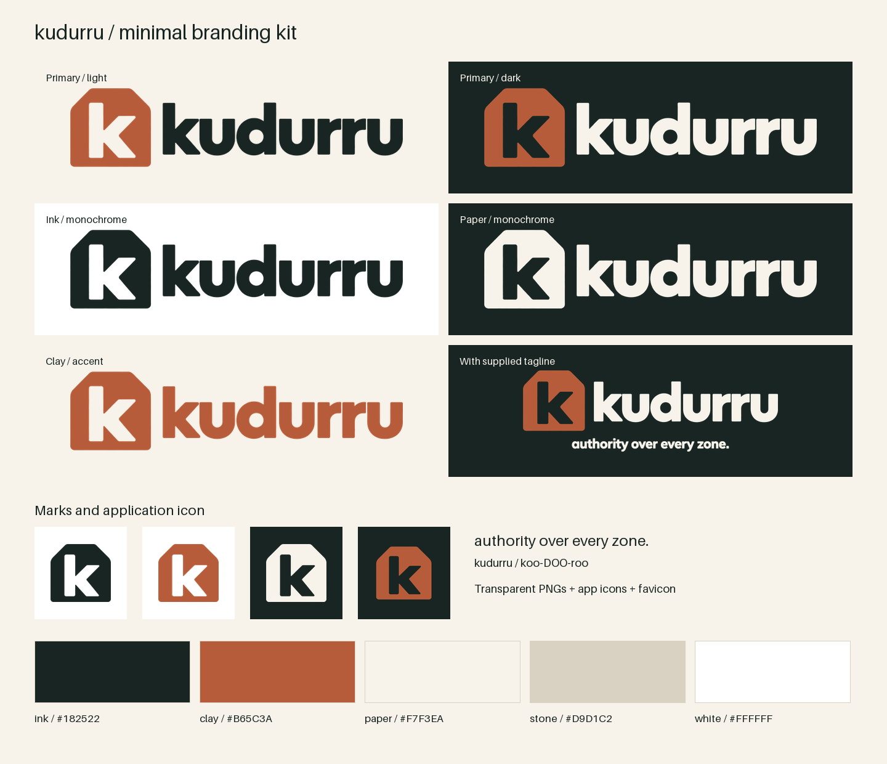

# kudurru branding kit

Ready-to-use raster artwork built from the 13 supplied logos. The kit includes clean transparent logos and marks, app icons, a favicon, a repository social card, and reusable color tokens.

`branding/` is the canonical source for artwork, original images, color
tokens and export scripts. The website and documentation build from this
folder; the dashboard, block page and license portal embed generated copies.
Changes require the owner's review through [.github/CODEOWNERS](../.github/CODEOWNERS).



## Choose a logo

| Background / purpose | Asset |
| --- | --- |
| Light background, default | [Clay mark with Ink wordmark](assets/kudurru-logo-mixed.png) |
| Dark background, default | [Clay mark with Paper wordmark](assets/kudurru-logo-mixed-paper.png) |
| Light background, monochrome | [Ink logo](assets/kudurru-logo-ink.png) |
| Dark background, monochrome | [Paper logo](assets/kudurru-logo-paper.png) |
| Accent treatment | [Clay logo](assets/kudurru-logo-clay.png) |
| With tagline, light background | [Mixed logo with tagline](assets/kudurru-logo-mixed-tagline.png) |
| With tagline, dark background | [Mixed/Paper logo with tagline](assets/kudurru-logo-mixed-paper-tagline.png) |

The default is the Clay tablet with an Ink wordmark on light surfaces and a Paper wordmark on dark surfaces. The repository README already switches between those versions using a `<picture>` element.

## Asset inventory

All production files use lowercase kebab-case names under [assets/](assets/). The [asset manifest](assets/manifest.json) records dimensions and checksums.

| Files | Specification | Use |
| --- | --- | --- |
| `kudurru-logo-{mixed,mixed-paper,ink,paper,clay}.png` | 1536 × 512, transparent RGBA | Headers and documentation |
| `kudurru-logo-{mixed,mixed-paper}-tagline.png` | 1536 × 640, transparent RGBA | Larger brand placements |
| `kudurru-mark-{ink,clay,paper}.png` | 1024 × 1024, transparent RGBA | Avatars and standalone marks |
| [kudurru-icon-192.png](assets/kudurru-icon-192.png), [kudurru-icon-512.png](assets/kudurru-icon-512.png) | Opaque square PNGs; Clay mark on Ink | Application icons; 20% inset |
| [favicon.ico](assets/favicon.ico) | 16, 32, and 48 px frames | Browser tabs; larger mark for small sizes |
| [kudurru-social.png](assets/kudurru-social.png) | 1200 × 630, opaque PNG | Repository social preview |
| [kudurru-brand-sheet.png](assets/kudurru-brand-sheet.png) | 1440 × 1240, opaque PNG | Quick visual reference |

The social card is available for upload to repository settings. The
v0.1.0 dashboard (`dashboard/`, React + Astryx, D69) uses this brand's palette,
favicon and app icons.

## Identity and copy

The tablet outline and lowercase **k** cutout refer to the Babylonian boundary stones that gave kudurru its name. Those stones recorded authority over territory, much like DNS zones record authority over a defined space. Use the supplied silhouette and bold lowercase wordmark consistently.

Write the name **kudurru**, lowercase. Pronunciation: **koo-DOO-roo**. The supplied tagline is **authority over every zone.** Preserve its lowercase spelling and final period. **Kubernetes-native DNS** can serve as a product descriptor in surrounding copy.

## Palette and typography

| Token | Color | Use |
| --- | --- | --- |
| `ink` | `#182522` | Wordmark, body text, dark surfaces |
| `clay` | `#B65C3A` | Tablet mark and restrained accent |
| `paper` | `#F7F3EA` | Light surfaces and reversed lettering |
| `stone` | `#D9D1C2` | Dividers and secondary surfaces |
| `white` | `#FFFFFF` | Neutral background |

Use [tokens.css](tokens.css) for CSS custom properties (`--kudurru-ink`, `--kudurru-clay`, and so on), or [tokens.json](tokens.json) for application code. Keep query success, blocked, warning, and error colors separate from brand colors.

Ink on Paper has approximately **14.3:1** contrast. Clay on Paper has approximately **4.1:1**; use Ink for normal-sized body text on Paper. Production exports use these exact foreground colors, with antialiasing at their edges.

The supplied wordmark and tagline remain image artwork; their original fonts
are unknown. Inter is the recommended UI font, with system sans serif
fallbacks. JetBrains Mono is the recommendation for commands and DNS
records, with system monospace fallbacks. The website self-hosts these
fonts; the dashboard themes use system fonts. The branding kit itself
includes no font files.

## Usage

- Preserve the aspect ratio and built-in clear space. If placing a tightly cropped image, leave at least one quarter of the tablet's visible height around it.
- Use a visible mark height of at least 24 px, a logo width of at least 180 px, and a tagline-logo width of at least 360 px. Use the dedicated favicon for browser tabs.
- Put Paper lettering on Ink or another sufficiently dark solid surface. Put Ink lettering on Paper or White. On photography, use a solid backing.
- Keep the cutout transparent so the background shows through it. Avoid shadows, outlines, added texture, or independent redrawing of letters.
- For a logo next to a visible project heading, use empty alt text. For a standalone identifying logo, use `alt="kudurru"`.

Example for a page that follows the viewer's color scheme:

```html
<picture>
  <source media="(prefers-color-scheme: dark)"
          srcset="branding/assets/kudurru-logo-mixed-paper.png">
  
</picture>
```

## Sources and reproducible exports

The [sources/](sources/) directory contains all 13 original PNGs in their Clay, Ink, Mixed, and Paper groups. Only filenames were changed; image bytes are unchanged. [sources/manifest.json](sources/manifest.json) records original filenames and SHA-256 hashes. Original generation prompts and model information were not supplied.

Production exports share the supplied Mixed lockup's silhouette and wordmark, the Mixed standalone tablet's silhouette, and the Ink tagline's lettering. The two supplied tablet drawings have minor shape differences; the standalone mark was retained for its higher resolution. Color variants within each format use identical geometry. The export script removes faint alpha noise and isolated pixels, normalizes foreground colors, and composes size-specific derivatives. It does not generate new artwork.

To reproduce from the repository root:

```sh
python3 -m venv .context/brand-venv
.context/brand-venv/bin/pip install Pillow==11.3.0
.context/brand-venv/bin/python3 branding/build-assets.py
```

The script rewrites production assets, manifests, and tokens; it leaves source PNGs unchanged. The [earlier generation prompts](prompts.md) remain as design reference, not as provenance for these supplied files. Raster PNGs are not editable vector masters.

After changing production artwork, regenerate the embedded dashboard,
block-page and email assets from the repository root:

```sh
.context/brand-venv/bin/python3 dashboard/scripts/brand-assets.py
.context/brand-venv/bin/python3 license-server/scripts/mail-brand.py
```

The dashboard and license portal keep their Astryx theme sources in
[`dashboard/src/themes/kudurru/`](../dashboard/src/themes/kudurru/) and
[`license-server/ui/src/themes/kudurru/`](../license-server/ui/src/themes/kudurru/).
Palette changes also need updates there; the image export scripts do not
rebuild themes. The websites read this kit during their builds.
