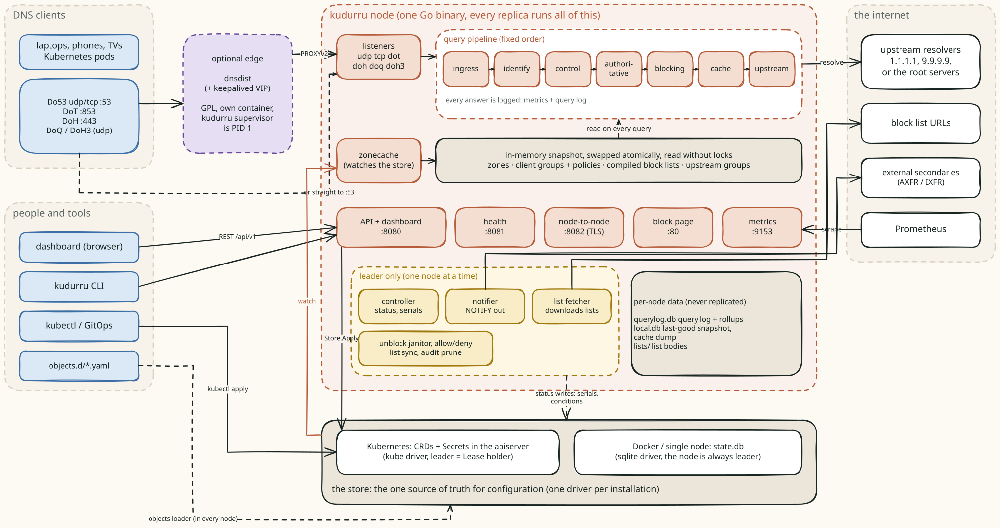
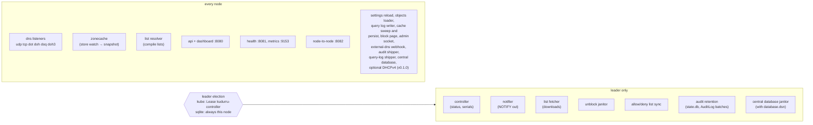

# How kudurru works

A visual tour of kudurru v0.1.0: where a DNS query goes, how
a client's policy is chosen, how configuration travels from a YAML file or
the dashboard to every node, and how the deployment shapes fit together.
Every page leads with a picture and then explains it.

The optional [DHCPv4 server](dhcp.md) is included in v0.1.0 on Linux with
either store: node-local SQLite with standalone or three-node quorum operation,
or `DHCPScope`/`DHCPLease` objects and one elected replica on the Kubernetes
store. Both have dashboard setup.

This tour is for contributors and for operators who want to know what
happens inside. For running kudurru, read the [guide](../guide/README.md)
and the [deployment docs](../deploy/README.md).
For *why* it is built this way, read the [design record](../../dev-docs/design-record.md)
and its decision log (D1 onwards); where the code and the design record
disagree, these pages follow the code and say so.

## The tour

| Page | What it shows |
|---|---|
| [A query's journey](query-path.md) | the seven pipeline stages, every way a query can leave them, and the status each outcome gets |
| [Clients, policies and blocking](policies-and-blocking.md) | how a client is identified, how its policies are merged, how one name is judged, the block page and unblock requests |
| [Block lists](block-lists.md) | how a list is fetched once by the leader, shared with every node, compiled and swapped in |
| [Upstreams and the cache](upstreams-and-cache.md) | which upstream group answers, strategies, server health, the cache and serve-stale |
| [Zones and transfers](zones.md) | authoritative answers, serials, NOTIFY and AXFR/IXFR |
| [DHCPv4 and leases](dhcp.md) | the optional v0.1.0 server, dashboard setup, staged restart apply, live management and persistent leases |
| [Configuration and the store](configuration-and-store.md) | the object model, the two store drivers, the write path, the snapshot, leader election and settings |
| [Deployment shapes](deployment.md) | one container, Kubernetes, compose HA with dnsdist and keepalived, and what happens when something fails |
| [Access: sign-in, tokens and RBAC](access.md) | principals, the authentication chain, OIDC sign-in, authorization, the node-to-node plane |
| [Licensing and license keys](licensing.md) | how a key is verified offline, what each state changes, and the one promise: DNS never depends on a key |
| [Observability](observability.md) | the query log pipeline, metrics, health probes and audit |

## Five ideas that explain most of the design

1. **One binary, every node the same.** Each replica runs the whole
   pipeline, the API and the dashboard. A few loops (status, serials,
   NOTIFY, list downloads) run on exactly one node, the leader.
2. **The store is the only source of truth for configuration.** In
   Kubernetes it is the apiserver (CRDs); in Docker it is `state.db`.
   Everything else is derived from it or local to one node.
3. **The query path never touches the store.** Each node watches the store
   and builds an in-memory snapshot. Queries read the snapshot without a
   lock, and the node keeps answering from it when the store is away.
4. **The pipeline is fixed.** The stage order is code, not configuration,
   so every answer can be explained by the stage that produced it.
5. **Runtime data stays on the node.** The query log, the response cache and
   list bodies are per node; only configuration is replicated.

## One process, many loops

`kudurru serve` starts one runner. Loops in the first group run on every
node from the start; loops in the second group run only while the node
holds the leader election, and stop (without stopping the process) when it
loses it.

Some loops start only when their feature is on (the block page, the
external-dns webhook, the query log writer, the admin socket). There is no
`roles:` setting: every node runs the full set.

## Ports

| Port | Listener | Who calls it |
|---|---|---|
| 53 udp/tcp (5353 behind an edge) | DNS | clients, or dnsdist with PROXYv2 |
| 67 udp (opt-in) | DHCPv4 scopes | direct clients on UDP 68; trusted relays on their authorized source port |
| Operator-selected TCP peer port (opt-in) | DHCPv4 quorum | mutually authenticated replication and forwarded management between three voters |
| 853 tcp / 443 tcp / 853 udp / 443 udp | DoT, DoH, DoQ, DoH3 (off by default) | clients |
| 8080 | REST API `/api/v1` and the dashboard | browsers, the CLI, automation |
| 8081 | `/healthz/*`, `/lameduck` (no auth) | probes, `kudurru health`, `kudurru lameduck` |
| 8082 | node-to-node API (always TLS + token) | other replicas, edge supervisors |
| 9153 | `/metrics` | Prometheus |
| 80 (443) | block page (when enabled) | browsers sent there by a block answer |
| 127.0.0.1:8888 | external-dns webhook (when enabled) | external-dns |
| unix `/run/kudurru/kudurru.sock` | admin socket | `kudurru admin` inside the container |

## Built and not built

The design record plans more than v0.1 ships. These pages describe the
code. The main gaps between the two:

| Planned in the design record | State in the code |
|---|---|
| Complete pipeline (`local`, `rewrite`, …) | 9 installed stages, including DNSSEC and the postprocess wrapper; local and rewrite remain reserved |
| `follower` and `raft` store drivers | `kube` and `sqlite` only |
| scatter-gather across nodes | the node list, the stats and the query log are gathered over `:8082` (or read from the central database with `database.dsn`); `/nodes/{other}/health` returns 501 |
| cluster-wide temporary disable of blocking | per node, in memory |
| client match by MAC, hostname, DoT/DoH client ID | match by IP and CIDR (the index supports the rest; no transport fills them in) |
| `cluster.role: static` read-only twins | no such key; each twin is an independent sqlite node |
| secondary zones, NOTIFY in, dynamic UPDATE | independent secondary AXFR/IXFR over TCP/TLS with authenticated NOTIFY fan-out; dynamic UPDATE remains in progress |
| DHCP server support | DHCPv4 ships in v0.1.0 on Linux: SQLite standalone or three-node quorum failover, or the Kubernetes store with `DHCPScope`/`DHCPLease` objects and one elected replica behind a relay; dashboard setup, direct/relayed subnets, conflict checks, advanced network/boot options, live management, lease import/export and persistent A/PTR ownership; DHCPv6 is excluded |
| Kubernetes Events from the controller | events are logged only |

The open list lives in [follow-ups](../../dev-docs/followups.md).

## Reading the diagrams

Two kinds of pictures appear on these pages:

- **Hand-drawn diagrams** (`diagrams/*.excalidraw.svg`) give the big
  picture. Each SVG embeds its Excalidraw scene: open it at
  [excalidraw.com](https://excalidraw.com) (menu → Open) or with the
  Excalidraw extension for VS Code, edit it, and export it again as SVG with
  "Embed scene" checked, under the same name.
- **Mermaid diagrams** (in the markdown) show flows, sequences and states.
  GitHub and the docs site render them; edit them as text.

Colours in the hand-drawn diagrams:

| Colour | Meaning |
|---|---|
| clay | kudurru code |
| blue | clients, people and tools |
| purple | dnsdist and keepalived (GPL, separate processes) |
| stone | stored data |
| yellow | leader-only work, warnings |
| green / red | an answer / a block |
| white | systems outside kudurru |
