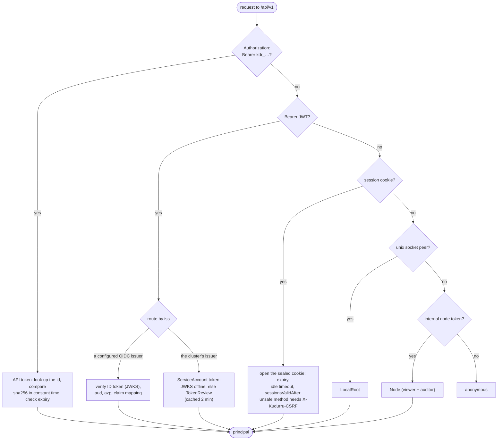
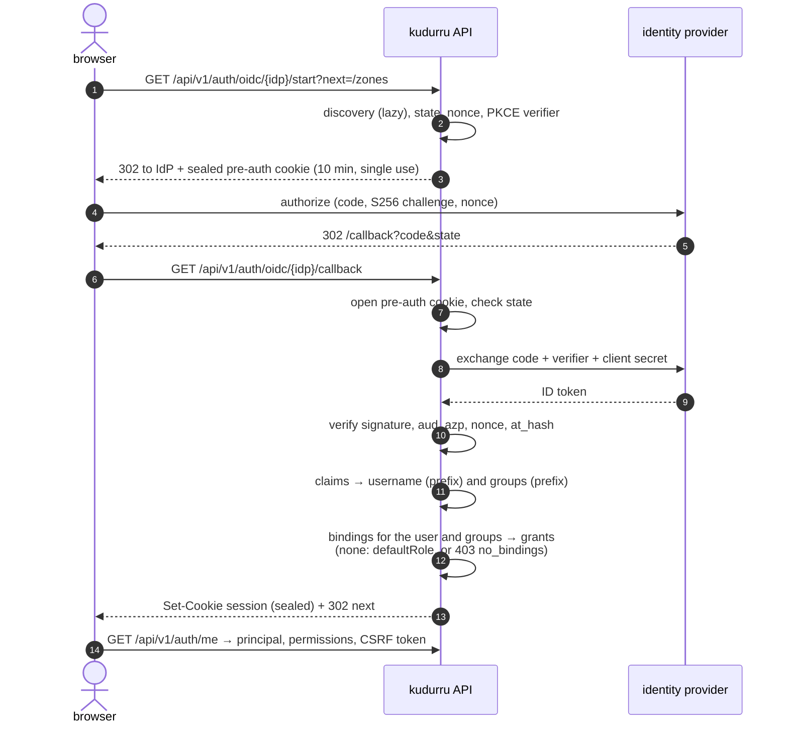
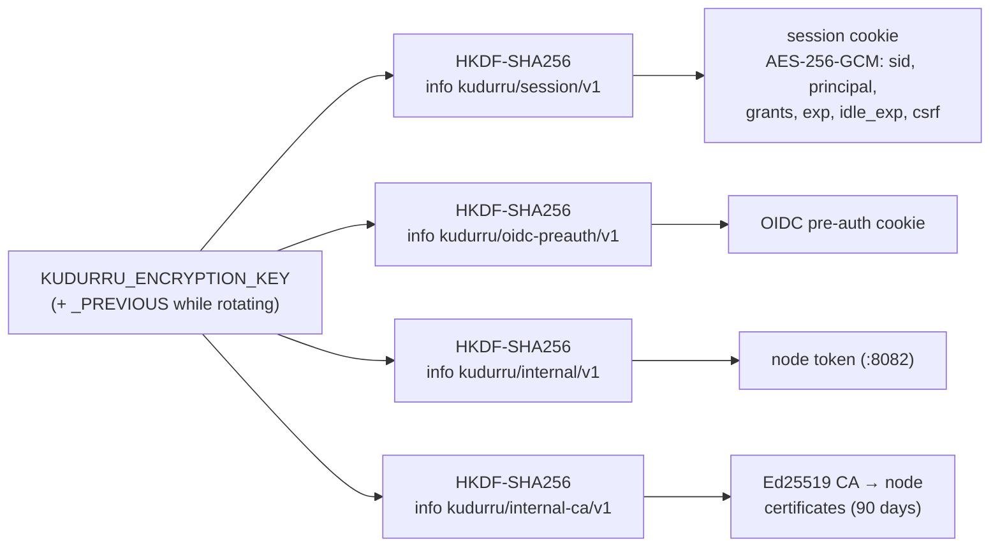
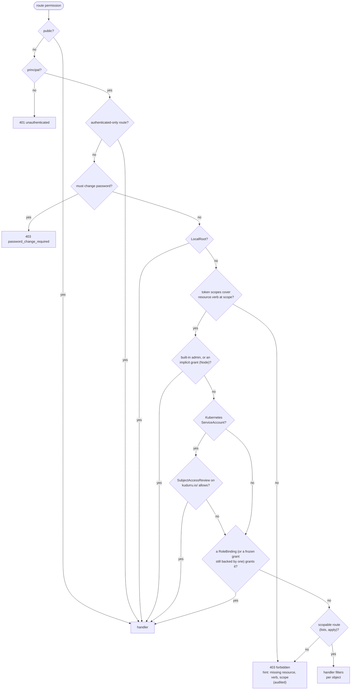

# Access: sign-in, tokens and RBAC

Everything except DNS goes through the HTTP API on `:8080`: the dashboard is
a single-page app served from `/` that talks only to `/api/v1`, and the CLI
uses the same API with a bearer token. This page shows how a request
becomes a **principal** and how the principal is **authorized**.

Code: `internal/api` (routes, middleware, authorization),
`internal/auth/*` (authenticators, sessions, OIDC, tokens, users, the admin
socket, Kubernetes tokens), `internal/rbac` (`permissions.yaml`, the
engine, SubjectAccessReview), `internal/cluster/internalapi` (node-to-node).

## Principals

| Kind | Comes from | Typical caller |
|---|---|---|
| `User` | local password login, or OIDC sign-in | a person in the dashboard |
| `ServiceAccount` | a `kdr_` API token owned by a kudurru ServiceAccount | automation, the bootstrap token |
| `KubernetesServiceAccount` | a projected ServiceAccount token (audience `kudurru`) | a Job or controller in the cluster |
| `LocalRoot` | a peer on the unix admin socket (uid 0, the server's uid, or a configured gid) | `kudurru admin` inside the container |
| `Node` | the internal node token | another kudurru node, an edge supervisor |

## The request path

### Authentication: first claim wins

A credential that is present but wrong is rejected at once (401); it never
falls through to the next authenticator, and an unknown bearer value is
never anonymous.

## Signing in

### First start

When there is no `LocalUser`, the server creates `admin` (built-in admin)
with the password from `KUDURRU_ADMIN_PASSWORD[_FILE]` or
`auth.bootstrap.adminPasswordFile`; otherwise it generates one, prints it
once, and requires a change at the first sign-in (every permission route
answers `403 password_change_required` until then).
`KUDURRU_BOOTSTRAP_TOKEN[_FILE]` creates an admin API token for automation.

Local passwords are Argon2id (19 MiB, t=2, p=1). Failed sign-ins lock an
address for 5 minutes after 5 failures, and an account for 15 minutes after
10.

### OIDC in the browser

kudurru is a confidential client (backend for frontend): the browser never
sees a token, only a sealed cookie.

OIDC users are not stored. Their grants are resolved at sign-in and frozen
in the session; deleting or narrowing a binding revokes frozen grants on the
next request. There is no refresh token: the session lasts 12 hours, or
30 minutes without activity.

### The sealed session cookie

Because every node derives the same keys from the shared encryption key, any
replica can open any session, and nodes trust each other on `:8082`, without
a shared session store or an extra Secret. The cookie is
`__Host-kudurru_session` when it is Secure (the default, since the API
serves a self-signed certificate unless told otherwise), HttpOnly and
SameSite=Lax, and is re-sealed at most once a minute to slide the idle
timeout.

### The CLI

`kudurru login --token kdr_…` stores a token. `kudurru login --username`
signs in with a password, creates a personal token
(`kudurru-cli@<host>`), signs out, and stores the token. Tokens go to the
OS keyring, with a 0600 file as the fallback. Browser and device-code
sign-in for the CLI are planned for v0.2.

## Authorization

`internal/rbac/permissions.yaml` is the single source for resources, verbs
and roles; it generates the aggregated ClusterRoles in the chart, and a lint
fails the build when a route declares no permission.

| Role | Can |
|---|---|
| `viewer` | read zones, records, lists, groups, policies, stats, cache, settings (redacted) |
| `auditor` | viewer + the query log (with client addresses), its export, the audit log |
| `operator` | write records, lists, groups, policies, clients; flush the cache; toggle blocking; decide unblock requests |
| `zone-admin` | everything on one zone (the only scoped role: `zone-admin@zone:<name>`) |
| `admin` | `*.*` |

A binding gives a role at a scope (`cluster` or `zone:<name>`) to users,
groups (the prefixed IdP group names) or service accounts. Kubernetes
identities can instead be authorized by Kubernetes RBAC through
SubjectAccessReview on the `kudurru.io` resources, including virtual ones
such as `querylogs` and `caches`; a request is allowed when either path
allows it, and the audit record names the path.

## Node to node (`:8082`)

| Route | Used by |
|---|---|
| `GET /internal/status` | edge supervisors, diagnostics |
| `GET /internal/lists/{digest}` | replicas pulling list bodies from the leader |
| `GET /internal/zones` | edge supervisors (zone serials) |
| `GET /internal/catalogue`, `/internal/catalogue/adguard` | replicas pulling the services catalogue |

Always TLS with the derived CA, always the bearer node token, rate-limited
per client. The same token is accepted on `:8080` as a `Node` principal with
`viewer` and `auditor`.
