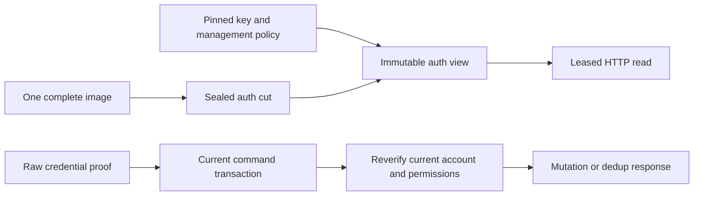
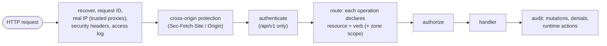
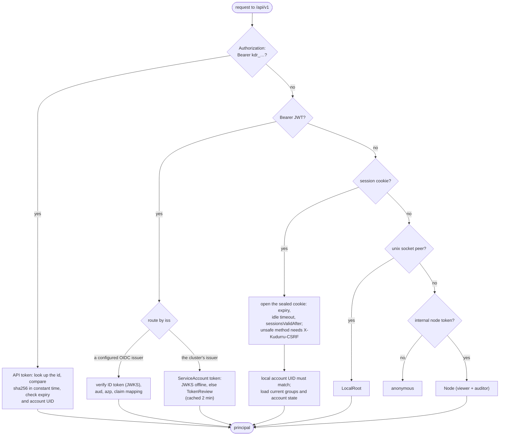
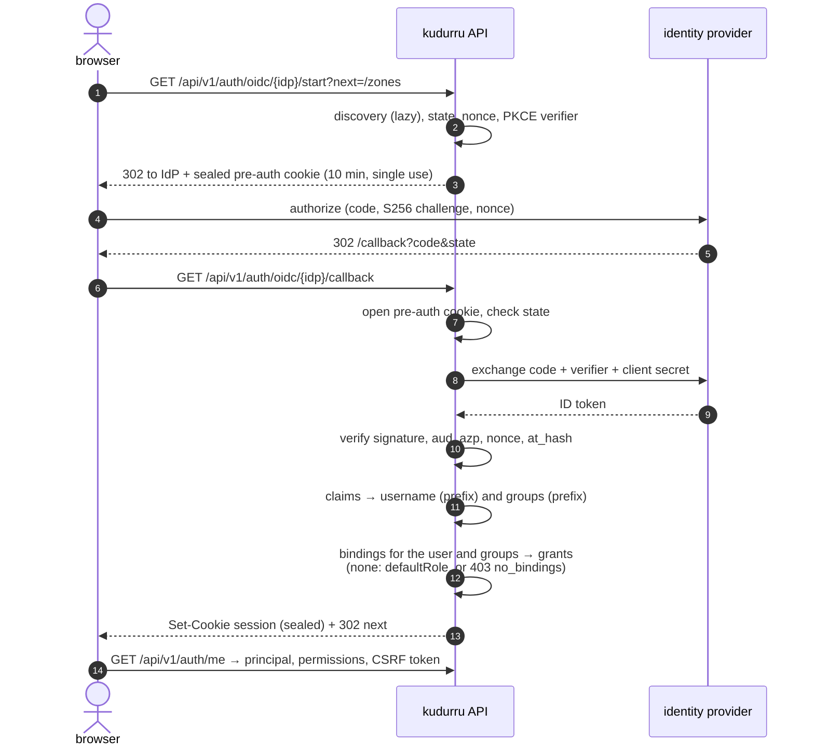
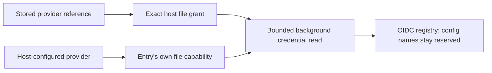
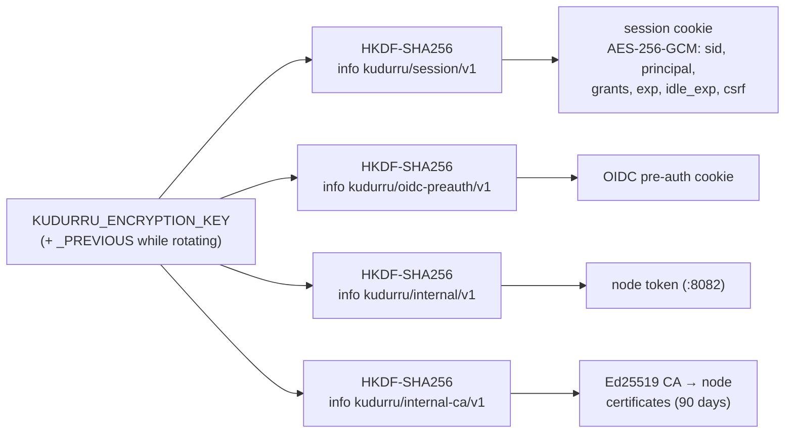
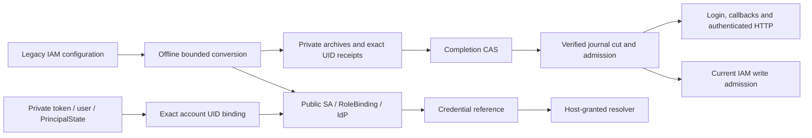

# Access: sign-in, tokens and RBAC

Everything except DNS goes through the HTTP API on `:8080`: the dashboard is
a single-page app served from `/` that talks only to `/api/v1`, and the CLI
uses the same API with a bearer token. This page shows how a request
becomes a **principal** and how the principal is **authorized**.

Code: `internal/api` (routes, middleware, authorization),
`internal/auth/*` (authenticators, sessions, OIDC, tokens, users, the admin
socket, Kubernetes tokens), `internal/rbac` (`permissions.yaml`, the
engine, SubjectAccessReview), `internal/cluster/internalapi` (node-to-node).

Two parts of this page need a license key (see [licensing](licensing.md)).
OIDC sign-in lives in `ee/oidc`: without a key the providers stay configured
but are switched off. Roles beyond the built-in administrator live in
`ee/rbac`: without a key the authorization step (see "Authorization" below)
ends after the built-in administrator, API token scopes and the peer-node
grant, so role bindings and Kubernetes SubjectAccessReview grant nothing. The
first-boot administrator, the bootstrap token and the admin socket keep full
access.

## Coherent authentication owner foundation

`internal/servingauth` prepares an immutable auth view from one complete SQLite
replication image. Its input includes public ServiceAccount, RoleBinding and
IdentityProvider configuration, private LocalUser, APIToken and PrincipalState
objects, the Kudurru singleton, and versioned security state. Public IAM objects
remain outside DNS snapshot readiness. Explicit empty manifest entries are valid;
missing kinds, a safe export, or missing security history cannot create a view.

The required `auth/v1/root` row inventories every auth-owned security row and
records a monotonic epoch. Sessions bind the exact account UID and issuance epoch
to durable enrollment, expiry, grants, a CSRF verifier and revocation state.
Account/provider floors also bind UIDs; normalized grant floors persist across
deletion and regrant. Cookies issued at or before a floor are rejected. The new
version 2 cookie requires its matching enrollment, so activating this owner will
require users of legacy sealed cookies to sign in again.

Local passwords, local/service-account tokens and enrolled cookies verify without
store reads from the view. Command authentication instead rereads the current
identities and security rows through an actual `sqlite.CommandTx`, including
staged changes and dedup replay. A previously authenticated principal cannot
authorize that write. Current local groups and private administrator state remain
authoritative; token scopes narrow administrator permissions too.

`internal/servinghttp` captures the complete publisher lease before checking a
cookie or API token and keeps it until the bounded handler finishes. CSRF uses
the same captured enrollment. Authorization rechecks the original proof against
that view; a caller-supplied principal cannot replace it. Pending publication
returns 503, and a rejected bearer never falls back to a cookie. Mutations must
pass the retained raw proof to the current command verifier separately.

These owners are tested across held old/new views, store closure, restart, actual
replica installation and promotion. The HTTP bridge also tests held reads during
revocation, current-command denial and cleanup on cancellation/panic. Production
owner composition and mounting, provider capabilities, TOTP replay consumption
and the public session workflow remain in progress. The
request diagrams below describe the existing production stack until that wiring
is installed. Kubernetes migration admission is a separate verified journal gate.

SQLite startup initializes the explicit empty security manifest under its writer
fence and validates owner rows on later writes/replica installation. Existing
history is preserved; an absent root beside other auth rows is an error.
`internal/auth/security` supplies transaction-bound object changes and monotonic
revocation floors, session enrollment/revocation, and expiry collection. Current
local-password issuance resolves the actual account, grants and canonical login
policy/TTL before staging enrollment in that same command. Cookie sealing requires
a committed view containing the enrollment. These command APIs are tested; the
production HTTP stack still needs to adopt them for every relevant writer.

## Principals

| Kind | Comes from | Typical caller |
|---|---|---|
| `User` | local password login, or OIDC sign-in | a person in the dashboard |
| `ServiceAccount` | a `kdr_` API token owned by a kudurru ServiceAccount | automation, the bootstrap token |
| `KubernetesServiceAccount` | a projected ServiceAccount token (audience `kudurru`) | a Job or controller in the cluster |
| `LocalRoot` | a peer on the unix admin socket (uid 0, the server's uid, or a configured gid) | `kudurru admin` inside the container |
| `Node` | the internal node token | another kudurru node, an edge supervisor |

## The request path

### Authentication: first claim wins

A credential that is present but wrong is rejected at once (401); it never
falls through to the next authenticator, and an unknown bearer value is
never anonymous.

## Signing in

### First start

When there is no `LocalUser`, the server creates `admin` (built-in admin)
with the password from `KUDURRU_ADMIN_PASSWORD[_FILE]` or
`auth.bootstrap.adminPasswordFile`; otherwise it generates one, prints it
once, and requires a change at the first sign-in (every permission route
answers `403 password_change_required` until then).
`KUDURRU_BOOTSTRAP_TOKEN[_FILE]` creates an admin API token for automation.

Local passwords are Argon2id (19 MiB, t=2, p=1). Failed sign-ins lock an
address for 5 minutes after 5 failures, and an account for 15 minutes after
10.

### OIDC in the browser

kudurru is a confidential client (backend for frontend): the browser never
sees a token, only a sealed cookie.

OIDC users are not stored. Their grants are resolved at sign-in and frozen
in the session; deleting or narrowing a binding revokes frozen grants on the
next request. There is no refresh token: the session lasts 12 hours, or
30 minutes without activity.

Stored providers can read only exact file paths granted by the operator in
`credentials.allowedFiles`. This node setting is host-only and requires a
restart; it is excluded from canonical cluster settings and replication.
The resolver bounds reads to 64 KiB, requires a regular file, and redacts
credential-resolution errors. `credentials.allowedEnvironment` grants named
environment variables to credential references; values remain local.
A host-configured `auth.identityProviders` entry separately delegates access
to its configured secret file, without granting that path to stored objects.
Config entries retain precedence over same-name stored providers even if their
secret disappears: a failed config entry cannot activate another issuer.

### The sealed session cookie

Because every node derives the same keys from the shared encryption key, any
replica can open any session, and nodes trust each other on `:8082`, without
a shared session store or an extra Secret. The cookie is
`__Host-kudurru_session` when it is Secure (the default, since the API
serves a self-signed certificate unless told otherwise), HttpOnly and
SameSite=Lax, and is re-sealed at most once a minute to slide the idle
timeout.

Local sessions now carry the account UID in their sealed principal, and
personal and service-account tokens carry it in `spec.owner.uid`. Deleting and
recreating an account cannot inherit credentials, even within the same second.
Token creation reads the current account and refuses a supplied stale UID;
authentication reads memory snapshots. Legacy local cookies without a UID
require a fresh login.

SQLite schema 3 binds existing tokens before normal decoding, in the same
transaction as the schema upgrade. Hashes, ownership, status, object metadata
and audit history are preserved. Missing owners and tokens predating their
owner remain unbound and cannot authenticate. Equal creation timestamps require
audit evidence that the current account was created before the token; without
that evidence, reissue the token. An invalid stored document rolls back the
entire upgrade, and older binaries reject the newer database schema.
Kubernetes legacy token conversion uses the explicit offline IAM migration;
an unbound token is never silently rebound during authentication.

Service-account bootstrap authority lives in private `PrincipalState` objects,
keyed by the account UID. ServiceAccount specs no longer contain a
`builtinAdmin` field. Schema 4 moves the old flag and its identity binding in
one transaction; a conflicting private row aborts the upgrade. New bootstrap
accounts use an atomic create-only precondition. If an account already exists
without matching private authority, bootstrap refuses to elevate it. A crash
between creating a new account and recording authority can leave an unprivileged
account; local administrator recovery remains available. Ordinary annotations
and name reuse cannot grant bootstrap privileges.

ServiceAccount, RoleBinding and IdentityProvider now share the public CRD
object model. Safe exports include their configuration while continuing to
omit LocalUser, APIToken and PrincipalState. IdentityProvider uses
`clientSecretRef` with exactly one `secretRef`, `file` or `env` capability;
the old `clientSecretFile` field remains accepted only in host configuration.
Credential Secret namespaces are chosen by the operator, never by public spec.

SQLite schema 5 converts the old file/Secret references in the migration
transaction, preserving UIDs, creation order, ownership, status and token hashes.
It validates public admission and rolls back the entire upgrade if a legacy
document is malformed, ambiguous or exceeds the migration bounds. Conversion
does not read a file or grant its path. Kubernetes uses new server-issued CRD
UIDs. The offline `kudurru iam migrate` command preserves original Secrets,
archives the complete pinned source set and creates targets with private exact
UID receipts. An uncertain Create cannot be adopted from matching public
annotations or contents. Resume requires an explicit offline acknowledgment and
the exact inspected journal resource version; see the
[upgrade runbook](../deploy/iam-upgrade.md).

The token verifier has an optional migration resolver for private cutover proof.
It verifies the token hash and expiry first, then checks the current account's
disabled state, exact target UID, original token UID and original account
creation floor. The resolver cannot supply roles or bootstrap authority. Local
accounts retain their original UID and creation instant; name reuse, absent
proof and later replacements fail closed. Kubernetes runtime admission captures
status and immutable bindings from the same uncached, verified journal cut. It
rechecks the journal UID and resourceVersion after verification. Native installs
return no migration bindings; incomplete state and errors close remote admission.

The gate runs before identity bootstrap and outside the HTTP authentication
stack, including login and OIDC callbacks. It admits at most eight concurrent
checks, each bounded to five seconds. Closed admission returns a sanitized 503
with retry advice; IAM mutations independently recheck current admission before
writing. DNS snapshots exclude management IAM kinds and DNS queries never call
this gate. These reads do not provide a multi-object Kubernetes transaction:
migration still requires all readers and writers to remain stopped. Complete
immutable authentication publication and durable session state remain separate
v0.2 work. Ordinary object backups do not yet carry raw migration journals and
archives; protect them with the Kubernetes backup described in the runbook.

### The CLI

`kudurru login --token kdr_…` stores a token. `kudurru login --username`
signs in with a password, creates a personal token
(`kudurru-cli@<host>`), signs out, and stores the token. Tokens go to the
OS keyring, with a 0600 file as the fallback. Browser and device-code
sign-in for the CLI are planned for v0.2.

## Authorization

`internal/rbac/permissions.yaml` is the single source for resources, verbs
and roles; it generates the aggregated ClusterRoles in the chart, and a lint
fails the build when a route declares no permission.

| Role | Can |
|---|---|
| `viewer` | read zones, records, lists, groups, policies, stats, cache, settings (redacted) |
| `auditor` | viewer + the query log (with client addresses), its export, the audit log |
| `operator` | write records, lists, groups, policies, clients; flush the cache; toggle blocking; decide unblock requests |
| `zone-admin` | everything on one zone (the only scoped role: `zone-admin@zone:<name>`) |
| `admin` | `*.*` |

A binding gives a role at a scope (`cluster` or `zone:<name>`) to users,
groups (the prefixed IdP group names) or service accounts. Kubernetes
identities can instead be authorized by Kubernetes RBAC through
SubjectAccessReview on the `kudurru.io` resources, including virtual ones
such as `querylogs` and `caches`; a request is allowed when either path
allows it, and the audit record names the path.

## Node to node (`:8082`)

| Route | Used by |
|---|---|
| `GET /internal/status` | the Nodes page (`GET /api/v1/nodes` fetches every peer's status), edge supervisors |
| `GET /internal/lists/{digest}` | replicas pulling list bodies from the leader |
| `GET /internal/zones` | edge supervisors (zone serials) |
| `GET /internal/catalogue`, `/internal/catalogue/adguard` | replicas pulling the services catalogue |

Always TLS with the derived CA, always the bearer node token, rate-limited
per client. The same token is accepted on `:8080` as a `Node` principal with
`viewer` and `auditor`.
