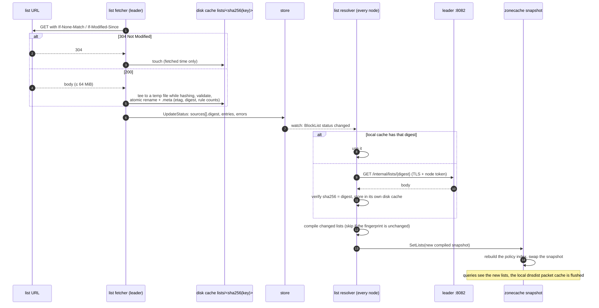
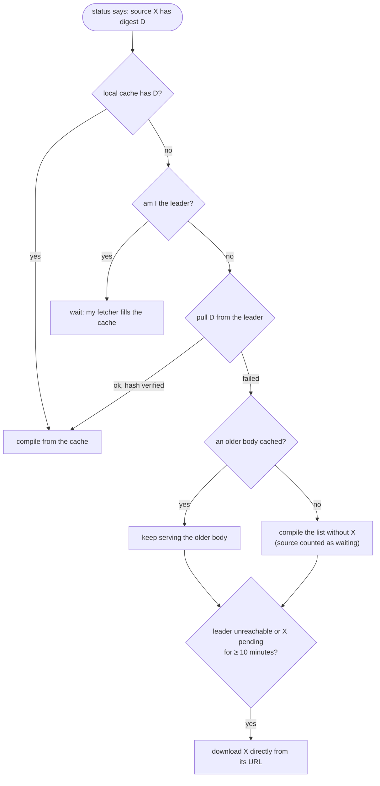
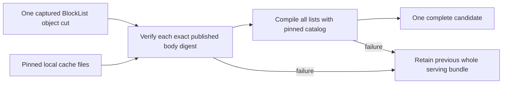
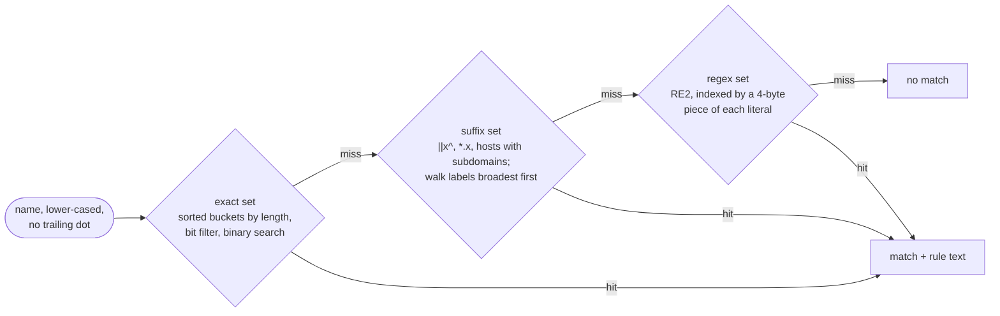
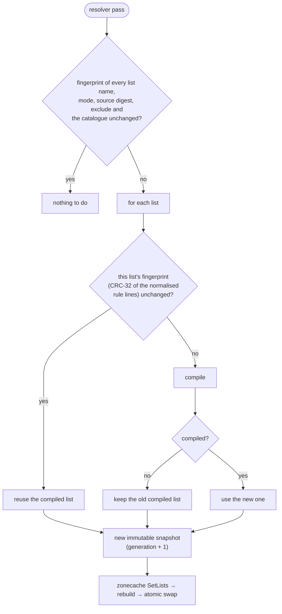
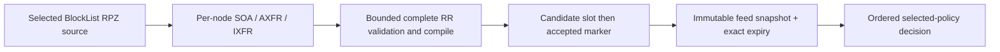
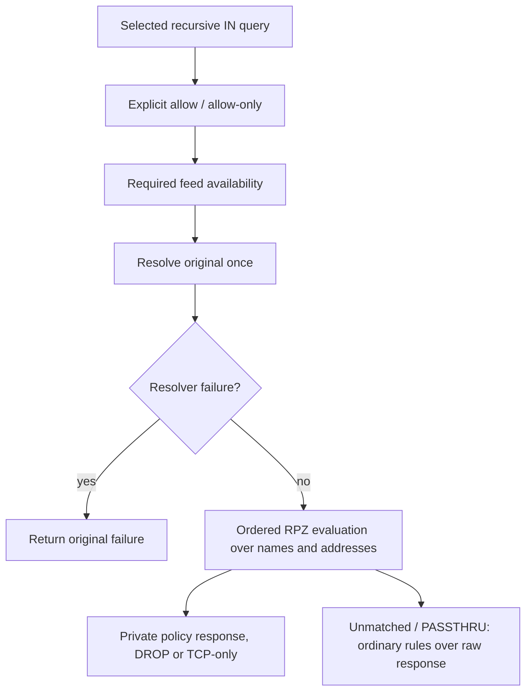

# Block lists

A BlockList is a named set of rules from one or more sources. Its body is
downloaded **once, by the leader**, shared with every other node by digest,
and **compiled on every node**. Only bodies travel; compiled matchers never
leave the process that built them.

The host-only `blocking.httpsOnly` option applies to new external downloads
through the leader's downloader and the replica's direct fallback, and to both
catalog refreshers. A transport guard checks the initial URL and every redirect
before sending it. The existing TLS roots, local-address restrictions, proxy
configuration and deadlines still apply. Refusal keeps the last good body;
cached data and authenticated peer copies retain their existing semantics.
See [download policy](../deploy/download-policy.md).

Code: `internal/listfetcher` (the leader's fetcher, the disk cache, every
node's resolver), `internal/blocking` (parsing, the compiled list, the
snapshot) and `internal/blocking/matcher`.

The compiler also retains bounded evidence of actual source rules removed by
exclusions. Explicit HTTP dig diagnostics evaluate these witnesses against the
original selected policies and client/question context. Evidence stays on the
request and never enters response caches; ordinary DNS requests skip the scan.
The dashboard consumes the same answer, without a later list read or browser
regex evaluation. See [disabled-rule diagnostics](../deploy/allowlist.md#checking-disabled-rules)
for permissions, bounds and the distinction between a disabled rule and the
final verdict (D255).

## The object

```yaml
apiVersion: kudurru.io/v1alpha1
kind: BlockList
metadata: { name: ads, namespace: dns }
spec:
  mode: block                 # block | allow
  refreshInterval: 24h
  response: zeroIP            # optional; beats the policy's blockMode
  sources:                    # 1..256, each exactly one of:
  - url: https://big.oisd.nl/ #   url | inline[] | configMapRef | entries[]
    format: auto              #   auto | hosts | domains | adblock | regex
  - inline: ["||tracker.example^", "@@||cdn.tracker.example^"]
```

A source's body is identified by a cache key: its URL, or
`configmap://<ns>/<name>`. Inline and `entries` sources travel inside the
object itself and are never fetched. Two lists that share a URL share one
download.

## From URL to answer



The leader schedules each source at `lastFetched + refreshInterval` (minus
up to 5 % jitter, never under 1 minute) or at once on
`POST /api/v1/blocklists/{ns}/{name}/refresh`. Downloads run four at a time
with up to three attempts; a failing source cools down from 1 minute up to
1 hour and keeps its last good body. Only `http` and `https` URLs are
fetched, and loopback, link-local and metadata addresses are refused unless
`blocking.allowLocalListURLs` is set.

### When the leader is out of reach



The first resolver pass after a restart reads only the disk cache, so a node
comes back with its lists before it can reach anybody. Readiness follows
`blocking.initStrategy`: `fast` is ready at once, `blocking` waits until no
source is waiting (unless `blocking.allowDegraded`), and `failOnError` exits
the process when the first load fails.

## Complete serving candidates

`listfetcher.PrepareComplete` supplies strict list preparation for the complete
serving publisher. It receives all BlockList objects from one captured image
and the exact pinned service catalog. Every enabled external text source must
have an explicit published digest, matching cache metadata and matching SHA-256
body bytes. The file descriptor remains open through verification and parsing.
Preparation performs no network requests or store reads, and bounds the number
of lists, sources and bytes it consumes.

A missing body, digest mismatch or compilation failure rejects the whole
candidate. The publisher retains its previous complete bundle. Disabled and
empty lists remain explicit; RPZ lists retain their identity while their feed
data comes from a separately captured runtime owner. This preparer does not
use the older-body and individual-list fallback behavior of the existing
resolver described above. Production publisher composition is still pending.



## Inside a compiled list



Each list has two chains of these matchers: the **primary** chain (deny rules
in a block list, allow rules in an allow list) and the **exception** chain
(`@@` rules of a block list). A fourth set holds bare IP entries, used only
when the answer is checked. Each entry keeps a one-byte syntax tag, so the
query log can show the rule as written without storing the lines.

Lookups allocate nothing. The spike measured p99 1.18 µs for a hit and
0.71 µs for a miss over a 1 M-entry suffix set, and about 90 MB steady RSS
for 3 M entries ([spike](../../dev-docs/spikes/blocking.md)); `make bench` guards it.

| Syntax | Compiles to |
|---|---|
| `example.com`, hosts line `0.0.0.0 example.com` | exact (suffix when `subdomains: true`) |
| `\|\|example.com^`, `\|\|example.com`, `*.example.com` | suffix (`*.x` also matches `x`) |
| `@@\|\|example.com^` | exception chain (per list) |
| `/regex/` | regex (at most 1000 per list) |
| `$dnstype`, `$dnsrewrite`, `$client`, `$ctag`, `$important`, `$badfilter`, `$denyallow`, mid-pattern wildcards | complete contextual rule stream; unknown modifiers remain counted and ignored |

## Compile and swap



A comment-only change to a list does not recompile it. Lists of 1 MiB or more
trigger a garbage collection between compiles, so a refresh of several big
lists does not hold them all in memory at once.

## The starter list

On the first start the bootstrap seeds `BlockList starter` (one inline
source made from the StevenBlack hosts file, embedded in the binary) and
`Policy default` that uses it. Blocking therefore works offline from the
first query, and its hits show as `blocked_exact`.

## Transferred RPZ foundation

`BlockList` sources can describe an RPZ origin and TCP/TLS transfer primaries,
with an optional TSIG key reference. The `internal/rpz` receiver reuses the
secondary transfer transport, but never installs the feed as an authoritative
zone. Each node maintains its own SOA refresh/retry/expire timers and durable
last-good copy. Unsupported NSDNAME/NSIP triggers and unknown policy actions
are counted; the compiler supports QNAME, CLIENT-IP and RESPONSE-IP with
NXDOMAIN, NODATA, PASSTHRU, DROP, TCP-only and local-data actions.

Within a feed, client-IP precedes QNAME and answer-IP; feed declaration order
takes precedence across feeds. A selected required feed that is missing,
expired or bound to an old source identity returns an unavailable decision.
The query evaluator reads immutable memory and checks exact expiry. RPZ names
use DNS closest-encloser wildcard semantics, distinct from adblock suffix rules.



Durable data binds cluster, source UID/configuration and credential fingerprint.
Restart cannot renew expiry. Candidate and acceptance writes use two bounded
slots and a checksum/nonce-bound marker; failed acceptance preserves the prior
copy. A configuration race invalidates the candidate. If both marker deletion
and fallback overwrite fail, an exact configuration/credential restoration after
a crash can still recover that candidate; production publication must coordinate
the source/credential cut with this separate local storage boundary.

The ordinary list fetcher never downloads or parses RPZ sources, including an
invalid RPZ source. RPZ-only lists retain their policy identity with zero text
rules; mixed lists compile their ordinary sources separately. Shared source
counts and digests describe only ordinary rules. RPZ transfer state belongs to
each node, so shared BlockList status cannot establish feed availability.

The blocking-stage adapter evaluates only the feeds in the selected policy's
list order. Explicit allow lists and allow-only run first. It resolves the
original query once, preserves resolver failures, then evaluates QNAME, CNAME
targets and answer addresses together. Thus an earlier feed's answer-IP rule
beats a later feed's QNAME rule. PASSTHRU stops RPZ evaluation and continues
ordinary blocking. Local data, CNAME, NXDOMAIN/NODATA, DROP and TCP-only have
distinct responses; synthesis removes AD/proofs and remains outside the raw
resolver cache. CNAME dependencies retain the captured policy and cleanup
ownership, and feed expiry is checked again after target resolution.



Compiler/runtime/schema acceptance includes native BIND transfers and policy
comparisons, TSIG/TLS rejection, IXFR, outage/restart, expiry, identity changes
and persistence faults. Adapter tests cover policy order, all actions, raw-cache
isolation, bounded CNAME resolution, expiry and response cleanup. Production
capture/publication, node diagnostics, transport observation, edge isolation
and dashboard integration remain in progress. The adapter is not yet wired
into the server.
