# Configuration and the store

kudurru separates three kinds of state, and keeps them apart on purpose:

| Kind | Examples | Where it lives | Replicated? |
|---|---|---|---|
| **Objects** | zones, record sets, lists, groups, policies, users, tokens | the store (one driver) | yes, by the store |
| **Settings** | upstreams, cache, blocking defaults, listeners | `kudurru.yaml`, a settings file or ConfigMap, environment | node settings no; cluster settings by your file distribution or the ConfigMap |
| **Runtime data** | query log, response cache, list bodies, the last-good snapshot | files on each node | never |

This page covers the first two: how an object gets from a writer to every
node's query path, and how settings reload.

With the SQLite store, the v0.1.0 [DHCPv4 server](dhcp.md) adds a separate node-local
setup registry, `dhcp-settings.json`, and per-scope `dhcp.db`/`dhcp-<name>.db`
databases. Fresh setup can be entered entirely in the dashboard. Existing host
`dhcp.*` configuration stays file-owned until explicit adoption; generic
host-only settings restrictions remain. Any DHCP environment override blocks
UI setup ownership. Setup saves stage complete scopes for restart and never
change live listeners or lease state. API-managed scopes keep live options and
reservations in their lease database. The setup view overlays current values
only for scopes without pending edits; setup and database revisions prevent
concurrent changes from being lost. Lease schema v4 retains each scope's setup
token and adds persistent DNS claims and replica progress. Standalone startup
applies tokens once, preserving later live edits. Optional three-voter Raft
replicates DHCP leases and live management independently of object-store
replication; local setup tokens cannot override established replica settings.
Keep its Raft directory and hidden DNS claim registry with lease databases.
Ordinary object backup does not include this state. Committed lease
snapshots supply DNS and policy names without query-time storage reads.
With the Kubernetes store, scopes are `DHCPScope` objects in the store
instead, and leases are `DHCPLease` objects of the separate runtime group
`dhcp.kudurru.io`, which the store does not serve or back up
([Kubernetes store](dhcp.md#kubernetes-store), D180).

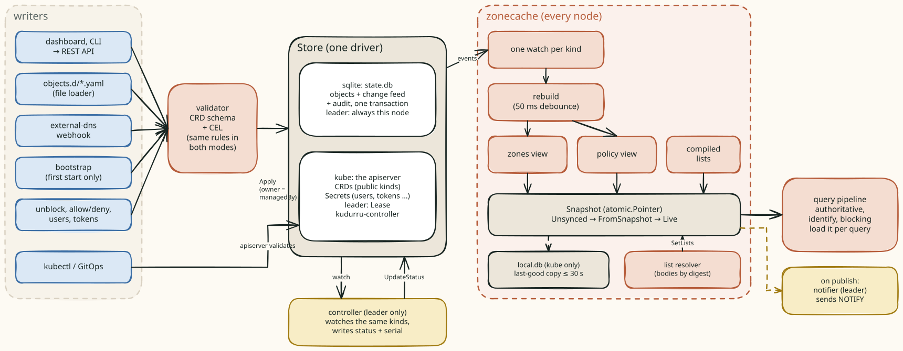

Code: `api/v1alpha1`, `api/internalkinds/v1alpha1`, `internal/store`
(interface, drivers, validator, conformance suite), `internal/zonecache`,
`internal/objects` (the file loader), `internal/bootstrap`,
`internal/controller`, `internal/config`, `cmd/kudurru/reload.go`.

## API migrations

`internal/importers` reads Pi-hole v6 and Technitium HTTP APIs and produces
objects, a settings merge patch and conversion warnings. The dashboard's
Tools wizard uses `POST /imports/preview` and submits the reviewed result to
`POST /imports/start`. This returns HTTP 202, a run ID and a Location header
before object writes finish. The CLI's `import pihole|technitium` uses the same
converter locally; `--apply` starts the same background job and `--wait` polls
its report. `POST /imports/apply` remains available for synchronous callers.
A preview never writes destination state. These REST routes require `settings.write`,
because administrators intentionally connect to private source networks.
This permission grants SSRF-equivalent network access: even a role with
only `settings.write` can send credentialed requests to caller-selected
HTTP(S) targets, including loopback, link-local metadata addresses and
internal services. Source HTTP failure status codes are visible; error
response bodies are not. Grant the permission only to trusted administrators
and use network egress controls to restrict which destinations the server
can reach.

Source credentials exist only during the request: Technitium uses a bearer
token, Pi-hole an application password and a temporary session that is closed
after reading. Source redirects are refused, response sizes and request time
are bounded, and upstream errors never echo credentials or response bodies.
Import writes use the existing object authorization, schema, ownership and
license checks. They are not transactional and return a result per object;
the selected settings patch is applied only when every selected object succeeds. Unsupported
source semantics are reported in the preview. See the
[migration guides](../../docs-site/content/migrate/_index.md) for supported data.

Each import starts an internal `MigrationRun` journal before destination writes
(D182, D184), using the existing store: SQLite JSON rows or labeled Kubernetes
Secrets. It retains source type and URL origin, actor, times, planned objects,
per-object outcomes, zone UIDs, original/current authority and cutover attempts.
Credentials, source URL paths/query parameters and source records are excluded.
An optional selection lists object identities (`Kind/[namespace/]name`) and
top-level settings sections; omitting it selects the full plan for compatibility.
Unknown or duplicate selections and explicitly empty selections are refused before
writes. Dependencies are not automatically selected: choose them too or ensure they
already exist. Unselected objects and settings are journaled as `skipped`; only
selected primary zones are tracked for later cutover.

Selected items progress from `pending` to `running`, then `created`, `updated`,
`unchanged` or `error`, with the error key, explanation, hint and saved version.
Settings have separate rows and are applied in one merge patch after all selected
objects succeed, or become `not_applied` if an object fails. Progress is saved
before the first object write, then each completed result and the next object's
running marker share one journal update. Settings have a separate running marker.
A journal failure stops further writes and records a journal error. Capacity for
bounded error details is checked before any writes.
The dashboard opens `/tools/migrations/{id}`, polls progress and shows counts and
per-item results, including retained successes when other items fail. The report
remains reachable through Tools' migration history after navigation or reload.

Background workers retain the caller's identity and authorization, copy mutable
request state and run independently of browser disconnects. At most two imports
run per API server process; overload is refused before journal creation. Replicas
sharing a store each admit their own two workers. There is no cross-run lock on
zones: overlapping imports still use normal ownership and optimistic version
checks, so avoid starting simultaneous imports for the same destination objects.
Each job is bounded to ten minutes. Server shutdown cancels and joins workers
before the store closes; final journal updates get a separate ten-second context. Reviewed plans
live only in worker memory: jobs are not replayed or resumed after restart. Once
a running job's recorded deadline plus fifteen seconds passes, reads show it as
`interrupted` and unresolved items as `unconfirmed`. Check the destination before
retrying, since a write may have committed just before its journal update.
Journals use a 1 MiB cap on both drivers to fit Kubernetes Secret data; a run
accepts at most 100 cutover attempts. Before claiming an attempt, apply checks that the journal has
room for every zone and address-record outcome, bounded errors, and authority
updates. An attempt that cannot fit is refused before any destination writes.
Full backups include internal journals; safe exports omit them.

An optional `nameservers` list replaces apex NS and SOA MNAME during conversion.
Alternatively, `nameserverAddresses` generates stable `ns-<hex-address>` names
within each imported zone and matching A/AAAA endpoints. Both options are
mutually exclusive; empty options preserve source authority. The dashboard
suggests its navigated hostname (an IP URL selects serving addresses instead),
with editable targets and opt-in VIP discovery from `/edge` (`edge.read`). The
CLI uses its destination context for `--update-nameservers` or a decommission
preview without explicit targets, and offers `--use-vips` discovery.
`/imports/runs` lists durable history;
`/imports/runs/{id}/decommission/preview` reads tracked live zones and shows
current authority and target names. Apply recomputes those changes from stored
run data, claims the run using its revision, and writes through normal zone
validation, ownership and authorization with each reviewed resourceVersion.
The run annotation, UID and expected authority fence old runs from newer
imports, recreated zones and manual authority changes. Cutovers are partial,
retryable operations; after ten minutes an interrupted attempt can be recovered,
including a write committed just before its journal update. Work is bounded to
two minutes; all write races still use optimistic versions. A retry records the
abandoned attempt as partial. Address cutovers use per-zone generated record
sets scoped to the run and addresses: each preview or apply request loads all
record sets once, groups them by zone, and reuses that snapshot for conflict
checks. Generated record sets are still reread and written under their reviewed
versions. Preview includes endpoints and versions,
refuses existing name conflicts, requires `records.write`, and refuses zones
with custom record-set selectors. Apply creates/verifies address records before
changing NS/SOA and journals each result. Existing records are never implicitly
adopted or overwritten. Record write failures leave authority intact; retries
reuse identical generated records. Parent delegation/glue and existing hostname
address changes remain external to this flow.

`GET /imports/existing` finds API-managed primary zones matching the converter's
stable IDs without a run annotation. Explicit `POST /imports/adopt` tracks a
reviewed selection under resourceVersion checks without reimporting records.
History and adoption use `settings.write`; each destination zone still requires
its own `zones.write` grant. CLI `import runs`, `import decommission` and
`import track-existing` use these same routes, with saved JSON previews required
for the latter two writes.

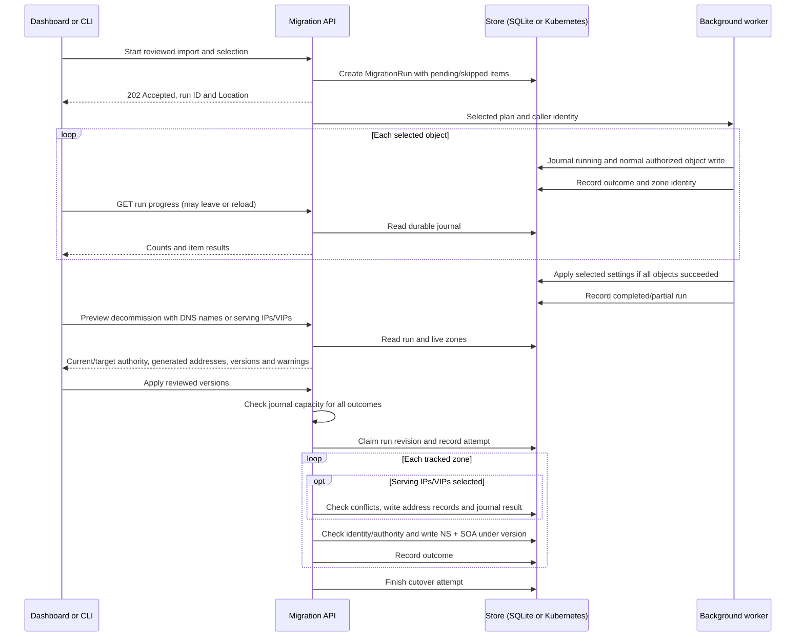

Technitium catalog member primary zones become independent primary zones.
The converter reads `overrideCatalogQueryAccess`: an override keeps the
member's local query policy; otherwise it reads the catalog's policy and
copies its query mode and ordered ACL. Catalog reads, including failed
reads, are cached for the preview. Unknown inheritance, unreadable catalogs
and unsupported query modes skip affected zones instead of falling back
to permissive member defaults. Catalog membership and replication are not
imported. Comment and blank lines in subscription URLs are ignored.

## The objects

All kinds share `kudurru.io/v1alpha1`. Public kinds are CRDs in Kubernetes;
internal kinds hold identity data and migration journals and are never CRDs (Secrets in Kubernetes,
rows in `state.db` in Docker).

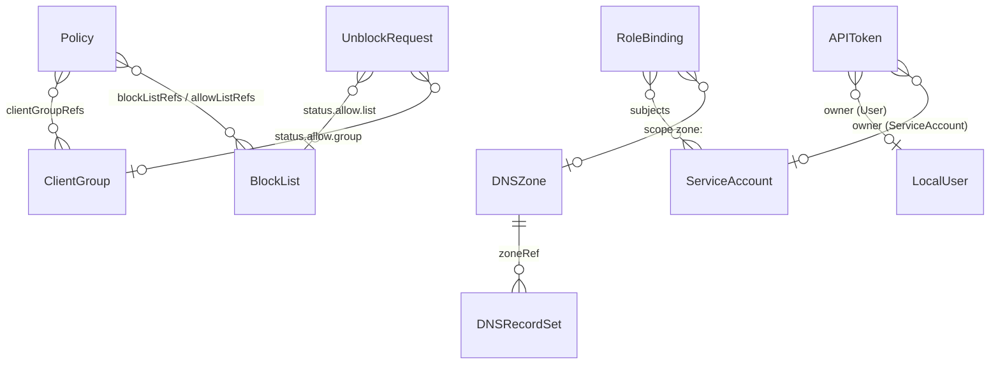

| Kind | Scope | Public or internal | Purpose |
|---|---|---|---|
| `DNSZone` | cluster | public (CRD) | authority over a name: primary or forward |
| `DNSRecordSet` | namespaced | public | records (external-dns `Endpoint` shape) added to a zone |
| `BlockList` | namespaced | public | block or allow rules from sources |
| `ClientGroup` | namespaced | public | who a client is |
| `Integration` | namespaced | public | provider settings and credential references; execution host in progress |
| `Kudurru` | cluster, name `default` | public | generated cluster settings and replicated blocking status; serving integration in progress |
| `Policy` | namespaced | public | what a group gets: lists, schedule, upstream group, safe search |
| `UnblockRequest` | namespaced | public | a block-page request and its decision |
| `DHCPScope` | cluster | public | a DHCPv4 pool, its options, relays and reservations (served with the Kubernetes store, D180) |
| `LocalUser` | cluster | internal | local account with an Argon2id hash |
| `APIToken` | cluster | internal | SHA-256 of a `kdr_` token, owned by a user or service account |
| `PrincipalState` | cluster | internal | private bootstrap authority bound to an exact service-account UID |
| `ServiceAccount` | namespaced | public | a non-human principal; credentials and bootstrap authority stay private |
| `RoleBinding` | namespaced | public | role at a scope for users, groups, service accounts |
| `IdentityProvider` | cluster | public | an OIDC provider with operator-granted credential references |
| `IntegrationSourceHead` / `IntegrationSourceChunk` | cluster | internal | bounded original inbound source evidence and its complete version pointer |
| `IntegrationNameAllocation` | cluster | internal | retained collision reservation bound to Integration and target zone UIDs |

Inbound runtime carriers use private Secrets in Kubernetes and private objects in
SQLite. Full backups and replication include them, with explicit zero-count kind
manifests after deletion; safe configuration exports omit them. Carrier validation
checks identity, chunk digests and finite bounds. Whole-source current admission
and publication remain separate from storing these individual records.

The bootstrap seeds four objects on the first start, with owner `bootstrap`:
the root forward zone `.` → `default`, `ClientGroup default` (all
addresses), `BlockList starter` and `Policy default`.
Namespaced defaults use the release namespace in Kubernetes and `default`
in SQLite. An existing `default/default` policy keeps a Kubernetes install
on `default` until a default policy exists in the release namespace; no
objects are moved automatically ([upgrade behavior](../deploy/helm.md#default-object-namespace-and-upgrades)).

### One writer per object

`ApplyOptions.CreateOnly` requires the object to be absent at commit time.
An existing object conflicts even when its content is identical or `Force` is
set. SQLite checks within its transaction; Kubernetes uses a create request
for both CRDs and private Secrets, so a concurrent creator cannot turn a
bootstrap or migration operation into an update.

Every write carries a **manager**, recorded as the object's owner in the
`kudurru.io/managed-by` annotation: `api`, `file:<path>`,
`integration:<name>`, `bootstrap` or `system`.


This is why a zone from `objects.d/zones.yaml` cannot be edited in the
dashboard ("managed by file objects.d/zones.yaml"), and why two sources of
truth for one object cannot exist. The API may take over objects owned by
`bootstrap`. Objects written with `kubectl` carry no annotation, so anyone
may write them.

## The store

```go
// internal/store/store.go (abridged)
type Store interface {
    Get, List, Apply, Delete, UpdateStatus  // CRUD; Apply is whole-object, optimistic (resourceVersion)
    Watch(ctx, kind, opts) (Watcher, error) // list + watch: ADDED, MODIFIED, DELETED, BOOKMARK
    Elector(name string) Elector             // leader election primitive
    Snapshot, Restore                        // backup = `kind: List` YAML that `kudurru apply -f` accepts
    Info() Info; Close() error
}
```

Two drivers exist. They pass the same conformance suite
(`internal/store/conformance`), so the rest of the code cannot tell them
apart.

| | `kube` | `sqlite` |
|---|---|---|
| Used by | Kubernetes, any replica count | Docker, systemd, the chart's `standalone` mode, each compose HA twin |
| Backing | the apiserver: CRDs for public kinds, Secrets (`kudurru.io/kind=<Kind>`) for internal kinds; server-side apply with the manager as field owner | `state.db`: an `objects` table (JSON), a change feed, an audit table (hash-chained, same transaction), a `flock` |
| Watch | informers; they keep serving from memory when the apiserver is away | the current objects, a bookmark, then an in-process broadcaster fed by the change feed |
| Validation | the apiserver (CRD schema + CEL) | the embedded validator, inside `Apply` |
| Leader | Lease `kudurru-controller` (15 s / 10 s / 2 s), identity = pod name | always this node |
| Last-good copy | `local.db` on each node | not needed: `state.db` is local |

The **validator** (`internal/store/validator`) runs the apiserver's own
structural schema, defaulting and CEL programs from the embedded CRDs, so
Docker rejects exactly what Kubernetes rejects. The API, the file loader,
the bootstrap and the sqlite driver all call it. Cross-object problems (a
record outside its zone, a duplicate) are not validation errors: the
controller reports them as conditions.

Each database carries a schema version. A file newer than the binary stops
the process with an explanation; an older one is migrated in one
transaction.

## From a write to the query path

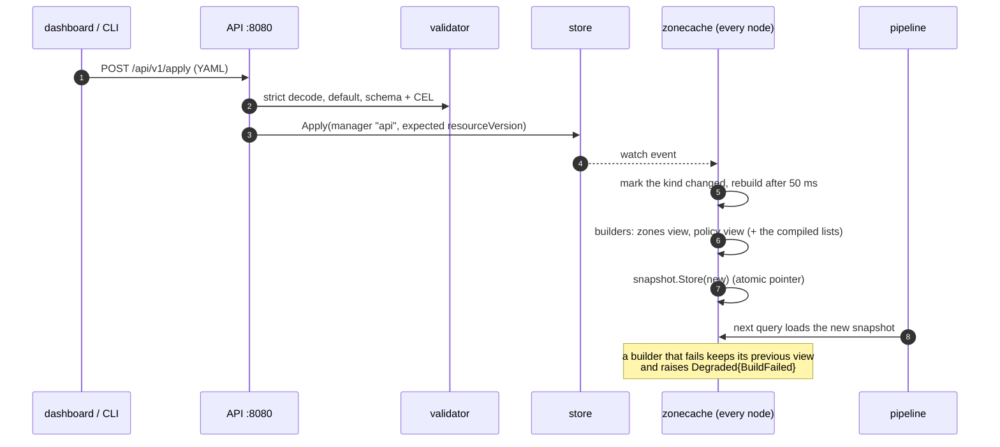

The file loader takes the same path with manager `file:<path>`: it reads
`objects:` in `kudurru.yaml` and every `objects.d/*.yaml`, applies them,
deletes the objects that its files no longer declare, and re-applies on a
file change (fsnotify, 500 ms debounce) and every 60 s to repair drift.
Errors in a file become diagnoses; they never stop the server.

### The snapshot's life

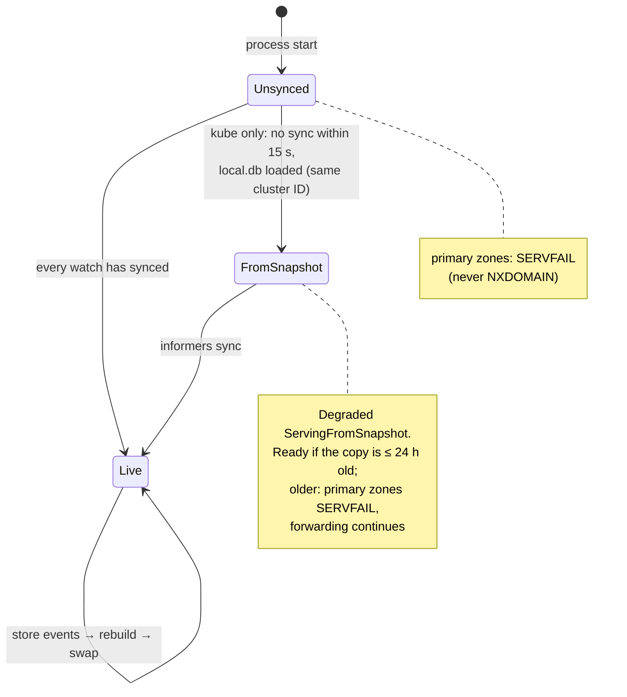

In Kubernetes mode each node writes the complete object set to `local.db`
after its first sync and then at most every 30 s when something changed. A
pod that restarts while the apiserver is down therefore still answers:
forwarded names, cached names, and primary zones from the copy.

Startup reads for the policy namespace, default-object seeding and identity
caches have bounded deadlines. An apiserver availability failure defers
initialization and lets the DNS listeners and snapshot cache start;
bootstrap and identity initialization retry after recovery. Authorization,
certificate, schema and local-data errors retain their normal failure
behavior. Identity secrets are not taken from `local.db`, so an empty IAM
cache cannot authenticate local users or tokens during an offline start.
See the [cold-start runbook](../deploy/runbooks.md#cold-start-without-the-apiserver).

## The leader

One election covers all leader-only work. The runner starts the leader-only
loops under a "term" context when the node wins, and cancels them when it
loses. **Losing the lease never stops the process**: the DNS listeners, the
API and the snapshot keep running, which is exactly what you want during an
apiserver outage.

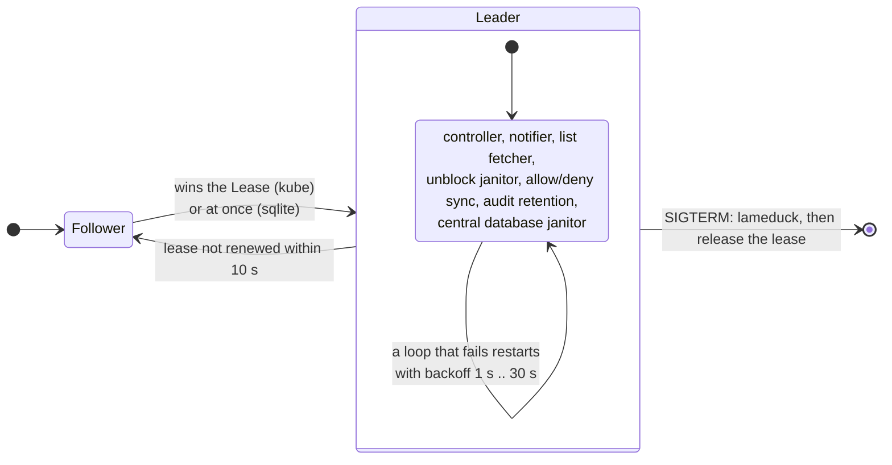

Leader loops are idempotent and level-triggered: they read the store, compare
with the status, and write only the difference. A new leader picks up where
the old one stopped without special hand-over.

### The controller

One reconciler per kind (DNSZone, DNSRecordSet, BlockList, ClientGroup,
Policy), each with its own watch and a rate-limited work queue, writing
status only when it differs; a full re-list every 10 minutes.

| Kind | Status it writes |
|---|---|
| DNSZone | `serial`, `contentHash`, `recordCount`, `Ready` (Serving, Invalid, Unsupported), `Degraded` (worst record-set problem) |
| DNSRecordSet | `Ready`, `Degraded` (OutsideZone, Duplicated, Occluded, Invalid, NotSelected, ZoneNotFound) |
| BlockList | `Degraded` (ListFetchFailed); the fetcher writes `sources[].digest` and counts |
| ClientGroup | `members` |
| Policy | `Degraded` (MissingReference, UnknownService, UnknownCategory) |

Events (`SerialBumped`, `Duplicated`, `OutsideZone`, …) go to the log only;
the Kubernetes Events sink exists but is not wired yet.

## Settings

The existing production settings path uses files and a live configuration
pointer; the v0.2 canonical object and command adapter are described below.
Each key in the metadata table
(`internal/config/schema.go`) has a **scope** and flags:

| Scope | Examples | Changed how |
|---|---|---|
| node, `hostOnly`, restart | `node.*`, `listeners.*`, `store.*`, `tsigKeys`, `auth.adminSocket.*` | file or environment, then restart; never through the API |
| node, dedicated DHCP setup | enabled state and complete DHCP scope topology | DHCP setup API/dashboard, explicit file adoption, then restart; generic Settings remains host-only |
| cluster, hot | `upstreams.*`, `cache.*`, `blocking.enabled/defaultResponse/blockTTL`, `ratelimit.*`, `querylog.privacy/retention` | API, dashboard, settings file; applied without a restart |
| cluster, restart | `querylog.enabled`, `blocking.initStrategy`, `auth.session.*` | as above, applied at the next start |
| cluster, `hostOnly` | `auth.identityProviders`, `rbac.bindings` | file or environment only |


An environment variable wins and locks the key in the dashboard. In
Kubernetes, sections default to `gitops`: edit Helm values or the settings
ConfigMap. Only `upstreams` can currently switch to `ui` ownership, through
an explicit, revision-checked adoption. Adoption copies the entire effective
section (groups, servers, bootstrap, conditional rules, ECS and recursion)
without changing routing. Host-only restrictions remain in place.

UI-owned upstreams live with their ownership record in a separate ConfigMap,
`<release>-ui-settings` by default (`KUDURRU_SETTINGS_RESOURCE`). Helm never
renders that resource. Each replica reads it at startup and on the settings
watcher's ten-second poll. Its values replace the entire file section; file
keys are never merged into a UI-owned section. The environment still wins
and locks individual keys; any upstream environment override blocks ownership
transitions. File declarations under a UI-owned section produce a warning,
the `conflicts` field in `GET /settings` and a dashboard banner while UI values remain
authoritative. Other sections continue following the settings ConfigMap.

Ownership and values share a Kubernetes `resourceVersion`; concurrent
adoptions, releases and edits use compare-and-swap. The API exposes section
owners and reviewed revisions in the `sections` field of `GET /settings`, accepts
`If-Match` on upstream settings patches, and authorizes transitions with
`settings.write`. The header is optional for backward compatibility, but
safe concurrent upstream edits require a reviewed revision; omitting it can
overwrite newer client edits. Other sections do not use the upstream revision.
For CLI edits, review `kudurru settings ownership`, then pass the token to
`kudurru settings set upstreams.bootstrap=9.9.9.9:53 --revision TOKEN`.
Writes and transitions are audited. Every replica uses the
same reload subscriptions, including upstream set swaps and cache flushes.
Invalid or unavailable sources leave the running configuration intact.
A node-local `ui-settings-<identity>.json` cache retains the last confirmed
shared ownership and values for offline startup; writes always require the
apiserver. Preserve the node data directory alongside `local.db`.

In Docker, the API keeps writing the existing writable settings file. A
`settingsOwnership` map in that file records explicit adoption/release, in the
same atomic rename as complete section values. Existing Docker settings remain
UI-editable; a deployment without a writable settings file retains its existing
in-memory behavior and cannot change ownership.

Generate current or proposed Helm values with
`POST /settings/sections/upstreams/yaml` (no write). To return ownership to
GitOps, commit and apply the current exported values, wait for the settings
volume to update on every replica, refresh the preview, then call
`POST /settings/sections/upstreams/ownership/release` with its
revision. Release refuses mismatched file values on the serving replica;
it does not collect acknowledgments from other replicas. Kubernetes volume
projection is asynchronous, so the operator must verify that all replicas
have received the applied values before releasing. Adoption uses the same
path ending in `/adopt`. Only ownership is transferred; no new CRD is required.
Include the API-owned ConfigMap in your
Kubernetes backups; ordinary object-store exports do not include it.

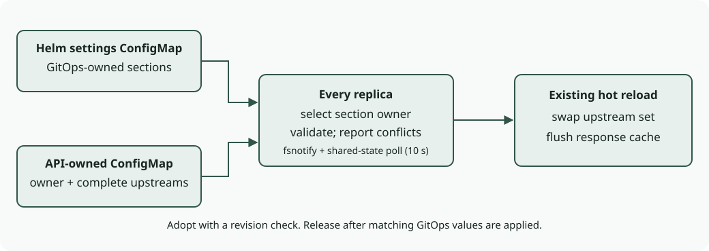

```mermaid
sequenceDiagram
    participant SRC as file / Helm ConfigMap / API-owned settings
    participant M as ownership manager (every node)
    participant W as settings watcher (every node)
    participant R as reload subscribers
    SRC->>W: change (fsnotify + 10 s poll)
    W->>M: read both sources and ownership revision
    M->>M: replace UI-owned sections; report file conflicts
    M->>W: validated effective cluster settings
    W->>R: log level, upstream groups (swap + cache flush),<br/>cache, blocking, block page, rate limiter,<br/>query log privacy, edge cache flush
```

## Not built yet

The `follower` (v0.2) and `raft` (v1.0) drivers, the `cluster.role: static`
read-only mode for compose twins, the health of other nodes (the node
list, the stats and the query log are already gathered), and a
`roles:` setting. See [the design record §4](../../dev-docs/design-record.md#4-data-model-storage-replication-ha)
for the plan.

## SQLite replication foundation

Schema 2 adds durable member/authority metadata, owned extension sections and
private recovery images. `internal/store/replication` defines a versioned
complete logical image; it is separate from the YAML backup/apply format.
`internal/store/follower` supplies a local-read facade and a bounded pull loop.
The server transport, startup selection and coherent serving/authentication
publication are being integrated; these packages alone do not enable HA.

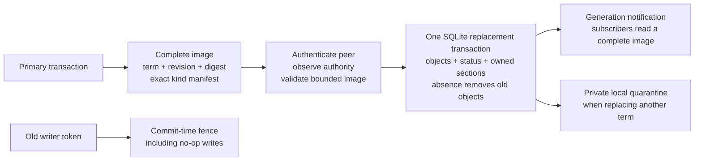

Images preserve source object resource versions, UIDs, ownership, statuses
and private documents. The receiver requires the complete registered-kind
manifest and all owned sections, verifies the digest and bounded strict JSON,
and validates copies without defaulting the source data. Node-local audit,
secondary/stub copies, query logs and response caches remain local. Cluster
settings have one designated future owner, `Kudurru/default`; the image carries
an owner reference, not a second settings map.

Complete-image owner validators run after the generic envelope, row and digest
checks. They enforce cross-row inventories that individual row validators cannot
prove. SQLite repeats them before replica installation, serving-candidate
admission and promotion. Opening a database and reading its raw generation remain
available to explicit startup migrations; neither operation grants serving or HA
eligibility. Local mutation commands still enforce their own owner invariants.

Every mutation checks its captured member/term/incarnation token inside the
writer transaction. Observing an authenticated higher epoch durably fences
the old primary; equal-epoch conflicting promotions stop writes until an
explicit branch resolution. Failed fence persistence also blocks writes in
memory. SQLite uses `synchronous=FULL` for all writer connections, including
reconnections and standalone databases. Restoring a public backup remains an
apply operation subject to the same writer fence.

`sqlite.Command` runs current authorization, staged reads and writes in one
fenced transaction. It also accepts up to 16 final checks of already pinned
immutable dependencies and the actual clock. Those checks run after the callback
and complete-image validation, immediately before commit or a successful no-op;
a denial rolls back object, security, audit, receipt and revision changes together.
Checks cannot access the ended transaction or acquire publication/provider locks.
Callers retain dependency replacement exclusion through the entire command.
This defines admission time; wall time may still advance while SQLite syncs.
External enrollment registers a final proof check so a JWT that expires during
later command work cannot create a session.

An accepted replacement rotates the local watch lineage and closes old
watches; object resource versions remain those of the source. Consumers that
need a coherent generation must subscribe before `ReadGeneration` and publish
one prepared bundle, rather than combine independent kind watches. Manual
promotion requires coordinator checks in addition to the store's atomic CAS.
This is epoch fencing after reconnection: two partitioned primaries can both
accept writes after a manual promotion. It is not a consensus protocol.

A schema-2 database cannot be opened by a schema-1 binary. Preserve a backup
from the earlier binary before testing an upgrade; rollback uses that backup.
Recovery images can contain credentials and are neither public backups nor
ordinary object exports.

## Cluster settings object foundation

`Kudurru/default` supplies the canonical object shape for v0.2 cluster settings.
`spec.settings` has a nested structural schema generated from `config.Schema`
by `hack/settingscrd`; `make generate` refreshes it before copying the CRD into
the chart and store validator. Node-scope, host-only, and secret settings are
excluded. A public settings object cannot name listener files, replace host
identity providers, or change audit storage. The store and real Kubernetes
admission tests exercise the same generated fields.

`config.ApplyClusterDocument` prepares a complete configuration from that
object and local host inputs. Omitted public keys return to compiled defaults,
so deleting a key cannot retain an older generation's value. Environment locks
retain their local values; canonical input is validated even when a local lock
would override it. Initial seeding does not distribute a node's environment
values. The host and source document remain unchanged during preparation.

SQLite startup now seeds a missing singleton in the same actual command that
initializes private runtime manifests. It captures only public cluster settings
from the primary's existing effective configuration; environment-locked keys use
compiled defaults. A present singleton is preserved exactly on later starts,
including after host configuration changes. Followers never seed it locally.

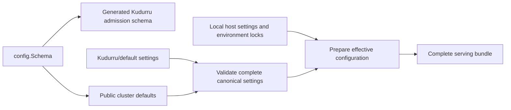

The object also carries absolute blocking-disable state in status: an optional
`disabledUntil` requires `disabled: true`; an absent deadline means indefinite.
Expiry never restarts with a process.

The optional canonical API adapter now reads settings and their schema values
from the original complete HTTP lease. It validates a merge patch, then writes
only named public keys to the actual singleton through current raw authentication,
the original writer and complete dependency exclusion. A stale request cannot
overwrite a newer configuration; identical writes still cross final credential
and writer checks. Map merges and null resets preserve the API's existing behavior.
Successful PATCH replies acknowledge durable desired values. Subsequent serving
reads wait for complete publication; the adapter never writes the legacy file or
changes the independent reload pointer. Actual HTTP/SQLite tests cover these
paths. SQLite `serve.go` mounts this adapter with the complete HTTP owner;
Kubernetes retains its existing settings writer.

SQLite generic public object GETs and their aliases read the original HTTP
lease's object set. Detail responses retain that object's UID and resourceVersion;
record permissions use its captured zone reference. Pagination binds the complete
generation and normalized query, applies authorization before cursor keys, and
returns 409 when a later request changes either binding. It does not keep old
images alive across page requests. Compiled blocklist search uses the same
captured list bodies and modes; missing compiled data returns 503 even if a live
cache or inline source could answer. Kubernetes keeps the existing read path.

Catalog GETs read the original blocking view, report actual acquired base/import
provenance, and omit live refresher status. Services, categories and safe-search
entries use that same catalog; missing owners return 503 without a Holder
fallback. Policy state uses the original objects, canonical settings, catalog and
compiled list owners together. Text/RPZ counts describe acquired data; RPZ expiry
clears readiness without erasing diagnostic counts. The desired object's
Conditions remain historical receipts. Schedules and expiry share one observation
time; traffic statistics remain explicitly historical query-log reads. Public
reads are still migrating route by route: enabling these capabilities does not
convert the remaining runtime diagnostics.

Blocking GETs use the original blocking view's canonical settings and absolute
deadline at one observation time. A held request keeps its original state after
a replacement; exact timer expiry reenables blocking without writing a new
receipt. Configured-off and indefinitely disabled states omit a resume timer.
These cluster-scoped responses never fall back to the legacy local toggle.

Blocking POSTs reauthorize the original proof for cluster `blocking.toggle` and
update only `Kudurru/default.status.blocking` in the current command. No-ops retain
the same final credential and writer checks. A 200 response waits for a complete
publication containing the exact committed settings UID, resourceVersion and
status, then evaluates its blocking view at one response time. The original
writer binding remains in force during this observation, outside transaction and
dependency locks. If commit succeeds but publication cannot be acknowledged, 503
includes a `committed: true` hint and the exact receipt; it does not imply rollback.

Persisted deadlines have whole-second precision. Relative timers round up to the
next UTC second, adding less than one second; fractional absolute `until` values
are rejected. Neither publication waits nor restart renews the deadline. Enabling
the toggle clears its temporary disable but does not override configured-off
blocking settings.

Source-entry GETs authorize the original BlockList and retain its inline values,
structured entries, parser settings and exclusions. URL and ConfigMap bodies
open only the digest named by that captured source's receipt. The adapter verifies
the regular file, exact size and full SHA256 before parsing, with a 64 MiB body
cap and the existing four concurrent scan slots. Cache replacement preserves an
already open descriptor, but may discard a digest before it is opened; that
request returns 503 instead of reading a newer body. These responses omit the
uncaptured local fetch time. RPZ feeds are not line-source bodies and return 422.
Continuation tokens bind the exact generation, object UID/RV, source, parser
inputs and query; changed observations require restarting pagination.

Upstream diagnostics retain the original request's resolver-set membership and
sample that set's local health, failures, backoff and RTT. Those operational
counters can advance during a held request; they are not frozen publication
metadata. Local, central-history and self-shard stats paths use this same reader.
A failed local sample remains an explicit failed node in partial cluster results;
remote peer samples and traffic history retain their separate scopes.

SQLite zone record upsert/removal, BIND import and cascading zone deletion now
plan and apply within one current command. Each plan seals the original
transaction, target and complete permission set. Imports require zone creation
permission only when creating a zone, and record deletion permission when
removing stale API-owned import chunks. Cascade and dry runs check every current
reference and owner before staging any change. Even an unchanged write, dry run
or missing-result response crosses current proof and final-time admission. Cache
flush and aggregate audit reporting occur after the command; per-object durable
audit remains transactional. Actual server tests cover native DNS publication
and restart after these commands.

SQLite temporarily returns 503 for unsafe convenience writes without complete
current admission: domain/allowlist/denylist mutations, inline source
entry edits and unblock-request actions. Generic object commands remain available.
These gates prevent legacy helpers from writing outside current authorization or
returning an unchecked no-op; they are explicit remaining integration work.
Generic apply/batch-delete retains its independent per-item result contract. All
items retain the original HTTP lease, so a first commit can make later items
stale; no successor capture or atomic-batch guarantee is implied.


## Complete serving publication

`internal/serving` prepares one whole immutable bundle from a complete SQLite
replication image. The required component manifest includes objects, zones,
policy, resolution, response processing, cache behavior, blocking, inventory,
authentication and runtime data. Owner preparation must provide every component
with the same canonical generation and verified dependency identity. An error,
panic, missing component, changed dependency or stale generation retains the
entire previous bundle.

SQLite issues an opaque token in the same read transaction as the image. The
publisher checks that token under the SQLite writer barrier before swapping one
pointer. Compilation, downloads, and resource retirement happen outside that
barrier. `zonecache.Prepare` supplies strict complete-object view preparation
without watches or per-builder last-good substitutions.

Requests hold leases. Replacement releases the publisher's reference, while
old pools and other resources remain alive until the final request or stream
releases its lease. DNS capture needs no database read and may use last-good
data during preparation or fencing. Protected HTTP capture also checks the
in-memory authority and dependency cursors and fails closed while publication
is pending. Explicit fenced DNS-only publication cannot open authentication,
readiness, or promotion. Promotion pins the actual serving bundle through its
commit, then releases the pin before waiting for new-term publication.

Background recovery uses `WithWriterGate` with an exact writable term and local
incarnation. It holds the same publication/promotion exclusion even when no
bundle exists or a newer image is pending; it grants no HTTP read eligibility.
The callback next pins current dependency replacement and retains both gates
through the actual fenced command. It releases them before waiting for serving
acknowledgment, so startup recovery cannot deadlock on its own publication.

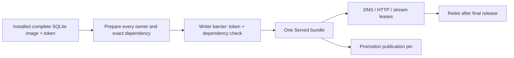

The DNS adapters capture one lease before identification and read typed policy,
zone, inventory, resolver, response, cache and blocking views from that lease.
Missing owners fail closed. Alias and DNS64 subqueries inherit the capture;
detached cache work clones its lease and fences late fills against retired
resolver/cache incarnations, including A → B → A changes. Transfers hold the
lease until consumption or explicit response cleanup, including streams never
iterated. UDP, TCP, DoT, DoH, DoH3, DoQ and the API query caller release cleanup.
The explicit transfer adapter reads the captured zone set; its legacy live-set
entry point is rejected once capture is installed.

`internal/servingbuild` now supplies all ten concrete owners. Its local schema
includes every registered public and private kind. Primary lifecycle and auth
consume the complete image; the public DNS object projection includes only
`zonecache.DefaultKinds`. It applies canonical settings against captured host
settings, compiles exact-digest complete list bodies against the matching catalog,
and binds acquired zone runtimes to the captured immutable keyring. Inventory has
an explicit empty owner when no claims exist. A dependency cursor changing during
preparation rejects the entire candidate and releases its resources exactly once.

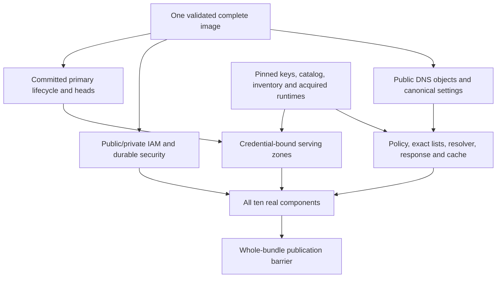

`BindDNS` connects every stage to the outer request lease. Prepared primaries are
never marked published by the builder. Resolver pools and auth resources remain
alive through held leases. The current implementation allocates new resolver and
cache incarnations for each candidate; reuse of unchanged semantic owners remains
a scale optimization.

The publisher, builder, store barrier and DNS/HTTP adapters are tested against real
SQLite publication, concurrent owner changes, missing list bodies, rollback,
retirement, restart, replica installation, promotion and native UDP/TCP listeners.
The root SQLite assembly now connects providerhost, coordinator, complete
publication, current command pins, primary driver and status projection. Its
always-on workers perform acquisition and publication on every role; a separate
writer entry retains the original elector token, resets provider floors, reconciles
the startup config-provider manifest and joins old work before replacement.
License and manager/catalog/key changes wake complete preparation. Native signed
UPDATE, license replacement recovery, follower restart/promotion and joined
shutdown are tested through this assembly. A newly enrolled follower remains
running but unavailable while awaiting its first replica. The same runtime
publishes after a valid installation without initializing local owner roots;
malformed installed owner inventories still fail startup. SQLite `serve.go` now
mounts this assembly into the actual DNS and HTTP listeners. Readiness uses the
protected complete publication; followers skip local bootstrap and file loading.
The runner joins elected and always-on workers before borrowed resources close,
even when its shutdown diagnostic timeout expires. Kubernetes retains its
existing serving path. Peer transition exclusion and three-process partition/rejoin
acceptance remain integration work.

Published canonical settings also drive operational consumers: ingress rate
limits, query-log privacy/retention, block-page rendering and response-cache
capacity. This watcher subscribes before capture, detaches the configuration
while holding the complete lease, and applies it after releasing that lease.
It does not replace captured DNS owners or update the legacy settings file/pointer.
DNS settings continue to take effect through complete publication.
Installed data is never reported as Served
merely because its database transaction completed. The disconnected-primary
limitation remains: a former primary can acknowledge writes until it learns of
a higher term; this publication mechanism does not provide consensus.
