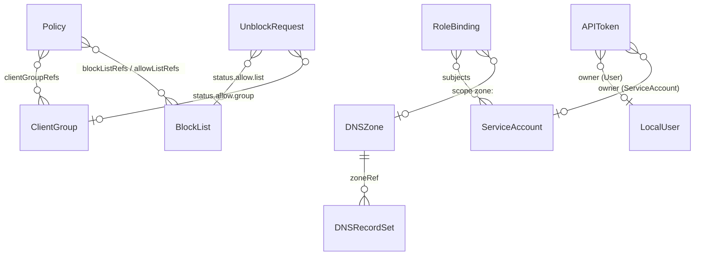
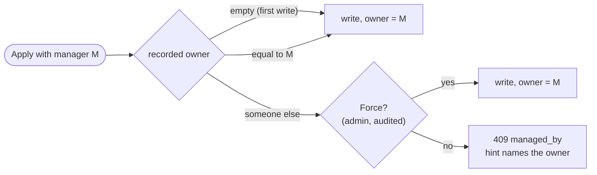
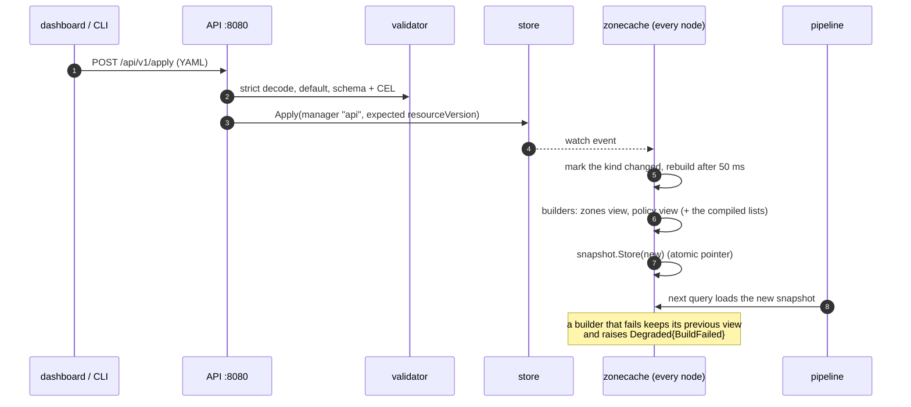
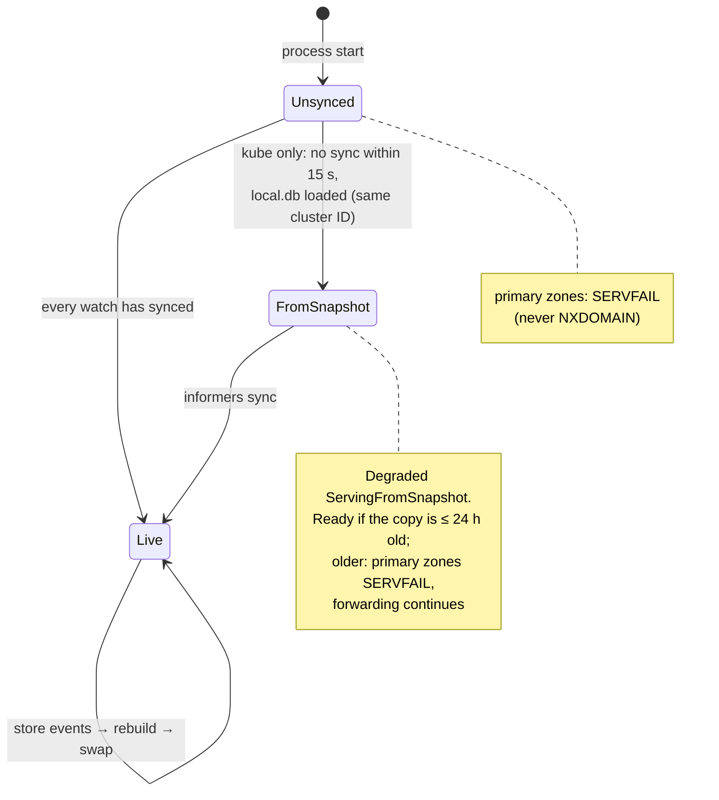
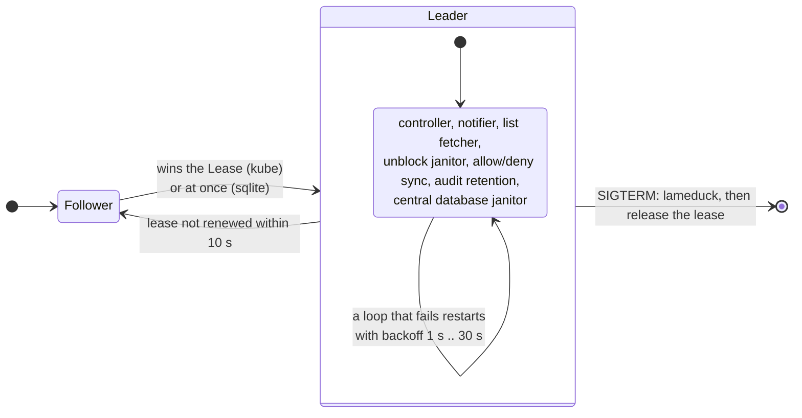
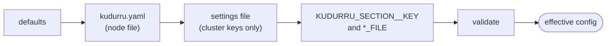
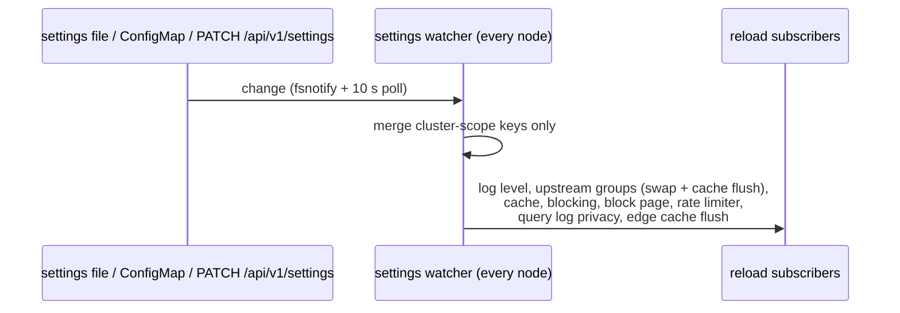

# Configuration and the store

kudurru separates three kinds of state, and keeps them apart on purpose:

| Kind | Examples | Where it lives | Replicated? |
|---|---|---|---|
| **Objects** | zones, record sets, lists, groups, policies, users, tokens | the store (one driver) | yes, by the store |
| **Settings** | upstreams, cache, blocking defaults, listeners | `kudurru.yaml`, a settings file or ConfigMap, environment | node settings no; cluster settings by your file distribution or the ConfigMap |
| **Runtime data** | query log, response cache, list bodies, the last-good snapshot | files on each node | never |

This page covers the first two: how an object gets from a writer to every
node's query path, and how settings reload.

The v0.1.0 [DHCPv4 server](dhcp.md) adds a separate node-local
setup registry, `dhcp-settings.json`, and per-scope `dhcp.db`/`dhcp-<name>.db`
databases. Fresh setup can be entered entirely in the dashboard. Existing host
`dhcp.*` configuration stays file-owned until explicit adoption; generic
host-only settings restrictions remain. Any DHCP environment override blocks
UI setup ownership. Setup saves stage complete scopes for restart and never
change live listeners or lease state. API-managed scopes keep live options and
reservations in their lease database. The setup view overlays current values
only for scopes without pending edits; setup and database revisions prevent
concurrent changes from being lost. Lease schema v4 retains each scope's setup
token and adds persistent DNS claims and replica progress. Standalone startup
applies tokens once, preserving later live edits. Optional three-voter Raft
replicates DHCP leases and live management independently of object-store
replication; local setup tokens cannot override established replica settings.
Keep its Raft directory and hidden DNS claim registry with lease databases.
Ordinary object backup does not include this state. Committed lease
snapshots supply DNS and policy names without query-time storage reads.


Code: `api/v1alpha1`, `api/internalkinds/v1alpha1`, `internal/store`
(interface, drivers, validator, conformance suite), `internal/zonecache`,
`internal/objects` (the file loader), `internal/bootstrap`,
`internal/controller`, `internal/config`, `cmd/kudurru/reload.go`.

## API migrations

`internal/importers` reads Pi-hole v6 and Technitium HTTP APIs and produces
objects, a settings merge patch and conversion warnings. The dashboard's
Tools wizard uses `POST /imports/preview` and submits the reviewed result to
`POST /imports/apply`. The CLI's `import pihole|technitium` uses the same
converter locally; `--apply` sends its preview to the same writer. A preview
never writes destination state. Both REST routes require `settings.write`,
because administrators intentionally connect to private source networks.
This permission grants SSRF-equivalent network access: even a role with
only `settings.write` can send credentialed requests to caller-selected
HTTP(S) targets, including loopback, link-local metadata addresses and
internal services. Source HTTP failure status codes are visible; error
response bodies are not. Grant the permission only to trusted administrators
and use network egress controls to restrict which destinations the server
can reach.

Source credentials exist only during the request: Technitium uses a bearer
token, Pi-hole an application password and a temporary session that is closed
after reading. Source redirects are refused, response sizes and request time
are bounded, and upstream errors never echo credentials or response bodies.
Import writes use the existing object authorization, schema, ownership and
license checks. They are not transactional and return a result per object;
the settings patch is applied only when every object succeeds. Unsupported
source semantics are reported in the preview. See the
[migration guides](../../site/content/migrate/_index.md) for supported data.

Technitium catalog member primary zones become independent primary zones.
The converter reads `overrideCatalogQueryAccess`: an override keeps the
member's local query policy; otherwise it reads the catalog's policy and
copies its query mode and ordered ACL. Catalog reads, including failed
reads, are cached for the preview. Unknown inheritance, unreadable catalogs
and unsupported query modes skip affected zones instead of falling back
to permissive member defaults. Catalog membership and replication are not
imported. Comment and blank lines in subscription URLs are ignored.

## The objects

All kinds share `kudurru.io/v1alpha1`. Public kinds are CRDs in Kubernetes;
internal kinds hold credentials and are never CRDs (Secrets in Kubernetes,
rows in `state.db` in Docker).



| Kind | Scope | Public or internal | Purpose |
|---|---|---|---|
| `DNSZone` | cluster | public (CRD) | authority over a name: primary or forward |
| `DNSRecordSet` | namespaced | public | records (external-dns `Endpoint` shape) added to a zone |
| `BlockList` | namespaced | public | block or allow rules from sources |
| `ClientGroup` | namespaced | public | who a client is |
| `Policy` | namespaced | public | what a group gets: lists, schedule, upstream group, safe search |
| `UnblockRequest` | namespaced | public | a block-page request and its decision |
| `LocalUser` | cluster | internal | local account with an Argon2id hash |
| `APIToken` | cluster | internal | SHA-256 of a `kdr_` token, owned by a user or service account |
| `ServiceAccount` | namespaced | internal | a non-human principal |
| `RoleBinding` | namespaced | internal | role at a scope for users, groups, service accounts |
| `IdentityProvider` | cluster | internal | an OIDC provider |

The bootstrap seeds four objects on the first start, with owner `bootstrap`:
the root forward zone `.` → `default`, `ClientGroup default` (all
addresses), `BlockList starter` and `Policy default`.
Namespaced defaults use the release namespace in Kubernetes and `default`
in SQLite. An existing `default/default` policy keeps a Kubernetes install
on `default` until a default policy exists in the release namespace; no
objects are moved automatically ([upgrade behavior](../deploy/helm.md#default-object-namespace-and-upgrades)).

### One writer per object

Every write carries a **manager**, recorded as the object's owner in the
`kudurru.io/managed-by` annotation: `api`, `file:<path>`,
`integration:<name>`, `bootstrap` or `system`.



This is why a zone from `objects.d/zones.yaml` cannot be edited in the
dashboard ("managed by file objects.d/zones.yaml"), and why two sources of
truth for one object cannot exist. The API may take over objects owned by
`bootstrap`. Objects written with `kubectl` carry no annotation, so anyone
may write them.

## The store

```go
// internal/store/store.go (abridged)
type Store interface {
    Get, List, Apply, Delete, UpdateStatus  // CRUD; Apply is whole-object, optimistic (resourceVersion)
    Watch(ctx, kind, opts) (Watcher, error) // list + watch: ADDED, MODIFIED, DELETED, BOOKMARK
    Elector(name string) Elector             // leader election primitive
    Snapshot, Restore                        // backup = `kind: List` YAML that `kudurru apply -f` accepts
    Info() Info; Close() error
}
```

Two drivers exist. They pass the same conformance suite
(`internal/store/conformance`), so the rest of the code cannot tell them
apart.

| | `kube` | `sqlite` |
|---|---|---|
| Used by | Kubernetes, any replica count | Docker, systemd, the chart's `standalone` mode, each compose HA twin |
| Backing | the apiserver: CRDs for public kinds, Secrets (`kudurru.io/kind=<Kind>`) for internal kinds; server-side apply with the manager as field owner | `state.db`: an `objects` table (JSON), a change feed, an audit table (hash-chained, same transaction), a `flock` |
| Watch | informers; they keep serving from memory when the apiserver is away | the current objects, a bookmark, then an in-process broadcaster fed by the change feed |
| Validation | the apiserver (CRD schema + CEL) | the embedded validator, inside `Apply` |
| Leader | Lease `kudurru-controller` (15 s / 10 s / 2 s), identity = pod name | always this node |
| Last-good copy | `local.db` on each node | not needed: `state.db` is local |

The **validator** (`internal/store/validator`) runs the apiserver's own
structural schema, defaulting and CEL programs from the embedded CRDs, so
Docker rejects exactly what Kubernetes rejects. The API, the file loader,
the bootstrap and the sqlite driver all call it. Cross-object problems (a
record outside its zone, a duplicate) are not validation errors: the
controller reports them as conditions.

Each database carries a schema version. A file newer than the binary stops
the process with an explanation; an older one is migrated in one
transaction.

## From a write to the query path



The file loader takes the same path with manager `file:<path>`: it reads
`objects:` in `kudurru.yaml` and every `objects.d/*.yaml`, applies them,
deletes the objects that its files no longer declare, and re-applies on a
file change (fsnotify, 500 ms debounce) and every 60 s to repair drift.
Errors in a file become diagnoses; they never stop the server.

### The snapshot's life



In Kubernetes mode each node writes the complete object set to `local.db`
after its first sync and then at most every 30 s when something changed. A
pod that restarts while the apiserver is down therefore still answers:
forwarded names, cached names, and primary zones from the copy.

Startup reads for the policy namespace, default-object seeding and identity
caches have bounded deadlines. An apiserver availability failure defers
initialization and lets the DNS listeners and snapshot cache start;
bootstrap and identity initialization retry after recovery. Authorization,
certificate, schema and local-data errors retain their normal failure
behavior. Identity secrets are not taken from `local.db`, so an empty IAM
cache cannot authenticate local users or tokens during an offline start.
See the [cold-start runbook](../deploy/runbooks.md#cold-start-without-the-apiserver).

## The leader

One election covers all leader-only work. The runner starts the leader-only
loops under a "term" context when the node wins, and cancels them when it
loses. **Losing the lease never stops the process**: the DNS listeners, the
API and the snapshot keep running, which is exactly what you want during an
apiserver outage.



Leader loops are idempotent and level-triggered: they read the store, compare
with the status, and write only the difference. A new leader picks up where
the old one stopped without special hand-over.

### The controller

One reconciler per kind (DNSZone, DNSRecordSet, BlockList, ClientGroup,
Policy), each with its own watch and a rate-limited work queue, writing
status only when it differs; a full re-list every 10 minutes.

| Kind | Status it writes |
|---|---|
| DNSZone | `serial`, `contentHash`, `recordCount`, `Ready` (Serving, Invalid, Unsupported), `Degraded` (worst record-set problem) |
| DNSRecordSet | `Ready`, `Degraded` (OutsideZone, Duplicated, Occluded, Invalid, NotSelected, ZoneNotFound) |
| BlockList | `Degraded` (ListFetchFailed); the fetcher writes `sources[].digest` and counts |
| ClientGroup | `members` |
| Policy | `Degraded` (MissingReference, UnknownService, UnknownCategory) |

Events (`SerialBumped`, `Duplicated`, `OutsideZone`, …) go to the log only;
the Kubernetes Events sink exists but is not wired yet.

## Settings

Settings are not store objects. Each key in the metadata table
(`internal/config/schema.go`) has a **scope** and flags:

| Scope | Examples | Changed how |
|---|---|---|
| node, `hostOnly`, restart | `node.*`, `listeners.*`, `store.*`, `tsigKeys`, `auth.adminSocket.*` | file or environment, then restart; never through the API |
| node, dedicated DHCP setup | enabled state and complete DHCP scope topology | DHCP setup API/dashboard, explicit file adoption, then restart; generic Settings remains host-only |
| cluster, hot | `upstreams.*`, `cache.*`, `blocking.enabled/defaultResponse/blockTTL`, `ratelimit.*`, `querylog.privacy/retention` | API, dashboard, settings file; applied without a restart |
| cluster, restart | `querylog.enabled`, `blocking.initStrategy`, `auth.session.*` | as above, applied at the next start |
| cluster, `hostOnly` | `auth.identityProviders`, `rbac.bindings` | file or environment only |



An environment variable wins and locks the key in the dashboard. In
Kubernetes the cluster settings are the `kudurru-settings` ConfigMap (the API
refuses to write them; edit the ConfigMap or the Helm values); in Docker the
API writes the settings file.



## Not built yet

The `follower` (v0.2) and `raft` (v1.0) drivers, the `cluster.role: static`
read-only mode for compose twins, the health of other nodes (the node
list, the stats and the query log are already gathered), and a
`roles:` setting. See [the design record §4](../architecture.md#4-data-model-storage-replication-ha)
for the plan.
