# Configuration and the store

kudurru separates three kinds of state, and keeps them apart on purpose:

| Kind | Examples | Where it lives | Replicated? |
|---|---|---|---|
| **Objects** | zones, record sets, lists, groups, policies, users, tokens | the store (one driver) | yes, by the store |
| **Settings** | upstreams, cache, blocking defaults, listeners | `kudurru.yaml`, a settings file or ConfigMap, environment | node settings no; cluster settings by your file distribution or the ConfigMap |
| **Runtime data** | query log, response cache, list bodies, the last-good snapshot | files on each node | never |

This page covers the first two: how an object gets from a writer to every
node's query path, and how settings reload.

With the SQLite store, the [DHCPv4 server](dhcp.md) adds a separate node-local
setup registry, `dhcp-settings.json`, and per-scope `dhcp.db`/`dhcp-<name>.db`
databases. Fresh setup can be entered entirely in the dashboard. Existing host
`dhcp.*` configuration stays file-owned until explicit adoption; generic
host-only settings restrictions remain. Any DHCP environment override blocks
UI setup ownership. Setup saves stage complete scopes for restart and never
change live listeners or lease state. API-managed scopes keep live options and
reservations in their lease database. The setup view overlays current values
only for scopes without pending edits; setup and database revisions prevent
concurrent changes from being lost. Lease schema v4 retains each scope's setup
token and adds persistent DNS claims and replica progress. Standalone startup
applies tokens once, preserving later live edits. Optional three-voter Raft
replicates DHCP leases and live management independently of object-store
replication; local setup tokens cannot override established replica settings.
Keep its Raft directory and hidden DNS claim registry with lease databases.
Ordinary object backup does not include this state. Committed lease
snapshots supply DNS and policy names without query-time storage reads.
With the Kubernetes store, scopes are `DHCPScope` objects in the store
instead, and leases are `DHCPLease` objects of the separate runtime group
`dhcp.kudurru.io`, which the store does not serve or back up
([Kubernetes store](dhcp.md#kubernetes-store), D180).

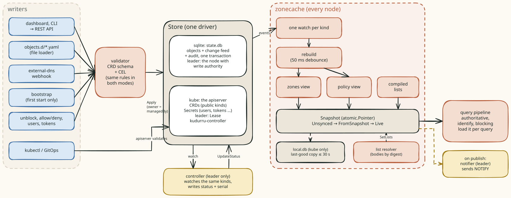

Code: `api/v1alpha1`, `api/internalkinds/v1alpha1`, `internal/store`
(interface, drivers, validator, conformance suite), `internal/zonecache`,
`internal/objects` (the file loader), `internal/bootstrap`,
`internal/controller`, `internal/config`, `cmd/kudurru/reload.go`.

## Kubernetes saved-state identity

Kubernetes outage admission uses the host-only, restart-required
`store.kube.expectedClusterID`, provisioned independently from the intended
cluster's `kube-system` UID. Both policy namespace fallback and zonecache
require a nonempty saved identity matching that pin. A known online identity
must match as well; neither a live observation nor saved data can replace a
missing host pin for offline admission. Old identity-free object snapshots
require a complete verified live sync; they are never relabeled. Existing
matching snapshots remain compatible without a database-format migration.

When configured, the pin gates the kube driver's authenticated HTTP transport
before ordinary discovery, reads, mutations and lease operations. The sole
identity probe uses the original credential-bearing transport rather than its
own wrapper, honors cancellation and the startup timeout, rejects redirects,
and bounds the namespace response to 1 MiB. This guard verifies the identity
initially: a match is cached for the process lifetime; a mismatch remains
refused until restart. Unavailability
admits no HTTP operation and never queues a refused mutation for replay.
The pinned driver disables the separate legacy cluster-discovery goroutine;
`Store.Info().ClusterID` reads that guard's observation, so a later discovery
cannot overwrite the trusted identity. No periodic or query-path identity
probe is added. Retargeting an API endpoint requires a process restart to
verify its identity again; the guard does not continuously detect a different
cluster behind an endpoint that still satisfies the configured transport trust.
Auxiliary serve clients inherit the same guarded REST config; the separately
constructed shared-settings client installs the same guard. Shared-settings
cache identity includes the independent pin, so legacy unpinned or differently
pinned caches are not reused. Without a pin, online startup remains compatible
but offline shared-settings fallback and object snapshot admission are disabled.
New Kubernetes snapshots are not persisted or refreshed before the live cluster
identity is known. Age limits and original authority/ownership/credential gates
remain additional requirements, including when recovering with a matching pin.

See the [cold-start runbook](../deploy/runbooks.md#cold-start-without-the-apiserver)
for the nonsecret provisioning and upgrade procedure.

The optional `StartupClusterID` capability returns only an authenticated,
nonempty observed UID under the earlier caller deadline and configured startup
timeout. Unpinned callers share existing discovery; pinned callers use the same
identity guard. Closing the Store cancels a held probe or wait. A direct client
without background discovery cannot invent an unpinned identity. This getter
is used by optional private credential startup, with no general startup or
readiness barrier; it does not make unsigned saved-state serving depend on
an online API server or by itself establish a complete TSIG source.

## API migrations

`internal/importers` reads Pi-hole v6 and Technitium HTTP APIs and produces
objects, a settings merge patch and conversion warnings. The CLI also converts
a bounded, single-document AdGuard Home or Blocky YAML file locally with
`import adguard|blocky --file PATH` (`-` reads stdin). Offline conversion uses
the same `Plan`, selection and migration start/apply commands. It never reads
referenced files, resolves source client names or fetches source URLs. A normal
offline preview has no destination API access; destination-derived authority
options explicitly opt into destination context/VIP access. YAML aliases,
anchors, duplicate keys and ambiguous identities are refused. Unsupported
settings produce a bounded loss report with values redacted.

`import coredns --file PATH` reads a CoreDNS Corefile with a hand-written
reader of the documented server-block grammar (`internal/importers/corefile.go`,
D392): comments, quoted tokens, braced or single braceless server blocks,
directive sub-blocks and snippets defined in the same file. Imports of files,
environment placeholders, zone files and hosts files stay unresolved and are
reported. The converter (`coredns.go`) maps `forward` to upstream groups and
conditional routes, inline `hosts` entries and exact `rewrite name` rules to
`Policy/default` rewrites, and the root block's `cache` and `acl` to the global
cache and control settings. It first collects every plain DNS server block's
zones and keeps a local answer, PTR answer or `forward FROM` only when CoreDNS
would route that name to the defining block (longest matching zone on the
same port); the rest are counted in the loss report. Blocks that are not
converted take part in that routing: a classless reverse prefix with the zones
CoreDNS expands it to, and a block whose keys cannot be read makes the routing
unknown, so no local answer is imported (imported conditional routes are
reported as possibly taken by it). When blocks on different ports answer the
same name, the block on the lowest port wins and the other answers are
reported; on one port such a conflict is refused. Every emitted plan is checked in tests
with the CRD validator and the configuration validation (D392). Every other plugin is named in the loss report;
directive names that are not documented CoreDNS plugins are counted with the
name redacted. The resulting `Plan` follows the same selection, size checks and
tracked apply as the YAML importers.

The v0.2 complete SQLite runtime mounts migration apply/start, reviewed
adoption and decommission through current compound commands, described below.
Imported settings use the shared transaction-local canonical planner. The
legacy/Kubernetes flow below is unchanged.

The dashboard's Tools wizard uses `POST /imports/preview` and submits the
reviewed result to `POST /imports/start`. This returns HTTP 202, a run ID and a Location header
before object writes finish. The CLI's `import pihole|technitium` uses the same
converter locally; `--apply` starts the same background job and `--wait` polls
its report. `POST /imports/apply` remains available for synchronous callers.
A preview never writes destination state. These REST routes require `settings.write`,
because administrators intentionally connect to private source networks.
This permission grants SSRF-equivalent network access: even a role with
only `settings.write` can send credentialed requests to caller-selected
HTTP(S) targets, including loopback, link-local metadata addresses and
internal services. Source HTTP failure status codes are visible; error
response bodies are not. Grant the permission only to trusted administrators
and use network egress controls to restrict which destinations the server
can reach.

Source credentials exist only during the request: Technitium uses a bearer
token, Pi-hole an application password and a temporary session that is closed
after reading. Source redirects are refused, response sizes and request time
are bounded, and upstream errors never echo credentials or response bodies.
Import writes use the existing object authorization, schema, ownership and
license checks. They are not transactional and return a result per object;
the selected settings patch is applied only when every selected object succeeds. Unsupported
source semantics are reported in the preview. See the
[migration guides](../../docs-site/content/migrate/_index.md) for supported data.

Each import starts an internal `MigrationRun` journal before destination writes
(D182, D184), using the existing store: SQLite JSON rows or labeled Kubernetes
Secrets. It retains source type and URL origin (empty for offline sources), actor, times, planned objects,
per-object outcomes, zone UIDs, original/current authority and cutover attempts.
Credentials, source URL paths/query parameters, offline filenames and source records are excluded.
Only `SourceInfo` and journal source identities admit offline formats;
credential-bearing live preview requests remain limited to Pi-hole and Technitium.
An optional selection lists object identities (`Kind/[namespace/]name`) and
top-level settings sections; omitting it selects the full plan for compatibility.
Unknown or duplicate selections and explicitly empty selections are refused before
writes. Dependencies are not automatically selected: choose them too or ensure they
already exist. Unselected objects and settings are journaled as `skipped`; only
selected primary zones are tracked for later cutover.

Selected items progress from `pending` to `running`, then `created`, `updated`,
`unchanged` or `error`, with the error key, explanation, hint and saved version.
Settings have separate rows and are applied in one merge patch after all selected
objects succeed, or become `not_applied` if an object fails. Progress is saved
before the first object write, then each completed result and the next object's
running marker share one journal update. Settings have a separate running marker.
A journal failure stops further writes and records a journal error. Capacity for
bounded error details is checked before any writes.
The dashboard opens `/tools/migrations/{id}`, polls progress and shows counts and
per-item results, including retained successes when other items fail. The report
remains reachable through Tools' migration history after navigation or reload.

Background workers retain the caller's identity and authorization, copy mutable
request state and run independently of browser disconnects. At most two imports
run per API server process; overload is refused before journal creation. Replicas
sharing a store each admit their own two workers. There is no cross-run lock on
zones: overlapping imports still use normal ownership and optimistic version
checks, so avoid starting simultaneous imports for the same destination objects.
Each job is bounded to ten minutes. Server shutdown cancels and joins workers
before the store closes; final journal updates get a separate ten-second context. Reviewed plans
live only in worker memory: jobs are not replayed or resumed after restart. Once
a running job's recorded deadline plus fifteen seconds passes, reads show it as
`interrupted` and unresolved items as `unconfirmed`. Check the destination before
retrying, since a write may have committed just before its journal update.
Journals use a 1 MiB cap on both drivers to fit Kubernetes Secret data; a run
accepts at most 100 cutover attempts. Before claiming an attempt, apply checks that the journal has
room for every zone and address-record outcome, bounded errors, and authority
updates. An attempt that cannot fit is refused before any destination writes.
Full backups include internal journals; safe exports omit them.

An optional `nameservers` list replaces apex NS and SOA MNAME during conversion.
Alternatively, `nameserverAddresses` generates stable `ns-<hex-address>` names
within each imported zone and matching A/AAAA endpoints. Both options are
mutually exclusive; empty options preserve source authority. The dashboard
suggests its navigated hostname (an IP URL selects serving addresses instead),
with editable targets and opt-in VIP discovery from `/edge` (`edge.read`). The
CLI uses its destination context for `--update-nameservers` or a decommission
preview without explicit targets, and offers `--use-vips` discovery.
`/imports/runs` lists durable history;
`/imports/runs/{id}/decommission/preview` reads tracked live zones and shows
current authority and target names. Apply recomputes those changes from stored
run data, claims the run using its revision, and writes through normal zone
validation, ownership and authorization with each reviewed resourceVersion.
The run annotation, UID and expected authority fence old runs from newer
imports, recreated zones and manual authority changes. Cutovers preserve earlier
successful zones when a later step fails. After ten minutes an interrupted
attempt can be reviewed and retried. The legacy Kubernetes path also reconciles
writes committed before their separate journal updates; SQLite commits each
zone effect and outcome together. Work is bounded to two minutes; all write
races still use optimistic versions. A retry records the
abandoned attempt as partial. Address cutovers use per-zone generated record
sets scoped to the run and addresses: each preview or apply request loads all
record sets once, groups them by zone, and reuses that snapshot for conflict
checks. Generated record sets are still reread and written under their reviewed
versions. Preview includes endpoints and versions,
refuses existing name conflicts, requires `records.write`, and refuses zones
with custom record-set selectors. Apply creates/verifies address records before
changing NS/SOA and journals each result. Existing records are never implicitly
adopted or overwritten. Record write failures leave authority intact; retries
reuse identical generated records. Parent delegation/glue and existing hostname
address changes remain external to this flow.

`GET /imports/existing` finds API-managed primary zones matching the converter's
stable IDs without a run annotation. Explicit `POST /imports/adopt` tracks a
reviewed selection under resourceVersion checks without reimporting records.
In current SQLite mode, the listing also returns each zone UID; adoption requires
both the reviewed UID and resourceVersion.
History and adoption use `settings.write`; each destination zone still requires
its own `zones.write` grant. CLI `import runs`, `import decommission` and
`import track-existing` use these same routes, with saved JSON previews required
for the latter two writes.

### Current SQLite migration commands

SQLite apply/start execute an immutable, copied program of at most 1,000 object
steps plus initialization and completion. Decommission uses initialization and
at most 1,000 zone steps; the last zone step also completes its attempt. Initialization
uses the original HTTP lease. Each subsequent command captures its initial whole
lease, reauthenticates the original raw request credential against transaction-local
IAM, and retains the original elected writer episode and all current dependency
exclusions through final commit. A failed command ends the program; it never
retries against a successor lease or writer. Browser disconnects do not cancel
background jobs. Shutdown, credential revocation, expiry, and writer replacement
stop further steps. Plans are never replayed after restart.

Every successful object write and its journal outcome share one concrete SQLite
transaction. Schema and manager failures are prepared before mutation and become
error items without attempting a rejected write. VIP address records, NS/SOA
changes and their outcomes commit together for each zone. The last cutover zone
also records the attempt's completed/partial status and finish time in that same
transaction, under the same settings, zone and record permissions and final
credential/license checks. A later publication cannot leave a fully applied
cutover waiting for a separate completion write. An unexpected mutation or
final-admission failure rolls back the entire step, preserving previous
committed outcomes. Import completion remains a separate current command for
selected settings. If a required command cannot run, the durable deadline
eventually exposes unfinished work without inventing a successful terminal report.

Reviewed SQLite adoption uses one immutable program step for the entire selection.
It bounds the selection to 1,000 unique zones and 64 MiB of reviewed candidate
and stored object data, with the existing 1 MiB journal capacity check. All
candidates must still be previous API-imported primary zones without a migration
annotation, match their reviewed UID, resourceVersion and authority, and pass
canonical schema checks before any mutation. The step authenticates the original
proof once for cluster `settings.write` and every zone's `zones.write`, keeping
the original writer, whole HTTP lease and dependency exclusions through final
credential and license checks. The only content change is each zone's run
annotation; specs, authority, UIDs, managers and record sets remain intact. All
annotations and the completed `existing` journal commit together. A duplicate,
concurrent adoption, manager/version change, mutation error or final refusal
leaves no partial adoption or journal and never retries against a successor.
Durable adopted runs remain available after restart for reviewed cutover.

History and previews read private journals and public objects from the same
original complete serving image. They do not use live Store fallback. Selected
settings merge with the current canonical singleton in the completion transaction,
sharing validation and persistence with ordinary canonical PATCH. A selected
object failure leaves settings `not_applied`; invalid, host-only, node-scope, or
environment-locked settings produce durable error items without a settings
mutation. Successful settings and their journal outcome commit together,
including no-ops. The response reports persistence and restart-required paths;
durable Settings item hints retain restart requirements for background imports.
Branding retains the original complete view's Enterprise entitlement through
final commit. Kubernetes retains the preceding legacy behavior.

For apply/start, the current program follows this flow; adoption uses the
single atomic step described above.

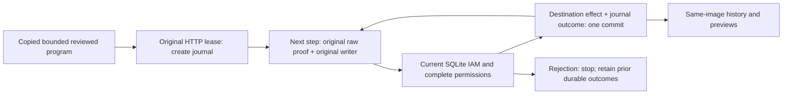

Current SQLite decommission completes with its last zone outcome:

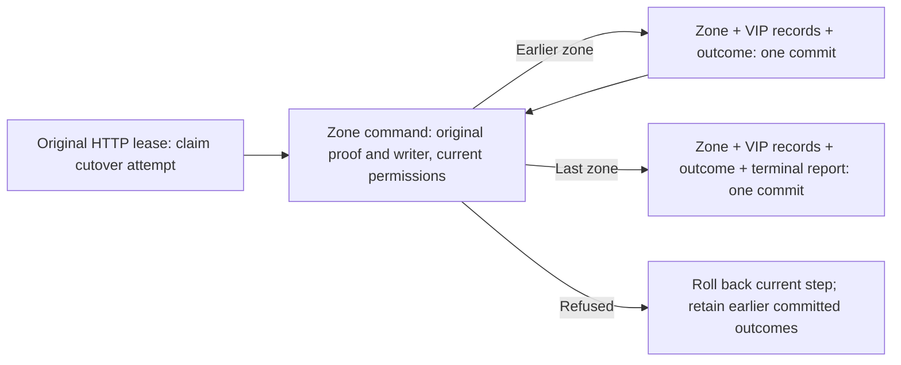

The following sequence describes the legacy Kubernetes path; SQLite uses the
current command protocol above.

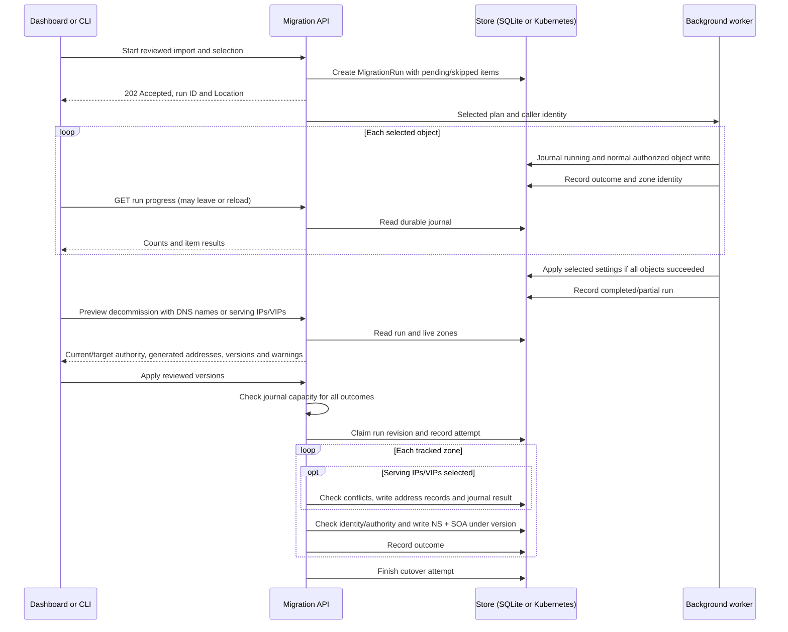

Technitium catalog member primary zones become independent primary zones.
The converter reads `overrideCatalogQueryAccess`: an override keeps the
member's local query policy; otherwise it reads the catalog's policy and
copies its query mode and ordered ACL. Catalog reads, including failed
reads, are cached for the preview. Unknown inheritance, unreadable catalogs
and unsupported query modes skip affected zones instead of falling back
to permissive member defaults. Catalog membership and replication are not
imported. Comment and blank lines in subscription URLs are ignored.

## The objects

All kinds share `kudurru.io/v1alpha1`. Public kinds are CRDs in Kubernetes;
internal kinds hold identity data and migration journals and are never CRDs (Secrets in Kubernetes,
rows in `state.db` in Docker).

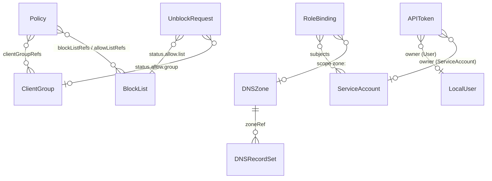

| Kind | Scope | Public or internal | Purpose |
|---|---|---|---|
| `DNSZone` | cluster | public (CRD) | authority over a name: primary, forward, secondary or stub |
| `DNSRecordSet` | namespaced | public | records (external-dns `Endpoint` shape) added to a zone |
| `BlockList` | namespaced | public | block or allow rules from sources |
| `ClientGroup` | namespaced | public | who a client is |
| `Integration` | namespaced | public | provider settings and credential references; the execution host runs on the complete SQLite runtime ([integrations](integrations.md)) |
| `Kudurru` | cluster, name `default` | public | canonical cluster settings and replicated blocking status on the complete SQLite runtime; Kubernetes keeps the settings ConfigMap flow ([Settings](#settings)) and its own blocking runtime state |
| `Policy` | namespaced | public | what a group gets: lists, schedule, upstream group, safe search |
| `UnblockRequest` | namespaced | public | a block-page request and its decision |
| `DHCPScope` | cluster | public | a DHCPv4 pool, its options, relays and reservations (served with the Kubernetes store, D180) |
| `LocalUser` | cluster | internal | local account with an Argon2id hash |
| `APIToken` | cluster | internal | SHA-256 of a `kdr_` token, owned by a user or service account |
| `PrincipalState` | cluster | internal | private bootstrap authority bound to an exact service-account UID |
| `ServiceAccount` | namespaced | public | a non-human principal; credentials and bootstrap authority stay private |
| `RoleBinding` | namespaced | public | role at a scope for users, groups, service accounts |
| `IdentityProvider` | cluster | public | an OIDC provider with operator-granted credential references |
| `IntegrationSourceHead` / `IntegrationSourceChunk` | cluster | internal | bounded original inbound source evidence and its complete version pointer |
| `IntegrationNameAllocation` | cluster | internal | retained collision reservation bound to Integration and target zone UIDs |
| `IntegrationEventCursor` | cluster | internal | how far one hook instance's event production has read the change feed (D379) |

Inbound runtime carriers use private Secrets in Kubernetes and private objects in
SQLite. Full backups and replication include them, with explicit zero-count kind
manifests after deletion; safe configuration exports omit them. Carrier validation
checks identity, chunk digests and finite bounds. Whole-source current admission
and publication remain separate from storing these individual records.

The bootstrap seeds four objects on the first start, with owner `bootstrap`:
the root forward zone `.` → `default`, `ClientGroup default` (all
addresses), `BlockList starter` and `Policy default`.
Namespaced defaults use the release namespace in Kubernetes and `default`
in SQLite. An existing `default/default` policy keeps a Kubernetes install
on `default` until a default policy exists in the release namespace; no
objects are moved automatically ([upgrade behavior](../deploy/helm.md#default-object-namespace-and-upgrades)).

### One writer per object

`ApplyOptions.CreateOnly` requires the object to be absent at commit time.
An existing object conflicts even when its content is identical or `Force` is
set. SQLite checks within its transaction; Kubernetes uses a create request
for both CRDs and private Secrets, so a concurrent creator cannot turn a
bootstrap or migration operation into an update.

A Kubernetes create request records `Update` field ownership. On a later apply,
the driver can migrate that ownership to `Apply` only if every non-status field
belongs to the same manager and the managed-by annotation agrees. The exact
observed resourceVersion guards this single request; a foreign owner or intervening
edit prevents the transition. This does not grant general takeover authority.

`DeleteOptions.ExpectedUID` and `ExpectedResourceVersion` retain the caller's
original object identity. A mismatch conflicts even with `Force`. Kubernetes
keeps the preconditions on its one delete request and never retries against a
newer object; private Secrets follow the same rule. SQLite checks them inside its
mutation/command boundary, and a failed command or atomic batch leaves all objects
unchanged. Omitted preconditions preserve the existing unguarded delete contract.

Every write carries a **manager**, recorded as the object's owner in the
`kudurru.io/managed-by` annotation: `api`, `file:<path>`,
`integration:<name>`, `bootstrap` or `system`.

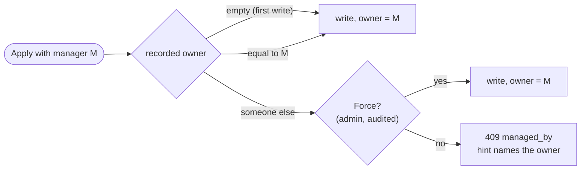

This is why a zone from `objects.d/zones.yaml` cannot be edited in the
dashboard ("managed by file objects.d/zones.yaml"), and why two sources of
truth for one object cannot exist. The API may take over objects owned by
`bootstrap`. Objects written with `kubectl` carry no annotation, so anyone
may write them.

## The store

```go
// internal/store/store.go (abridged)
type Store interface {
    Get, List, Apply, Delete, UpdateStatus  // CRUD; Apply is whole-object, optimistic (resourceVersion)
    Watch(ctx, kind, opts) (Watcher, error) // list + watch: ADDED, MODIFIED, DELETED, BOOKMARK
    Elector(name string) Elector             // leader election primitive
    Snapshot, Restore                        // backup = `kind: List` YAML that `kudurru apply -f` accepts
    Info() Info; Close() error
}
```

Two drivers exist. They pass the same conformance suite
(`internal/store/conformance`), so the rest of the code cannot tell them
apart.

| | `kube` | `sqlite` |
|---|---|---|
| Used by | Kubernetes, any replica count | Docker, systemd, the chart's `standalone` mode, each compose HA twin, enrolled primaries and followers |
| Backing | the apiserver: CRDs for public kinds, Secrets (`kudurru.io/kind=<Kind>`) for internal kinds; server-side apply with the manager as field owner | `state.db`: an `objects` table (JSON), a change feed, an audit table (hash-chained, same transaction), a `flock` |
| Watch | initial list/watch uses informers; explicit resourceVersion resumes retained server history directly | the current objects, a bookmark, then an in-process broadcaster fed by the change feed |
| Validation | the apiserver (CRD schema + CEL) | the embedded validator, inside `Apply` |
| Leader | Lease `kudurru-controller` (15 s / 10 s / 2 s), identity = pod name | the node with durable write authority: a standalone node, each static twin, or the enrolled primary ([the leader](#the-leader)) |
| Last-good copy | `local.db` on each node | not needed: `state.db` is local |

Kubernetes watches with a nonempty resourceVersion resume the API server's
retained event stream after that exact version, including modifications and
deletions absent from the current informer state. They reuse the original
identity-pinned transport and namespace; internal kinds resume labeled backing
Secrets in the configured namespace and filter the decoded object namespace.
The result buffer is bounded to 256 events. Cancellation, Store.Close and Stop
release blocked sends and terminate the remote request, including an initial
watch call still waiting for the server.

A resumed stream never silently replaces history with a current-state list.
Immediate server errors return from Watch; terminal stream/decoding errors close
the result channel and are available through `interface{ Err() error }` on the
watcher. Compaction remains a detectable Kubernetes expiration error. Callers
can then explicitly rebuild their state with an empty cursor. The special
Kubernetes cursor `0` is refused for exact resume. An empty cursor preserves the
existing informer Added/bookmark/live path used by zonecache. SQLite retains
its separately documented coalesced change-feed/relist behavior.


The **validator** (`internal/store/validator`) runs the apiserver's own
structural schema, defaulting and CEL programs from the embedded CRDs, so
Docker rejects exactly what Kubernetes rejects. The API, the file loader,
the bootstrap and the sqlite driver all call it. Cross-object problems (a
record outside its zone, a duplicate) are not validation errors: the
controller reports them as conditions.

The sqlite driver adds what the schema cannot say. Its serving image is
complete or absent ([Complete serving publication](#complete-serving-publication)):
a stored DNSZone that the image cannot build would stop DNS, readiness and
the API together, and the API would then not be there to correct it. `Apply`
therefore refuses a DNSZone of a type no release serves (`external`,
`catalog`, `secondaryCatalog`), with a query, transfer or notify policy that
does not compile, a primary zone whose `spec.policy.update` is neither
`deny` nor `allow` (the only update modes the primary runtime compiles) or
whose `spec.policy.updatePolicies` has an entry the primary runtime cannot
compile (a key name that is not a name, an owner outside the zone, a type an
update cannot carry, or more than the policy's bounds; checked whatever the
update mode, as the runtime compiles every entry), a zone with the zone name of another DNSZone, and a zone created under a
new object name for the zone name of a deleted zone whose lifecycle the
primary runtime still keeps (the image refuses two lifecycles for one apex;
re-creating the zone under its earlier object name continues that
lifecycle). Each is an ordinary `invalid` error that names the field (D373).
`zone.ServingErrors` is the rule for the object itself; it asks the builders
the image itself uses, and the zone-name and lifecycle checks run inside
the write transaction. On Kubernetes the apiserver admits these objects and
the controller reports them on the one zone.

Other objects are not refused; the image builders leave out what they
cannot use and report it on the object. A record set that names a forward
zone is stored by both drivers and reported on the record set; the zone
holds no records and is served as before. Everything the primary zone
builder refuses of a record set is left out of the zone's commit, and the
rest of the zone is committed and served: a record set that is invalid as a
whole (an endpoint that parses in no zone, such as an `A` target that is not
an address, an unknown record type or an `MX` without a preference, or two
endpoints with one name, type and set identifier) is projected `withheld`
with the reason; so is a record set none of whose endpoints the zone can
hold (outside the zone, a CNAME or NS endpoint at the apex), and one whose
endpoints conflict with an earlier record set is projected `duplicated`. A
record set that has some endpoints served is projected `served`. In every
case the record set's status conditions name each refused endpoint, as the
controller reports them on both drivers. The primary runtime runs its own
checks on the compiled zone before it commits it (zonestate's normalization
and `BuildCommittedPrimary` as the prebuild); the compiler keeps every
record set from reaching one of them, so none stops the zone. That includes
an endpoint written at a name that holds a record a dynamic update added:
without an authorized takeover the compiler checks each endpoint against
the committed dynamic records before the builder takes it and leaves out
only the colliding ones, a record set with nothing served is projected
`duplicated` with the reason, and the rest of the zone is committed, while
the dynamic record keeps answering. The check looks names up in an index of
the dynamic records (`zonestate.DynamicOwnership`), so its cost does not grow
with the number of dynamic DNAMEs. On SQLite the leader controller checks the
kept endpoints of each record set against the same index, read from the
committed head through the committed primary status, and reports each
colliding endpoint as a `Duplicated` conflict in the record set's own
conditions, also when other endpoints of the set are served; a publication
that changed neither the zone's record sets nor its committed head keeps
the conflicts already found. Only zone-wide capacity bounds (a million
records, 64 MiB of records, a 128 MiB aggregate) still refuse the zone as a
whole; it then keeps its last commit.
`TestCompilerWithholdsEveryRefusalOfThePrimaryRuntime` is the table of these
checks.

A block list source (URL or ConfigMap) for which no body was ever published
is compiled empty: its first download has not finished (the URL may accept
the connection and never answer), or it failed. A failed download is
reported on the list (`Degraded`, `ListFetchFailed`); while a first download
is still running nothing is reported, for up to the fetcher's attempts
(three of at most five minutes each). The fetcher writes the status of a
list as soon as the downloads of that list's sources end, so a silent URL
holds back only its own lists' status, not the other lists'. The download
that publishes the source's digest prepares a new candidate with the body.
A source whose digest is published but for which this node holds no body
as the source is configured now (a lost or never filled cache, a URL
changed after the last download, a follower that has not pulled the body
yet) is compiled empty as well, and storing the body wakes the serving
publisher to prepare again with it. The list does not block on that node
meanwhile; the node logs the wait once per source when it starts and again
when the body is stored. A source for which this node holds a
body under another digest (a refresh downloaded or pulled before its new
digest was published) still holds back the candidate until the published
body is stored, so a node never serves a body nobody published.

Each database carries a schema version. A file newer than the binary stops
the process with an explanation; an older one is migrated in one
transaction.

A release may tighten its schemas, so the last step of a `state.db`
migration, still inside that transaction, checks every stored object the way
the complete image will: strict decoding, the current CRD schema or the
kind's own validation, and the DNSZone rules above (a 0.1.0 database holds
no zone lifecycles, so that rule cannot apply to it). If an object fails, the
transaction is rolled back and the process exits naming every such object.
`state.db` is then byte for byte what the earlier release wrote, that
release still runs on it, and the objects are corrected there
([runbook](../deploy/runbooks.md#upgrade-refused-stored-objects-are-not-valid-in-this-release)).
0.1.0 stored secondary and stub zones without their configuration, zones of
types it did not serve, several DNSZones for one zone name, update modes and update
grants it did not implement and free-form policy rewrites; without this check the migration committed and the node
then served nothing, on a schema 0.1.0 no longer opens. A database that is
already on the current schema is opened as it is.

Schema 7 reserves durable root-anchor history with a non-granting physical
marker. Schema 8 adds a private receiver-local denial carrier in the same
migration transaction. Only an exact marker or valid never-managed dormant
owner can upgrade; existing managed history without that local evidence refuses
rather than inferring a zero retirement floor. The original writable startup
command initializes the dormant owner and its local binding together. Managed
restart validates existing evidence and never initializes or resets it.

Complete replication requires both `managed-root-anchors-v1` and
`managed-root-runtime-v1`, independently of the schema number. Old images and
binaries refuse without received-image conversion. Receiver-local denial rows
are excluded from replicated images and object-only backups. They survive
canonical row replacement; accepted owner changes and local denial updates
share the actual SQLite transaction. Uncertain commit completion closes local
admission rather than granting rollback or mutation-replay credit.

Replica pulls retain one finite original context, committed receiver source,
local evidence, authority and installed baseline before source reads or network
acquisition. A higher authenticated term still fences the receiver, but cannot
renew that original capture. Even a 304 response passes through the captured
no-op installation boundary. Exact awaiting-to-awaiting raw-driver installs
preserve their original marker and local carrier without constructing managed
history or a serving permit. Complete-runtime validators continue to reject
that marker until explicit owner initialization.

The shared version advances the `local.db` object-schema marker while its table
layout stays at version 2. Old quarantined bytes remain preserved, but the
current reader rejects older image features. These durable and installation
boundaries do not activate managed resolution: elected updater, explicit mode,
accepted resolver publication, final transport output, cache retirement and
installed edge bypass still require their separate composition and evidence.

Kubernetes forced whole-object takeover first validates the proposed replacement
with a resource-version-guarded dry-run PATCH and bounds its encoded size before
and after admission. Invalid schema, immutable transitions and oversize inputs
are refused before changing managed fields. Typed SSA payloads use the same
schema-aware non-nullable-null normalization as SQLite, and apiserver Invalid
responses retain structured field causes and Kubernetes status semantics.
Nullable values, defaults and list elements keep their schema semantics.
The subsequent ownership patch and SSA remain separate Kubernetes requests;
backend failures or concurrent changes after preflight can still leave partial
metadata effects. This is not a general transactional takeover guarantee.

## From a write to the query path

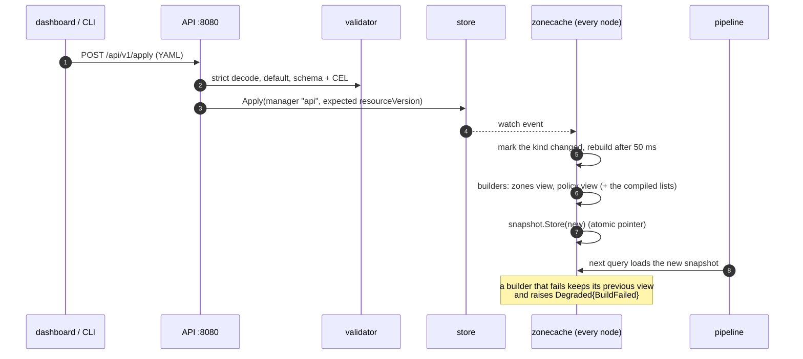

The file loader takes the same path with manager `file:<path>`: it reads
`objects:` in `kudurru.yaml` and every `objects.d/*.yaml`, applies them,
deletes the objects that its files no longer declare, and re-applies on a
file change (fsnotify, 500 ms debounce) and every 60 s to repair drift.
On Kubernetes every replica runs the loader. On SQLite it is a leader-only
loop: a standalone node and a static twin load their own files, and an enrolled
follower never applies its local files, because its objects arrive in the
primary's image.
The node configuration is read once per load, capped at 64 MiB, with one YAML
mapping and no duplicate keys. Its entire `objects` section is decoded and
schema-validated before reconciliation (4 MiB per flattened object). Missing,
unreadable, oversized or invalid input preserves all objects owned by that
inline source and prevents another file from taking them over. A valid empty,
null or removed `objects` section intentionally removes its owned objects.
Unrelated node settings are not applied by this watcher. An environment override
of `objects` keeps precedence and remains fixed for the process lifetime.

The watcher observes the node file's parent directory, so editor replacements
and projected ConfigMap symlink swaps keep working. A missing watch directory is
retried during polling. Reconciliation still uses individual store operations
with the original manager, current validation and writer fencing; a valid source
is not a cross-object database transaction. Errors become diagnoses without
logging node-file contents, and never stop the server.

### The snapshot's life

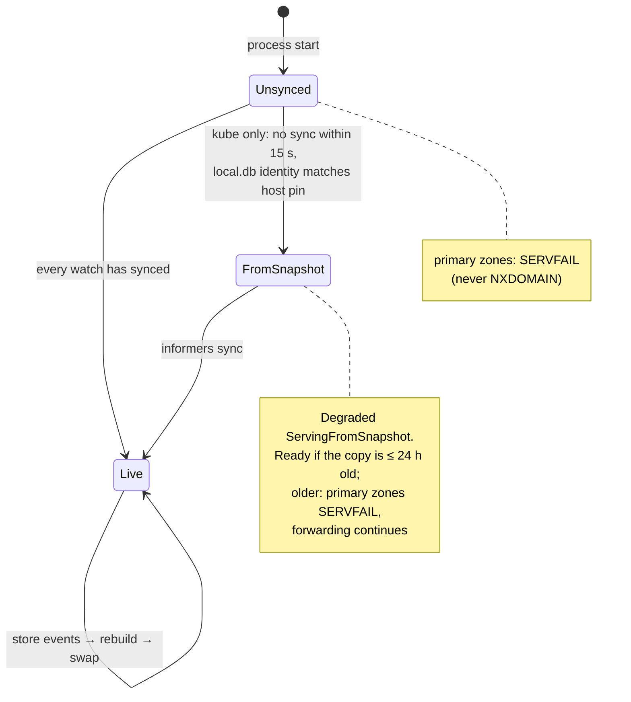

Database placement is host configuration: empty `node.localDir` and
`node.querylogDir` preserve `node.dataDir`; explicit directories select fixed
`local.db` and `querylog.db` filenames on restart. Startup inspects all selected
database/sidecar paths before initializing node state, without relaxing existing
permissions or moving files. State, audit and other node data keep their existing
paths. Split volumes have no shared transaction or atomic backup boundary; see
[storage placement and offline migration](../deploy/sqlite-storage.md).

In Kubernetes mode each node writes the complete object set to `local.db`
after its first sync and then at most every 30 s when something changed. A
pod that restarts while the apiserver is down can answer forwarded names,
cached names, and primary zones from an identified copy matching the
independently provisioned host pin. Missing pins or unidentified/foreign
copies do not admit saved serving state. RPZ feeds are the exception to
"forwarding continues": an offline restart cannot read stored TSIG keys, so a
signed feed fails closed, and a copy older than `maxAge` fails every selected
feed closed; in both cases clients whose policy selects the feed get SERVFAIL
for every recursive query ([block lists](block-lists.md#transferred-rpz-foundation)).
An unsigned feed's unexpired copy is reused. The zone cache reports ready from
`local.db` only once the snapshot built from it is published, so the policy
index that readiness checks is the restored one, never the empty unsynced one
(D390).

Startup reads for the policy namespace, default-object seeding and identity
caches have bounded deadlines. An apiserver availability failure defers
initialization and lets the DNS listeners and snapshot cache start;
bootstrap and identity initialization retry after recovery. Authorization,
certificate, schema and local-data errors retain their normal failure
behavior. Identity secrets are not taken from `local.db`, so an empty IAM
cache cannot authenticate local users or tokens during an offline start.
See the [cold-start runbook](../deploy/runbooks.md#cold-start-without-the-apiserver).

## The leader

One election covers all leader-only work. The runner starts the leader-only
loops under a "term" context when the node wins, and cancels them when it
loses. **Losing the lease never stops the process**: the DNS listeners, the
API and the snapshot keep running, which is exactly what you want during an
apiserver outage.

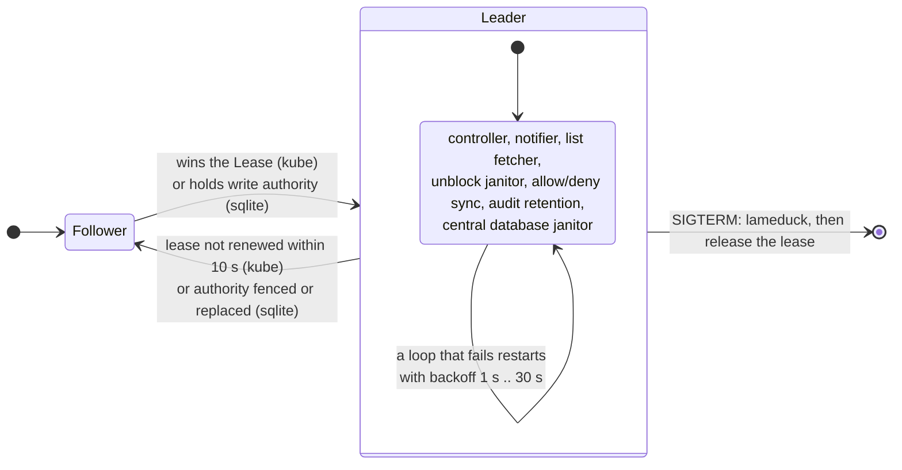

Leader loops are idempotent and level-triggered: they read the store, compare
with the status, and write only the difference. A new leader picks up where
the old one stopped without special hand-over.

The SQLite elector follows durable write authority instead of a lease. A
standalone node, and each static twin, leads itself from the start. In an
enrolled cluster only the primary's authority is writable, so only it runs the
leader-only loops; a follower starts them when a reviewed promotion makes it
primary, and a primary stops them when it is fenced or records a conflict.
Each leadership term carries its writer token, which every mutation checks
again inside its transaction. Every authority change, and the fail-closed
write block that precedes a durable fence, ends the current term: the store
cancels the term context before the new authority becomes visible, so a
leader-only loop that sees its token retired always finds its term already
over and stops quietly instead of failing and restarting. The cluster runner
treats an error returned after the term ended as the end of the term: it logs
nothing, counts no restart and leaves the runnable's last error empty.

### The controller

One reconciler per kind (DNSZone, DNSRecordSet, BlockList, ClientGroup,
Policy), each with its own watch and a rate-limited work queue, writing
status only when it differs; a full re-list every 10 minutes.

| Kind | Status it writes |
|---|---|
| DNSZone | `serial`, `contentHash`, `recordCount`, `Ready` (Serving, Invalid, Unsupported), `Degraded` (worst record-set problem) |
| DNSRecordSet | `Ready`, `Degraded` (OutsideZone, Duplicated, Occluded, Invalid, NotSelected, ZoneNotFound) |
| BlockList | `Degraded` (ListFetchFailed); the fetcher writes `sources[].digest` and counts |
| ClientGroup | `members` |
| Policy | `Degraded` (MissingReference, UnknownService, UnknownCategory) |

Events (`SerialBumped`, `Duplicated`, `OutsideZone`, …) go to the log only;
the Kubernetes Events sink exists but is not wired yet.

## Settings

The existing production settings path uses files and a live configuration
pointer; the v0.2 canonical object and command adapter are described below.
Each key in the metadata table
(`internal/config/schema.go`) has a **scope** and flags:

| Scope | Examples | Changed how |
|---|---|---|
| node, `hostOnly`, restart | `node.*`, `listeners.*`, `store.*`, `tsigKeys`, `auth.adminSocket.*` | file or environment, then restart; never through the API |
| node, dedicated DHCP setup | enabled state and complete DHCP scope topology | DHCP setup API/dashboard, explicit file adoption, then restart; generic Settings remains host-only |
| cluster, hot | `control.*`, `upstreams.*`, `cache.*`, `blocking.enabled/defaultResponse/blockTTL`, `ratelimit.*`, `querylog.enabled/sink/privacy/retention/sinks` | API, dashboard, settings file; applied without a restart |
| cluster, complete SQLite auth reload | `auth.localLogin`, `auth.session.idleTimeout/lifetime/secure`, `auth.tokens.maxLifetime` | canonical settings; applies to new credentials and original-view cookie policy after complete publication |
| cluster, restart | `blocking.initStrategy`, auth controls on legacy/Kubernetes hosts | as above, applied at the next start |
| cluster, `hostOnly` | `auth.identityProviders`, `rbac.bindings` | file or environment only |

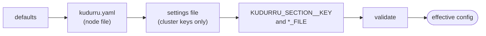

An environment variable wins and locks the key in the dashboard. In
Kubernetes, sections default to `gitops`: edit Helm values or the settings
ConfigMap. Only `upstreams` can currently switch to `ui` ownership, through
an explicit, revision-checked adoption. Adoption copies the effective public
cluster settings (groups, servers, bootstrap, conditional rules, ECS and
recursion) without changing routing. The schema excludes host-only fields from
both persistence and YAML export, including import paths, managed-root ingress
topology and installed edge identities. Each node retains its own declarations.
These local fields come from the original node document or schema defaults;
even a malformed stale shared section cannot erase or replace them.

On the v0.2 complete SQLite runtime, canonical settings commands replace this
legacy ownership manager. Adoption/release and legacy YAML export return 503
`unavailable` with a hint that names `kudurru settings set` and
`kudurru settings get` (`PATCH` and `GET /api/v1/settings`), because there is
no ownership to transfer;
canonical reads and writes never change the legacy settings file or reload
pointer. Kubernetes retains the ownership flow described here.

Complete SQLite auth controls validate the entire canonical document before
applying the exact installed environment locks. Settings schema, PATCH results
and restart logging use the same explicit runtime capability; a canonical reader
alone does not advertise hot auth reload. Global generated schema remains
conservative for other runtimes. Existing session/token deadlines are unchanged,
and a cookie naming/security change can require a fresh sign-in. File-defined
providers, provider trust/network policy, bootstrap input and admin-socket inputs
remain host-only and restart-bound. See [auth control reload](access.md#auth-control-reload).

UI-owned upstreams live with their ownership record in a separate ConfigMap,
`<release>-ui-settings` by default (`KUDURRU_SETTINGS_RESOURCE`). Helm never
renders that resource. Each replica reads it at startup and on the settings
watcher's ten-second poll. Its values replace the public cluster portion of the
file section; public file keys are never merged into a UI-owned section. The
environment still wins
and locks individual keys; any upstream environment override blocks ownership
transitions. File declarations under a UI-owned section produce a warning,
the `conflicts` field in `GET /settings` and a dashboard banner while UI values remain
authoritative. Other sections continue following the settings ConfigMap.

Ownership and values share a Kubernetes `resourceVersion`; concurrent
adoptions, releases and edits use compare-and-swap. The API exposes section
owners and reviewed revisions in the `sections` field of `GET /settings`, accepts
`If-Match` on upstream settings patches, and authorizes transitions with
`settings.write`. The header is optional for backward compatibility, but
safe concurrent upstream edits require a reviewed revision; omitting it can
overwrite newer client edits. Other sections do not use the upstream revision.
For CLI edits, review `kudurru settings ownership`, then pass the token to
`kudurru settings set upstreams.bootstrap=9.9.9.9:53 --revision TOKEN`.
Writes and transitions are audited. Every replica uses the
same reload subscriptions, including upstream set swaps and cache flushes.
Invalid or unavailable sources leave the running configuration intact.
A node-local `ui-settings-<identity>.json` cache retains the last confirmed
shared ownership and values for offline startup; writes always require the
apiserver. Preserve the node data directory alongside `local.db`.

In Docker, the API keeps writing the existing writable settings file. A
`settingsOwnership` map in that file records explicit adoption/release, in the
same atomic rename as complete section values. Existing Docker settings remain
UI-editable; a deployment without a writable settings file retains its existing
in-memory behavior and cannot change ownership.

Generate current or proposed Helm values with
`POST /settings/sections/upstreams/yaml` (no write). To return ownership to
GitOps, commit and apply the current exported values, wait for the settings
volume to update on every replica, refresh the preview, then call
`POST /settings/sections/upstreams/ownership/release` with its
revision. Release refuses mismatched file values on the serving replica;
it does not collect acknowledgments from other replicas. Kubernetes volume
projection is asynchronous, so the operator must verify that all replicas
have received the applied values before releasing. Adoption uses the same
path ending in `/adopt`. Only ownership is transferred; no new CRD is required.
Include the API-owned ConfigMap in your
Kubernetes backups; ordinary object-store exports do not include it.

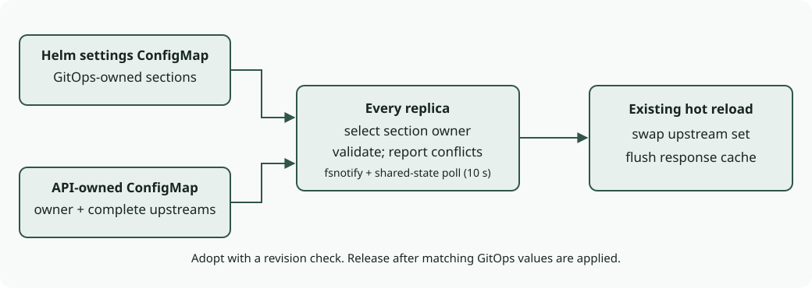

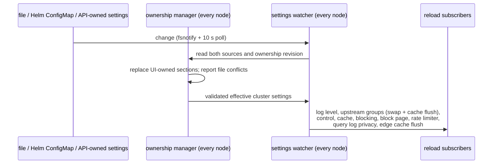

### Global DNS controls

`control.allowedNetworks` and `control.blockedQTypes` are cluster-scope hot
settings. Validation compiles bounded CIDR/type lists before adoption. The
complete SQLite publisher owns a detached immutable `control` component from
its exact settings image; DNS captures it through `BindDNS`. Held requests and
synchronous dependency queries retain that original component. A missing or
wrong original owner is a capture error, never an invitation to consult the
live configuration or a successor publication.

Legacy Kubernetes/settings-file reload validates the entire replacement and
atomically swaps one immutable view. Invalid reloads retain the previous view.
The operational publication subscriber and legacy reload path invalidate the
local edge resolver packet cache when controls change. Remote edge caches
still need their own invalidation or TTL expiry. The core raw-answer cache
remains behind the control stage, so a previously cached answer cannot bypass
new rules. See [DNS controls](../deploy/dns-controls.md) for input limits,
loopback compatibility and refusal behavior.

## Not built yet

The `raft` driver (v1.0) and a general `roles:` setting are not built, and a
follower is never promoted automatically. The enrolled SQLite path below is
mounted: first-primary activation, invitation issuance, initial remote
joining, retained follower acquisition, reviewed operator promotion, peer
authority observation and offline conflict resolution. An enrolled follower
forwards typed commands to its primary, including the blocking toggle,
canonical object writes, four zone commands and local password login. Each
forwarded domain has its own executor on the primary; the paragraph on the
root member-command executor below names what is not forwarded. Static
file-managed twins
and authenticated remote health reads are available separately. See [the design record §4](../../dev-docs/design-record.md#4-data-model-storage-replication-ha)
for the plan.

## SQLite replication foundation

Schema 2 adds durable member/authority metadata, owned extension sections and
private recovery images. `internal/store/replication` defines a versioned
complete logical image; it is separate from the YAML backup/apply format.
`internal/store/follower` supplies a local-read facade and a bounded pull loop.
These packages alone do not enable HA: the complete SQLite runtime mounts them
with the member transport, startup selection and coherent serving and
authentication publication described in the rest of this section and in the
enrollment subsections that start at
[Explicit first-primary activation](#explicit-first-primary-activation).

### Per-member TLS identity foundation

`internal/cluster/memberidentity` creates or loads a separate node-local Ed25519
CA under the node's original UUID. The private canonical artifact is created
exclusively at mode 0600, with file and directory synchronization. Descriptor-
relative operations refuse symlinks, hardlinks, nonregular files, permissive
modes, oversized/malformed data and wrong local UUIDs. Loading never creates or
repairs identity. Unsupported platforms refuse these filesystem operations.

Enrollment receives only a detached public CA certificate and fingerprint.
The ten-year node CA signs short-lived TLS leaves; restarting or renewing the
leaf preserves the original enrolled CA. A replacement CA with the same UUID
is a different identity. Client TLS trusts exactly the captured target CA and
member hostname, before sending any HTTP proof or body. Server TLS requires
mutual TLS from its captured bounded member set. Normal X.509 verification
stays enabled; cluster-wide shared CA credentials cannot substitute for a member.
A route must also match the actual connection to the exact claimed member with
`VerifyPeer`, which rechecks original certificate expiry, including held
connections. Membership authorization and revocation remain separate checks.

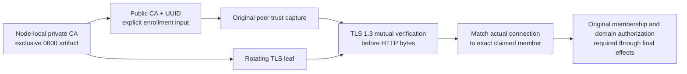

The root listener below mounts retained enrolled identities. Reviewed operator
join-token issuance, initial remote joining and outgoing typed command
forwarding are mounted below. Connection pools must be
scoped to the exact original enrolled trust, never reused for a successor CA.

`internal/cluster/enrollment` supplies the immutable owner and bounded wire
formats that those mounts use. An explicit owner retains up to 64 active
members, 256 permanent historical identities and 64 invitations in a canonical
512 KiB document. Invitations carry a random 256-bit secret; only its
purpose-separated hash enters the owner. Each invitation binds the original
cluster, writer term, exact target and absolute lifetime of at most ten minutes.
The secret-bearing wire format also carries the original issuer address and CA
for TLS verification before a joiner sends its proposal. Generic JSON encoding
of opaque invitations/proposals exposes no fields.

Acceptance verifies the prospective member's purpose-separated key-possession
signature, including the original invitation timestamps, and consumes the token
with member addition in one successor state. Revoked UUIDs and signing keys remain
permanent; issuing a new certificate around a retired key cannot restore it.
Revocation cancels earlier outstanding invitations for the target. Explicit
pruning removes expired invitation records only. Capacity exhaustion refuses
without pruning member history. Complete decoding and transition validation
reject missing, ambiguous, orphaned or rewritten history.

An opaque admission retains the original finite context, actual clock, exact
before/after digests, issuer and original certificate/invitation lifetimes for a
final memory-only check. Copies share the private terminal state; a refusal
permanently closes that admission. It is a
prepared successor, not evidence of a durable commit. The SQLite adapter stages
the whole owner under the original writer and retains the same check through
commit. Missing persisted history never becomes an invitation to initialize again.

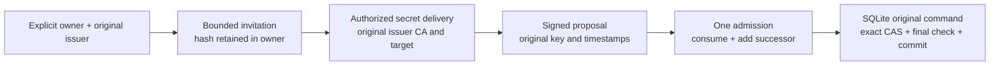

Schema 9 adds a single non-granting membership marker. Existing owned rows
refuse migration without adoption or replacement. The original startup command
converts only that exact marker to an explicit cluster-bound Dormant owner;
missing, orphaned or malformed rows refuse. The complete image requires
`member-enrollment-v1`, independently of its schema version, so old peers cannot
silently strip enrollment history. Private member keys remain node-local.

`enrollment/persistence` captures the original carried writer, complete owner
digest and memory-only operator check under an original deadline of at most
30 seconds. A capture is used once, including copies of its opaque handle.
Activation requires the actual writer's
member UUID; production assembly must supply its verified local private identity.
Issue, acceptance, revocation and explicit expiry pruning run in that command.
Only the actual successful outer commit permits delivery of an issued secret;
the adapter's returned digest and invitation are staged proposals beforehand.

The adapter writes one bounded complete row, then registers the driver's prefix
fence. A later mutation, including delete/reinsert of identical bytes, aborts
the command. Final possession checks retain the original invitation, certificate
and request lifetimes. Raw command writes also validate the complete owner
transition, and the legacy bulk lane refuses this prefix. Follower installation
and explicit conflict resolution compare original receiver history before
replacing any rows. A higher image revision cannot erase or resurrect members.
Unrelated commands do not read or decode enrollment state.

`CommandTx.StageEnrollmentPrimary` composes initial membership with the explicit
Standalone-to-Primary role transition. It requires the original Store-issued
complete source cut, an existing Dormant owner, the actual local private identity
and an original finite context. The caller authorizes inside the same transaction
and retains its original final proof checks and dependency pins. Activation runs
before mutations; the audit event is appended in that same command.

The driver stages the new role/incarnation after callback work and compares its
exact planned SQL authority while retaining the old memory authority through
final checks. Actual commit success publishes membership, role and one generation
notification together. Rollback preserves all old state and audit; uncertain
completion returns `ErrEnrollmentCompletionUnknown`, blocks the old writer and
wakes its dependents. Only a physical restart
may read durable authority again after that uncertainty. The old writer cannot
acknowledge success through a new incarnation; caller publication/output admission
is still required. This is a storage composition API, not a mounted operator route.

`Store.CaptureMemberRequest` supplies original admission for inbound enrolled
requests. Before body acquisition, it reads Primary authority and the complete
membership owner in one bounded transaction. Local and remote identities must
both be active, and the actual TLS verified chain must match the original peer
CA. The certificate admission retains immutable expiration and terminal state;
subsequent TLS-field changes and copied handles cannot renew it.

A request permits one image read or one `MemberCommand`. The command carries
the original writer into the transaction, compares the exact owner, registers
the postimage fence and checks the original peer again after every domain final
check. A separate command context cannot detach original cancellation. Waiting
for the writer lock retains the earlier original request/certificate deadline.
Domain authentication, current permission and external dependency pins remain
the caller's separate obligations. Membership is not administrator permission.

Only actual successful read/command completion issues an internal output state.
`WithOutput` compares the exact resulting authority/generation and original owner
under the writer lock, then holds it through emission and explicit transport
flush. Its context carries the earlier original request, peer certificate and
local CA expiration. The caller must install that deadline on the actual socket
and acquire all domain/publication pins before entering. Cancellation never
releases exclusion while the synchronous emitter is still running. A failed or
uncertain command, source interposition, revocation or copied-handle replay
cannot emit. Actual HTTP/1 and HTTP/2 mounts must flush protected bytes and 304
headers within this scope; protocol end-of-stream framing follows handler return.

`MemberCommand` followed by `WithCommandOutput` releases the writer lock between
completion and output, so any other commit in between is a source interposition
and the acknowledgment is withheld. `MemberCommandWithOutput` runs the same
output admission in the command's finalizer, after confirmed SQL completion and
before the writer lock is released. No other writer can then advance the
generation between a command's commit and its acknowledgment, and the peer is
not left with an unknown outcome for a command that committed. The exact
authority, owner, certificate and deadline comparisons are unchanged, and a
refused or failed output still reports the completion separately. An image
read keeps the two-step form: a newer generation must never be answered with
an older image.

`replica.NewMemberServer` mounts this boundary for the image and forwarded-command
HTTP paths. Root assembly (`prepareMemberServices` in `cmd/kudurru`) installs it
on the enrolled listener with the root command executor. The legacy `NewServer`
retains its explicit error-only authorizer and is not enrolled production admission.

The enrolled server acquires its concurrency slot and original finite deadline
before enrollment or body I/O. Both socket deadlines must be supported; body
acquisition uses the earlier peer/request deadline. Only the original Store
request supplies authority headers. Image and exact 304 output hold the Store
exclusion through explicit flush. A synchronous command handler retains domain
and dependency pins around `CommandService` with `SQLiteMemberAtomic`, then emits
inside `WithCommandOutput`. That scope requires an actual command receipt; image
completion cannot authorize a command acknowledgment. Dedup and domain changes
share the same original transaction. The root's scoped executor stages the
command with `StageSQLite` inside `MemberCommandWithOutput` instead, so its
acknowledgment leaves under the writer exclusion of the command's own commit.

`providercoordinator.WithMemberCommandOutput` supplies a separate bounded
composition for a trusted root domain callback. It holds publication, provider
resources and host exclusions in that order across one `MemberCommandWithOutput`:
the actual member command and its one Store-admitted output, which leaves before
the writer lock of that command's commit is released. The carried elected writer
must already match the original peer request. It does not substitute membership
or a subject name for raw user credentials. The callback verifies current domain
permission in the actual transaction, before effects or dedup reads.

The output context keeps the earliest request, peer, host and provider expiry,
and joins original peer cancellation even when the command has a separate parent.
The cancellation callback is reaped before dependency pins release. Root must also retain the original credential bounds and install the resulting
transport deadline. Output is synchronous and must explicitly flush without
reentering Store or acquiring another publication pin. The returned `committed`
bit records actual completion independently of emission failure. Ordinary
`WithCommand` and postcommit publication observations retain their existing
contracts. The scoped enrolled HTTP adapter below accepts this helper’s output context.
Production domain commands and listener startup remain root assembly work.

For an enclosing command/output coordinator, `MemberServer.ExecuteScoped`
accepts the already admitted emitter context and performs no second writer-lock
acquisition. `MemberRequest.CheckCommandOutput` checks a private context binding
to the same request, active output state, actual command completion and exact
resulting authority. Plain, foreign, image-only, canceled, extended-deadline and
escaped callback contexts cannot authorize response bytes. The transport checks
this context before and after bounded write/flush. The original command and
output-scope cancellations each interrupt active socket output by shortening the
write deadline, once. Callbacks are installed only after the original deadline
and joined before the output guard releases; a canceled buffered write cannot
start a flush. Selecting both executor forms is invalid.

`CommandService.StageSQLite` prepares domain changes and dedup inside the supplied
active transaction. Its result remains a proposal until the enclosing actual
member command succeeds. Ended transactions refuse staging. This connects the
coordinator to the enrolled HTTP adapter without nesting an output guard or
mistaking staged results for acknowledgments. The root supplies credential
handling and the bounded blocking domain described below.

Command envelope version 2 carries a bounded raw API token, session cookie or
compact JWT, including an optional original JWT provider selector. It carries no
verified principal, rights or lifetime. Version 1 refuses this field and retains
its existing wire shape. Password/TOTP and Kubernetes credentials are not part
of this envelope. The receiver must reverify the original bytes against current
transaction state before domain effects or dedup reads and retain the verified
credential deadline through output. Subject references remain claims to compare
with that verified identity. The raw proof is bound into the command fingerprint;
dedup persists only its digest and the outcome. Version-2 subject credential
references use the actual API token ID or a purpose-separated SHA-256 digest of
the exact typed cookie/JWT proof and original provider selector. Cookie/JWT
principals have no API TokenID, and an optional JWT jti is not required. Reference
equality alone grants nothing: it is compared only after current raw verification,
alongside the authenticated subject, provider and issuance time. Command/proof formatting and
structured logging redact secrets; explicit JSON is transport data and must
never be used for audit or diagnostic logging. Every additional root domain
requires its own current policy and typed execution.

`ReauthorizeCurrentForOutput` performs the same current raw-proof authorization
and final commit-time validation, then returns opaque `CredentialLifetime`
evidence. It retains only verified time bounds and the trusted verifier clock,
not raw credentials, the released view or the transaction's temporary context.
Under the original Store-issued output scope, `WithOutput` derives a child
context with the earlier original or credential deadline; cookies retain both
absolute and idle expiry. It checks time and cancellation around synchronous
emission. The transport must install that deadline and finish its cancellation
callbacks before releasing the enclosing output guard. Nil/unverified evidence
and unbounded contexts refuse output. This evidence supplies no permission or
completion receipt; output failure cannot undo a committed command. Enrolled
HTTP/1 and HTTP/2 composition uses the derived context without replacing the
private Store scope.

The root now supplies a closed `blocking.toggle` member-command executor. It
accepts version 2 only, requires an exact `Kudurru/default` resource version and
verifies the current `blocking.toggle` permission before domain effects or dedup.
Subject/provider/issuance and credential references must match the current raw
verifier. A derived authenticated context supplies actor and authorization-path
audit fields; neither peer claims nor raw proof enter audit metadata. The sender
must resolve relative timers before dispatch: the receiver accepts only a required
blocking Boolean and an optional absolute whole-second deadline, so delay cannot
restart a timer. It validates current effective configuration and stages the
canonical status and dedup result in the same concrete transaction. A command
whose `Kudurru/default` version is no longer current is a retained `409
conflict` outcome, as for a forwarded settings patch, which the follower relays
with its key; the follower answers a command it could not send, or whose
exchange failed, with the same `unavailable` and `completion_unknown` answers
as a forwarded object write.

The handler retains the original running writer, provider/host exclusions and
verified credential lifetime through one Store-admitted HTTP response, which
the Store emits before it releases the writer lock of the command's commit.
Writers that take no publication gate, such as status reconciliation, wait for
that response instead of withholding it. Exact
authorized duplicates return the retained outcome without reapplying their now
stale precondition; new commands must satisfy their original version, including
no-ops. The receipt reports actual completion with publication `pending`, and the
publisher is woken after the protected scope ends. The production internal
listener mounts this executor on `MemberServer`. Initial joining and operator
promotion are described below. Public blocking forwarding is mounted as described
below. The executor also accepts version-2 `objects.write` and `objects.delete`
commands: it decodes the forwarded normalized object, asks the public API server
for the exact command body its own `/objects` route runs, and executes that body
inside the member command transaction. The body's `authorize` callback
re-authorizes the original raw credential against the exact old/new scopes of
the object the primary reads, so the write, its audit row and the dedup record
commit together. A clean pre-mutation client refusal (`400`, `404`, `409`,
`412`, `413`) is retained as the command's result and relayed unchanged; any
other failure rolls back. Every public route that writes one canonical object
reaches this seam: the `/objects` routes, `POST /apply`, the `/blocklists`,
`/clientgroups` and `/policies` routes and `POST /{kind}:batchDelete`. The
follower starts one 30-second request lifetime for those routes and the four
zone convenience commands before it reads the body, because capture refuses an
unbounded request. Every other `POST`, `PUT` and `DELETE` under `/objects/` and
`/zones/` keeps the same bound on a follower, as it had before the forwarded
routes were named; `POST /zones/{zone}/notify` is the only registered one, and
it is not forwarded. An apply or batch delete sends one command for each
document or name inside that single request and reports one result for each
item. Every item captures the request's
original source again, so an item is refused, not applied and not replayed once
the lifetime has ended or the follower has installed a newer image (typically
its next pull, which carries the request's earlier items); the refusal names
which. A request that began on a follower stays a forward after its context has
ended: `ObjectForward` and `ZoneForward` answer that refusal themselves and
never hand the item to the node's local command, whose credential check would
report an expired session. A `zones.command` runs the primary's own zone route
function with its plan executed in the member transaction: the plan's sealed
requirements are reauthorized exactly as in `ZoneCommand`, and a plan whose
`Apply` started but did not finish always rolls back rather than being retained
as a refusal. A version-1 `auth.login` command carries no prior credential:
its payload holds the normalized username, password, factor code, client key, a
follower-prepared session ID and CSRF hash, and a random nonce. The primary runs
`IssueForwardedLocalWithAdmission`, which applies the same shared counters and
policy as its own login and enrolls the session with exactly that ID and hash;
credential refusals and lockouts are retained results whose counters commit.
The dedup record keeps only a fingerprint whose input includes the unstored
nonce, so it is no password oracle. A version-2 `auth.logout` command carries
the raw cookie or token proof and, for `DELETE /auth/sessions/{id}`, the path's
session ID. The primary verifies the raw credential in its transaction
(`AuthenticateCurrentSessionWithClock`), which also yields the session that a
verified cookie names: a sign-out revokes exactly that session, never a claimed
one, and a credential that is no cookie revokes nothing. A session revocation
applies the owner check of the primary's own route, and a session that is not
the caller's is a retained `404`. A credential that the primary no longer
accepts (the follower's view lags) is a retained `401`, except that a command
whose dedup record already exists is aborted, so a revoked credential never
recovers the outcome of its own sign-out. The result is emitted under the
command scope only, because the command may revoke its own credential. The
follower then pulls once and clears the browser's cookies; a sign-out that was
not sent or whose outcome is unknown also clears them and says that the
session may stay valid until it expires. A version-2 `settings.patch` command
carries the route's merge patch, its If-Match and a random nonce, with the
resourceVersion of the settings singleton in the follower's view as its
precondition. The primary refuses a stale precondition with a retained `409`,
then runs `ForwardedSettingsCommand`, which repeats the route's key, scope,
lock and value checks, merges the patch with the transaction's singleton,
checks branding against the transaction's pinned license and stages one write;
its object audit row is attributed to the original caller in the same commit.
Route refusals before the write (`400`, `402`, `409`, `412`) are retained; a
failed write rolls back. After a committed patch the follower pulls once and
answers when its published view no longer carries the version that the patch
was made against (at most five seconds, within the route's bound; a failed
pull or a later publication still answers the committed result). Without that
wait the caller's next settings change or blocking switch through the same
follower would carry the follower's own pre-commit version and be refused as
stale until the scheduled pull. A version-2 `auth.password` command carries
the current password, the factor code, the hash of the new password (the
follower checks the new password's rules and hashes it; the plaintext never
travels), `revokeTokens`, the client key, for a cookie caller a
follower-prepared session ID and CSRF hash, and an unstored nonce. The primary
verifies the raw credential, then runs `ChangeForwardedLocalPasswordWithAdmission`,
the admission of its own route (shared counters, current password, factor,
account manager) that enrolls exactly the prepared session; credential
refusals, lockouts and `managed_by` are retained results whose counters
commit. A version-2 `auth.tokens` command creates or revokes one personal API
token with the route's own body (`stageToken`, `deleteTokenCurrent`). For a
creation the follower generates the token and sends only its ID and secret
hash, because a retained outcome may not be sensitive; the primary checks the
staged row against that hash (`AuthenticateIssuedTokenCurrent`) instead of the
secret. A revocation keeps the owner or `tokens.delete` rule and its retained
`404`, and is emitted under the command scope only, because it may revoke the
token that sent it. For both commands a credential that the primary no longer
accepts or authorizes is a retained `401` or `403`, with the same dedup guard
as `auth.logout`. After a commit the follower pulls once and answers after its
own view serves the result: it seals the new cookie, or waits (at most five
seconds) until its view carries the new password hash, authenticates the new
token, or no longer lists the revoked one. A token caller's password change
that the view does not carry within those five seconds is answered from the
latest view for the original account, as the primary's own route answers from
the postcommit account; a cookie caller's change whose session the follower
cannot seal within the route's bound is answered `503
committed_output_unavailable` (the password changed; sign in with the new
one). A committed change is never answered `unavailable`, which means that
nothing was sent. Every one of these routes gets the 30-second bound before
body read. A mutation without a typed command is
refused on a follower, as described under
[What a follower does with a mutation](#what-a-follower-does-with-a-mutation).

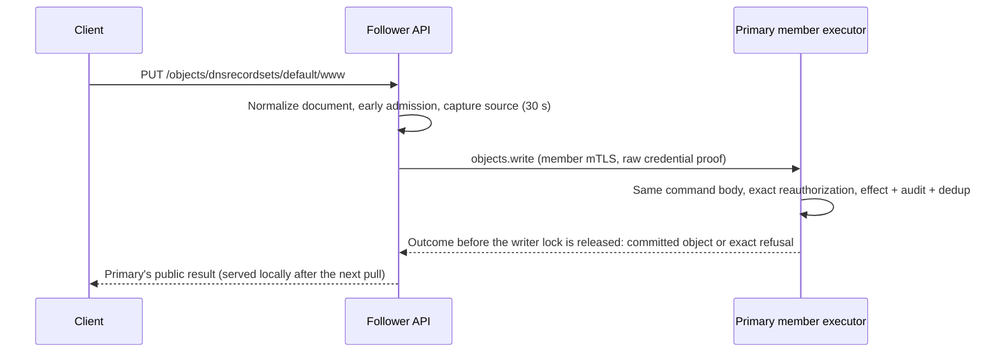

### What a follower does with a mutation

Every route with an unsafe method has one of three follower classes, kept by
operation ID in one table (`internal/api/follower.go`, decision D368):
`forwarded` (the typed commands above), `local` (the node's own cache, query
log, resolver and DHCP server, and the cluster commands that decide from the
node's own role) and `primary`. An operation that the table does not name is
`primary`. The class is attached where every route is declared
(`Server.declare`), so a route added later is refused on a follower until it
is classified, and an inventory test fails for any registered mutation without
a line in the table. The OpenAPI document carries the class as
`x-kudurru-follower`.

A `primary` operation gets a route middleware that runs after authentication
and the permission check and before the body is read. It asks the runtime for
the role of the request's own source: `servinghttp.SourceRole` reads the
authority that the request's lease captured before authentication, so the
answer cannot change during the request and no store is read. On a follower it
answers `503 primary_required` with the primary's name from that authority's
term, a hint and no `Retry-After`. Nothing is sent and no handler runs.
`GET /cluster` reports the same decision beforehand: `role`, `primary`,
`primaryRequired` and the operation IDs of the forwarded and local classes.
`GET /settings/_schema` marks a setting read-only when its PATCH route would
be refused.

The dashboard uses that report as a capability, as it uses `readOnly` in
static mode (`useClusterRole` in `dashboard/src/api/context.tsx`,
`dashboard/src/lib/follower.ts`). `useCan` refuses a permission whose every
mutating operation is outside the two lists, from a table of the
mutation-only permissions and their operation IDs that a test keeps equal to
the OpenAPI document; a permission that also gates a read is never refused as
a whole. An action under a mixed permission (an allow or deny entry under
`blocklists.write`, an import under `settings.write`) asks `usePrimaryOnly`
with its own operation ID. The disabled control's tooltip names the primary,
and a banner above every page says which changes go there. `GET /cluster`
needs `cluster.read`, which only the built-in admin role holds, so for any
other session (or when `/cluster` fails) the role and the primary come from
the public `GET /auth/status`, and the two lists from a build-time copy of the
`x-kudurru-follower` classification (`DOCUMENT_FORWARDED`, `DOCUMENT_LOCAL`;
a test keeps them equal to the OpenAPI document, and the dashboard is embedded
in the binary it describes). Only a session that holds `cluster.read` sends
`GET /cluster`, because the server audits every refused read as a denial; a
403 also ends that poll. The role is reread every 30 seconds (from whichever
of the two routes the session reads) and at once when a write answers
`primary_required`, so an open tab follows a promotion or demotion. The API
client reports every POST, PUT, PATCH and DELETE that the server answered
(`ApiClient` `onMutation`, with its method and path), however a page issues
it; on a follower a successful forwarded change (matched to its operation ID
by `FORWARDED_ROUTES`, a table a test keeps equal to the OpenAPI document) is
followed by one more refetch of the active queries after six seconds, the
follower's pull interval plus a margin. Sign-in, sign-out, a password change,
a read sent as POST (a DNS query) and the changes a follower runs itself
schedule nothing. Until one of the two reads answers, nothing is gated and the
server decides, except that a control that would open by itself (the `?add=`
link of the Allowlist and Denylist) waits for the answer.

The command seams repeat the answer for anything that reaches them on a
follower's request without passing that middleware (a route with a safe method
that still has an effect, or a handler called outside the API router):
`currentAuthCommandThen`,
`currentAuthCommandOutput` and `MigrationCommand` return the typed refusal
instead of a fenced-writer error when the request's source is a follower. OIDC
browser and CLI login are refused by their request admission, which runs
before the request holds a lease and therefore reads the Store's current
authority to choose the text. `POST /cache/flush` is `local`: on a follower
the command verifies the raw credential against the request's leased
authentication view (`AuthorizeOriginalTransition`), checks that this lease is
still the current publication, and flushes the node's own cache without a
transaction.

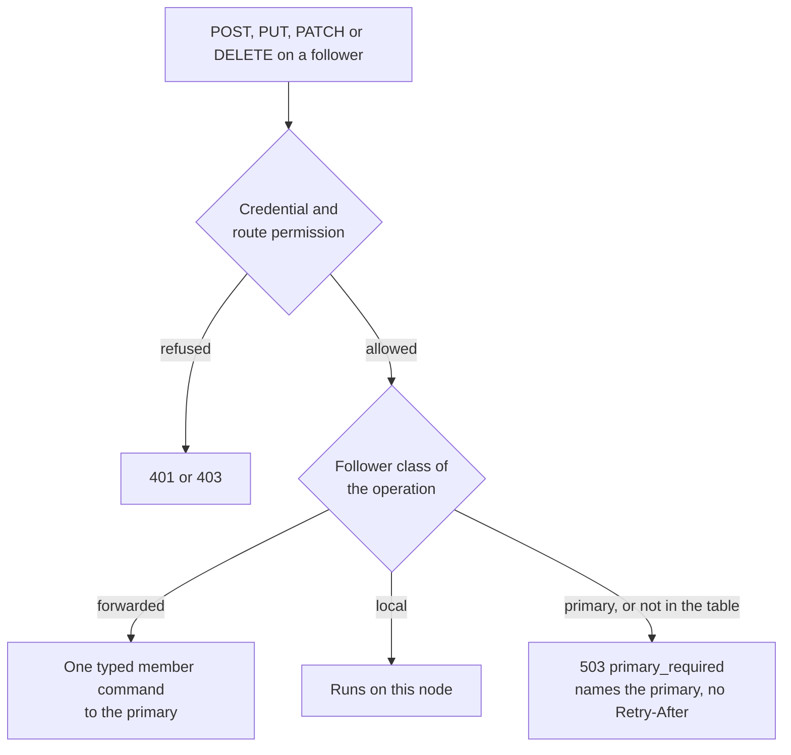

A member whose authority is fenced or in conflict publishes DNS-only data, so
no HTTP request gets a lease. The lease adapter answers those requests itself:
`503 cluster_fenced` or `503 cluster_conflict`, each with a hint and without
`Retry-After`, chosen from the publisher's authority observation after the
bounded capture wait. The provider-login admission, which runs before the
lease adapter, answers the same two keys from the same observation
(`servinghttp.AuthorityRefusal`). A publication that is only being prepared
keeps `503 generation_pending` with `Retry-After: 1`. The dashboard names
both states (`errorTitle` in `dashboard/src/components/Feedback.tsx`) and
links the operator documentation from the banner and the sign-in page.

The Nodes page drives the same reviewed membership commands as the CLI
(`dashboard/src/components/wizards/ClusterWizards.tsx`). Each wizard reads its
review (`GET /cluster/enrollment` or `GET /cluster/promotion`) once when it
opens, never refetches it behind the operator (the follower read-back skips
review queries), and sends exactly the values the operator confirmed:
ticking "I reviewed" snapshots the review on screen, "Read again" or
unticking drops the snapshot, and the finishing action validates every
earlier step again (the stepper can jump past the review step), so a re-read
review is never sent without a new confirmation. The commands are activation
of a dormant standalone node, an invitation from the primary with an absolute
expiry computed on the browser's clock when the operator issues it (at most
nine minutes, a minute below the primary's maximum measured on its own
clock), or the promotion of a follower with its reviewed installed
generation, the typed node name and one request ID per opening. A command is
sent once, and its dialog cannot be closed while it is in flight. A 409 (the
review changed; for an invitation also a name or address already used or
reserved, or an expiry the primary's clock refuses) or an answer that leaves
the outcome unknown (`completion_unknown`, `committed_output_unavailable`,
any other 5xx, a lost response or the client's 35-second bound) locks the
wizard; only a definite refusal before any commit (400, 401, 403, 413, 415,
429, and 503 `primary_required`, `cluster_fenced`, `cluster_conflict` or
`generation_pending`) can be corrected and decided again. The invitation is
requested with a plain call, never through the query or mutation cache, lives
only in the state of the step that shows it, and is dropped when its dialog
closes. `GET /cluster/anchors` is shown beside it with the documented action
for each state that needs an operator (`anchorAdvice` in
`dashboard/src/lib/cluster.ts`); a member whose API is closed is read with
its metrics or `anchors status --offline` instead.

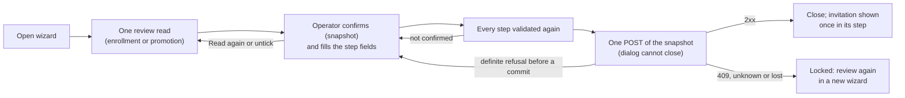

At startup, a SQLite runtime reads its complete enrollment owner and authority
from one bounded transaction. Explicit dormant enrollment retains the legacy
listener and creates no private identity. Enrolled history requires internal
credentials and the original mode-0600 `member-identity.json` under `node.dataDir`.
Missing, permissive, foreign or same-UUID replacement keys refuse startup. The
local CA must exactly match its active enrolled entry. This startup path neither
activates membership nor repairs state; first activation requires a restart to
mount the listener.

The existing internal socket selects member TLS only for the exact local
`<UUID>.member.kudurru.invalid` SNI. Each such handshake reads current complete
enrollment under a five-second bound and requires TLS 1.3 mutual authentication
against active peer CAs; session resumption is disabled. No active remote peers
means every member handshake refuses while the listener can still start.
Unknown member names refuse instead of selecting legacy TLS. Legacy status/list
traffic retains its own TLS credentials, token guard and routes. HTTP Host
cannot select either identity or route set. The enrolled path serves only the
member routes; it still requires the shared token in addition to actual peer TLS.

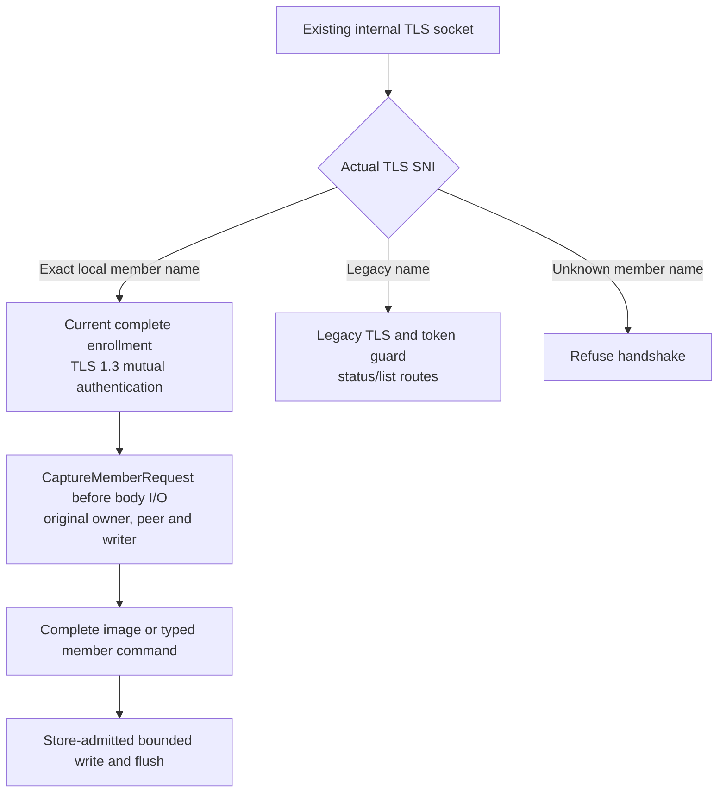

Handshake trust does not grant request or domain authority. The existing request
capture checks current local/remote enrollment and retains its original owner,
writer and certificate lifetime through effects and output. Revocation therefore
refuses subsequent requests on an established TLS connection as well as new
handshakes. Outgoing image installation is the follower worker described under
[Retained enrolled follower acquisition](#retained-enrolled-follower-acquisition);
the public commands a follower forwards are the ones listed above.

The output deadline also respects the original command expiration. Failed writes,
flush errors, lost original admission and callback failures abort the HTTP stream
rather than allowing handler-return buffering to emit protected bytes. After a
command dispatch, an absent acknowledgment leaves the client's outcome unknown;
it never triggers automatic replay. A command whose dial failed (the
connection was refused or the host was reported unreachable) was never
dispatched: `Client.Write` reports it as unavailable, not unknown, and a
forwarding follower answers that the change was not applied (D368). A dial
that is still pending when the exchange's deadline ends surfaces as the
context's deadline, not as a dial error, and stays unknown, as does every
failure after a connection exists (TLS, a dropped connection, a lost
response). Generic early refusals carry no current or
stale authority headers. Actual enrolled HTTP/1 and HTTP/2 tests cover the mount.
The operator and join routes, the root domain executors and enrolled startup
are described in the sections that follow.

`replica.NewMemberClient` connects those identities to image and command
exchanges. It requires the original resolver's exact member CA, rejects a local
UUID that does not match its private identity, and refuses custom transports.
Each captured exchange owns a TLS transport with connection reuse disabled;
a new enrollment at the same address cannot borrow an old verified connection.
The exact CA is verified before bearer credentials or a command body are sent.
Original certificate and request deadlines are checked again before authority
observation and before an image or command result can be accepted. No lookup
replaces the captured trust after a response. TLS alerts are authentication or
protocol refusals, not network-loss evidence for promotion. A POST alert or
cancellation after a complete result preserves an unknown outcome; the client
never dispatches a replacement command itself. An actual successful TLS handshake
against that original enrolled CA records authenticated contact even if the peer
then aborts HTTP without headers. Such failure clears the coordinator's missed-pull
window; it supplies no authority term, accepted image or success receipt. A failed
connection without that verified handshake remains network-loss evidence.

The existing `NewClient` is the shared-credential transport primitive used by
legacy tests; it does not establish independent member identity. The production
enrolled paths (follower acquisition, command forwarding, initial join and peer
authority observation) select `NewMemberClient` and supply the current
membership owner and final membership/output exclusions.

Peer-image acquisition captures its finite lifetime, local member and detached
token vector before resolving a peer. All body validation retains that original
bound; expired resolution cannot dial, and canceled completed bytes cannot
return an accepted image. Reads may try the originally captured rotation tokens
after a pre-authentication refusal. A command POST makes one credential attempt,
disables transport body replay and retains the earlier command expiry. An
ambiguous timeout remains an unknown outcome. These transport checks do not
replace member enrollment or enable primary/follower HA at startup.

Inbound peer requests start one finite lifetime before enrollment authorization.
The concurrency slot covers that synchronous authorization work as well as the
image or command handler. The same context and its earlier deadline reach the
transport and handler; successful authorization cannot restart the timeout or
dispatch after cancellation. Authorizers must honor the context and join their
work before returning. This admission boundary does not supply member identity
or replace the original command's final authorization checks.

The replication coordinator also starts its finite lifetime before waiting for
another pull, status read or promotion. Canceled waiters do not call the source,
publication pin or operator authorizer. The admitted operation retains that
context throughout; a late successful operator check cannot start promotion.
An expired status request reports no eligibility. Operator authorization now
returns the original verified proof's memory/clock check and its dependency
release. Both are mandatory. The coordinator retains that authorization and
the serving pin through `PromoteChecked`; SQLite checks the same proof on entry
and after every staged write, immediately before commit. Exact idempotent
success also requires that check. Expiry, revocation or cancellation rolls back
the transition without publishing a new authority or watch lineage. This is
commit admission: SQLite synchronization can outlast the proof's wall deadline.
The callback cannot perform I/O, acquire locks, read Store or adopt a successor.
Enrollment and the production operator route are separate mounts
([Reviewed operator promotion](#reviewed-operator-promotion)).

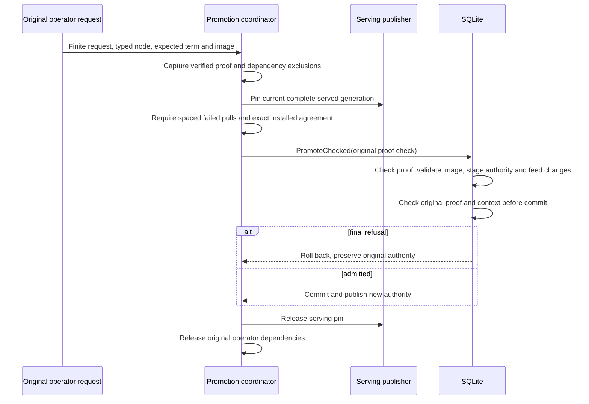

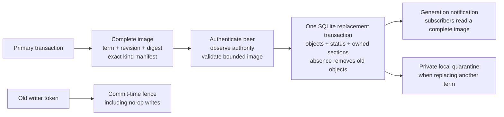

Images preserve source object resource versions, UIDs, ownership, statuses
and private documents. The receiver requires the complete registered-kind
manifest and all owned sections, verifies the digest and bounded strict JSON,
and validates copies without defaulting the source data. Node-local audit,
secondary/stub copies, query logs and response caches remain local. Cluster
settings have one designated owner, `Kudurru/default`; the image carries
an owner reference, not a second settings map.

Complete-image owner validators run after the generic envelope, row and digest
checks. They enforce cross-row inventories that individual row validators cannot
prove. SQLite repeats them before replica installation, serving-candidate
admission and promotion. Opening a database and reading its raw generation remain
available to explicit startup migrations; neither operation grants serving or HA
eligibility. Local mutation commands still enforce their own owner invariants.

Every mutation checks its captured member/term/incarnation token inside the
writer transaction. Observing an authenticated higher epoch durably fences
the old primary; equal-epoch conflicting promotions stop writes until an
explicit branch resolution. Failed fence persistence also blocks writes in
memory. A fenced or conflicted node publishes its last-good image as a DNS-only
bundle: DNS keeps answering from it, while protected HTTP, authentication and
writer work stay closed. The root anchor owner checks that candidate as the
DNS-only publication its token describes.

Branch resolution is a host-local offline operation, because a conflicted node
has no protected HTTP surface. `kudurru cluster resolution --offline` reads the
stopped member's authority, installed generation and recorded conflict or
divergence. `cluster resolve --offline` takes that saved review, rechecks it
under the exclusive database lock and calls `Store.ResolveAudited`: one
transaction quarantines the prior rows, keeps the reviewed image, allocates an
epoch above `MaxObservedEpoch` with this member as primary and inserts a
`cluster.resolve` audit row. A lost COMMIT acknowledgment is reported as unknown.
After restart, the member's scheduled peer exchanges fence the other branch,
whose next pull quarantines its own rows and installs the kept image.

The same transaction has one more entry condition (D369). A member fenced by a
higher term whose image it never installed, with no conflict or divergence,
reviews as `fenced_behind_term`. That member cannot be promoted, and a member
that refuses the current primary's managed trust-anchor branch stays in that
state indefinitely; if the term's primary and every member that followed it
are lost for good, nothing else could appoint a writer. `cluster resolve
--offline --abandon-term <epoch>` sets `ResolveRequest.AbandonTerm` to the exact
reviewed term. The store then requires `Fenced` mode, no conflict or
divergence, that exact term, an installed image of a lower epoch and the
member's own installed image as the kept branch; anything else is
`replication.ErrCAS` with nothing written. The kept owner is unchanged, so the
member's trust anchors, revocations and node-local denials carry into the new
term as they are. The audit row's authorization names the abandoned term.

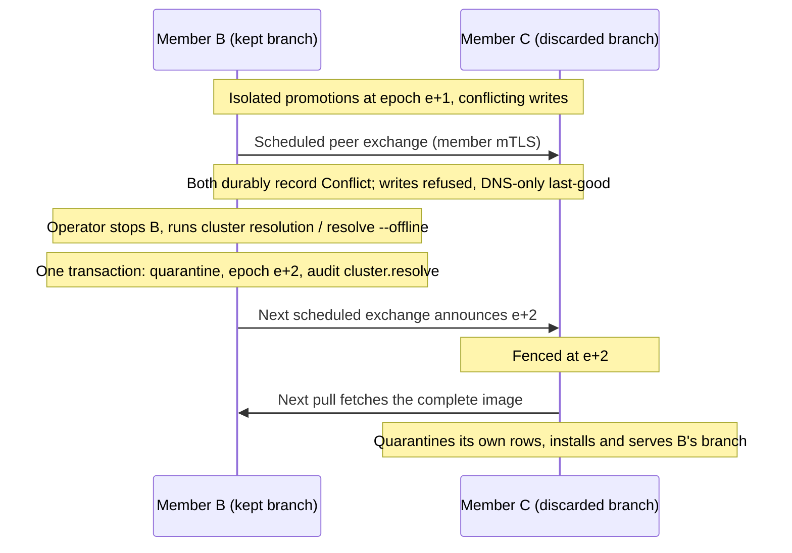

SQLite uses `synchronous=FULL` for all writer connections, including
reconnections and standalone databases. Restoring a public backup remains an
apply operation subject to the same writer fence.

`sqlite.Command` runs current authorization, staged reads and writes in one
fenced transaction. It also accepts up to 16 final checks of already pinned
immutable dependencies and the actual clock. Those checks run after the callback
and complete-image validation, immediately before commit or a successful no-op;
a denial rolls back object, security, audit, receipt and revision changes together.
Checks cannot access the ended transaction or acquire publication/provider locks.
Callers retain dependency replacement exclusion through the entire command.
Forwarded command envelopes register their expiry check after the domain's
checks, so callback success cannot authorize a later expired commit or dedup
response. Exhausted final-check capacity refuses and rolls back the command.
This defines admission time; wall time may still advance while SQLite syncs.
External enrollment registers a final proof check so a JWT that expires during
later command work cannot create a session.

An accepted replacement rotates the local watch lineage and closes old
watches; object resource versions remain those of the source. Consumers that
need a coherent generation must subscribe before `ReadGeneration` and publish
one prepared bundle, rather than combine independent kind watches. Manual
promotion requires coordinator checks in addition to the store's atomic CAS.
This is epoch fencing after reconnection: two partitioned primaries can both
accept writes after a manual promotion. It is not a consensus protocol.

A schema-2 database cannot be opened by a schema-1 binary. Preserve a backup
from the earlier binary before testing an upgrade; rollback uses that backup.
Recovery images can contain credentials and are neither public backups nor
ordinary object exports.

## Cluster settings object foundation

`Kudurru/default` supplies the canonical object shape for v0.2 cluster settings.
`spec.settings` has a nested structural schema generated from `config.Schema`
by `hack/settingscrd`; `make generate` refreshes it before copying the CRD into
the chart and store validator. Node-scope, host-only, and secret settings are
excluded. A public settings object cannot name listener files, replace host
identity providers, or change audit storage. The store and real Kubernetes
admission tests exercise the same generated fields.

`config.ApplyClusterDocument` prepares a complete configuration from that
object and local host inputs. Omitted public keys return to compiled defaults,
so deleting a key cannot retain an older generation's value. Environment locks
retain their local values; canonical input is validated even when a local lock
would override it. Initial seeding does not distribute a node's environment
values. The host and source document remain unchanged during preparation.

SQLite startup now seeds a missing singleton in the same actual command that
initializes private runtime manifests. It captures only public cluster settings
from the primary's existing effective configuration; environment-locked keys use
compiled defaults. A present singleton is preserved exactly on later starts,
including after host configuration changes. Followers never seed it locally.

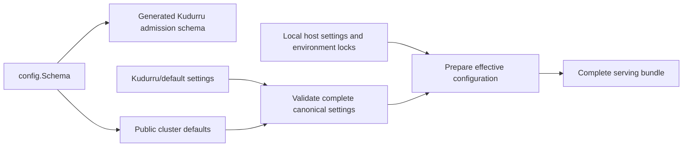

The object also carries absolute blocking-disable state in status: an optional
`disabledUntil` requires `disabled: true`; an absent deadline means indefinite.
Expiry never restarts with a process.

The optional canonical API adapter now reads settings and their schema values
from the original complete HTTP lease. It validates a merge patch, then writes
only named public keys to the actual singleton through current raw authentication,
the original writer and complete dependency exclusion. A stale request cannot
overwrite a newer configuration; identical writes still cross final credential
and writer checks. Map merges and null resets preserve the API's existing behavior.
Successful PATCH replies acknowledge durable desired values. Subsequent serving
reads wait for complete publication; the adapter never writes the legacy file or
changes the independent reload pointer. Actual HTTP/SQLite tests cover these
paths. SQLite `serve.go` mounts this adapter with the complete HTTP owner;
Kubernetes retains its existing settings writer.

SQLite generic public object GETs and their aliases read the original HTTP
lease's object set. Detail responses retain that object's UID and resourceVersion;
record permissions use its captured zone reference. Pagination binds the complete
generation and normalized query, applies authorization before cursor keys, and
returns 409 when a later request changes either binding. It does not keep old
images alive across page requests. Compiled blocklist search uses the same
captured list bodies and modes; missing compiled data returns 503 even if a live
cache or inline source could answer. Kubernetes keeps the existing read path.

Domain, Allowlist and Denylist GETs project entries, list exceptions, group
scopes, policy references and unattached managed policies from that same original
image. Match summaries use its compiled lists. An inactive exception retains its
original list/source identity and policy references; external source rules open
only the captured digest receipt. Missing capabilities or receipts return 503
without a live Store, cache or body fallback. Domain and unblock pagination bind
the normalized request query, page size and whole publication identity, including
dependency replacements at an unchanged canonical generation; changes return 409.

Unblock GETs retain the complete image's workflow rows on the runtime owner,
separate from the DNS object roster. Rows, state counts and pending expiry use
those original objects and canonical settings. The original auth view evaluates
its finite unblock entitlement against the current clock before returning a
response: times before its lower bound or at its exclusive deadline deny with
402, even after a live renewal. Read projections grant no decision authority;
mutation responses continue to use their exact committed command results.
Kubernetes keeps its existing Store/index, configuration and license read paths.

Catalog GETs read the original blocking view, report actual acquired base/import
provenance, and omit live refresher status. Services, categories and safe-search
entries use that same catalog; missing owners return 503 without a Holder
fallback. Policy state uses the original objects, canonical settings, catalog and
compiled list owners together. Text/RPZ counts describe acquired data; RPZ expiry
clears readiness without erasing diagnostic counts. The desired object's
Conditions remain historical receipts. Schedules and expiry share one observation
time; traffic statistics remain explicitly historical query-log reads. Public
reads are still migrating route by route: enabling these capabilities does not
convert the remaining runtime diagnostics.

Blocking GETs use the original blocking view's canonical settings and absolute
deadline at one observation time. A held request keeps its original state after
a replacement; exact timer expiry reenables blocking without writing a new
receipt. Configured-off and indefinitely disabled states omit a resume timer.
These cluster-scoped responses never fall back to the legacy local toggle.

Blocking POSTs reauthorize the original proof for cluster `blocking.toggle` and
update only `Kudurru/default.status.blocking` in the current command. No-ops retain
the same final credential and writer checks. A 200 response waits for a complete
publication containing the exact committed settings UID, resourceVersion and
status, then evaluates its blocking view at one response time. The original
writer binding remains in force during this observation, outside transaction and
dependency locks. The retained dependency predicate excludes the old image
revision, which the command's own commit supersedes; original host, provider,
catalog, key and managed-anchor dependency checks remain required. Other users
of the old image still fail its full currency check. If commit succeeds but publication cannot be acknowledged, 503
includes a `committed: true` hint and the exact receipt; it does not imply rollback.

Enrolled followers intercept this POST before body acquisition. One Store-issued
`MemberForwardRequest` retains the original complete HTTP token, local CA and
30-second request lifetime; copies share one consumption. After decoding,
publication, provider, host, auth/DNS key, catalog and transferred-owner exclusions
surround the exact Store membership/source exclusion, one member-mTLS POST and
public response flush. Queueing never replaces the source. Original credential,
provider, host-entitlement and certificate bounds shorten actual I/O deadlines.
The primary independently verifies the raw proof and original settings version;
there is no mutation replay, redirect, fallback or local image installation.

An authenticated complete primary receipt becomes HTTP 202 with `committed: true`
and `publication: pending`. It does not assert this follower's serving state.
Clients use a subsequent GET for that observation. Dashboard receipt handling
invalidates the local observation without replacing it with requested state;
the CLI reports pending publication. Failed/expired output may follow a real
commit, so clients must not interpret loss as rollback or automatically retry.
Canonical object writes, four zone commands and local password login use the
same member transport with their own typed executors (described with the root
member-command executor above). A mutation domain without such an executor is
not forwarded.

```mermaid
sequenceDiagram
    participant U as Original HTTP request
    participant F as Enrolled follower
    participant P as Enrolled primary
    U->>F: Capture complete source and finite attempt before body
    F->>F: Decode#59; pin publication, dependencies and original membership
    F->>P: One mutual-TLS command with raw proof and absolute intent
    P->>P: Current authorization, version CAS, effect/audit/dedup commit
    P-->>F: Authenticated committed receipt#59; publication pending
    F-->>U: Flush HTTP 202 under original exclusions and bounds
    F->>F: Release#59; later independent pull and complete publication
```

Persisted deadlines have whole-second precision. Relative timers round up to the
next UTC second, adding less than one second; fractional absolute `until` values
are rejected. Neither publication waits nor restart renews the deadline. Enabling
the toggle clears its temporary disable but does not override configured-off
blocking settings.

Source-entry GETs authorize the original BlockList and retain its inline values,
structured entries, parser settings and exclusions. URL and ConfigMap bodies
open only the digest named by that captured source's receipt. The adapter verifies
the regular file, exact size and full SHA256 before parsing, with a 64 MiB body
cap and the existing four concurrent scan slots. Cache replacement preserves an
already open descriptor, but may discard a digest before it is opened; that
request returns 503 instead of reading a newer body. These responses omit the
uncaptured local fetch time. RPZ feeds are not line-source bodies and return 422.
Continuation tokens bind the exact generation, object UID/RV, source, parser
inputs and query; changed observations require restarting pagination.

Source-entry PATCH uses the existing current object command for one transaction:
it reauthorizes the original raw proof, reads the exact list and source, checks
If-Match and ownership, then validates and stages the edit. Inline additions and
removals, structured enable switches, and URL/ConfigMap exclusions retain their
existing parser semantics. No-ops also check current authority, manager ownership
and final credential/writer validity. Bootstrap lists follow the same API
takeover rule as whole-object PUT. RPZ feeds return 422. Cache effects run only
after commit, and no failed command retries against a successor or a live Store.
The returned resourceVersion identifies the durable edit; serving reads observe
it after complete publication.

Upstream diagnostics retain the original request's resolver-set membership and
sample that set's local health, failures, backoff and RTT. Those operational
counters can advance during a held request; they are not frozen publication
metadata. Local, central-history and self-shard stats paths use this same reader.
A failed local sample remains an explicit failed node in partial cluster results;
remote peer samples and traffic history retain their separate scopes.

SQLite zone record upsert/removal, BIND import and cascading zone deletion now
plan and apply within one current command. Each plan seals the original
transaction, target and complete permission set. Imports require zone creation
permission only when creating a zone, and record deletion permission when
removing stale API-owned import chunks. Cascade and dry runs check every current
reference and owner before staging any change. Even an unchanged write, dry run
or missing-result response crosses current proof and final-time admission. Cache
flush and aggregate audit reporting occur after the command; per-object durable
audit remains transactional. Actual server tests cover native DNS publication
and restart after these commands.

SQLite unblock approval, denial/revocation and deletion now enter a closed
current command. The original raw credential requires only
`unblockrequests.decide` (or `delete`) on the request. Its current UID/version
binds the derived allow entry, matching policy references and shared-entry
ownership transfer; the delegated grant cannot write arbitrary lists or
policies. Every affected manager and bounded effect is checked in the same
concrete transaction. The pinned original requests entitlement and credential
clock are checked again at final commit. Cache invalidation covers all name
scopes and fences detached fills after commit, outside transaction/owner pins.

The SQLite unblock janitor uses a separate elected system command with the
original writer episode and full dependency exclusion through commit. It reads
pending-expiry and retention policy from the canonical settings row in that
transaction, merges it with the pinned host configuration, and atomically
releases entries, transfers shared ownership, expires statuses or prunes
requests. Cleanup still runs after license loss. It rebuilds from durable rows
on restart and performs no network work or precommit index/cache effects.

SQLite domain, Allowlist, Denylist and query-log allow/deny commands plan their
complete list and policy edits from one bounded current transaction inventory.
The sealed plan retains the existing cluster `blocklists.write` delegation for
policy references and empty-list cleanup. All candidates pass manager and schema
checks before any staging; a failed batch item discards its detached edits.
File/integration policies remain skipped. List exception discovery opens only the
original captured body receipt before transaction/owner pins, then checks the
original list UID/resourceVersion in the current transaction. No-op, deduplicated,
missing-result and item-error-only responses retain final proof expiry and writer
checks. Cache invalidation and aggregate audit run after the transaction commits.

SQLite migration adoption and imported settings use the current planners
described above. Generic object commands retain their own current admission.
Generic apply/batch-delete retains its independent per-item result contract. All
items retain the original HTTP lease, so a first commit can make later items
stale; no successor capture or atomic-batch guarantee is implied.


## Complete serving publication

`internal/serving` prepares one whole immutable bundle from a complete SQLite
replication image. The required component manifest includes objects, zones,
policy, global controls, resolution, response processing, cache behavior,
blocking, inventory, authentication and runtime data. Owner preparation must provide every component
with the same canonical generation and verified dependency identity. An error,
panic, missing component, changed dependency or stale generation retains the
entire previous bundle. Readiness and the API then report only that the
generation is unavailable (`prepare_failed`, `generation_pending`); the
server log names what the candidate failed on, once per failure, and says
when a generation is published again (`complete serving generation not
published`). The store refuses the zones it knows the image cannot build
when they are written, and the builders leave out a record set endpoint or
block list source they cannot use instead of failing ([The store](#the-store)).

SQLite issues an opaque token in the same read transaction as the image. The
publisher checks that token under the SQLite writer barrier before swapping one
pointer. Compilation, downloads, and resource retirement happen outside that
barrier. `zonecache.Prepare` supplies strict complete-object view preparation
without watches or per-builder last-good substitutions.

`ReadValidatedServingCandidate` retains complete local validation with that same
transaction's token. Provider reconciliation projects defensive copies of this
checked image; arbitrary candidate capture still performs Store validation.
Neither the checked image nor its projections grant publication authority.
Public CRD spec/status validation can reuse a successful exact encoded-object
fingerprint within the immutable Validator's 256-entry FIFO. Keys include the
kind and validation modes; the cache retains no documents or decoded secrets,
and failures are never cached. Strict decoding, source metadata, complete-image
digests and sections, private owners, custom validators and current authority
checks still run. Write admission and defaulting retain their original methods.

Requests hold leases. Replacement releases the publisher's reference, while
old pools and other resources remain alive until the final request or stream
releases its lease. DNS capture needs no database read and may use last-good
data during preparation or fencing. Protected HTTP capture also checks the
in-memory authority and dependency cursors and fails closed while publication
is pending. The HTTP listener waits up to two seconds for its first eligible
lease before authentication or handler dispatch; timeout still returns 503.
It never replaces a held request lease or replays a command. Explicit fenced
DNS-only publication cannot open authentication,
readiness, or promotion. Promotion pins the actual serving bundle through its
commit, then releases the pin before waiting for new-term publication.

Background recovery uses `WithWriterGate` with an exact writable term and local
incarnation. It holds the same publication/promotion exclusion even when no
bundle exists or a newer image is pending; it grants no HTTP read eligibility.
The callback next pins current dependency replacement and retains both gates
through the actual fenced command. It releases them before waiting for serving
acknowledgment, so startup recovery cannot deadlock on its own publication.
Publication acknowledgment never wakes or cancels the preparer: committed
source and dependency changes already schedule that work. Pending waits observe
publication or authority changes, avoiding a feedback loop between the driver and publisher.

```mermaid
flowchart LR
    Image["Installed complete SQLite image + token"] --> Prepare["Prepare every owner and exact dependency"]
    Prepare --> CAS["Writer barrier: token + dependency check"]
    CAS --> Bundle["One Served bundle"]
    Bundle --> Leases["DNS / HTTP / stream leases"]
    Bundle --> Pin["Promotion publication pin"]
    Leases --> Retire["Retire after final release"]
```

### Requests with several items

A current command of an HTTP request is admitted only while the request's
original lease is still the current publication, in memory and again at the
final commit check. A command's own commit retires that lease, so a request
can run a second command only when it says so. Two routes do: `POST /apply`
and `POST /{kind}:batchDelete` run one object command for each document or
name (D378). `ObjectItems` gives such a request one command chain of the
provider coordinator, which keeps the mark of the last command that changed
canonical state through it.

Until one of the request's commands has completed, every command is admitted
on the original lease, exactly as a single command is. The first completed
command anchors the chain: on its own commit receipt, which the Store issues
in the command's finalizer under the writer lock (`sqlite.CommandReceipt`), or,
when it changed nothing, on the mark that the coordinator held at that moment.
Each later command is admitted under the publication gate only if the
coordinator's mark is still the chain's anchor, and it moves the anchor to its
own receipt when it commits a change. The compare is by identity of the mark,
and every command through the coordinator installs a new mark when it changes
state: public API mutations of any credential, including sign-in, member
commands forwarded from followers, operator-started integration operations,
migration steps and the unblock-request sweep. A command whose SQL outcome is
unknown installs a mark that no chain equals. Writers that take only the Store
lock or the primary pin install none: status reconciliation, the zone
lifecycle and its committed heads, which is also how an RFC 2136 update
commits, list fetch status, integration reconciliation, the local admin
socket, the RoleBinding objects source, the login-lane request charge and
provider authority admission. They are not detected. Most are the node's own
follow-up work, but an RFC 2136 update (a TSIG client) and an admin socket
command (an operator) act for someone else, and a request does not stop for
them; an item reads nothing they write except in its own transaction.

Every commit retires the publication that every other API request is bound
to, until the node has published again. A request's items commit back to
back, so without a bound the node would have no current publication for
other callers for the whole request. DNS does not wait for it: an ordinary
answer from local, authoritative or mixed data is bound to the publication
that is served (`Publisher.Serves`, or for one second after the swap that
replaced it, a publication that was served when the query arrived,
`Publisher.ServedWithin`, D395), not to the latest commit, and its
dependency check (`RuntimeOwner.DNSDependenciesCurrent`) covers only what DNS
answers are computed from, the root lifetime, the DNS keyring and the
transferred and catalog zone data, not the provider host, the license cut or
the provider resource set that only HTTP authentication uses. A published
successor retires the old answers for every query captured after the swap,
and one second after it for a query already in flight, so no query that
arrives after a change was published gets older data. Transfers, UPDATE
acknowledgments, API
dig, cache insertions and native resolver mutations keep full data currency
(a superseded cache or native resolver write is skipped, and the query still
answers; D332, D377).

Before a later item the request lets the node publish for other callers: it
waits, inside its lifetime and writer episode, until the publisher is current
again (`Publisher.WaitTerm`), and then commits nothing for 200 milliseconds.
It does so once its items have run for two seconds since the node last had a
current publication for it, and at once when another caller's read (`GET` or
`HEAD`) waits for a publication in the HTTP listener's two-second capture wait
(`Publisher.AwaitHTTP`), as long as the request has not spent longer in its
waits than in its own work. A waiting write is not counted: it would usually
commit in the pause and stop the rest of the request. The wait is bounded: it
starts at two seconds, doubles after a wait that ended without a publication,
is twice the last publication's time after one that came, and never exceeds
ten seconds; the work between two timed waits is at least as long as the next
bound. A wait that reaches its bound goes on without the publication and
without the rest, so the pace makes a request at most about twice as slow. A
read is served within its capture wait whenever the node publishes within it;
a node that needs longer (a large data set, or the race detector on a loaded
machine, where one publication of 120 record sets reached ten seconds) still
refuses it with `503 generation_pending`. The pace captures no new lease: the
chain's compare still decides, so a command that another caller commits in
the pause stops every later item.

A chained command whose anchor has moved is refused as `unavailable` ("another
change was committed on this node while the request ran"). It does not run,
and no later command of that request can be admitted again; the request still
answers 200 with one result for each item. In place of the retired lease
comparison, a chained command checks the original elected writer episode and
that the Store's authority equals the lease's own authority in every field
except an advanced installed revision. The lease's dependency installations
are not compared again: the node replaces them on its own schedule, for
example whenever the provider resource owner installs a new resource set, and
each command pins the installations that are current when it runs through its
commit. The raw credential, grants, ownership, preconditions and limits are
read again in each command's transaction, so nothing is decided from the
retired image. The request's one lifetime bounds all of its commands, and an
item reached after it ended is answered as such. A follower forwards each item
as its own member command and keeps its original-source rule; its chain is
never used.

```mermaid
flowchart TD
    Request["One request: original lease, credential and lifetime"] --> First["Item admitted on the original lease"]
    First -->|refused cleanly| First
    First -->|completed| Anchor["Chain anchored: own commit receipt, or the current mark for a no-op"]
    Anchor --> Pace{"Items ran for their budget, or a read waits?"}
    Pace -->|no| Next["Next item under the publication gate"]
    Pace -->|yes| Wait["Wait (bounded, 2 to 10 s) for a current publication; if it came, rest 200 ms"]
    Wait --> Next
    Next -->|coordinator mark is the anchor| Run["Reauthorize in transaction, apply, move anchor to own receipt"]
    Run --> Pace
    Next -->|another command changed state| Stop["unavailable for this and every later item"]
    Follow["Status, zone lifecycle and other ungated writers"] -.->|advance the revision only| Next
```

The DNS adapters capture one lease before identification and read typed policy,
zone, inventory, control, resolver, response, cache and blocking views from
that lease.
Missing owners fail closed. Alias and DNS64 subqueries inherit the capture;
detached cache work clones its lease and fences late fills against retired
resolver/cache incarnations, including A → B → A changes. Transfers hold the
lease until consumption or explicit response cleanup, including streams never
iterated. UDP, TCP, DoT, DoH, DoH3, DoQ and the API query caller release cleanup.
The explicit transfer adapter reads the captured zone set; its legacy live-set
entry point is rejected once capture is installed.

`internal/servingbuild` now supplies all required concrete owners. Its local schema
includes every registered public and private kind. Primary lifecycle and auth
consume the complete image; the public DNS object projection includes only
`zonecache.DefaultKinds`. It applies canonical settings against captured host
settings, compiles exact-digest complete list bodies against the matching catalog,
and binds acquired zone runtimes to the captured immutable keyring. Inventory has
an explicit empty owner when no claims exist. A dependency cursor changing during
preparation rejects the entire candidate and releases its resources exactly once.

```mermaid
flowchart TD
    Candidate["One validated complete image"] --> Primary["Committed primary lifecycle and heads"]
    Candidate --> Auth["Public/private IAM and durable security"]
    Candidate --> Objects["Public DNS objects and canonical settings"]
    Local["Pinned keys, catalog, inventory and acquired runtimes"] --> Zones["Credential-bound serving zones"]
    Primary --> Zones
    Objects --> Owners["Policy, control, exact lists, resolver, response and cache"]
    Local --> Owners
    Auth --> All["All required real components"]
    Zones --> All
    Owners --> All
    All --> Publish["Whole-bundle publication barrier"]
```

`BindDNS` connects every stage to the outer request lease. Prepared primaries are
never marked published by the builder. Resolver pools and auth resources remain
alive through held leases. The current implementation allocates new resolver and
cache incarnations for each candidate; reuse of unchanged semantic owners remains
a scale optimization.

The publisher, builder, store barrier and DNS/HTTP adapters are tested against real
SQLite publication, concurrent owner changes, missing list bodies, rollback,
retirement, restart, replica installation, promotion and native UDP/TCP listeners.
The root SQLite assembly now connects providerhost, coordinator, complete
publication, current command pins, primary driver and status projection. Its
always-on workers perform acquisition and publication on every role. Provider
acquisition subscribes to source, authority and host changes before reading and
retains those subscriptions through the next wait, including changes during
resource release. Successful reconciliation waits for those notifications,
resource changes or the original host deadline; only failed attempts use the
bounded retry timer. Complete-image validation and final token checks still run
on every reconciliation; the provider projection retains the Store read's
validation result instead of repeating it. A separate writer entry retains the
original elector token, resets provider floors, reconciles the startup
config-provider manifest and joins old work before replacement.
License and manager/catalog/key changes wake complete preparation. Native signed
UPDATE, license replacement recovery, follower restart/promotion and joined
shutdown are tested through this assembly. A newly enrolled follower remains
running but unavailable while awaiting its first replica. Concurrent follower pulls retain their original
finite context while waiting for serialized acquisition. Cancellation releases a
queued caller before source or anchor acquisition and does not change the active
pull's contact status; the admitted pull keeps exclusion through installation.
The internal listener recognizes only the exact enrollment migration sentinel
with no installed generation or installation history on a read-only receiver.
It keeps ordinary listeners running, without issuing member trust or creating
identity files. Missing, malformed or previously initialized enrollment still
fails startup; first activation of member routes requires restart. The same runtime
publishes after a valid installation without initializing local owner roots;
malformed installed owner inventories still fail startup. SQLite `serve.go` now
mounts this assembly into the actual DNS and HTTP listeners. Readiness uses the
protected complete publication; followers skip local bootstrap and file loading.
A pending Preparing lifecycle carries the freshly observed source token into its
Fencing CAS, so a controller status update cannot strand it on an older resource
version. The transaction still validates exact source, membership and writer
authority.
The runner joins elected and always-on workers before borrowed resources close,
even when its shutdown diagnostic timeout expires. Kubernetes retains its
existing serving path. Peer transition exclusion and three-process partition/rejoin
acceptance remain integration work.

Published canonical settings also drive operational consumers: ingress rate
limits, query-log privacy/retention, block-page rendering and response-cache
capacity. This watcher subscribes before capture, detaches the configuration
while holding the complete lease, and applies it after releasing that lease.
It does not replace captured DNS owners or update the legacy settings file/pointer.
DNS settings continue to take effect through complete publication.

`GET /node/config` remains a local configuration-document read. SQLite PATCH
serializes local changes, remerges only requested `log.level`/`log.format` leaves,
and reauthorizes the original raw credential for `node.config` in its original
current-writer transaction. A bounded, versioned metadata row in `state.db` binds
the optional preferences to this host's node name. Local stages share the final
writer, dependency and credential-clock checks, rollback and commit boundary
with authorization. A local-only commit does not change the canonical revision,
object feed, complete serving cut or replicated image. Object snapshots omit it;
replica installation preserves the receiver's local row and never imports the
sender's. There is no settings-file write or nested legacy transaction.

The priority is defaults, then durable API preferences, then explicitly declared
node-file log leaves, then environment values. A set of a declared host leaf
returns `409 host_locked`; an environment override returns `409 env_locked`.
PATCH `null` deletes that overlay leaf and restores its captured original host
baseline. Reset can remove a dormant preference under a host/environment lock
without changing the effective host value. Startup reads the bounded metadata
read-only before constructing the logger; a missing database remains lazy, a
record for a different node is not adopted, and malformed/future records refuse
startup. Cluster refreshes retain the original local baseline and leaf locks.

The command is primary-local: an eligible follower can read its own document,
but PATCH returns 503 without forwarding to another node. Successful SQLite
receipts report `Persisted=true` for node-local durability. `log.level` updates
the actual logger level; `log.format` remains restart-required and changes the
handler only on restart. SQLite commit precedes local adoption and acknowledgment,
so cancellation after commit may return an error after durable acceptance. A
later admitted command reconciles any committed preference still pending local
adoption. No receipt claims a transaction spanning SQLite and the local logger.
The legacy Kubernetes path retains its explicit memory-only receipt. The local
document is not part of the captured DNS installation.

Installed data is never reported as Served
merely because its database transaction completed. The disconnected-primary
limitation remains: a former primary can acknowledge writes until it learns of
a higher term; this publication mechanism does not provide consensus.

Unsupported node-write capabilities keep node values and schema readable but
return `501 read_only` for node PATCH sets and null resets. Schema `readOnly`
marks those node rows so the dashboard directs operators to host configuration;
cluster rows remain independently editable. SQLite uses the durable original
command described above. `/settings` remains cluster-only: `scope=node` is
refused, and supported node changes use `/node/config` with its existing
permission and CSRF checks. Capability metadata does not bypass final primary,
credential, host-lock or writer checks.


### Direct CLI access to public Kubernetes CRDs

Explicit CLI Kubernetes transport uses a restricted Get/List/Apply/Delete/Close
facade over the original uncached driver. Public resource paths and scopes come
from shipped CRDs, avoiding context-free discovery or unrelated watch permissions.
The ordinary server constructor still uses dynamic discovery and starts its
original informer runtime. The CLI facade starts no background work and exposes
no private kinds, election, snapshot or watch capability.

A direct apply carries the original observed version or absence into normal
manager-api admission. Delete retains the original UID/version precondition and
returns a conflict instead of reacquiring a replacement. Kubernetes credential,
namespace, impersonation and RBAC semantics come from one explicit kubeconfig
selection. HTTP contexts remain separate. Listing/response/document and original
command-time bounds fail visibly; CRD describe never calls a server diagnosis API.


## Encrypted TSIG source ownership

Private TSIG records store purpose-separated authenticated ciphertext bound to
cluster, actual storage UID, canonical name, algorithm and credential epoch.
Safe backups exclude these credentials; full backups preserve the ciphertext
and require the original encryption trust. A Kubernetes Secret receives its
actual UID before an explicit CAS reseals the source for cold startup.

A complete bounded source prepares an immutable keyring together with the
installed encryption owner and file baseline. Duplicate file/store names,
malformed carriers, missing keys and oversized inventories refuse the whole
source. Resealing preserves the credential epoch; independent replacement does
not. Current DNS commands compare the exact retained durable rows inside the
same transaction, including no-op and replay paths, so coordinator lag cannot
supply current authority.

SQLite startup mounts the coordinator and captured transport mode with the
same owners used by secondary and RPZ acquisition. Listeners bind only after
their capture hooks are configured. Without an initial complete prepared source,
the file baseline supplies no complete serving or acquisition authority. Stored
keys can be loaded from existing encrypted records, including across restart.
The SQLite management API now supports explicit create, replace, revoke and
reseal commands with original-source, current-credential and writer checks in
one transaction. Its receipt distinguishes confirmed commit from observed
publication; an uncertain error is not a rollback certificate. File keys stay
read-only. Kubernetes runs the same commands through exact-version object
writes, and every node reloads the stored source without a restart
([zones](zones.md#captured-tsig-keys-and-stored-key-management), D365). See
[stored TSIG keys](../deploy/tsig-keys.md).

Kubernetes prepares a complete stored source once, asynchronously, under the
original configured startup bound. It requires the observed cluster UID and a
successful complete private-carrier read, decrypt and merge. Pending or failed
preparation never certifies a missing source or permits file-only signing.
Successful preparation, including a verified empty inventory, publishes an
immutable keyring. From then on each node rereads the complete stored source
every ten seconds and after its own commands: a changed source that prepares
replaces the keyring, a changed source that does not prepare withdraws stored
and file signatures until a later source prepares, and a failed read keeps the
current keyring. UID discovery and the later Secret list are separate API
observations, not an atomic transaction or current mutation authority.

Native and encrypted requests select that actual immutable keyring once before
verification. An unavailable source refuses signed requests with empty unsigned
SERVFAIL; unrelated unsigned saved-state DNS remains available. Signed secondary
jobs retain the stored credential epoch and original expiry. Unsigned acquisition
can proceed independently. NOTIFY waits only for this one preparation result,
then retains a provider for each round. A failed startup requires restart after
recovery; no DNS lookup, background retry or file fallback repairs the source.


## Static file-managed SQLite twins

Host-only `cluster.role: static` plus `cluster.peers` installs the existing
static membership at startup. The bounded list has unique names and unicast
internal endpoints and must include this node. Each node retains its own
standalone database and leader; routing configuration cannot replace enrolled
primary/follower authority. Kubernetes retains its elector membership through
the default `auto` mode. Peer status must identify the configured name, and an
unavailable or mismatched peer is shown without a readiness assertion. Shared
TLS/token authentication proves access to this internal plane, not individual
replication enrollment.

The file loader is mounted in static mode. A common API guard covers ordinary
and forwarded object/settings/IAM/provider mutations after authorization and
before body decoding or side effects, even for previously API-owned objects.
Read endpoints, authentication sessions and node-local runtime controls remain
available. Cluster settings metadata and dashboard actions reflect read-only
mode; credential provisioning requires host administration before activation.
The external-dns mutation webhook is refused at configuration validation.
The public block page also disables unblock-request submissions, including
direct form POSTs, so it cannot create configuration objects outside the API guard.
Blocking keeps its original current command and publication acknowledgment,
but its response explicitly identifies the static node scope. No cross-node
mutation or authority is inferred from the configured peer list.

Cluster settings follow the SQLite rule of
[the cluster settings object](#cluster-settings-object-foundation): the first
start seeds `Kudurru/default` from `kudurru.yaml`, and a later start keeps
the stored object. With the API guard refusing settings writes, a static
twin therefore has no path to change a cluster setting after its first start
in 0.2.0 (a known gap). The first operational reload after a start applies
the stored object over the file's cluster keys. For the keys that reload
without a restart it logs the warning `cluster settings in kudurru.yaml are
not in effect`, with those keys and the stored scalar values now in effect.
The restart-required keys are not reloaded: it logs them by name in a
second warning (`... differ from the cluster settings object ...`) that says
the process keeps the values it started with, and claims no value for them.
Later reloads of a real cluster change log `settings applied`. Host keys
and file objects keep following the files.

```mermaid
flowchart LR
    Files["Identical distributed files"] --> A["Node A: local SQLite leader"]
    Files --> B["Node B: local SQLite leader"]
    A <-->|"Authenticated status and digest reads"| B
    API["API object/settings writes"] --> Refuse["503 read_only"]
    A --> DNSA["Local admitted DNS state"]
    B --> DNSB["Local admitted DNS state"]
```

### Explicit first-primary activation

`cluster enrollment` reads the complete enrollment owner under the original HTTP
publication and returns its cluster UUID, local member UUID, source digest and
owner digest for separate operator review. `cluster activate` requires all four
values plus a member name, internal host:port address and audit reason. Only the
complete nonstatic SQLite runtime mounts these routes. They use `cluster.read`
and `cluster.join`; cookie activation also requires CSRF.

The HTTP adapter establishes the original 30-second bound before capturing a
publication or interpreting credentials/body bytes. Activation forwards the
original Store-issued token, never a fresh source capture. The actual current
command pins writer/provider/host dependencies, reauthorizes the raw proof and
checks complete dormant enrollment against the reviewed owner. Before that
command, the original permission/source review permits exclusive creation of
`member-identity.json` or loading of the existing exact valid local identity.
Filesystem I/O stays outside the transaction callback, and the command repeats
all source and authorization checks afterward. Missing active history is never
initialization authority. A failed command can leave this non-granting private
file behind, but cannot replace or repair it.

First membership, Standalone-to-Primary authority and attributed audit commit in
one transaction with original final proof checks. The old memory incarnation is
retained until actual completion, then fenced. A public receipt reports only
`committed` and `restartRequired`; it supplies no membership credential, peer
readiness or publication acknowledgment. Restart mounts the retained listener.
A canceled/lost response or `completion_unknown` cannot establish rollback;
inspect retained enrollment (after restart if the old writer is fenced) before
a new operator decision. The dedicated client disables redirects and replayable
bodies and sends no implicit review read or retry. Invitation issuance is mounted
below; initial joining and promotion are mounted in their separate scopes
described later. Retained outgoing image acquisition is mounted below.

```mermaid
sequenceDiagram
    participant Operator
    participant API
    participant Command as Current SQLite command
    participant Disk as Private identity and database
    Operator->>API: GET /cluster/enrollment
    API-->>Operator: Original source and owner identities
    Operator->>API: POST /cluster/activate with exact reviewed identities
    API->>Disk: After original review, create or load exact local identity
    API->>Command: Original HTTP source, lifetime and raw proof
    Command->>Command: Repeat current permission, dormant owner and source checks
    Command->>Disk: Atomic membership, Primary authority and audit commit
    API-->>Operator: Committed#59; restart required
```


### Reviewed invitation issuance and command output

`cluster join-token` sends one `POST /cluster/join-token` with the four exact
identities from a separate enrollment review, target name/address, absolute
RFC3339 expiry (at most ten minutes) and audit reason. Only an enrolled SQLite
Primary may issue. The original 30-second bound precedes lease/proof acquisition;
inside that lease, root checks `cluster.join` and cookie CSRF and captures a
Store-issued `CommandOutputRequest` before Huma reads any body bytes. A transport
wrapper clamps body-deadline resets to that earlier original bound and interrupts
canceled reads. It refuses unsupported deadline controls before mutation.

The actual command retains publisher -> provider resource -> host -> Store
exclusion, verifies the original raw credential against current state, and
checks the exact original source and reviewed complete enrollment owner. It
stages only the invitation hash and attributed audit in one transaction. The
invitation's explicit secret export remains private until actual SQL completion.
A domain proposal, caller-supplied outcome, successful callback or ambiguous
driver completion cannot create an output receipt. Copies share one use.

After confirmed commit (or a confirmed generic command no-op), the Store finalizer
retains its existing writer lock and issues one authenticated output context.
The coordinator retains all outer exclusions through emission. Root shortens
output to the original credential, invitation and issuer-CA expirations, installs
the real transport deadline, writes headers/body, and explicitly flushes within
that same scope. Cancellation callbacks are joined before locks release. Output
callbacks cannot call Store, acquire dependency locks or escape asynchronously.

A failed output preserves actual commit independently. Before output starts,
`committed_output_unavailable` reports that the hash committed without a usable
secret response. After any output starts, failure aborts the HTTP handler so no
error response or deferred flush follows outside the scope. Unknown SQL completion
remains `completion_unknown`; neither error permits replay. The dedicated client
disables redirects, replayable bodies and retries. The receipt is a bearer secret
for private delivery, never a log entry or unsealed response-dedup record.

This issuance scope is separate from the joining and promotion paths below and
from partition/rejoin
acceptance. Retained outgoing image acquisition is described below.


### Retained enrolled follower acquisition

At startup, the complete SQLite runtime loads the original local member identity
and prepares both the enrolled listener and the existing replica Coordinator.
Both are installed before workers start. Pending or explicitly dormant enrollment
creates neither identity nor member services. Listener preparation itself does
not mutate workers in a running runtime. Each exchange builds pure validators
from the immutable local schema using that exchange's original context; the
five-second startup context is never retained for later validation.

Before source I/O, the follower Puller retains the original anchor, authority and
installed-source admission. The outgoing EnrolledSource then acquires a separate
Store-issued MemberAcquisition: only a complete enrolled Follower/Fenced receiver
with no conflict/divergence, its exact active local CA, and the actual active
primary address/trust can enter. The original lifetime is at most 30 seconds
including queueing, and both CA expirations shorten it. Cancellation-aware mutex
admission creates no detached waiter.

The Store writer lock excludes membership replacement and local promotion
through one bounded TLS request, body decode and response-term observation. No
SQL transaction or other owner gate is held during this network work. The
callback cannot reenter Store; its only allowed effect is the scope's serial,
one-attempt authority observer. Actual response TLS must verify against the
captured peer before metadata is observed. Higher authenticated authority fences
immediately but invalidates this acquisition before body acceptance. Ignoring a
failed observation cannot produce success. Copies share the scope, which closes
before the Store lock releases.

After acquisition releases the lock, complete validation and installation cross
the Puller's original captured admission. An intervening source/authority change
refuses the old attempt. An accepted 304 also crosses that boundary before
successful-contact bookkeeping. The publisher independently installs the complete
serving bundle. The runtime cancels and joins the Coordinator on shutdown; it
never grants operator promotion. This worker installs images only: typed command
forwarding is the separate mount described above, and initial joining and
explicit operator promotion are described below.

```mermaid
flowchart LR
    A[Original follower install capture] --> B[Store enrollment and authority exclusion]
    B --> C[Bounded mutual TLS exchange]
    C --> D[Verify actual peer and observe term before body]
    D --> E[Release acquisition exclusion]
    E --> F[Validate and install through original capture]
    F --> G[Publish complete serving bundle]
```


Promotion also uses cancellation-aware Store lock admission. Its original
finite authorization and installed-generation CAS remain unchanged, but a queued
cancellation/deadline now returns without waiting for another member's network
exchange to release the lock. No detached waiter remains able to promote later.


### Reviewed operator promotion

Retained enrolled SQLite nodes expose `GET /cluster/promotion` and
`POST /cluster/promote`. The review reports the complete installed generation,
local member/node and current missed-pull eligibility. It grants no permission.
A promotion needs current `cluster.promote`, cookie CSRF when applicable, the
separately reviewed generation/member, exact node confirmation, a request ID and
an audit reason. Static, legacy and unmounted runtimes refuse this capability.

For an already enrolled follower, save and inspect a review before making the
separate decision (the configured CLI context supplies authentication):

```sh
kudurru -o json cluster promotion > promotion-review.json
kudurru cluster promote --review promotion-review.json --confirm-node node-b   --request-id promote-node-b-20261109 --reason "Reviewed primary outage"
```

The server repeats actual continuous primary-loss/two-interval eligibility and
served/installed agreement. The original at-most-30-second lifetime includes
proof, body, queueing and commit; the socket wrapper prevents later framework
body-deadline resets from extending it. The Coordinator acquires its queue and
actual publication pin before root pins provider resources, host/license/auth
keys, TSIG, catalog and transferred managers. It never nests another publication
pin. Root verifies the original raw token/cookie/JWT against that exact complete
View. Final memory/time checks retain credential expiry, original source and all
lower exclusions through the concrete Store installed-generation CAS.

```mermaid
flowchart LR
    Review[Saved source and explicit operator intent] --> Proof[Original HTTP proof and finite lifetime]
    Proof --> Queue[Coordinator queue and publication pin]
    Queue --> Pins[All lower dependency exclusions]
    Pins --> Commit[Installed-image CAS plus atomic promotion audit]
    Commit --> Receipt[Confirmed committed receipt]
    Commit --> Unknown[Unknown commit remains unknown]
```

A confirmed duplicate in the storage primitive rechecks original authorization
without creating a second term/audit. The public client does not retry or refresh
its review, and refuses redirects and replayable requests. Audit failure rolls
back the transition; a driver commit error becomes `completion_unknown` and
permits neither success nor an assumption of rollback. Inspect current state
before a new operator decision after an unknown/lost response. The public
committed receipt describes only the durable transition; whole publication and
peer convergence are separate. Startup acquisition has no operator proof and
cannot invoke this path. Separate-process partition, promotion and rejoin
acceptance is summarized under
[Enrolled peer authority observation](#enrolled-peer-authority-observation);
initial remote joining is described next.


### Initial remote join into a pristine receiver

`cluster join` is an explicit offline operation using local OS permissions and an
independently delivered invitation file. It requires a new, nonexistent data
directory, the separately confirmed target name/address, and the configured
original cluster encryption key. It creates one private local identity and binds
the actual never-installed migration carrier. Existing standalone/follower data,
missing or changed history, and existing directories are refused.

The original finite attempt is captured before network acquisition. Under the
original writer-lock deadline, an exclusive node-local metadata insert records
the invitation fingerprint, local CA and exact migration carrier/authority.
The purpose-separated fingerprint covers canonical invitation bytes without
persisting its bearer secret. Existing intent is never replaced. Unconfirmed
local commit refuses dispatch and closes admission. A distinct
`<primary UUID>.join.kudurru.invalid` SNI selects only the invitation handler on
the internal socket. Its separate server-only leaf retains the original member
name and join alias. Normal TLS 1.3 chain/hostname verification uses the original
invitation CA before bearer bytes are sent. Ordinary member SNI still requires
current-roster mutual TLS; HTTP Host never chooses privilege or trust. The join
handler additionally verifies the configured internal token and signed
possession of the joining member's private CA.

Before reading a proposal body, the primary captures its actual complete source,
writer, enrollment owner and one command/output attempt. The exact one-use
invitation consumption, member addition and attributed audit share one SQL
transaction. Actual writer exclusion remains held through bounded explicit
response flush. The receipt confirms only primary acceptance; unknown completion
or lost output never authorizes replay. The client sends one proposal without
redirects, replacement credentials, trust discovery or retries.

After confirmed acceptance, one mutual-TLS fetch obtains the first complete
image. The receiver validates the consumed original invitation, exact local and
primary CAs, target and issuer term. Under the original local capture, one SQL
transaction pins the term and replaces the complete image together with its
private anchor carrier. Source/cancellation/time refusal precedes installation;
actual ambiguous commit closes local admission. There is no intermediate enrolled
receiver that can acquire a replacement install capture after network input.

```mermaid
sequenceDiagram
    participant Operator
    participant Receiver
    participant Primary
    Operator->>Receiver: Original invitation + reviewed target + shared key configuration
    Receiver->>Receiver: Create pristine directory/identity#59; capture cut and commit immutable intent
    Receiver->>Primary: Invitation-CA TLS#59; one signed proposal
    Primary->>Primary: Original source/owner CAS#59; membership + audit commit
    Primary-->>Receiver: Confirmed primary acceptance
    Receiver->>Primary: Original member mutual TLS#59; first complete-image read
    Primary-->>Receiver: Complete image under membership/output exclusion
    Receiver->>Receiver: Original local CAS#59; atomic term + first-image + anchor installation
    Receiver-->>Operator: Separate primary and installation receipts
```

The new receiver can then start the retained follower path with the same private
identity and encryption configuration. This does not start a daemon, publish a
serving bundle or establish cluster convergence. Failure preserves the new
directory and identity. Primary acceptance can be durable while local installation
is incomplete; preserve and inspect both ends, without replay or identity repair.
Explicit reconciliation uses the separate observation path below. See the
[offline join guide](../deploy/sqlite-join.md).

### Explicit observation of an incomplete join

`cluster join-reconcile` opens only an existing current-schema receiver and its
original private identity. It never initializes, migrates or repairs missing
inputs. Before network work, a new explicit finite observation captures the
actual still-Unenrolled, never-installed source and requires the exact durable
intent. The same intent and source are checked again inside first-image SQL
admission. Copies share consumption; successful installation prevents another
first-image operation.

The opaque `JoinObservation` exposes no proposal method or conversion to an
invitation. It preserves original issue/expiry bytes while allowing an expired
invitation to identify historical acceptance. Current member mutual TLS, valid
original CAs, and exact consumed-ticket/target/issuer provenance in the complete
image are mandatory. The only network operation is one image GET to the original
address/CA/term, with no proposal POST, discovery, redirects or automatic retry.
Changed terms and missing or pruned historical tickets refuse. Receivers created
before durable intent was implemented require separate investigation.

```mermaid
sequenceDiagram
    participant Operator
    participant Receiver
    participant Primary
    Operator->>Receiver: Explicit join-reconcile with original private inputs
    Receiver->>Receiver: Open existing data/identity#59; capture finite cut#59; match durable intent
    Receiver->>Primary: Current member mutual TLS#59; one complete-image GET
    Primary-->>Receiver: Image retaining original consumed invitation and member CA
    Receiver->>Receiver: Validate provenance#59; original-cut CAS#59; atomic first installation
    Receiver-->>Operator: Existing membership observed#59; separate installed generation
```

The result reports observed membership and actual local installation separately;
it never claims a new primary commit, serving publication or peer convergence.
An unaccepted member fails current-roster TLS without sending another proposal.
The initial operation's deadline is not refreshed; the operator deliberately
starts a distinct bounded observation. This recovery path is independent of
the partition and rejoin behavior described next.


### Enrolled peer authority observation

A writable SQLite primary uses each scheduled Coordinator turn to contact one
live enrolled peer in round-robin order. The exchange carries only its original
term and has a two-second outgoing lifetime. The Store selects actual current
peer trust/address and retains membership exclusion through mutual TLS and
response consumption. It grants no missed-pull or promotion eligibility.

The receiving authority route uses nonblocking writer admission: simultaneous
outgoing exchanges cannot queue on each other's held Store locks. It verifies
the sender against the actual nonrevoked roster, persists a higher or conflicting
term through the existing authority transition, and flushes its resulting term
under the same membership and original certificate/deadline bounds. Older terms
never downgrade authority. A durable fence survives canceled output. The exchange
installs no image and chooses no conflicting branch.

```mermaid
sequenceDiagram
    participant Old as Returning primary
    participant Peer as Promoted enrolled peer
    participant Pull as Later follower pull
    Old->>Peer: Original bounded term probe over member TLS
    Peer->>Peer: Try membership exclusion and authenticate current roster
    Peer-->>Old: Flush actual term under original bounds
    Old->>Old: Authenticate response and durably fence
    Note over Old,Pull: End original metadata attempt
    Pull->>Peer: Independently capture and acquire successor image
    Pull->>Old: Validate, install and publish complete state
```

Separate-process acceptance covers public join, partition, promotion, old-primary
restart and automatic rejoin with original private identities
(`TestEnrolledClusterProcessesPartitionCatchupAndRestart`,
`TestEnrolledClusterProcessesPromoteAndRejoin`). A three-process test
(`TestEnrolledProcessConflictResolution`) covers conflicting promotions of two
isolated followers, the durable conflict recorded by scheduled peer exchanges,
DNS-only last-good serving, and offline branch resolution as described under
[SQLite replication foundation](#sqlite-replication-foundation). Acceptance on
independent virtual machines behind a VIP has not been run.
