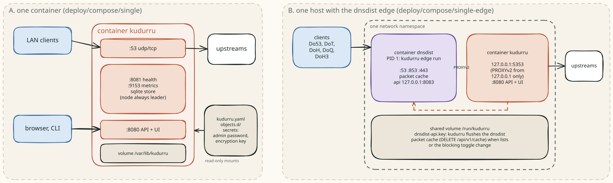
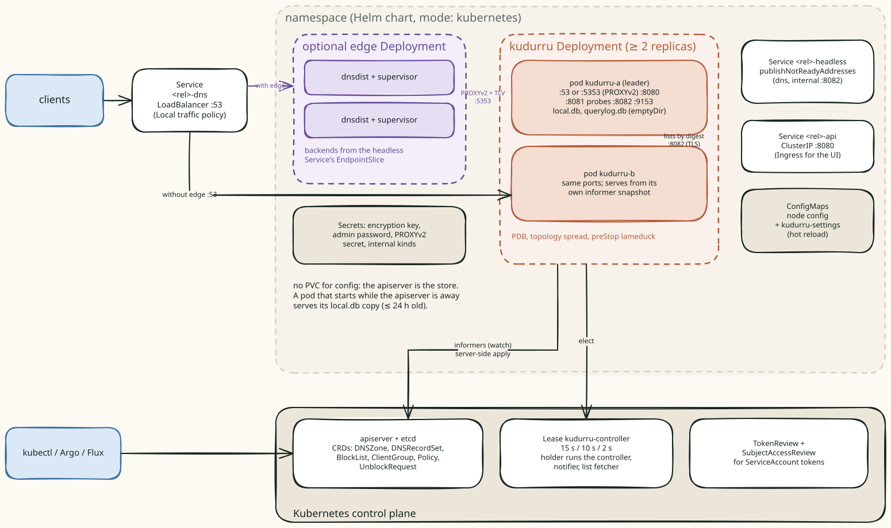
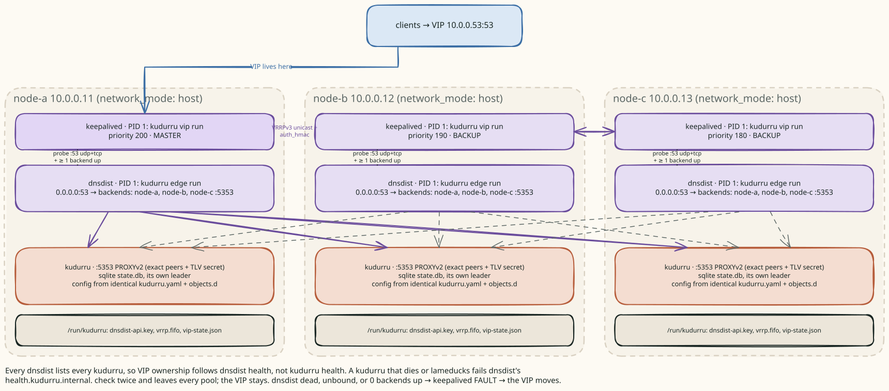
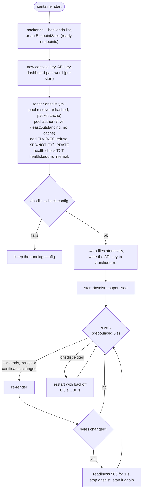
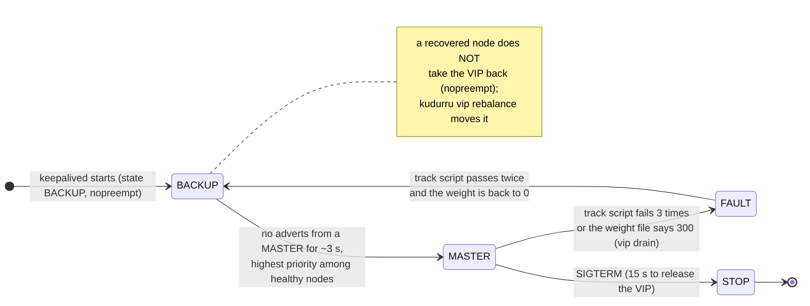
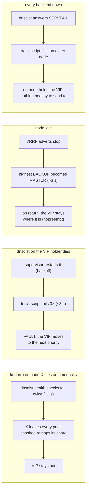

# Deployment shapes

The same binary runs in every shape. What changes is the store driver, how
many nodes answer, and whether dnsdist (load balancing, packet cache,
encrypted transports) and keepalived (a floating VIP) stand in front. Both
are GPL programs, so they always run as separate processes in their own
images, each driven by a kudurru **supervisor** that is PID 1 in that
container.

| Shape | Store | Nodes answering | Leader | Files |
|---|---|---|---|---|
| One container | sqlite `state.db` | 1 | itself | `deploy/compose/single` |
| One host + edge | sqlite | 1, behind dnsdist | itself | `deploy/compose/single-edge` |
| systemd | sqlite | 1 | itself | `deploy/systemd` |
| Kubernetes | kube (CRDs) | every replica (Deployment ≥ 2) | Lease holder | `charts/kudurru`, `config/` |
| Kubernetes standalone | sqlite on a PVC | 1 (StatefulSet) | itself | `charts/kudurru` `mode: standalone` |
| Compose HA (static twins) | sqlite on each node | every node, behind dnsdist, one VIP | each node for itself | `deploy/compose/ha/node-{a,b,c}` |

Operator docs: [deploy/](../deploy/README.md). This page shows how the
pieces talk to each other.

Licensing ([how it works](licensing.md)): more than one node, and the dnsdist
and keepalived edge, need a license key; a free personal key covers 3 nodes.
DNS answering never depends on a key. Every kudurru container (server,
dnsdist supervisor, keepalived supervisor) gets it as `KUDURRU_LICENSE_KEY`,
and the supervisors refuse to start without a key that covers the edge.

## One container, and one host with the edge

With the edge, dnsdist owns :53, :853 and :443 and kudurru listens on
`127.0.0.1:5353`. Because both share one network namespace, kudurru accepts
PROXYv2 only from `127.0.0.1` and needs no shared secret. When the lists or
the blocking toggle change, kudurru flushes dnsdist's packet cache through
the dnsdist API, whose key the supervisor writes to the shared
`/run/kudurru` volume.

## Kubernetes

- The chart renders a **Deployment** (two replicas, PDB, topology spread)
  with the kube driver, so there is no PVC for configuration. It switches to
  a StatefulSet for per-pod query-log or `local.db` volumes, to a DaemonSet
  with `hostNetwork.enabled`, and to a single-replica StatefulSet with the
  sqlite driver in `mode: standalone`.
- The **headless Service** (`publishNotReadyAddresses`) gives every pod a
  stable name. Its EndpointSlice is how replicas find the leader on `:8082`,
  how the Nodes page lists every replica (and fetches each one's status),
  and how the edge builds its backend list.
- Probes use the ops port: startup, readiness and liveness on
  `/healthz/*` (:8081). `preStop` runs `kudurru lameduck`, so a pod fails
  readiness and drains before it stops.
- `externalTrafficPolicy: Local` keeps client addresses, which client
  groups and the query log need. The edge can run as a Deployment (default),
  as a sidecar in each kudurru pod, or as a `hostNetwork` DaemonSet with
  keepalived when `vip.provider: keepalived`. `kube-vip` and `metallb` only
  add annotations to the dns Service.
- A NetworkPolicy (optional) admits `:5353` only from edge pods and `:8082`
  only from kudurru and edge pods.

## Compose HA: three nodes, one VIP

Each node runs the same three containers with `network_mode: host`. The
nodes do not share a store: each is an independent sqlite node with an
identical, file-managed configuration that you distribute (Git, Ansible,
rsync). keepalived decides who holds the VIP; every dnsdist sends to every
kudurru with PROXYv2 plus the shared TLV secret.

### The edge supervisor (`kudurru edge run`)

Readiness on `:8084/healthz/ready` is "dnsdist runs and at least one backend
is up". The supervisor also polls every backend's `/internal/zones` on
`:8082` and flushes the authoritative pool's cache when a zone serial
changes (when that pool is cached). The poll needs the internal credentials
(`KUDURRU_ENCRYPTION_KEY` or `--internal-token-file`); the shipped chart and
compose files do not pass them to the edge yet, so there it stays off.
Membership changes restart dnsdist in
v0.1: invisible behind a VIP or a LoadBalancer with two edge replicas, a
sub-second gap for a lone edge.

### The VIP (`kudurru vip run`)

The supervisor renders `keepalived.conf` (VRRPv3 unicast, `state BACKUP`,
`nopreempt`, `auth_hmac`, priority `200 - 10 × index`), checks it, and runs
keepalived. keepalived itself calls two kudurru programs:

- the **track script** `kudurru health --vrrp`, every second: a TXT query for
  `health.kudurru.internal.` over UDP **and** TCP to the VIP (or loopback
  when not holding it) through dnsdist, plus "≥ 1 backend up" from the
  dnsdist API;
- the **notify FIFO** consumer `kudurru vip fifo`, which writes
  `vip-state.json`; the supervisor turns it into `kudurru_vip_master{vip}`.

`kudurru lameduck` never touches the VIP (decision D51): it makes the local
kudurru answer the health name with SERVFAIL, so every dnsdist drops that
backend, while the VIP stays as long as the local dnsdist has a healthy
backend. Only `kudurru vip drain` (weight 300 → FAULT) moves the VIP on
purpose.

### What happens when something fails

In Kubernetes without a VIP, the Service follows readiness on `:8081`, the
lameduck `preStop` drains a pod before it stops, and the edge re-renders
within 5 s of an EndpointSlice change.

## Not built yet

`kudurru serve` does not write the keepalived weight file itself (only
`kudurru vip drain` and `vip rebalance` do), so "prefer-not" (weight 60) is
unused. The compose twins have no read-only mode, and a zone transfer from
twins should name one node, because each twin stamps its own serials. The
follower driver (v0.2) and raft (v1.0) replace twins with one writable
primary.
