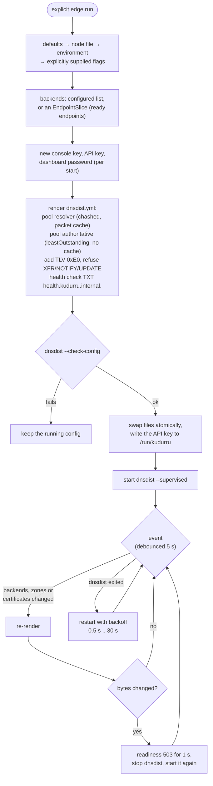
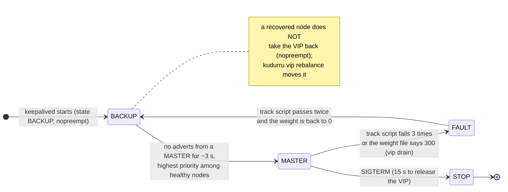
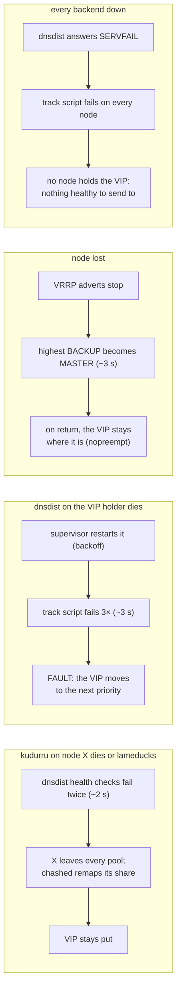

# Deployment shapes

The same binary runs in every shape. What changes is the store driver, how
many nodes answer, and whether dnsdist (load balancing, packet cache,
encrypted transports) and keepalived (a floating VIP) stand in front. Both
are GPL programs, so they always run as separate processes in their own
images, each driven by a kudurru **supervisor** that is PID 1 in that
container.

| Shape | Store | Nodes answering | Leader | Files |
|---|---|---|---|---|
| One container | sqlite `state.db` | 1 | itself | `deploy/compose/single` |
| One host + edge | sqlite | 1, behind dnsdist | itself | `deploy/compose/single-edge` |
| systemd | sqlite | 1 | itself | `deploy/systemd` |
| Kubernetes | kube (CRDs) | every replica (Deployment ≥ 2) | Lease holder | `deploy/helm/kudurru`, `deploy/kustomize/` |
| Kubernetes standalone | sqlite on a PVC | 1 (StatefulSet) | itself | `deploy/helm/kudurru` `mode: standalone` |
| Compose HA (static twins) | sqlite on each node | every node, behind dnsdist, one VIP | each node for itself | `deploy/compose/ha/node-{a,b,c}` |

Operator docs: [deploy/](../deploy/README.md). This page shows how the
pieces talk to each other.

The v0.1.0 [DHCPv4 server](dhcp.md) is opt-in, runs on Linux with either
store, and independent allocators must never share a pool. On the Kubernetes
store, scopes are `DHCPScope` objects, leases are `DHCPLease` objects, and
the holder of the `kudurru-dhcp` Lease serves clients that a router relays
to a LoadBalancer address (`dhcp.enabled`, `dhcp.serverAddress`); see
[DHCP on the Kubernetes store](dhcp.md#kubernetes-store). On the SQLite
store, it supports a standalone Linux node or three quorum voters
with local SQLite replicas and direct broadcast access or configured trusted
relays for its subnets. Configure the explicit
three-voter failover group before serving the same scopes from multiple nodes. Fresh setup is
available in the dashboard without DHCP YAML. Setup saves stage the next
restart; live options and reservations use the active scope API. Keep both
`dhcp-settings.json`, the DNS claim registry, lease databases and failover
Raft state on persistent storage. A UI-owned DHCP
startup failure leaves DNS/API running for setup repair, while file-owned
failures remain fatal. See [DHCP deployment](../deploy/dhcp.md) for host
networking, capabilities, adoption and conflict recovery.

Licensing ([how it works](licensing.md)): more than one node, and the dnsdist
and keepalived edge, need a license key; a free personal key covers 3 nodes.
DNS answering never depends on a key. Every kudurru container (server,
dnsdist supervisor, keepalived supervisor) gets it as `KUDURRU_LICENSE_KEY`,
and the supervisors refuse a first start without a key that covers the edge
(an expired key never stops a restart).

## One container, and one host with the edge

With the edge, dnsdist owns :53, :853 and :443 and kudurru listens on
`127.0.0.1:5353`. Because both share one network namespace, kudurru accepts
PROXYv2 only from `127.0.0.1` and needs no shared secret. When the lists or
the blocking toggle change, kudurru flushes dnsdist's packet cache through
the dnsdist API, whose key the supervisor writes to the shared
`/run/kudurru` volume.

## Kubernetes

- The chart renders a **Deployment** (two replicas, PDB, topology spread)
  with the kube driver, so there is no PVC for configuration. It switches to
  a StatefulSet for per-pod query-log or `local.db` volumes, to a DaemonSet
  with `hostNetwork.enabled`, and to a single-replica StatefulSet with the
  sqlite driver in `mode: standalone`.
- The **headless Service** (`publishNotReadyAddresses`) gives every pod a
  stable name. Its EndpointSlice is how replicas find the leader on `:8082`,
  how the Nodes page lists every replica (and fetches each one's status),
  and how the edge builds its backend list.
- Audit events are kept in `AuditLog` objects (`audit.kudurru.io`, from the
  `kudurru-crds` chart) that every replica reads, so the per-pod `emptyDir`
  can go. With `database.existingSecret` the replicas keep the audit log,
  query log and statistics in a PostgreSQL database instead
  ([postgres.md](../deploy/postgres.md)); DNS never waits for it.
- Probes use the ops port: startup, readiness and liveness on
  `/healthz/*` (:8081). `preStop` runs `kudurru lameduck`, so a pod fails
  readiness and drains before it stops.
- `externalTrafficPolicy: Local` keeps client addresses, which client
  groups and the query log need. The edge can run as a Deployment (default),
  as a sidecar in each kudurru pod, or as a `hostNetwork` DaemonSet with
  keepalived when `vip.provider: keepalived`. `kube-vip` and `metallb` only
  add annotations to the dns Service.
- A NetworkPolicy (optional) admits `:5353` only from edge pods and `:8082`
  only from kudurru and edge pods.
- Dashboard/API traffic can use a standard Ingress or a Traefik
  IngressRoute (`ingress.kind`). Traefik routes directly to pods with
  `nativeLB: false` and uses the `kudurru_instance` affinity cookie by
  default. This keeps a browser on the same replica while it is available.
  Standard Traefik Ingress resources get the cookie settings through
  Service annotations. Direct Service clients can enable Kubernetes
  `ClientIP` affinity. Neither affinity mechanism changes DNS routing.

## Compose HA: three nodes, one VIP

Each node runs the same three containers with `network_mode: host`. The
nodes do not share a store: each is an independent sqlite node with an
identical, file-managed configuration that you distribute (Git, Ansible,
rsync). keepalived decides who holds the VIP; every dnsdist sends to every
kudurru with PROXYv2 plus the shared TLV secret.

### Host supervisor configuration

The explicit `edge render|run` and `vip render|run` commands accept typed
`edge.*` and `vip.*` sections from the selected node configuration. Every key
is node-scoped, host-only and restart-required; neither settings API can write
or reset one. These sections do not start a supervisor from `serve`. Secrets
remain file references, and `--out` remains an invocation-only output location.

Precedence is schema defaults, then node file, then environment, then flags
explicitly supplied on that invocation. Explicit false, zero, empty strings and
empty/replacement collections retain their meaning. Only an explicitly overridden
supervisor key skips parsing its lower environment value or `_FILE` input;
unrelated invalid environment still fails. `--readiness-address` aliases
`edge.healthAddress`, and `--node-name` aliases `vip.routerID`. YAML/Lua renderer
aliases and protocol casing retain their existing behavior.

`vip.vips` is a list of `{name, address, interface, vrid}` records, and
`vip.preemptDelay` maps VIP names to integer seconds. Only those two new keys
accept structured JSON environment values. VRIDs remain operator-assigned and
cannot change through a remote write. A configured `priorityIndex: 0` retains
its source provenance during Kubernetes node discovery; only an omitted
priority derives from the node's discovered position. All existing credential,
frontend-address, source and renderer refusals still apply to the effective
configuration. The [generated reference](../../docs-site/content/reference/configuration.md)
lists the exact keys and constraints.

### The edge supervisor (`kudurru edge run`)

Readiness on `:8084/healthz/ready` is "dnsdist runs and at least one backend
is up". The supervisor also polls every backend's `/internal/zones` on
`:8082` and flushes the authoritative pool's cache when a zone serial
changes (when that pool is cached). The poll needs the internal credentials
(`KUDURRU_ENCRYPTION_KEY[_FILE]` or `--internal-token-file`); the shipped
chart, Kustomize and Compose files mount the backend's encryption key into
the edge for this.
Membership changes restart dnsdist in
v0.1: invisible behind a VIP or a LoadBalancer with two edge replicas, a
sub-second gap for a lone edge.

### The VIP (`kudurru vip run`)

Multiple `--vip` flags define independent instances with alternating
priority order, allowing two VIPs to prefer opposite nodes. The chart
exposes these as `vip.keepalived.vips`. Each VIP's interface receives its
address; `--vrrp-interface` (`vip.keepalived.vrrpInterface`) optionally
selects a separate interface for advertisements and default unicast
source discovery.

VIP names, addresses and VRIDs must be unique. Keepalived tracks both the
VRRP interface and each VIP's address interface; loss of either link faults
the instance and withdraws its address. Gratuitous ARP uses the address
interface ([Helm guide](../deploy/helm.md)).

The Helm chart selects either the original shared HMAC Secret or an exact
VRID-to-Secret-key mapping (`vip.keepalived.hmacKeySecrets`). Only selected
keys enter a bounded root init copy into private memory files, mode 0600, so
the edge's fsGroup cannot make keepalived's runtime keys group-readable.
The source projection is init-only; the private mount is keepalived-only.
The existing `{vrid}` CLI substitution binds each instance to its selected
file, with no shared-key fallback. Key changes require coordinated restart;
see [key placement and rotation](../deploy/vrrp-keys.md).

The supervisor renders `keepalived.conf` (VRRPv3 unicast, `state BACKUP`,
`nopreempt`, `auth_hmac`, priority `200 - 10 × index`), checks it, and runs
keepalived. keepalived itself calls two kudurru programs:

- the **track script** `kudurru health --vrrp`, every second: a TXT query for
  `health.kudurru.internal.` over UDP **and** TCP to the VIP (or loopback
  when not holding it) through dnsdist, plus "≥ 1 backend up" from the
  dnsdist API;
- the **notify FIFO** consumer `kudurru vip fifo`, which writes
  `vip-state.json`; the supervisor turns it into `kudurru_vip_master{vip}`.

`kudurru lameduck` never touches the VIP (decision D51): it makes the local
kudurru answer the health name with SERVFAIL, so every dnsdist drops that
backend, while the VIP stays as long as the local dnsdist has a healthy
backend. Only `kudurru vip drain` (weight 300 → FAULT) moves the VIP on
purpose.

### What happens when something fails

In Kubernetes without a VIP, the Service follows readiness on `:8081`, the
lameduck `preStop` drains a pod before it stops, and the edge re-renders
within 5 s of an EndpointSlice change.

## Not built yet

`kudurru serve` does not write the keepalived weight file itself (only
`kudurru vip drain` and `vip rebalance` do), so "prefer-not" (weight 60) is
unused. The compose twins have no read-only mode, and a zone transfer from
twins should name one node, because each twin stamps its own serials. The
follower driver (v0.2) and raft (v1.0) replace twins with one writable
primary.

### Service-provider annotations

For `vip.provider: kube-vip` or `metallb`, the chart requires the DNS Service
(type `LoadBalancer`) and renders the selected provider's address request on
each mixed or split DNS Service. MetalLB additionally receives the configured
pool and, for split UDP/TCP Services, the release's shared-IP key. kube-vip does
not acquire MetalLB sharing annotations implicitly. Existing explicitly supplied
annotations remain; selected provider values override matching address/pool keys.
For compatibility, split Services with `provider: none` retain their historical
MetalLB sharing key for externally managed address allocation.

The named chart annotation helper is checked against the Go ServiceProvider
annotation contract across direct, sidecar, separate Deployment and DaemonSet
edge topologies. These annotations request allocation; they do not prove which
node currently announces an address. Owner observation remains a separate task.
