# DHCPv4 and lease state

DHCPv4 is an optional **v0.2.0 development feature**. v0.1.0 does not serve
DHCP. It runs on one Linux node with the SQLite configuration store and
supports multiple directly attached and relayed IPv4 subnets. See the
[deployment guide](../deploy/dhcp.md) for configuration and cutover.

```mermaid
flowchart LR
    config["Host configuration<br/>used until explicit adoption"] --> setup["Setup manager<br/>desired registry and revision"]
    setup --> desired[("dhcp-settings.json<br/>atomic durable save; no live activation")]
    desired -->|"Node restart"| apply["Scope token and DB revision checks<br/>validate live leases; commit staged options"]
    apply --> service
    apply --> db
    client["Direct client or trusted relay"] --> service["DHCP service<br/>one UDP 67 listener per interface"]
    service --> validate["Scope routing and packet validation"]
    validate --> serial["Scope processing lock"]
    api["Node-local API and dashboard<br/>revision and permission checks"] --> serial
    api -->|"Setup edits"| setup
    serial --> leases["Lease/configuration transaction<br/>pool, reservations, live ownership"]
    leases --> db[("Per-scope SQLite database<br/>exclusive owner; WAL; FULL sync")]
    db -->|"Commit succeeds"| response["OFFER / ACK or API result"]
    response --> client
    db -->|"Publish committed state"| snapshot["Immutable bound-lease snapshot"]
    snapshot --> dns["Authoritative local-record hook<br/>A/PTR and policy hostnames"]
```

`cmd/kudurru/serve.go` opens the setup manager, selects the startup registry,
opens its scope databases and binds the service before starting the node
runner. Cancellation closes sockets and stores before the setup lock. A
UI-owned DHCP store, topology or listener startup failure releases service
resources and leaves DNS/API available for repair; file-owned failures remain
fatal. Opening corrupt setup data or conflicting environment ownership still
fails startup. `internal/dhcp` uses the
BSD-licensed `insomniacslk/dhcp` codec. Allocation and state transitions are
kudurru code derived from RFC 2131 and RFC 2132.

## Configuration and management

Legacy flat `dhcp.*` configures the `default` scope. Alternatively,
`dhcp.scopes` declares stable names, subnets and interfaces. The forms are
mutually exclusive. Subnets cannot overlap. Scopes on one interface share a
server address and have at most one directly attached scope. Each scope
requires a fixed local server address; a relay-only scope can serve a remote
subnet. The service rejects infrastructure addresses as allocation targets,
including server, router, network, broadcast and trusted relay gateways.

Fresh Linux/SQLite installations can configure DHCP entirely in the dashboard
without writing a DHCP YAML section. The node-local setup API owns a durable
desired registry in `node.dataDir/dhcp-settings.json`, with a process-lifetime
`dhcp-settings.lock` even when DHCP is disabled. Writes use private permissions,
atomic replacement and file/directory synchronization. Unknown versions and
corrupt files fail closed. Reads of absent setup do not create lease databases.

Existing host configuration stays file-owned until explicit dashboard adoption;
the YAML is never rewritten. Adoption saves API-managed scopes and requires a
restart, even when their network values are unchanged. Any `dhcp.*` environment
override, including `enabled`, blocks UI saves and conflicts with a persisted
UI registry at startup. File management retains environment precedence. Generic
Settings host-only restrictions still apply; dedicated DHCP setup has its own
permissions, ownership and revision checks.

Setup saves stage enabling/disabling, scope creation/removal and topology,
including interface, server address, subnet and trusted relays. They never
bind a socket or modify an open lease store. Every saved scope must be complete
and valid even while disabled; enabled setup needs a scope. Limits are 256
scopes and a 4 MiB encoded desired document. Host interface/address provisioning
and network privileges remain deployment tasks.

For host-file scopes, `management: file` remains the default;
`management: api` delegates pool options and reservations to live management.
First startup seeds these values; later starts preserve persisted API values.
Changing ownership back to file mode validates file values against all live
offers, bindings and quarantine. Dashboard-owned scopes always use API management.

Management edits use a scope revision and transactional candidate validation.
Mutable environment overrides are rejected for enabled API-managed scopes
to avoid masking host settings with persisted values; file mode retains
normal environment precedence. The API requires `If-Match` bound to node,
scope and revision, enforces permissions, and uses `Service.MutateScope` to serialize
changes against packet handling. The service refreshes reply options from
committed configuration before releasing that lock, even when a callback
returns an error after a successful commit. Lease renewals do not advance
the configuration revision. There is no administrative lease-delete endpoint.

### Desired setup, effective values and conflict recovery

`GET /setup` uses the setup manager's read-only lease metadata view. Scopes
without pending setup edits expose current durable options and reservations;
pending scopes expose their saved desired values. `pendingScopes` identifies
these scopes. `scopeRevisions` includes current database revisions, including
retained scope databases, as decimal strings. `PUT /setup` requires the exact
node/setup ETag and the observed revision map. A concurrent setup or live option
edit returns 412 without changing state; the dashboard refreshes revision
metadata while retaining the draft for review before retrying.

Each desired scope carries an opaque apply token and expected database
revision. At restart, a changed token checks that revision and all live rows,
then atomically commits options, reservations, the next revision and the token.
Read-only preflight checks at save time cannot replace this startup transaction.
An already applied token preserves subsequent live API edits; a listener bind
failure and retry cannot replay stale saved options. Tokens change only for
that scope's desired content changes or an explicit re-save after a revision
conflict, not enable toggles or edits to another scope.

`GET /status` describes the running service and reports disabled when no
service exists. Setup responses describe desired state separately. A UI-owned
startup failure appears in `runtimeError`; setup remains available and
restart-required so an administrator can correct it, save and restart. This
does not cover corrupt registry files or environment conflicts that prevent
opening the setup manager.

## Wire behavior

The socket is bound to its configured interface without address or port
reuse. Direct unconfigured clients receive broadcast replies; configured
clients receive renewal and INFORM replies at their address.

Relays must match the receiving interface and an exact configured pair of
source address and `giaddr`, with source UDP port 67. Replies go to
`giaddr:67`. Valid option 82 data is echoed. Unsupported link-selection,
server-ID-override and alternate-port relay extensions are dropped. Direct
packets carrying relay information are rejected. Routed unicast renewals
select a scope by `ciaddr` on the receiving interface and require an existing
binding. An invalid renewal into a relay-only scope stays silent when no
relay is present: a NAK must be broadcast on the client's link. A relayed
rebinding request can receive a NAK through its relay.

The client identifier option is the lease identity when supplied; otherwise
the Ethernet MAC is used. Identity namespaces remain distinct even for opaque
client-ID bytes. The MAC also selects reservations. An OFFER holds an address
for one minute. An ACK durably records a binding before sending it, retaining
any later existing bound expiry. RELEASE removes a matching client's lease;
DECLINE quarantines its address for ten minutes. Unknown INIT-REBOOT or
renewal requests do not acquire leases. INFORM returns options without an
allocation. Address conflict probing is not implemented.

## Persistent state and transfer

The default scope uses `dhcp.db`; named scopes use `dhcp-<name>.db` under
`node.dataDir`. Each database has a private file, exclusive inode lock,
serialized transactions, address uniqueness constraints, WAL and full
synchronization. Schema version 2 added management state; schema version 3
adds the applied setup token to that state. Migration from earlier versions,
staged settings and live-state validation are transactional. Failed seeding or
incompatible live state rolls back the migration and seed, allowing corrected
configuration to recover.

A directory lock prevents parallel services from allocating from independent
scope registries. Removed or renamed scope databases remain locked and are
checked read-only: live allocations or unrecognized schemas prevent startup.
The operator must drain the original scope before retiring it. A rename creates
a different database identity; it does not transfer allocations. UI saves can
stage removal while the old service keeps running, but next startup still
enforces retirement safety. The retained revision inventory permits restoring
the original name after a failed retirement. Databases are not silently deleted
or reset. Backups must include both the setup registry and scope databases;
native lease export contains neither setup nor managed options/reservations.

Native version 1 JSON exports include scope, subnet, explicit identity kind,
absolute expiration and offered/bound/declined states. The exact stored
client-ID bytes are base64 encoded. Native and dnsmasq lease-file imports
merge atomically, including in file management mode, with a 4 MiB limit.
Imports cannot replace live identity/address ownership or shorten expiry;
expired rows are skipped and counted. Invalid records, reservation conflicts
and unsupported infinite leases reject the entire import. dnsmasq export at
the store boundary refuses states it cannot represent. The HTTP/dashboard
export uses native JSON to preserve holds and quarantine.

## Lease DNS and policy names

With `registerDNS: true`, a scope owns a dedicated `domainName` and answers
A and PTR records for current bound leases. `internal/dhcpdns` reads immutable
snapshots published only after a successful transaction. Queries never access
SQLite; they check expiry in memory. TTL is bounded by `dnsTTL` and remaining
lease life. Release, decline, import and management changes update snapshots
immediately. Reservation hostnames take precedence over client names; duplicate
names and conflicts with reserved names are suppressed. Offers, quarantine,
expired leases and malformed or outside-domain hostnames produce no records.

The optional `authoritative.Stage.LocalRecords` hook runs after the unsynced
gate when no zone matches, or when the match is exactly the root forward zone
used for catch-all routing. Specific forward and primary zones, and a primary
root, retain precedence including negative answers. ACL and controller gates
remain intact. Generated records do not enter configured zones, change their
serials or appear in AXFR/IXFR. Owned domains return NODATA or NXDOMAIN with
zero negative TTL; unrelated names and reverse addresses continue normally.
Use a dedicated DHCP domain without a configured zone covering it, apart from
the catch-all forward root. `policy.Options.Hostnames` uses the same current
bindings for hostname and nameGlob client matching.

## Deployment boundary and verification

The `kube` store is rejected: independent local allocators cannot coordinate
ownership. DHCPv6, lease replication and multi-node failover remain deferred;
a DNS VIP does not provide DHCP failover. No live network is needed for tests.

Unit and race tests cover wire transitions, setup durability and adoption,
effective/pending views, staged restart apply, management, migration, import,
DNS precedence, revision conflicts and concurrent mutation. The opt-in
`test/dhcp` namespace harness uses a separately implemented stock dhcpcd
client. It verifies acquisition on two direct subnets and through a relay,
reservations, distinct clients, exhaustion, release/reuse, restart retention,
routed renewal and expiration/reacquisition. The server runs as uid 65532
with only `NET_BIND_SERVICE` and `NET_RAW`, plus `no-new-privileges`, inside
a disconnected test network. Hardware relay and production LAN acceptance
remain deployment responsibilities.
