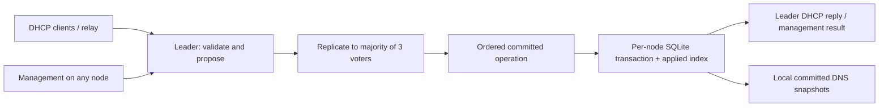

# DHCPv4 and lease state

DHCPv4 is an optional **v0.2.0 development feature**. v0.1.0 does not serve
DHCP. It runs on Linux with the SQLite configuration store and supports multiple directly attached and relayed IPv4 subnets. See the
[deployment guide](../deploy/dhcp.md) for configuration and cutover.

```mermaid
flowchart LR
    config["Host configuration<br/>used until explicit adoption"] --> setup["Setup manager<br/>desired registry and revision"]
    setup --> desired[("dhcp-settings.json<br/>atomic durable save; no live activation")]
    desired -->|"Node restart"| apply["Scope token and DB revision checks<br/>validate live leases; commit staged options"]
    apply --> service
    apply --> db
    client["Direct client or trusted relay"] --> service["DHCP service<br/>one UDP 67 listener per interface"]
    service --> validate["Scope routing and packet validation"]
    validate --> serial["Scope processing lock"]
    api["Node-local API and dashboard<br/>revision and permission checks"] --> serial
    api -->|"Setup edits"| setup
    serial --> leases["Lease/configuration transaction<br/>pool, reservations, live ownership"]
    leases --> db[("Per-scope SQLite database<br/>exclusive owner; WAL; FULL sync")]
    db -->|"Binding/options commit or bound reuse"| response["OFFER / ACK or API result"]
    db -->|"New offered address"| probe["Bounded ARP or routed ICMP probe"]
    probe -->|"Quiet timeout"| response
    probe -->|"Conflict: quarantine; retry up to 3 candidates"| leases
    probe -->|"Error or cancellation"| dropped
    response --> client
    db -->|"Publish committed state"| snapshot["Immutable bound-lease snapshot"]
    snapshot --> dns["Authoritative local-record hook<br/>A/PTR and policy hostnames"]
    leases -->|"Packet handler/storage failure"| dropped["ERROR log; drop packet<br/>DNS stays available"]
    dropped -->|"Next packet or retry"| service
    service -->|"Unexpected runtime socket failure"| fatal["Fatal runnable error"]
```

`cmd/kudurru/serve.go` opens the setup manager, selects the startup registry,
opens its scope databases and binds the service before starting the node
runner. Cancellation closes sockets and stores before the setup lock. A
UI-owned DHCP store, topology or listener startup failure releases service
resources and leaves DNS/API available for repair; file-owned failures remain
fatal. Opening corrupt setup data or conflicting environment ownership still
fails startup. `internal/dhcp` uses the
BSD-licensed `insomniacslk/dhcp` codec. Allocation and state transitions are
kudurru code derived from RFC 2131 and RFC 2132.

## Configuration and management

Legacy flat `dhcp.*` configures the `default` scope. Alternatively,
`dhcp.scopes` declares stable names, subnets and interfaces. The forms are
mutually exclusive. Subnets cannot overlap. Scopes on one interface share a
server address and have at most one directly attached scope. Each scope
requires a fixed local server address; a relay-only scope can serve a remote
subnet. The service rejects infrastructure addresses as allocation targets,
including server, router, network, broadcast, trusted relay gateways and
server-ID overrides, and every configured failover server address.

Fresh Linux/SQLite installations can configure DHCP entirely in the dashboard
without writing a DHCP YAML section. The node-local setup API owns a durable
desired registry in `node.dataDir/dhcp-settings.json`, with a process-lifetime
`dhcp-settings.lock` even when DHCP is disabled. Writes use private permissions,
atomic replacement and file/directory synchronization. Unknown versions and
corrupt files fail closed. Reads of absent setup do not create lease databases.

Existing host configuration stays file-owned until explicit dashboard adoption;
the YAML is never rewritten. Adoption saves API-managed scopes and requires a
restart, even when their network values are unchanged. Any `dhcp.*` environment
override, including `enabled`, blocks UI saves and conflicts with a persisted
UI registry at startup. File management retains environment precedence. Generic
Settings host-only restrictions still apply; dedicated DHCP setup has its own
permissions, ownership and revision checks.

Setup saves stage enabling/disabling, scope creation/removal and topology,
including interface, server address, subnet and trusted relays. They never
bind a socket or modify an open lease store. Every saved scope must be complete
and valid even while disabled; enabled setup needs a scope. Limits are 256
scopes and a 4 MiB encoded desired document. Host interface/address provisioning
and network privileges remain deployment tasks.

For host-file scopes, `management: file` remains the default;
`management: api` delegates pool options and reservations to live management.
First startup seeds these values; later starts preserve persisted API values.
Changing ownership back to file mode validates file values against all live
offers, bindings and quarantine. Dashboard-owned scopes always use API management.

Management edits use a scope revision and transactional candidate validation.
Mutable environment overrides are rejected for enabled API-managed scopes
to avoid masking host settings with persisted values; file mode retains
normal environment precedence. The API requires `If-Match` bound to node,
scope and revision, enforces permissions, and uses typed service mutations to
serialize changes against packet handling. Replicated scopes reject arbitrary
`MutateScope` callbacks so writes cannot bypass consensus. The service refreshes reply options from
committed configuration before releasing that lock, even when a callback
returns an error after a successful commit. Lease renewals do not advance
the configuration revision. There is no administrative lease-delete endpoint.

### Desired setup, effective values and conflict recovery

`GET /setup` uses the setup manager's read-only lease metadata view. Scopes
without pending setup edits expose current durable options and reservations;
pending scopes expose their saved desired values. `pendingScopes` identifies
these scopes. `scopeRevisions` includes current database revisions, including
retained scope databases, as decimal strings. `PUT /setup` requires the exact
node/setup ETag and the observed revision map. A concurrent setup or live option
edit returns 412 without changing state; the dashboard refreshes revision
metadata while retaining the draft for review before retrying.

Each desired scope carries an opaque apply token and expected database
revision. At restart, a changed token checks that revision and all live rows,
then atomically commits options, reservations, the next revision and the token.
Read-only preflight checks at save time cannot replace this startup transaction.
An already applied token preserves subsequent live API edits; a listener bind
failure and retry cannot replay stale saved options. Tokens change only for
that scope's desired content changes or an explicit re-save after a revision
conflict, not enable toggles or edits to another scope.

`GET /status` describes the running service and reports disabled when no
service exists. Setup responses describe desired state separately. A UI-owned
startup failure appears in `runtimeError`; setup remains available and
restart-required so an administrator can correct it, save and restart. This
does not cover corrupt registry files or environment conflicts that prevent
opening the setup manager. `runtimeError` reports startup activation failures
only; it is not a live packet/storage health signal.

## Wire behavior

The socket is bound to its configured interface without address or port
reuse. Direct unconfigured clients receive broadcast replies; configured
clients receive renewal and INFORM replies at their address.

Relays must match the receiving interface and an exact configured tuple of
source address, `giaddr`, source UDP port and authorized extension values.
`sourcePort` defaults to 67. RFC 3527 link selection (option 82 suboption 5)
selects a scope only when its address exactly matches `linkSelection`, which
must be a usable address in that scope. A single relay source/giaddr can serve
several subnets through distinct explicit selectors. Packet-supplied values
never create trust or infer a scope from a requested address.

RFC 5107 server identifier override (suboption 11) must exactly match
`serverIdentifier`. It replaces response option 54 and selecting-request
matching, while the source IP remains the configured local server address.
RFC 8357 alternate source ports require both an explicit non-67 `sourcePort`
and zero-length suboption 19. The port comes from the authorized UDP source
tuple, not suboption bytes. Port 68, unexpected extensions, duplicate
selection/control suboptions, malformed TLVs and source-port mismatches are
rejected before allocation. Ordinary option 82 data is echoed whole, or omitted
whole when the client reply limit cannot accommodate it. Replies use
`giaddr:sourcePort`; link selection never changes the return address.

Direct packets carrying relay information are rejected. Routed unicast
renewals select a scope by `ciaddr` on the receiving interface and require an
existing binding. An invalid renewal into a relay-only scope stays silent
when no relay is present: a NAK must be broadcast on the client's link. A
relayed rebinding request can receive a NAK through its relay.

The client identifier option is the lease identity when supplied; otherwise
the Ethernet MAC is used. Identity namespaces remain distinct even for opaque
client-ID bytes. The MAC also selects reservations. An OFFER holds an address
for one minute. An ACK durably records a binding before sending it, retaining
any later existing bound expiry. RELEASE removes a matching client's lease;
DECLINE quarantines its address for ten minutes. Unknown INIT-REBOOT or
renewal requests do not acquire leases. INFORM returns options without an
allocation. Lease duration, T1 and T2 in replies use the duration returned by
the committed allocation operation. A concurrent replicated options change
cannot make an ACK advertise more time than its committed grant.

Option 12 hostnames are advisory: trailing NUL bytes are stripped, and an
empty or unusable name is ignored without blocking address allocation.
Malformed option framing is still rejected. Operator-configured names remain
strictly validated.

### Conflict detection

Before a new OFFER, storage first commits its offer hold. A bounded Linux
probe then checks the candidate: ARP with sender IPv4 zero on a direct Ethernet
link, or an ICMP echo with a correlated random payload on the routed path.
Probes pin the selected interface; ICMP also pins the server source address.
Positive replies or competing ARP probes cause an owned, still-offered address
to become a durable ten-minute quarantine through `QuarantineOffer`. Only then
can the packet handler try another candidate, with at most three candidates
per packet. The backend verifies both the exact lease identity and MAC;
concurrent changes cannot quarantine a bound or reassigned address.

`conflictDetection` accepts `auto`, `arp`, `icmp` or `disabled`. `auto` (or an empty runtime value) selects
ARP for a direct scope without relays and ICMP for relay-only scopes or scopes
with trusted relays. Explicit ARP rejects relay-configured scopes. The default
`probeTimeout` is 200ms; integral milliseconds from 50ms through 500ms are
allowed. Socket, route and cancellation errors fail closed and drop the
packet. An existing bound lease returned for DISCOVER skips probing, because
its legitimate owner may already be using the address.

A quiet timeout means only that no conflict was observed. Sleeping hosts,
filtered ICMP and simultaneous allocations outside this server remain possible;
probes do not replace exclusive DHCP pools or operator address management.
The probe function is injectable. Unit tests disable or replace it and never
send LAN traffic; receive-loop tests use AF_UNIX socketpairs.

### Network options and network boot

The server honors parameter-request-list order and the client's reply-size
limit, omitting an optional option whole if it would exceed that limit. Options
include the ordinary mask/router/DNS/domain and:

| Configuration | Wire representation and limits |
| --- | --- |
| `ntpServers` | Option 42; up to 63 unicast IPv4 addresses |
| `domainSearch` | Option 119; validated DNS labels, at most 255 encoded bytes, without compression |
| `classlessRoutes` | RFC 3442 option 121, plus Microsoft option 249 when requested; canonical IPv4 destination and usable in-scope next hop; at most 255 encoded bytes |
| `bootServer` | BOOTP `siaddr`; optional unicast IPv4 |
| `bootServerName` | Option 66, also `sname` when at most 63 bytes; at most 253 non-space printable ASCII bytes |
| `bootFile` | Option 67 and BOOTP `file`; at most 127 non-space printable ASCII bytes |
| `bootProfiles` | Up to 128 unique option-93 architecture values; first matching client architecture selects a complete set of boot settings |

Clients receiving classless routes ignore option 3; include `0.0.0.0/0`
explicitly when a default route is needed. A boot profile replaces all three
scope boot fields, including empty values. URLs can select an external HTTP
boot service; this server does not serve boot files or run proxyDHCP on port
4011. Architecture values are matched as unsigned 16-bit values.

Client FQDN option 81 supports DNS-label and legacy ASCII names. Valid names
are advisory and take precedence over option 12. Malformed flags, compressed
names and malformed option 93 lists are rejected. The response sets N=1 and
S=0, with O when overriding the client's S request: the server does not claim
to send RFC 2136 DNS UPDATE messages. Local `registerDNS` publication is a
separate feature.

### Packet failure isolation

After successful startup, a lease-handler or storage failure logs at ERROR
and drops only that packet, without sending a successful lease reply for the
failed operation. Later requests and client retries continue in both file-
and UI-owned scopes. This keeps optional DHCP storage failures from stopping
core DNS ([D175](../architecture.md#16-decision-log)). Existing network timeout
and ICMP exceptions remain per-packet; unexpected socket failures remain fatal.
Startup ownership and activation rules are unchanged. Live packet failures
are diagnosed through logs, not the startup-only setup `runtimeError` field.

## Persistent state and transfer

The default scope uses `dhcp.db`; named scopes use `dhcp-<name>.db` under
`node.dataDir`. Each database has a private file, exclusive inode lock,
serialized transactions, address uniqueness constraints, WAL and full
synchronization. Schema version 2 added management state; version 3 added the applied setup
token. Version 4 adds durable DNS claim ranks and replica progress. Migration from earlier versions,
staged settings and live-state validation are transactional. Failed seeding or
incompatible live state rolls back the migration and seed, allowing corrected
configuration to recover.

The allocator keeps committed indexes by address and client identity. Ordinary
allocation and renewal update only affected cached rows and immutable DNS
shards after a successful transaction. Failed writes publish nothing. Expiry
is checked on access; a cache tracks the earliest expiry and rebuilds when
cleanup, external database changes or a full-state operation requires it.
Listing and export are read-only snapshot operations. They still copy and sort
the requested live set under the store lock; allocation scans occupied pool
addresses, and full configuration/import validation remains proportional to
live state. DNS queries never acquire that lock or read SQLite.

The same FULL-synchronous SQLite fixture was measured before and after the
optimization on Linux/amd64, Xeon 2.90 GHz, Go 1.27, six workers, DNS enabled.
Medians of three runs with 20 operations each at 10,000 leases:

| Operation | Before | After |
| --- | ---: | ---: |
| Offer + acknowledge + release | 146.106 ms | 3.367 ms |
| Renewal | 46.533 ms | 0.354 ms |
| Contended renewal | 47.617 ms | 0.347 ms |
| List | 49.574 ms | 4.993 ms |
| Native export, excluding JSON encoding | 48.834 ms | 5.378 ms |

Renewal allocations fell from 30,937,168 to 23,864 bytes per operation.
Reproduce with `go test ./internal/dhcp -run '^$' -bench '^BenchmarkLeaseScale$' -benchtime=20x -benchmem -count=3`;
the fixture includes both 1,000 and 10,000 leases. These short shared-VM runs
compare the implementations; they do not establish sustained throughput,
p99 latency, production disk performance or quorum capacity.

A directory lock prevents parallel services from allocating from independent
scope registries. Removed or renamed scope databases remain locked and are
checked read-only: live allocations or unrecognized schemas prevent startup.
The operator must drain the original scope before retiring it. A rename creates
a different database identity; it does not transfer allocations. UI saves can
stage removal while the old service keeps running, but next startup still
enforces retirement safety. The retained revision inventory permits restoring
the original name after a failed retirement. Databases are not silently deleted
or reset. Backups must include the setup registry, scope databases and DNS claim registry
(and Raft state for failover);
native lease export contains neither setup nor managed options/reservations.

Native version 1 JSON exports include scope, subnet, explicit identity kind,
absolute expiration and offered/bound/declined states. The exact stored
client-ID bytes are base64 encoded. Native and dnsmasq lease-file imports
merge atomically, including in file management mode, with a 4 MiB limit.
Imports cannot replace live identity/address ownership or shorten expiry;
expired rows are skipped and counted. Invalid records, reservation conflicts
and unsupported infinite leases reject the entire import. dnsmasq export at
the store boundary refuses states it cannot represent. The HTTP/dashboard
export uses native JSON to preserve holds and quarantine.

dnsmasq hostname fields use the same advisory-name normalization as option 12;
unusable names are omitted without rejecting an otherwise valid lease. Native
JSON remains strict and lossless: invalid hostnames reject the import rather
than being normalized. Other invalid records still reject either import.

## Lease DNS and policy names

With `registerDNS: true`, a scope owns a dedicated `domainName` and answers
A and PTR records for current bound leases. `internal/dhcpdns` reads immutable
snapshots published only after a successful transaction. Queries never access
SQLite; they check expiry in memory. TTL is bounded by `dnsTTL` and remaining
lease life. Release, decline, import and management changes update snapshots
immediately. Reservation hostnames take precedence over client names, including
while a reserved device is offline. Conflicting reservations for different
MACs suppress that name. Offers, quarantine,
expired leases and malformed or outside-domain hostnames produce no records.

For unreserved names, the earliest still-live established bound claim owns
A/PTR and policy matching across all scopes sharing the domain. Later duplicate
claims cannot suppress that owner. The hidden `.dhcp-dns-claims.sqlite` registry
and its lock allocate monotonic claim tickets and serialize claim establishment
through commit/publication across standalone scopes. Every scope must retain
that shared data directory. Renewal and rediscovery preserve the rank; rename,
release, decline, expiry, DNS disable or domain reassignment end the old claim.
When an owner ends, the earliest eligible waiting bound claimant becomes visible,
including expiry detected by a DNS read. Reservation changes can hide or reveal
a dynamic claimant. Legacy migration cannot recover historical establishment
order: it assigns ranks by address within each opened scope and persists them.

Native export includes optional claim metadata. Public import issues fresh
tickets in source claim order; importing an old backup cannot steal an existing
live name. Matching current identities preserve rank and expiry lower bounds.
HA snapshots preserve exact ranks; replicated claims use an epoch, the global
Raft index and a per-command ordinal, retaining standalone owners adopted at
bootstrap. None of this adds storage access to DNS queries.

Client names and MAC addresses remain unauthenticated. A client can claim an
unused name or impersonate a reserved MAC. Use reservations for stable naming,
IP/network policies for required restrictions and a restrictive default policy.

The optional `authoritative.Stage.LocalRecords` hook runs after the unsynced
gate when no zone matches, or when the match is exactly the root forward zone
used for catch-all routing. Specific forward and primary zones, and a primary
root, retain precedence including negative answers. ACL and controller gates
remain intact. Generated records do not enter configured zones, change their
serials or appear in AXFR/IXFR. Owned domains return NODATA or NXDOMAIN with
zero negative TTL; unrelated names and reverse addresses continue normally.
Use a dedicated DHCP domain without a configured zone covering it, apart from
the catch-all forward root. `policy.Options.Hostnames` uses the same current
bindings for hostname and nameGlob client matching.

## Three-node quorum failover

`internal/dhcpha` replicates lease operations and typed options, reservation and
import mutations through HashiCorp Raft. Exactly three static voters use mutual
TLS with configured certificate identity, cluster ID and topology checks. Only
the leader with current quorum authority serves DHCP, including INFORM and NAK.
The log and stable state use synchronized Bolt storage; filesystem snapshots
include all scopes, offers, bindings, quarantine, options, reservations, DNS
claims, setup tokens and SQLite applied indexes. A committed command carries
its decision time; replay clamps backward leader time deterministically. Healthy,
synchronized host clocks are required: quorum cannot correct a clock jumping
forward and expiring leases early.

Only the explicit bootstrap peer (alphabetically first ID) may adopt existing
standalone leases as the initial cluster seed. Joining stores must be empty or
already owned by the same persisted cluster. A durable identity prevents silent
rebootstrap after Raft data loss. Snapshot restore preserves each node's local
interface and server IP. Each scope has the same three-node `failoverServers`
map on all of its replicas and excludes those three addresses from allocation.
Different scopes can use different server mappings for their respective links. Each leader uses its own
server identifier; clients recover through T2 rebinding without a VIP.

Follower management forwards over the authenticated peer transport and waits
for its own SQLite applied index before reporting the result. Generic mutation
callbacks and direct store writes cannot bypass replication. No quorum means
no new allocation or renewal success; existing DNS snapshots remain readable
and expire in memory. A fatal local SQLite apply failure fences that replica
and stops its voting, allowing the other two to continue. The node does not
pretend an unapplied command succeeded. Ordinary packet/probe failures retain
D175 isolation, and unexpected DHCP socket failures remain fatal.

Setup stays node-local. Before initial bootstrap, the sole bootstrap node may
apply its staged seed with the expected-revision check. After identity exists,
shared scope registry/topology and voter identity are immutable. Live replicated
options and reservations remain editable; local interface, listener/TLS references
and node enable/disable stage restart. Per-node setup tokens never replay seeds
over replicated settings. Disabling DHCP retains failover ownership; an
established node cannot restart as a standalone allocator. This quorum service
replicates DHCP state only, independently of DNS object-store replication.

## Deployment boundary and verification

The `kube` store is rejected: each voter requires durable local SQLite lease
replicas. DHCPv6 remains outside this implementation. A DNS VIP alone does not
provide lease coordination. No live LAN is needed for automated tests. Three-node
loopback tests exercise elections, partitions, quorum loss, authenticated peer
rejection, forwarded writes, full restart, snapshot catch-up, bootstrap adoption
and SQLite failure fencing. Runtime tests create each node through saved setup
with injected DHCP listeners and verify leader replacement and preserved state.

Unit and race tests cover wire transitions, setup durability and adoption,
effective/pending views, staged restart apply, management, migration, import,
DNS precedence, revision conflicts and concurrent mutation. The opt-in
`test/dhcp` namespace harness uses a separately implemented stock dhcpcd
client. It verifies acquisition on two direct subnets and through a relay,
reservations, distinct clients, exhaustion, release/reuse, restart retention,
routed renewal and expiration/reacquisition. Real ARP and routed ICMP responders
occupy the first pool candidates, and their quarantines must survive restart.
The relay exercises link selection, server-ID override and alternate UDP port
1067 with a stock client. The same client consumes NTP, search, classless
routes and boot options and supplies option 81. The server runs as uid 65532
with only `NET_BIND_SERVICE` and `NET_RAW`, plus `no-new-privileges`, inside
a disconnected test network. Both ambient and executable-file capability
profiles are checked against actual effective/permitted/bounding capabilities;
restart switches to the file-capability profile. The `dhcp-acceptance` CI job
installs Ubuntu's stock `dhcpcd-base` and saves logs, lease state and captures.
These checks do not activate a real systemd manager or Docker daemon. Hardware
relay and production LAN acceptance remain deployment responsibilities.
