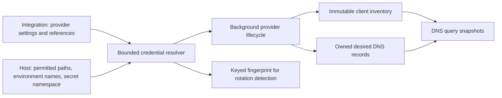
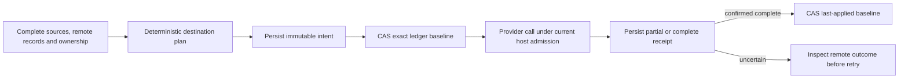
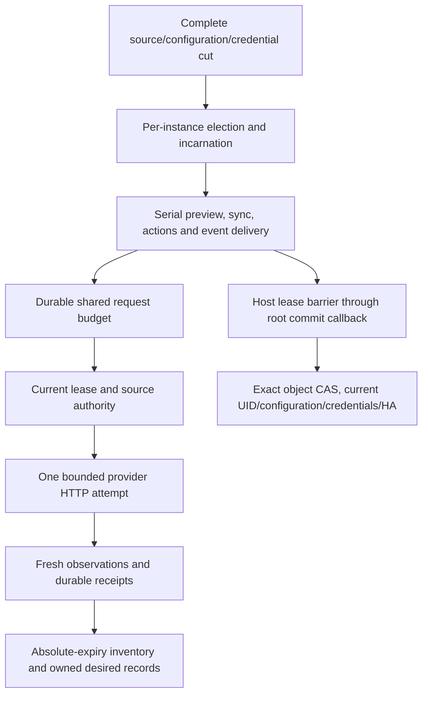
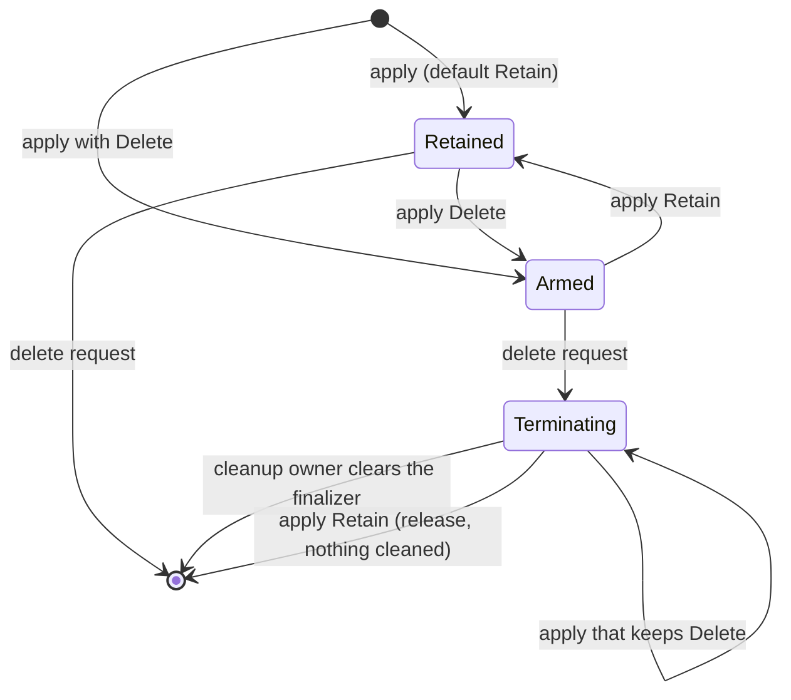
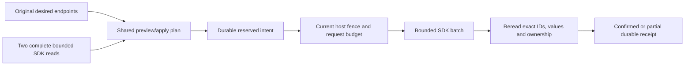
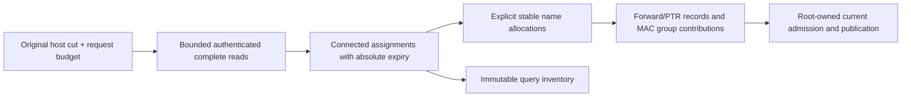
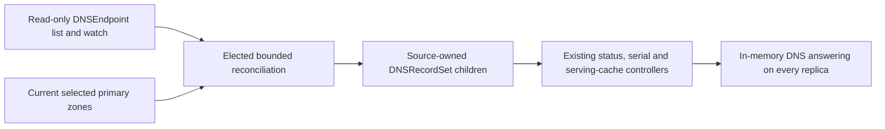
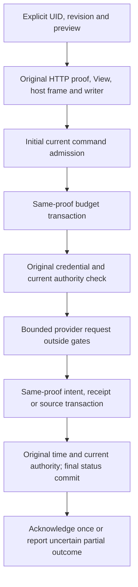

# Background integrations

The public `Integration` object describes Cloudflare publication, UniFi
inventory, or a Tier-B webhook. It is namespaced and uses the same generated
schema in SQLite and Kubernetes. Provider blocks must match `spec.type`;
Cloudflare requires an `apiToken` reference and UniFi an `apiKey` reference.
Deletion defaults to `Retain`, and every optional UniFi write defaults to off.
The [sample](../../deploy/kustomize/samples/kudurru.io_v1alpha1_integration.yaml) starts
suspended so applying an example cannot publish records.

The schema, credential resolver, publication planner, durable ownership ledger,
background host, Cloudflare SDK adapter and UniFi polling adapter are implemented.
The SQLite serving runtime mounts the host, concrete fenced ledger/source commands,
and complete-image inventory publication. Kubernetes execution, the `Delete`
cleanup job (its finalizer, planner mode and ledger transition exist, see
[Deletion policy](#deletion-policy-and-the-cleanup-finalizer)), remaining
providers and dashboard controls remain parts of the full
[v0.2 implementation](../../dev-docs/milestones/v0.2/README.md).



`internal/credentials` accepts exactly one Secret, file, or environment
reference. File and environment references require explicit host allowlists.
Secret references cannot choose a namespace: the operator supplies it to the
resolver. These capabilities are captured immutably; SQLite background capture detects
file/environment rotation and joins the old provider before replacement. SQLite
does not enable native Secret lookup. Kubernetes production execution remains
disabled pending atomic complete-source admission; it cannot use sequential
per-object writes as a substitute.
The resolver bounds credential sizes, returns private copies, and removes
provider error bodies before reporting lookup failures. A keyed HMAC fingerprint
detects changes without publishing a plain hash of the credential. Secret values
belong only to the provider instance; they never enter object spec, status,
query logs, or audit details.

The host and providers must remain outside the DNS query path. Queries consume
the inventory and zone snapshots already published in memory, including during
a provider outage. Source identity includes the Integration UID and relevant
spec identity, so deleting and recreating a provider cannot adopt stale client
claims or another instance's external records.

## Publication plans and receipts

`ee/integration/plan` selects original admitted record objects, including
public-only endpoints withheld from internal DNS. Global selection and zone
publication rules share type/domain/exclusion limits; endpoint labels override
record-set labels. Disabled or expired endpoints are omitted. Ambiguous rules
and incomplete source or remote snapshots refuse planning. Preview identity
includes source, configuration, credential fingerprint, remote versions and
private ledger versions, so stale preview cannot silently authorize new work.

One plan covers a complete destination with per-record `sync`, `upsert-only`
or `create-only` policy. The ledger retains the previous policy for removed
sources. Foreign ownership and CNAME conflicts protect the entire affected
owner. Adoption must be explicit. Ownership binds the cluster and Integration
UID; a legacy cluster-only remote marker additionally requires private ledger
evidence for the exact provider IDs.

`ee/integration/ledger` writes an immutable operation intent before reserving
an exact ledger baseline. Partial receipts retain provider IDs and completed
targets; they cannot regress or advance the baseline. Only a confirmed complete
receipt advances it. A current same-UID guard may record recovered historical
facts, but does not authorize replay under stale configuration or credentials.
Abandonment terminalizes the intent before releasing the reservation and requires
fresh authenticated before-state evidence after provider calls have stopped.



IntegrationLedger, IntegrationOperation, IntegrationBudget and IntegrationDelivery
are bounded private runtime kinds. The shared runtime registry includes them in
both store drivers, full backups and complete replication manifests, including
empty kinds. Safe configuration exports omit them. Real SQLite tests cover
fenced receipt recovery across restart; carrier tests cover native Kubernetes
Secrets, validation, exact creation semantics and safe export. External side
effects are not atomic with database commits.

## Background execution

`ee/integration/host` captures complete original sources and exact named
credentials, then elects and serializes each Integration UID. Replacement waits
for the old provider to stop. Missing credentials or incomplete input cancel
execution; failed inventory polls retain observations only until their original
absolute expiry. Source changes schedule a new reconciliation, while the host's
own receipt/status writes do not invalidate its desired-source identity.
The SQLite root binds each instance to its own authority dependencies, excluding
incidental target status and its own generated facts. Equivalent capture refreshes
supply future operations with fresh immutable inputs; held operations keep their
original root resource and source-zone copy. Exact original UID/resource versions
are still compared inside every desired-object transaction. Configuration,
credential, admission or selected outbound source replacement revokes authority.



Every actual provider request, including a retry or batch fallback, must enter
the host's request adapter with its original operation context. A cluster-wide
Cloudflare budget survives token/instance replacement. Rate limits and temporary
failures use bounded backoff only when explicitly classified temporary or
rate-limited. Fencing, refused, permanent and unclassified failures wait for
changed input or an explicit command; no refused command is automatically replayed. Preview binds all destinations, and sync rejects a changed
preview before effects. Unknown or foreign remote outcomes remain pending until
a complete reread establishes ownership and outcome.

Recovery also accepts a partially applied RRset whose targets have mixed old
and new TTLs or provider options. Only rows bound to the exact pending operation
qualify: old provider IDs must retain captured before/after content, and new IDs
must carry the current Integration UID marker and exact intended content.
Explicit adoption additionally checks its original IDs, versions and unchanged
permission. Foreign siblings and CNAME conflicts remain protected. A mixed
observation cannot establish a complete RRset hash or masquerade as absence;
ordinary preview and executable planning still require consistent original rows.

Actions validate advertised bounded schemas and redact named credentials from
responses. Event delivery persists sanitized input and a stable delivery ID
before callbacks, retries to the original 24-hour deadline, and retains terminal
records for deduplication and audit. Delivery is at least once. Guarded retention
cleanup remains necessary before sustained production feeds.

The host's `WithLease` holds instance admission through the SQLite root command.
The root retains the original credential/key/license cut and elected writer token,
then pins complete serving dependencies through the concrete transaction. It
compares current Integration UID, resource version and configuration, plus the
original selected source UID/resource versions; memory-only final checks run
before commit, including no-ops. Provider I/O occurs outside those gates. Actual
SQLite replica-install/promotion acceptance verifies that a held observation
cannot commit after its original writer is fenced.

`Retain` is the supported production deletion policy. A configured `Delete`
instance is refused before provider work until the original-authority cleanup
job is mounted; the store, planner and ledger parts of that protocol exist and
are described under [Deletion policy](#deletion-policy-and-the-cleanup-finalizer).
Kubernetes needs a single fenced atomic admission
root binding configuration, desired objects, allocations, source and global
inventory; ordinary per-object CAS plus a Lease is insufficient. These remain
explicit dependencies, not completed capabilities. See the
[operator guide](../deploy/integrations.md).

## Deletion policy and the cleanup finalizer

An Integration whose `spec.deletionPolicy` is `Delete` promises that the
records it published are removed before the object is. The durable form of
that promise is the reserved finalizer `kudurru.io/integration-cleanup`
(D367): while it is present, a delete request only sets the deletion
timestamp, and the object stays readable with its spec, credential
references, UID and status for the cleanup owner. No private tombstone kind
exists, and no writer's document decides the finalizer.



- **SQLite** decides the finalizer at admission, inside `Apply`: the
  defaulted policy `Delete` arms it in the same write as the spec, so no
  instance can own external state unarmed. A manager's whole-object apply
  without finalizers, a `Force` takeover and an apply during termination all
  keep it. Changing the policy to `Retain` removes it, which on a terminating
  object is the release. A delete request is the file reconciler's orphan
  delete, because Integrations are file-declared on SQLite; re-adding the
  document does not finalize or revive the object.
- **Kubernetes** has no kudurru admission, so the driver never arms the
  finalizer on its own (nothing would clear it while no host runs there). It
  carries a finalizer the elected host armed through server-side apply and
  through the `Force` takeover, which otherwise removes every field the new
  manager omits.
- The only other writer is `store.FinalizerWriter.UpdateFinalizer`, a
  metadata-only change bound to the exact UID and resource version the
  caller observed. It keeps manager, spec, status and generation, never
  retries on a newer object, and removes a terminating object when its last
  finalizer goes. SQLite offers it inside a command transaction
  (`CommandTx.UpdateFinalizer`), so finalization can commit together with
  its checks and audit; Kubernetes uses a merge patch with the observed
  resource version under the separate field manager `kudurru-finalizer`.

The planner has an explicit cleanup mode (`plan.Input.Cleanup`). It refuses
desired records and per-record policies and plans deletes only. A record set
is deleted when every row carries this cluster and Integration UID marker (or
the ledger-proven legacy marker), every provider ID is listed in the confirmed
ledger baseline of that record set, and its name has no conflict. For those
record sets `Delete` overrides the destination's and the ledger's retained
`upsert-only` or `create-only` policy. A marker alone never authorizes a
delete, because a marker can be copied with a record. Every record set of the
owner that the plan leaves in place is listed in `Plan.Retained` with its
reason (conflict at the name, a record set shared with rows of another owner,
or a marker without ledger evidence); a destination is clean exactly when a
cleanup plan from a fresh complete snapshot has neither operations nor
retained entries. The flag is part of the plan digest, and ordinary plans
keep the digests and operation IDs they had before.

`ledger.Repository.Forget` is the only transition that deletes private
publication state. It removes one record's ledger row and its operations by
exact UID and resource version, row first. It refuses a pending row, a
partially applied operation, and a baseline that still lists provider content
unless the host supplies a fresh complete observation that the provider no
longer holds the record. The SQLite root commits a forget in one fenced
command under the same lease, configuration and writer checks as every ledger
write, and can name only ledger and operation rows: the shared request budget
is out of its reach and survives every instance. The host reads ledger rows
and operations for a whole Integration incarnation across destinations, so
rows of a destination that was removed from the spec are found and reported
instead of being ignored.

Automatic inventory-only polling retains its configured future schedule after an
original-frame fence while both the job and lease remain active. The refused
acquisition stays refused; the next timer event captures and authorizes its own
frame. A changed source still cancels and joins the old job before replacement.
This scheduling rule does not apply to outbound Publishers, explicit commands,
canceled jobs or permanent provider errors (D284).

## Cloudflare adapter

`ee/integration/cloudflare` uses the official Cloudflare Go v7 SDK. A provider
captures its exact cluster and Integration UID, configuration and named token.
It resolves each destination to the verified account and zone IDs and checks
the configured apex. Complete bounded pagination is read twice; disagreement,
duplicate IDs or malformed observations rejects the destination. These checks
detect observed drift; Cloudflare does not supply a transactional snapshot or
record compare-and-swap.

Preview and apply share the host planner and the same provider normalization.
Original source endpoints include public-only records. Provider defaults,
per-target options, translations, TTL, proxy and plan-specific metadata limits
are validated before remote effects. The comment ownership suffix binds both
cluster and Integration UID. Foreign or ambiguous markers stay protected;
explicit adoption may use unowned records or recognized external-dns heritage.

Every actual HTTP attempt enters the original host request context and durable
budget. SDK retries and redirects are disabled. Batches contain at most 200
effects with cancellation-aware cadence; uncertain outcomes require complete
rereads before another effect. Confirmed provider IDs and partial facts feed
the durable receipt ledger. No provider call runs on a DNS request.



Actual SDK tests against local HTTP servers cover UID-bound ownership, paging
drift, wire records, partial batches, ambiguous responses and restart recovery.
Host recovery covers mixed intermediate attributes. SQLite production mounting
uses this adapter and the same durable ledger protocol; local root acceptance
also exercises a publisher double through actual fenced ledger and budget writes.

## Durable inventory evidence

`internal/inventory/persistence` stores the complete global inventory in the
replication runtime section: one versioned root and immutable digest-addressed
chunks. It retains source revisions, original observation and expiry timestamps,
and winning, removed or ambiguous address ownership. Restart and replica install
do not renew observations or reconstruct history from the current client list.

The owner is limited to 257 rows and 64 MiB. Concrete SQLite commands check the
literal owner prefix's row and byte totals before loading payloads. Replacement
checks the exact root digest and generation, then stages one generation advance
in the same transaction as the caller's source authority. A failed callback or
final admission rolls back all staged rows.

Writable SQLite startup initializes an explicit empty root only when no prior
inventory rows or private source authority exist. Followers receive the root
through replication. Complete image validation requires it, and the
`inventory-state-v1` feature prevents peers without this owner from silently
omitting it. The complete serving builder derives inventory from this same
candidate image as DNS and authentication. Held requests keep their original
snapshot and expiry even after replacement or store shutdown; a missing or
malformed owner rejects the candidate. The SQLite root source command stages
source-owned desired objects, permanent allocations, source head/chunks and
global inventory in one transaction. Publication acknowledgment waits for the
exact source root and admitted desired-record receipts in a complete bundle;
complete omission also settles old same-manager receipts on current primary heads.

The pure `ee/integration/inbound` adapter now encodes complete original source
observations in bounded digest chunks. It validates target, generated-record,
allocation and private group evidence without inventing object UIDs or resource
versions. Strict decoding rejects duplicate or aliased JSON fields and incomplete
payloads; bounds cover metadata before serialization. Stable name allocation
retains reservations across omission, and returns new rows as create-only intent.
Complete image decoding binds every source, allocation, private group and global
inventory watermark to one validated image. It rejects missing ownership evidence,
target mismatches and duplicate inventory slots before preparing an overlay;
actual SQLite restart, replica installation and promotion preserve those proofs.
Its serving overlay suppresses ineligible live claims while retaining original
watermarks and merging authorized MAC contributions into detached public groups.
These functions confer no write authority. The root source command separately
admits and saves all components together, then acknowledges exact publication.
Private MAC grants compile separately from manual public members, bound to the
original inventory source, group UID and exclusive absolute expiry. Identification
checks these immutable predicates at the original request time; another source
using the same MAC cannot inherit them.

The host's preferred source callbacks now retain one original observation
capability from acquisition through commit and acknowledgment. Its request ID,
execution lease, source identity and deadline cannot be replaced during a retry.
Bounds and pure validation precede copying. The root can hold host replacement
exclusion through the actual SQLite command and register a memory-only final
check, including for deduplication. A committed observation whose publication
fails retains its receipt and pending state. Actual SQLite rollback, cancellation
and final-check tests cover this seam; mounted SQLite tests additionally cover real
UniFi HTTPS acquisition, desired DNS publication, ownership rollback, omission,
credential rotation, joined replacement and replica promotion.

## UniFi inventory adapter

`ee/integration/unifi` polls the official UniFi Network API over verified HTTPS.
The supported read contract is Network 10.6.106. It uses local wire structs and a standard HTTP request builder; every request passes
through the host's original context and durable request budget. Redirects,
ambient proxies and hidden retries are disabled. An explicit leaf-certificate
pin replaces CA trust while retaining hostname and certificate-time checks.

Site, network and connected-client pagination has bounded pages, bytes, attempts
and total observations. Complete client assignments are read twice, followed by
site/network/version verification; observed drift publishes nothing. Optional
legacy enrichment is limited to supported local Network 9/10 endpoints. Saved
names and notes can enrich metadata, but historical timestamps and fixed-IP
reservations never create a fresh address claim.

Successful connected-client observations produce absolute expiry, normally three
poll intervals, floored to a whole second at acquisition so durable endpoint
evidence retains exactly the same expiry. Failed polls retain that original deadline; complete omission
withdraws an address immediately. Restart and replicas retain finite original
evidence without renewal; only a new successful poll creates new authority. Ambiguous
address claims never fall back to an older owner. Queries read only the immutable
published inventory, including after the controller becomes unavailable.

When DNS inventory is enabled, the host lends the provider a copy of its original
captured destination zone. Forward records retain each observation's expiry.
Explicit authenticated network prefixes define bounded reverse-zone coverage;
PTRs require a live, unambiguous address and a unique allocated forward name.
Network/note groups contribute MAC matchers only, preserving IP reassignment
semantics. Devices without MACs cannot acquire group membership through an IP.



Collision names require an explicit allocation map; absent ambiguous allocations
fail closed. Production durable allocation, source-owned record/group merging,
manual membership preservation and reverse-child lifecycle admission remain root
integration work. Local HTTPS and actual host tests cover rotation, lease loss,
expiry, restart, drift, TLS, budget/cancellation and query-time memory isolation.
Optional DHCP DNS pushes, gateway mirroring and actions remain subsequent slices;
unsupported configured writes currently return an error.

## Direct Kubernetes DNSEndpoint source

Kubernetes can read `externaldns.k8s.io/v1alpha1` `DNSEndpoint` objects directly
(D303), independently of the webhook or the external-dns process. Install the
upstream CRD separately and enable the licensed integration in host configuration:

```yaml
store:
  driver: kube
externalDNS:
  crd:
    enabled: true
    namespace: apps
    zoneSelector:
      external-dns: enabled
```

With Helm, place the `externalDNS` block under `config.node`. An empty namespace
reads all namespaces allowed by Kubernetes RBAC. The existing chart already grants
only `get`, `list` and `watch` on `DNSEndpoint`; the adapter never changes a source's
spec, status, labels, finalizers or ownership. The source requires Kubernetes;
SQLite configuration is rejected before startup. Namespace and zone selection are
host-only settings that require restart.

The elected controller keeps derived `DNSRecordSet` children in each source's own
namespace, with a deterministic name, exact source UID and owner reference. Each
endpoint selects the longest matching primary-zone suffix. A zone's existing
`recordSetSelector` still checks the source namespace and labels. Existing endpoint
validation and native record conflict selection apply. Invalid source data withdraws
that source's old children; a conflicting destination is never taken over, and
unrelated sources can continue. Source deletion, UID replacement and zone-selection
changes remove only original, still-owned children. A manually adopted child is
left alone.



Watch events trigger fresh reads; a ten-second relist also covers zone changes.
A reconciliation retains its original term context and a maximum 30-second deadline.
Source and zone UID/version checks precede writes; creation requires absence,
updates require the observed destination version, and deletion retains both its UID
and version. The adapter does not retry a refused mutation or a lost write reply.
A later independent reconciliation may observe what actually committed.

Limits are 1,024 sources and 16 MiB of retained source data, 1,024 inspected zones,
1,000 endpoints and eight destination zones per source, and 8,192 inspected child
rows. Source pages and watch responses have a 2 MiB read bound. Missing CRDs,
RBAC refusals, partial lists and unavailable reads are errors, never an empty-source
signal authorizing cleanup. Disabling the controller stops reconciliation and
retains generated data; normal Kubernetes garbage collection still follows source
owner references. DNS serving does not depend on a live license check.

This follows Kubernetes controller convergence: source, zone and child are separate
API objects, so their checks and writes are not one atomic transaction. Cancellation
prevents undispatched work; an already accepted write may still commit.

A mounted two-replica test against a real API server
(`TestRunServeDirectDNSEndpointLeaseLossAndPartition`) covers partition and
lease loss: the partitioned leader loses the `kudurru-controller` Lease, the
other replica alone reconciles later source changes, the partitioned replica
keeps answering from its last valid data, and after healing the former leader
neither reclaims the Lease nor duplicates children. This qualifies controller
convergence; it is not a distributed fence around individual writes.

## external-dns webhook transport authentication

The external-dns webhook is an optional, licensed inbound listener. Authentication
is disabled by default for compatibility with existing webhook clients. Operators
can require a shared bearer token on every route, including protocol negotiation,
by setting this host-only startup configuration:

```yaml
externalDNS:
  webhook:
    enabled: true
    listen: 127.0.0.1:8888
    tokenFile: /run/secrets/external-dns-token
```

Supply a private regular file of at most 4 KiB containing a randomly generated
bearer token of at least 16 characters. The token uses RFC 6750 bearer syntax
(letters, digits, `-._~+/`, with optional trailing `=` padding); surrounding file
whitespace is trimmed. Mounted-secret symlinks are supported. A missing,
unreadable, special, oversized, empty or malformed configured file prevents the
enabled, licensed webhook from starting. The file must have a read permission
bit and be readable by the process. The constructor captures only a SHA-256
digest; replacing or removing the file does not change the running credential.
Restart kudurru after rotation. File errors disclose neither contents nor paths.

Clients must send exactly one `Authorization: Bearer <shared token>` header on
every webhook request. Missing, incorrect, duplicate or malformed credentials
return a generic HTTP 401 before route dispatch or body parsing. The digest
comparison takes constant time. This authenticates transport access only:
record changes still pass the existing current-command admission, validation,
namespace and zone restrictions, and ownership checks. A token does not grant
current write authority or authorize retrying a refused mutation.

Upstream external-dns v0.23.0 exposes `--webhook-provider-url`, but its
[documented flags](https://github.com/kubernetes-sigs/external-dns/blob/v0.23.0/docs/flags.md)
and [webhook client](https://github.com/kubernetes-sigs/external-dns/blob/v0.23.0/provider/webhook/webhook.go)
do not provide a custom Authorization header setting. With that version, enable
this option only when a trusted local proxy injects the header on every request;
point `--webhook-provider-url` at that proxy. Keep the proxy private and restrict
access to the webhook listener. The listener serves plain HTTP: a bearer token
does not encrypt traffic. The default loopback address supports a sidecar or
client on the same host; wider listeners require suitable network protection.

Kubernetes source selection stays in external-dns, including the Ingress,
Service, Gateway and CRD sources supported by that client. This option adds no
Kubernetes watch or direct `DNSEndpoint` source to kudurru. The webhook continues
to receive external-dns's computed endpoints, including its TXT registry records,
and preserves its existing record ownership rules.

### Pod-local webhook relay

`kudurru externaldns-webhook` is an explicit transport sidecar (D288). It accepts
only the four webhook method/path pairs on literal loopback, forwards to one
operator-configured upstream and injects the captured upstream token. It has no
store, local reconciliation, election or authority-writing capability. The
upstream remains the owner of records, namespaces, licensing and admission.

Each operation has its original request context and a bounded deadline, body,
headers and concurrency slot. A fresh HTTP/1 transport has no reused connection
or replayable body, proxies are disabled, and redirects refuse. CA/token files
are bounded startup inputs and cannot be supplied by request data. Cookies and
forwarding headers are discarded. A response is bounded before downstream
headers commit; uncertain responses remain errors and are never retried by the
relay. Remote upstreams require verified HTTPS; local development HTTP requires
a literal loopback destination.


## Reviewed API and CLI operations

Complete SQLite serving mounts bounded integration list/get, connection check,
preview, explicit sync and advertised-action routes under `/api/v1/integrations`.
The matching `integrations` CLI uses generated dispatch. Every execution requires
the reviewed Integration UID and resource version. Cloudflare sync additionally
requires `--mode publish --preview-digest DIGEST`; UniFi inventory acquisition
uses `--mode observe`. A command never fetches a replacement review or retries a
refused effect. Legacy/Kubernetes hosts explicitly refuse this execution
capability; direct Kubernetes object transport does not bypass that refusal.



The first command requires the original complete HTTP publication. Its own
budget/receipt/source writes can advance publication, so later transactions
retain the original operation proof and independently reauthorize it against
that transaction's current View. Both aggregate dependency identities must
match. Original credential expiry, cancellation, Integration source, installed
credential fingerprint, host lease and writer episode remain required through
final acknowledgment. Provider I/O and installed-reference reads occur outside
publication and SQLite gates. Final status is deferred until the operation has
finished its effects, avoiding invalidation by its own resource-version update.

Reads expose public identity/type and a local status only when its observed
UID/revision matches the reviewed object. Status can conservatively be unknown
after a status publication; it grants no allocation or writer authority. Preview
exposes bounded DNS changes/conflicts and one aggregate digest, excluding remote
account/zone/row IDs, versions, credential references and private receipts.
Named credentials are rejected even when JSON-escaped. Action return bodies are
discarded; the built-in providers currently advertise no actions and unsupported
invocation returns501.

An obsolete preview before any effect returns409. A partially applied or
unacknowledged mutation returns an explicit uncertain result with confirmed
counts and pending/source-publication flags. The CLI disables mutation body
replay and redirects, bounds acknowledgments, and preserves the refusal. A
separate, intentional operator review is required before further work.

Qualification includes the real Cloudflare SDK and UniFi adapter against local
TLS peers, production router and generated CLI, stale-plan refusal, committed
writes, an applied-but-unreadable pending outcome, original cookie CSRF and
scoped-token/writer/revocation refusals. It does not claim contact with production
provider infrastructure. Kubernetes execution and remaining
all-driver/restart release gates remain separate work.

## Tier-B runtime client status

The SQLite production factory supports Cloudflare, UniFi and Tier-B webhook
clients/actions. The registered `ee/integration/webhook` constructor advertises
only client inventory and actions. Peers requiring hooks or record publication
refuse negotiation; the public constructor does not acquire an unused HMAC key.

It captures named bearer or mTLS material and request bytes, then routes each
bounded attempt through the original host request scope. Verified TLS, fresh
HTTP/1 connections, no redirects/body replay/proxy/cookies and fixed method/path
pairs keep one charge per actual attempt. Original cancellation and deadlines
cover response-body reads, and stopping the transport cancels in-flight work.
Status errors contain no peer bodies or credentials.

A successful response is wire evidence. Managed record publication still needs
remote ownership and durable partial-result handling through `Publisher`.
Negotiation retains the
exact versioned media, capabilities, manifest, filters and action schemas as one detached
identity. It rejects malformed or ambiguous JSON, mismatched capabilities and
credential echoes; a later peer declaration cannot silently replace the retained
one. Action parameter semantics remain subject to host validation. The lifecycle
retains named credentials, freezes the first accepted
advertisement, and fences the instance after an observed change. It sends declared
actions once. A private delivery prerequisite signs host-supplied stable events
with a separate HMAC key; it is excluded from the registered constructor.

The inventory adapter requires complete bounded clients and networks
lists under one original operation. Genuine `LastSeen` determines a fixed
three-minute expiry; polling cannot renew an expired observation. Null rows,
duplicate identities, partial/paginated results, credential echoes and mismatched
network references refuse. `FixedIP` stays desired metadata and never becomes
an observed address. The adapter emits no desired DNS or ClientGroup writes,
and two remote lists do not establish an atomic remote snapshot. Mounted
SQLite/TLS/router tests cover original observation expiry, credential rotation,
action schema/scope refusals and uncertain single-attempt outcomes. Record
publication remains unsupported. The host accepts a negotiated observation schedule:
actions-only peers disable inventory sync, while client polling has a one-minute
maximum interval. A shorter `resync` wins; the generic ten-minute stored default
cannot exceed the provider's cap. This never extends observation expiry.

The signed delivery callback and durable host queue are also prerequisites.
Automatic root event-topic production is not yet connected; enabling a factory
alone would not establish working hook subscriptions.

## Standalone webhook protocol checks

`internal/integrationconformance` implements the explicitly invoked
`integrations webhook conformance` command (D295). Its target is an external
webhook, so it uses the versioned external-dns/Tier-B protocol directly. The
ordinary integration administration commands continue to use generated Kudurru
OpenAPI dispatch. This runner does not acquire a serving View, provider host,
writer, local ledger or runtime integration authority.

```mermaid
flowchart LR
    Input["Explicit URL, trust, credential and probe files"] --> Capture["One bounded capture; original run deadline"]
    Capture --> Negotiate["Verified target; version and capability checks"]
    Negotiate --> Reads["Bounded advertised read probes"]
    Reads --> OptIn["Explicit mutation opt-in and selected inputs"]
    OptIn --> Once["One attempt per selected mutation"]
    Once --> Report["Sanitized acknowledgment or uncertain outcome"]
```



The target has no ambient API credential, proxy, cookie jar or Kubernetes
lookup. CA, bearer or mTLS material and input bodies are detached before
network work. Capture has one process-wide worker slot; a blocked filesystem
call may retain it after caller cancellation, but cannot publish late inputs
or create replacement workers. Every request retains the original run context
and an earlier per-request bound.

Each attempt uses a fresh HTTP/1 connection and a nonreplayable body. Redirects,
automatic retries and cleanup mutations are disabled. Events use the exact
captured body and documented signature/delivery headers. Unknown capabilities,
duplicate JSON fields, invalid shapes and over-limit bodies refuse. Action
selection is checked before any mutation. An uncertain effect stops all later
mutation probes without interpreting a replacement response as success.

The report records only fixed protocol check names and safe outcomes. Untested
mutations and other advertised actions keep it incomplete. Successful responses
do not prove persistence, provider lifecycle activation or external DNS effects.
See the [operator guide](../deploy/integrations.md#check-an-external-webhook)
for explicit inputs and limits.
