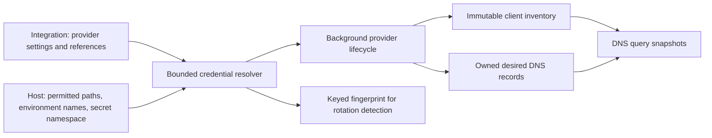
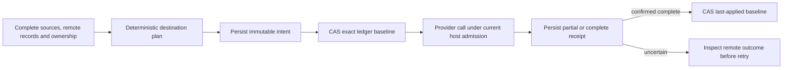
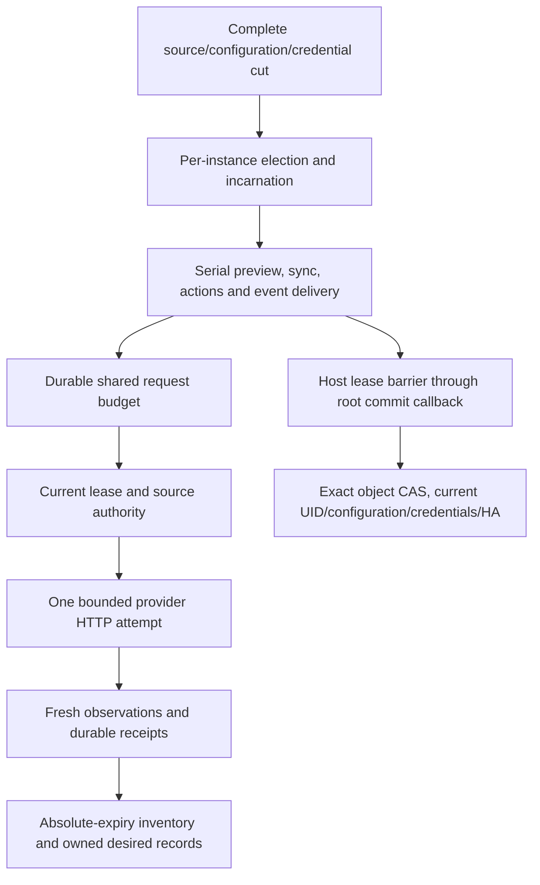
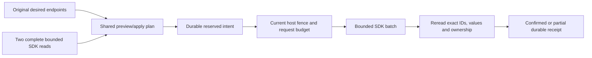
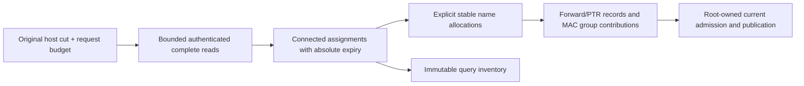

# Background integrations

The public `Integration` object describes Cloudflare publication, UniFi
inventory, or a Tier-B webhook. It is namespaced and uses the same generated
schema in SQLite and Kubernetes. Provider blocks must match `spec.type`;
Cloudflare requires an `apiToken` reference and UniFi an `apiKey` reference.
Deletion defaults to `Retain`, and every optional UniFi write defaults to off.
The [sample](../../config/samples/kudurru.io_v1alpha1_integration.yaml) starts
suspended so applying an example cannot publish records.

The schema, credential resolver, publication planner, durable ownership ledger,
background host, Cloudflare SDK adapter and UniFi polling adapter are implemented.
Production commit adapters, remaining providers and API/dashboard controls remain parts of the full
[v0.2 implementation](../v0.2/README.md).

`internal/credentials` accepts exactly one Secret, file, or environment
reference. File and environment references require explicit host allowlists.
Secret references cannot choose a namespace: the operator supplies it to the
resolver. These capabilities are captured immutably and replaced on host reload.
The resolver bounds credential sizes, returns private copies, and removes
provider error bodies before reporting lookup failures. A keyed HMAC fingerprint
detects changes without publishing a plain hash of the credential. Secret values
belong only to the provider instance; they never enter object spec, status,
query logs, or audit details.

The host and providers must remain outside the DNS query path. Queries consume
the inventory and zone snapshots already published in memory, including during
a provider outage. Source identity includes the Integration UID and relevant
spec identity, so deleting and recreating a provider cannot adopt stale client
claims or another instance's external records.

## Publication plans and receipts

`ee/integration/plan` selects original admitted record objects, including
public-only endpoints withheld from internal DNS. Global selection and zone
publication rules share type/domain/exclusion limits; endpoint labels override
record-set labels. Disabled or expired endpoints are omitted. Ambiguous rules
and incomplete source or remote snapshots refuse planning. Preview identity
includes source, configuration, credential fingerprint, remote versions and
private ledger versions, so stale preview cannot silently authorize new work.

One plan covers a complete destination with per-record `sync`, `upsert-only`
or `create-only` policy. The ledger retains the previous policy for removed
sources. Foreign ownership and CNAME conflicts protect the entire affected
owner. Adoption must be explicit. Ownership binds the cluster and Integration
UID; a legacy cluster-only remote marker additionally requires private ledger
evidence for the exact provider IDs.

`ee/integration/ledger` writes an immutable operation intent before reserving
an exact ledger baseline. Partial receipts retain provider IDs and completed
targets; they cannot regress or advance the baseline. Only a confirmed complete
receipt advances it. A current same-UID guard may record recovered historical
facts, but does not authorize replay under stale configuration or credentials.
Abandonment terminalizes the intent before releasing the reservation and requires
fresh authenticated before-state evidence after provider calls have stopped.

IntegrationLedger, IntegrationOperation, IntegrationBudget and IntegrationDelivery
are bounded private runtime kinds. The shared runtime registry includes them in
both store drivers, full backups and complete replication manifests, including
empty kinds. Safe configuration exports omit them. Real SQLite tests cover
fenced receipt recovery across restart; carrier tests cover native Kubernetes
Secrets, validation, exact creation semantics and safe export. External side
effects are not atomic with database commits.

## Background execution

`ee/integration/host` captures complete original sources and exact named
credentials, then elects and serializes each Integration UID. Replacement waits
for the old provider to stop. Missing credentials or incomplete input cancel
execution; failed inventory polls retain observations only until their original
absolute expiry. Source changes schedule a new reconciliation, while the host's
own receipt/status writes do not invalidate its desired-source identity.

Every actual provider request, including a retry or batch fallback, must enter
the host's request adapter with its original operation context. A cluster-wide
Cloudflare budget survives token/instance replacement. Rate limits and temporary
failures use bounded backoff; permanent failures wait for changed input or an
explicit command. Preview binds all destinations, and sync rejects a changed
preview before effects. Unknown or foreign remote outcomes remain pending until
a complete reread establishes ownership and outcome.

Recovery also accepts a partially applied RRset whose targets have mixed old
and new TTLs or provider options. Only rows bound to the exact pending operation
qualify: old provider IDs must retain captured before/after content, and new IDs
must carry the current Integration UID marker and exact intended content.
Explicit adoption additionally checks its original IDs, versions and unchanged
permission. Foreign siblings and CNAME conflicts remain protected. A mixed
observation cannot establish a complete RRset hash or masquerade as absence;
ordinary preview and executable planning still require consistent original rows.

Actions validate advertised bounded schemas and redact named credentials from
responses. Event delivery persists sanitized input and a stable delivery ID
before callbacks, retries to the original 24-hour deadline, and retains terminal
records for deduplication and audit. Delivery is at least once. Guarded retention
cleanup remains necessary before sustained production feeds.

The host's `WithLease` holds instance admission through the root writer callback;
the production adapter must still check current configuration, credentials and
HA authority inside the actual transaction or carrier CAS. The host does not
replace that commit check with a preliminary leader check. Real production
adapters and multi-node failover acceptance remain open.

## Cloudflare adapter

`ee/integration/cloudflare` uses the official Cloudflare Go v7 SDK. A provider
captures its exact cluster and Integration UID, configuration and named token.
It resolves each destination to the verified account and zone IDs and checks
the configured apex. Complete bounded pagination is read twice; disagreement,
duplicate IDs or malformed observations rejects the destination. These checks
detect observed drift; Cloudflare does not supply a transactional snapshot or
record compare-and-swap.

Preview and apply share the host planner and the same provider normalization.
Original source endpoints include public-only records. Provider defaults,
per-target options, translations, TTL, proxy and plan-specific metadata limits
are validated before remote effects. The comment ownership suffix binds both
cluster and Integration UID. Foreign or ambiguous markers stay protected;
explicit adoption may use unowned records or recognized external-dns heritage.

Every actual HTTP attempt enters the original host request context and durable
budget. SDK retries and redirects are disabled. Batches contain at most 200
effects with cancellation-aware cadence; uncertain outcomes require complete
rereads before another effect. Confirmed provider IDs and partial facts feed
the durable receipt ledger. No provider call runs on a DNS request.

Actual SDK tests against local HTTP servers cover UID-bound ownership, paging
drift, wire records, partial batches, ambiguous responses and restart recovery.
Host recovery covers mixed intermediate attributes. Production admission and
mounting remain required before enabling the adapter in a running server.

## Durable inventory evidence

`internal/inventory/persistence` stores the complete global inventory in the
replication runtime section: one versioned root and immutable digest-addressed
chunks. It retains source revisions, original observation and expiry timestamps,
and winning, removed or ambiguous address ownership. Restart and replica install
do not renew observations or reconstruct history from the current client list.

The owner is limited to 257 rows and 64 MiB. Concrete SQLite commands check the
literal owner prefix's row and byte totals before loading payloads. Replacement
checks the exact root digest and generation, then stages one generation advance
in the same transaction as the caller's source authority. A failed callback or
final admission rolls back all staged rows.

Writable SQLite startup initializes an explicit empty root only when no prior
inventory rows or private source authority exist. Followers receive the root
through replication. Complete image validation requires it, and the
`inventory-state-v1` feature prevents peers without this owner from silently
omitting it. The complete serving builder derives inventory from this same
candidate image as DNS and authentication. Held requests keep their original
snapshot and expiry even after replacement or store shutdown; a missing or
malformed owner rejects the candidate. Production source admission and allocation
updates remain separate integration work.

The pure `ee/integration/inbound` adapter now encodes complete original source
observations in bounded digest chunks. It validates target, generated-record,
allocation and private group evidence without inventing object UIDs or resource
versions. Strict decoding rejects duplicate or aliased JSON fields and incomplete
payloads; bounds cover metadata before serialization. Stable name allocation
retains reservations across omission, and returns new rows as create-only intent.
Complete image decoding binds every source, allocation, private group and global
inventory watermark to one validated image. It rejects missing ownership evidence,
target mismatches and duplicate inventory slots before preparing an overlay;
actual SQLite restart, replica installation and promotion preserve those proofs.
Its serving overlay suppresses ineligible live claims while retaining original
watermarks and merging authorized MAC contributions into detached public groups.
These functions confer no write authority: the production source command must
admit and save desired objects, allocations and global inventory together, then
acknowledge the exact primary publication.

## UniFi inventory adapter

`ee/integration/unifi` polls the official UniFi Network API over verified HTTPS.
The supported read contract is Network 10.6.106. It uses the MIT-licensed
unpoller/unifi data types and request builder; every actual request still passes
through the host's original context and durable request budget. Redirects,
ambient proxies and hidden retries are disabled. An explicit leaf-certificate
pin replaces CA trust while retaining hostname and certificate-time checks.

Site, network and connected-client pagination has bounded pages, bytes, attempts
and total observations. Complete client assignments are read twice, followed by
site/network/version verification; observed drift publishes nothing. Optional
legacy enrichment is limited to supported local Network 9/10 endpoints. Saved
names and notes can enrich metadata, but historical timestamps and fixed-IP
reservations never create a fresh address claim.

Successful connected-client observations produce absolute expiry, normally three
poll intervals. Failed polls retain that original deadline; complete omission
withdraws an address immediately. Restart requires a new observation. Ambiguous
address claims never fall back to an older owner. Queries read only the immutable
published inventory, including after the controller becomes unavailable.

When DNS inventory is enabled, the host lends the provider a copy of its original
captured destination zone. Forward records retain each observation's expiry.
Explicit authenticated network prefixes define bounded reverse-zone coverage;
PTRs require a live, unambiguous address and a unique allocated forward name.
Network/note groups contribute MAC matchers only, preserving IP reassignment
semantics. Devices without MACs cannot acquire group membership through an IP.

Collision names require an explicit allocation map; absent ambiguous allocations
fail closed. Production durable allocation, source-owned record/group merging,
manual membership preservation and reverse-child lifecycle admission remain root
integration work. Local HTTPS and actual host tests cover rotation, lease loss,
expiry, restart, drift, TLS, budget/cancellation and query-time memory isolation.
Optional DHCP DNS pushes, gateway mirroring and actions remain subsequent slices;
unsupported configured writes currently return an error.
