# Background integrations

The public `Integration` object describes Cloudflare publication, UniFi
inventory, or a Tier-B webhook. It is namespaced and uses the same generated
schema in SQLite and Kubernetes. Provider blocks must match `spec.type`;
Cloudflare requires an `apiToken` reference and UniFi an `apiKey` reference.
Deletion defaults to `Retain`, and every optional UniFi write defaults to off.
The [sample](../../deploy/kustomize/samples/kudurru.io_v1alpha1_integration.yaml) starts
suspended so applying an example cannot publish records.

The schema, credential resolver, publication planner, durable ownership ledger,
background host, Cloudflare SDK adapter and UniFi polling adapter are implemented.
The SQLite serving runtime mounts the host, concrete fenced ledger/source commands,
complete-image inventory publication and the `Delete` cleanup job (see
[Deletion policy](#deletion-policy-and-the-cleanup-finalizer)). The Kubernetes
store mounts the same host for Cloudflare publication, UniFi inventory and
group observation, the `Delete` cleanup and the administration API, and refuses
UniFi record publication, UniFi optional writes and webhook instances on their objects (see
[Kubernetes execution](#kubernetes-execution)). Integrations are written
through the generic object routes on both stores (see
[Writing Integrations](#writing-integrations)), and the dashboard's
Integrations page drives the same routes (see
[Dashboard](#dashboard)). Those refusals remain parts of the full
[v0.2 implementation](../../dev-docs/milestones/v0.2/README.md).

## Writing Integrations

An Integration is an object kind of `/api/v1/objects/integrations`,
`POST /apply` and `POST /integrations:batchDelete` (D400), written by the same
path as every other object: the API normalizes and sanitizes the document
(status and server metadata dropped), validates it strictly against the CRD
schema, and writes it as manager `api` with the stored `resourceVersion` as
its compare-and-swap. Two checks are specific to the kind, both decided on
the stored object the write is swapped against:

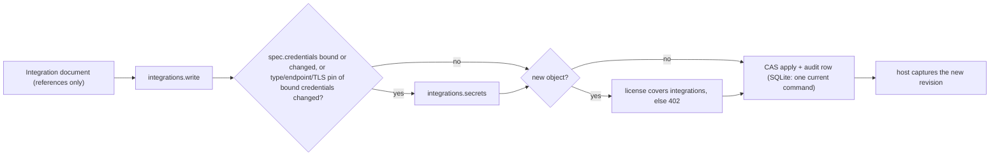

On SQLite the whole sequence runs in the root's current command: the
original raw credential is re-authorized against the attributes the command
derives from its own read (`integrations.write`, plus `integrations.secrets`
when credentials change or, while credentials are bound, `spec.type`,
`spec.unifi.endpoint`, `spec.unifi.tlsFingerprint` or `spec.webhook.endpoint`
changes), the license cut is re-checked at commit, and the
store arms the cleanup finalizer of a `Delete` policy and writes the audit row
in the same transaction. An enrolled follower forwards the write as the typed
object member command. On Kubernetes the API reads the object, checks, and
applies with `ExpectedResourceVersion`; the kube driver's audit spool records
the write. A validation failure that names `spec.credentials` is replaced by
a fixed message with the field paths only (the validator prints the refused
value quoted, so substring matching cannot be relied on), and every other
refusal has each string of `spec.credentials` removed in its raw, Go-quoted
and JSON-escaped forms, so a value pasted into a reference field is not
echoed, relayed or logged.
`GET /integrations/manifests` exposes the provider manifests and this
driver's refusals (`cmd/kudurru/integration_manifests.go`), so a form can
offer only what the host will run.

### Dashboard

The dashboard's Integrations page (`/integrations`,
`dashboard/src/pages/IntegrationsPage.tsx` and `IntegrationDetailPage.tsx`)
holds no list of providers. Its forms come from `GET
/integrations/manifests`: the provider block's JSON Schema becomes the C1
shape that `ShapeField` renders (`dashboard/src/lib/integrations.ts`), with
the manifest's `refused` fields left out and a type the node does not run
listed but not selectable; each credential key is a reference of a form in
`credentialSources` (a select of the granted names for a holder of
`integrations.secrets`), never a value. Writes are the object routes
(create-only `POST`, `PUT` with `If-Match`, `DELETE` with `If-Match`).
Every command is bound to the UID and revision of the status on screen; a
publishing sync sends the digest of the preview the operator reviewed, and
a refused (409) or uncertain (503 `integration_uncertain`) sync spends that
preview. After an uncertain sync the open page offers no other sync of that
instance (held by UID, so a status write that moves the revision does not
lift it) until a Check reports the endpoint reachable and the credential
accepted, or a Preview succeeds (a Check that answers but reports either one
failing keeps the hold); the hold is page state, so a
reload or another client is not held. A preview whose revision is no longer
the one on screen is dropped with a "Preview superseded" notice. Form
validation checks draft-only problems (half-typed numbers, durations, map
keys) on the draft and required fields on the built value against the
schema, so a required field of an optional object (Cloudflare
`adoptFrom.externalDNSOwner`, UniFi `inventory.zoneRef`) is required only
when that object is set. What a schema cannot state is kept by provider
block in `dashboard/src/lib/integrations.ts` and compared with the Go code
by `integrations.test.ts`: the publish rule (`PUBLISH_RULES`, the server's
`integrationPublishes`: a Cloudflare block, a webhook with domains, a UniFi
block with `push.mirrorRecords.enabled`), the destination fields, the
conditions between UniFi push fields that `validatePush` checks
(`FIELD_CONDITIONS`), and the reason a refused field is refused. On
Kubernetes the UniFi push switches are refused, so the push block is not
offered (its DHCP parameters mean nothing without their switch) and the
form names `UniFiPushUnsupportedOnKubernetes`.

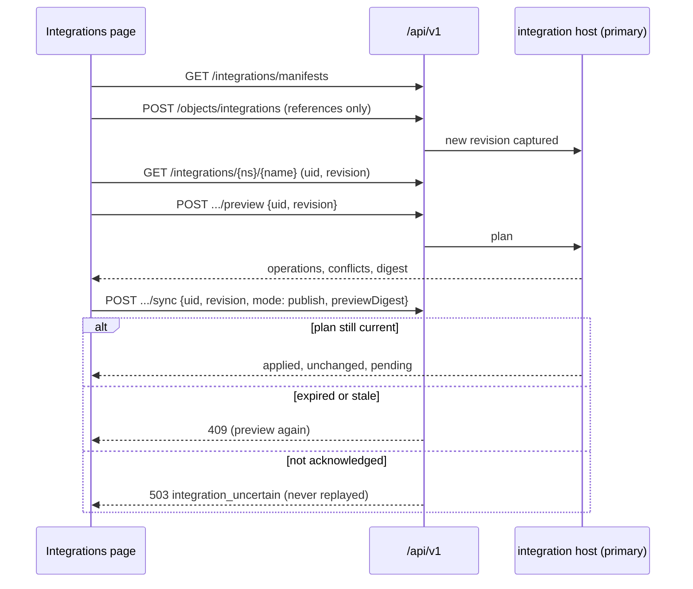

The page gates each control by permission (`integrations.read`, `write`,
`delete`, `secrets`, `check`, `sync`, `act`, `release`), by the license the
manifests report, by static mode, and on an enrolled follower by operation:
Integration writes are forwarded, check, preview, sync, actions and release
need the primary (`dashboard/src/lib/follower.ts`).

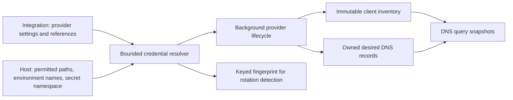

`internal/credentials` accepts exactly one Secret, file, or environment
reference. File and environment references require explicit host allowlists.
Secret references cannot choose a namespace: the operator supplies it to the
resolver. These capabilities are captured immutably; SQLite background capture detects
file/environment rotation and joins the old provider before replacement. SQLite
does not enable native Secret lookup, and neither does Kubernetes yet: there the
credential namespace would be the release namespace, which also holds kudurru's
own keys, so only allowlisted files and environment names resolve (D384).
The resolver bounds credential sizes, returns private copies, and removes
provider error bodies before reporting lookup failures. A keyed HMAC fingerprint
detects changes without publishing a plain hash of the credential. Secret values
belong only to the provider instance; they never enter object spec, status,
query logs, or audit details.

The host and providers must remain outside the DNS query path. Queries consume
the inventory and zone snapshots already published in memory, including during
a provider outage. Source identity includes the Integration UID and relevant
spec identity, so deleting and recreating a provider cannot adopt stale client
claims or another instance's external records.

## Publication plans and receipts

`ee/integration/plan` selects original admitted record objects, including
public-only endpoints withheld from internal DNS. Global selection and zone
publication rules share type/domain/exclusion limits; endpoint labels override
record-set labels. Disabled or expired endpoints are omitted. Ambiguous rules
and incomplete source or remote snapshots refuse planning. Preview identity
includes source, configuration, credential fingerprint, remote versions and
private ledger versions, so stale preview cannot silently authorize new work.

One plan covers a complete destination with per-record `sync`, `upsert-only`
or `create-only` policy. The ledger retains the previous policy for removed
sources. Foreign ownership and CNAME conflicts protect the entire affected
owner. Adoption must be explicit. Ownership binds the cluster and Integration
UID; a legacy cluster-only remote marker additionally requires private ledger
evidence for the exact provider IDs.

`ee/integration/ledger` writes an immutable operation intent before reserving
an exact ledger baseline. Partial receipts retain provider IDs and completed
targets; they cannot regress or advance the baseline. Only a confirmed complete
receipt advances it. A current same-UID guard may record recovered historical
facts, but does not authorize replay under stale configuration or credentials.
Abandonment terminalizes the intent before releasing the reservation and requires
fresh authenticated before-state evidence after provider calls have stopped.
An intent with acknowledged effects is abandoned only by a publisher that has
no recovery path (the reviewed UniFi mirror, D401), and only when the same
complete reread shows the baseline and none of the provider IDs acknowledged
to it; those facts stay in the operation as `undone`.

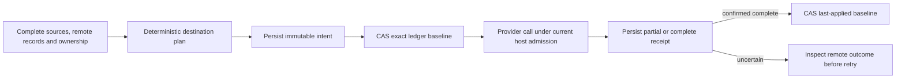

IntegrationLedger, IntegrationOperation, IntegrationBudget, IntegrationDelivery
and IntegrationEventCursor (D379) are bounded private runtime kinds. The shared runtime registry includes them in
both store drivers, full backups and complete replication manifests, including
empty kinds. Safe configuration exports omit them. Real SQLite tests cover
fenced receipt recovery across restart; carrier tests cover native Kubernetes
Secrets, validation, exact creation semantics and safe export. External side
effects are not atomic with database commits.

## Background execution

`ee/integration/host` captures complete original sources and exact named
credentials, then elects and serializes each Integration UID. Replacement waits
for the old provider to stop. Missing credentials or incomplete input cancel
execution; failed inventory polls retain observations only until their original
absolute expiry. Source changes schedule a new reconciliation, while the host's
own receipt/status writes do not invalidate its desired-source identity.
The SQLite root binds each instance to its own authority dependencies, excluding
incidental target status and its own generated facts. Equivalent capture refreshes
supply future operations with fresh immutable inputs; held operations keep their
original root resource and source-zone copy. Exact original UID/resource versions
are still compared inside every desired-object transaction. Configuration,
credential, admission or selected outbound source replacement revokes authority.

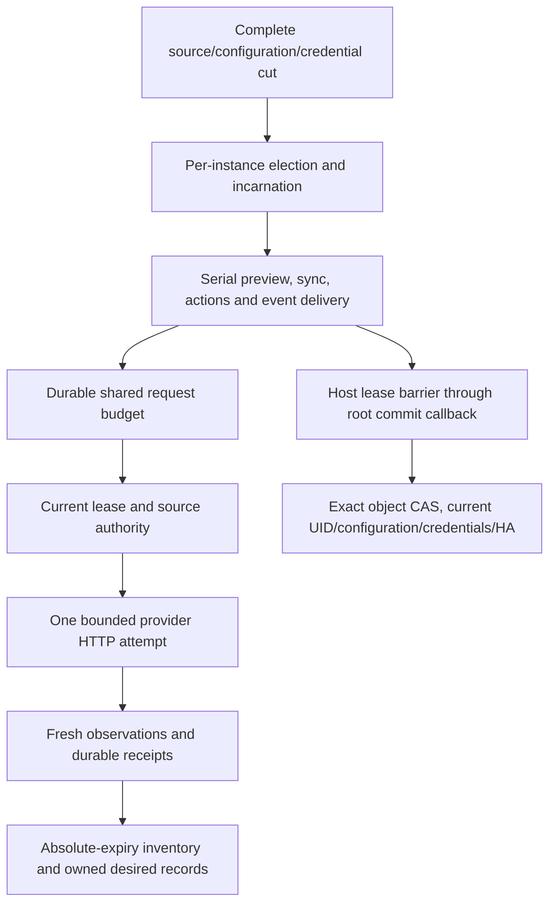

Every actual provider request, including a retry or batch fallback, must enter
the host's request adapter with its original operation context. A cluster-wide
Cloudflare budget survives token/instance replacement. A reservation that loses
the budget's compare-and-swap to another instance is attempted again, fenced,
after a growing pause, until the request's own deadline. Rate limits and temporary
failures use bounded backoff only when explicitly classified temporary or
rate-limited. Fencing, refused, permanent and unclassified failures wait for
changed input or an explicit command; no refused command is automatically replayed. Preview binds all destinations, and sync rejects a changed
preview before effects. Unknown or foreign remote outcomes remain pending until
a complete reread establishes ownership and outcome.

Recovery also accepts a partially applied RRset whose targets have mixed old
and new TTLs or provider options. Only rows bound to the exact pending operation
qualify: old provider IDs must retain captured before/after content, and new IDs
must carry the current Integration UID marker and exact intended content.
Explicit adoption additionally checks its original IDs, versions and unchanged
permission. Foreign siblings and CNAME conflicts remain protected. A mixed
observation cannot establish a complete RRset hash or masquerade as absence;
ordinary preview and executable planning still require consistent original rows.

Actions validate advertised bounded schemas and redact named credentials from
responses.

### UniFi optional writes (D401)

UniFi writes are explicit operator commands on SQLite; the Kubernetes root
refuses an Integration that enables one. The record mirror makes the UniFi
provider a publisher whose roles say `Reviewed`: a periodic or reconcile sync
of such a publisher builds no plan and applies nothing. It reads the provider
only when a ledger row is pending, and then only settles that intent from a
fresh complete reread (confirm, or abandon when the site shows exactly the
baseline and none of the policies a partial create had acknowledged). New operations run only from a reviewed sync bound to a preview
digest. DNS policies cannot carry an ownership marker, so the adapter reports
every A and CNAME policy as an `Unmarked` row, and every other policy as a
claim on its name. The planner treats an unmarked row as the Integration's
exactly when the confirmed ledger of its RRset lists its ID; recovery also
accepts an ID that the provider acknowledged to the pending intent's own
receipt. Any other policy is a conflict that is never modified or adopted.
The DHCP DNS server override and client block/unblock are advertised actions
(`dhcp-dns-servers`, `block-client`, `unblock-client`) present only when the
spec enables them. The DHCP action previews a plan whose digest binds every
network body it read, and applies only under that digest. An action may refuse
before any effect with a stale review or an inapplicable plan; every other
action failure is an uncertain outcome, and nothing is replayed.

```mermaid
flowchart TD
    Tick["Poll or reconcile tick"] --> Pending{"Ledger row pending?"}
    Pending -- no --> Observe["Observe inventory only"]
    Pending -- yes --> Reread["Complete DNS policy reread"] --> Settle["Confirm, abandon, or stay pending"] --> Observe
    Review["Reviewed sync with preview digest"] --> Plan["Plan: unmarked rows owned only by ledger IDs"]
    Plan --> Effects["One request per policy effect, no retry"]
    Effects --> Receipt["Reread and receipt"]
    Act["Reviewed act (integrations.act)"] --> Action{"Action"}
    Action -- dhcp-dns-servers --> DHCP["Preview digest, or apply under it"]
    Action -- block or unblock --> Station["One legacy cmd/stamgr command"]
``` Event delivery persists sanitized input and a stable delivery ID
before callbacks, retries to the original 24-hour deadline, and retains terminal
records for deduplication and audit. Delivery is at least once. Retention
bounds the rows of each hook instance by count and by time (see the hook
events section below).

The host's `WithLease` holds instance admission through the SQLite root command.
The root retains the original credential/key/license cut and elected writer token,
then pins complete serving dependencies through the concrete transaction. It
compares current Integration UID, resource version and configuration, plus the
original selected source UID/resource versions; memory-only final checks run
before commit, including no-ops. Provider I/O occurs outside those gates. Actual
SQLite replica-install/promotion acceptance verifies that a held observation
cannot commit after its original writer is fenced.

`Retain` is the default deletion policy. On SQLite a `Delete` instance runs
like any other while its object is live, and an elected cleanup job ends it
after a delete request; both are described under
[Deletion policy](#deletion-policy-and-the-cleanup-finalizer). On Kubernetes
the root arms the cleanup finalizer itself before the instance may make any
provider call, and the same cleanup job runs; see
[Kubernetes execution](#kubernetes-execution) and the
[operator guide](../deploy/integrations.md).

## Kubernetes execution

On the Kubernetes store every replica runs the host (D384). Each Integration
has its own Lease (`kudurru-integration-<digest>` in the release namespace);
the replica holding it captures the Integration, its credentials and, for a
publisher, the admitted record sets from that replica's live watch snapshot.
A replica serving a `local.db` snapshot captures nothing. Only Integrations in
the release namespace run: the credential allowlist is node-wide, so an
Integration in any other namespace is refused with reason
`NamespaceNotAllowed` before any provider exists. An Integration the root
refuses outright (another namespace, a webhook, UniFi record publication or an optional UniFi write) has
its credential references left unresolved, so no fingerprint of an
allowlisted credential is written to its status. While the controller
reports, for an admitted record set's current generation, that the zone drops
or rejects part of it (`Duplicated`, `Occluded` or `Invalid`), every publisher
is refused with reason `SourceConflicted` and a message naming up to five
such record sets, written on each publisher's object by its Lease holder.
SQLite makes the whole capture unavailable for a duplicated source
projection; Kubernetes halts only the publishers, because only they read
sources: UniFi observers keep running. All publishers halt, not only those
whose selection includes the record set, because a publisher plans from its
whole selection and the root would otherwise have to repeat each provider's
own zone, label, type and exclusion rules to tell; leaving the record set
out of the selection instead would let a `sync` publisher delete its remote
copy. The refusal is asked again after every capture, so a running publisher
is stopped and joined when a conflict appears, and replaced by a running one
when it clears.

```mermaid
sequenceDiagram
    participant Host as Host (Lease holder)
    participant API as Kubernetes API
    participant CF as Cloudflare
    Host->>API: GET Lease (holder, acquire time, transitions, renew time)
    Host->>API: GET Integration (UID, resourceVersion, spec digest, mode)
    Host->>API: one create or exact-resourceVersion write of a ledger Secret
    Host->>API: GET Lease, GET Integration
    Host->>CF: one provider request
    Host->>API: GET Lease, GET Integration
    Host->>API: exact-resourceVersion write of the operation receipt
```

Before every provider request and every store write the root adapter reads the
Lease and refuses unless it still names this replica with the acquisition it
recorded when its term started and an unexpired renew time
(`store.VerifyTerm`). It then reads the Integration and refuses unless its UID,
resourceVersion, spec digest and guard mode are the captured ones, and checks
every captured source zone and record set against the replica's current
snapshot by UID and identity: everything but status, resourceVersion and
managed fields. The controller writes zone and record set status after every
change; those writes change no published input, so they neither fence an
effect reserved just before them nor wake or replace the instance. The one
part of that status the check does read is a conflict report: a captured
record set the controller has since reported `Duplicated`, `Occluded` or
`Invalid` fences the next effect, before the next capture refuses the
publisher. Only
the private ledger, operation, budget, delivery and event-cursor kinds can be
written, each by one create-only or exact-resourceVersion Secret write that is
never forced or repeated; only ledger, operation, delivery and cursor rows can
be forgotten, by exact UID and resourceVersion, in order, ledger row first.
Integration status is written by the Lease holder with the captured
resourceVersion as precondition; the capture leaves status and
resourceVersion out of each instance's authority, so a status write never
replaces the instance. A refusal status that could not be written marks its
job with a retry time: one poll interval after the first failure, doubling
with each consecutive failure up to five minutes. The first capture at or
after that time replaces the job, so a new term writes the refusal again.
Nothing wakes the host early, so a status write that keeps failing (RBAC, an
admission webhook, validation) costs at most one Lease term, one capture and
one status write per backoff step.

What this does **not** make atomic: the Lease is a rejection check, not a
lock, so a request or write already sent after a passing check can land after
the Lease is lost (it is then a serializable predecessor of the successor's
CAS or a conflict, and a pending intent it leaves forces a fresh reread); the
Integration and source checks are reads just before the write, not part of
it; a multi-row forget can stop part way; and remote provider effects are not
atomic with any store write, as on SQLite. The shared request budget is one
Secret written by exact CAS, and a lost CAS writes nothing; the request then
makes fresh reservation attempts, each after a jittered pause that doubles
from 10 ms to at most 250 ms and its own fence (a reservation is commutative
and idempotent by its ID, D364), until one is written or the request's own
context ends: its operation timeout, or the cancellation of its lease or job.
Every lost round lets at least one contender through, so any number of
instances reserving together all settle. Without this, instances starting
together on two replicas collided on the budget's first write and a loser's
setup failed, leaving it inert until its object changed; a fixed bound of four
attempts still left one of four instances inert. No request is sent
unreserved. The Lease
proof is holder identity, acquire time and transition count, and the identity
is the node name: two live processes that share a name (a force-deleted
StatefulSet pod still running on a partitioned node and its replacement) both
pass it. The proof assumes one live process per identity.

### Inbound sources on Kubernetes

A UniFi instance without `spec.unifi.inventory` observes clients and their
VLAN or note groups. Only the Lease holder polls the provider; its commit
(`cmd/kudurru/integration_kube_source.go`) has one commit point, the
`IntegrationSourceHead` of that Integration UID:

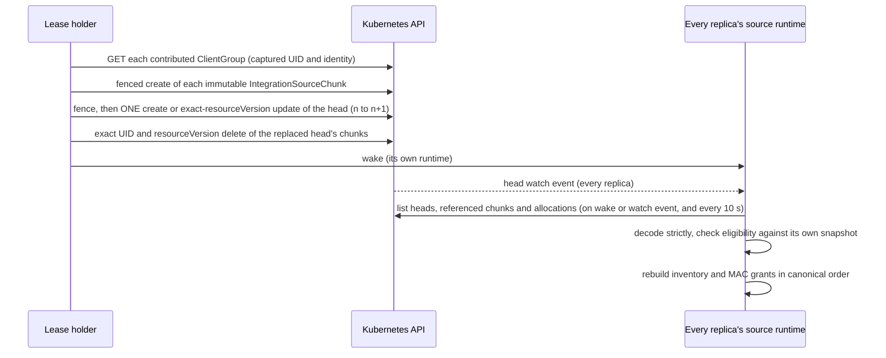

`kube.IntegrationSourceBackend` stages the chunks and rechecks that each is
durable before the head write; a lost head CAS writes nothing and leaves the
previous source plus unreferenced chunks. A head write that was sent and not
acknowledged (`kube.ErrSourceOutcomeUnknown`) is resolved by one read of the
head: the head written is a commit; anything else is reported as an
uncertain outcome (`integration_uncertain`, the intent pending) and never
written again. Every private integration carrier
decodes strictly, so a damaged one is an error rather than an absent row.
Committed means the head CAS succeeded; Published means the committing
replica's own source runtime installed that root.

Every replica runs the source runtime (`integration-sources`,
`cmd/kudurru/integration_kube_sources.go`). It decodes the listing with
`inbound.DecodeCarriers` and decides eligibility against its own object
snapshot, with no store read on the query path: the Integration must have the
head's owner UID, not be suspended or deleting, run on this store and have the
head's spec digest; every target zone and evidenced object must exist with the
same UID and intent digest. Suspending or editing the Integration therefore
closes its inventory and grants on every replica without a new commit. The
eligible sources are rebuilt into one inventory in a canonical order (accepted
time, then source ID), so replicas that read the same heads arbitrate addresses
alike; the cross-source removal watermarks SQLite persists are not durable
here. The identify stage reads that inventory, and MAC contributions become
policy grants (`policy.Options.MACGrantsInput` through
`zonecache.Cache.SetInput`) with the original exclusive expiry, never
renewed. A failed relist keeps the last listing, so during an API outage a
replica keeps answering until each observation's original expiry and then
stops. Every replica watches the heads, so it relists and installs a
successor head within one watch delivery; the ten-second relist is only the
backstop for a watch that is down, and a relist that finds a chunk already
retired by the holder is repeated at once. An observation expires three
polls after it was made, truncated to the second, so a non-holder's grant
stays continuous only while one poll-and-commit cycle of the holder plus one
watch delivery is shorter than about two polls: at the one-second minimum
poll a slow cycle can let grants lapse until the next commit; two seconds or
more is qualified.

What is not atomic: the contributed groups are read live just before the head
write, not in it (each replica re-checks the group's UID when it grants); the
deletion of replaced chunks can fail, which leaves unreferenced chunks that no
source uses; and a head CAS lost after its chunks were staged leaves those
chunks until the instance is purged. UniFi record publication
(`spec.unifi.inventory`: source-owned DNS records and reverse zones) is not
certified on this store yet and is refused with reason
`RecordPublicationUnsupportedOnKubernetes`; webhook (Tier-B) instances need
SQLite's change feed for hook events and are refused with
`UnsupportedOnKubernetes`.

### Administration on Kubernetes

`/api/v1/integrations` and `kudurru integrations` work on Kubernetes
(`cmd/kudurru/integration_kube_admin.go`). List and get read the Integration
from the replica's snapshot; the phase comes from the Ready condition the
Lease holder writes, so every replica answers alike, and is known only when
that condition observed the current generation (an instance no job runs for,
such as a suspended one, shows the status every replica derives locally).
`leader` says whether this replica holds the instance's Lease. Check,
preview, sync, actions and act run only on the Lease holder, with the exact
reviewed UID and revision; any other replica answers `503` with the holder's
name in `hint.holder` and never forwards or replays the request. When no
other replica holds the Lease (a suspended, unlicensed or paused instance,
or one between two jobs), the `503` names no holder and carries the
instance's `phase` and `reason` instead. The route
permission is the only authorization: there is no original-credential proof
re-checked inside each effect as on SQLite, so a permission withdrawn while a
command runs does not stop it. A reviewed sync or act is recorded as a
structured log line on the holder (`integration.sync`, `integration.act`),
because this store has no kudurru audit table. An unacknowledged sync or act
answers `integration_uncertain` and is not replayed.

### Delete on Kubernetes

The store has no kudurru admission, so the root arms the reserved finalizer:
a live Integration that runs here with `deletionPolicy: Delete` gets it by one
metadata patch bound to its UID and resourceVersion; one whose policy is no
longer `Delete` is disarmed the same way. Until a capture shows the finalizer
the host pauses the instance (`CleanupFinalizerMissing`) and every fence
refuses it, so nothing is owned unarmed. Replicas may race; losers conflict
and change nothing. A refused instance is neither armed nor disarmed; one
armed before it became refused (UniFi that gained `spec.unifi.inventory`)
keeps the finalizer, and its cleanup, which makes no provider request, is the
one effect the fences admit for it. `kubectl delete` then leaves a terminating object, and the
same cleanup job as on SQLite runs under the instance's Lease. Its local purge
is a sequence of fenced exact-UID and resourceVersion deletes (source-owned
objects, then the head, then its chunks, allocations and deliveries), so a cut
purge leaves a suffix the next run removes; it is not one transaction. The
finalizer is removed last by one metadata patch bound to the guard's UID and
resourceVersion. The cleanup summary is a structured log line. Changing the
policy to `Retain`, the reviewed release command, or removing the finalizer
by hand ends the obligation without cleanup, which is `Retain`.

## Deletion policy and the cleanup finalizer

An Integration whose `spec.deletionPolicy` is `Delete` promises that the
records it published are removed before the object is. The durable form of
that promise is the reserved finalizer `kudurru.io/integration-cleanup`
(D367): while it is present, a delete request only sets the deletion
timestamp, and the object stays readable with its spec, credential
references, UID and status for the cleanup owner. No private tombstone kind
exists, and no writer's document decides the finalizer.

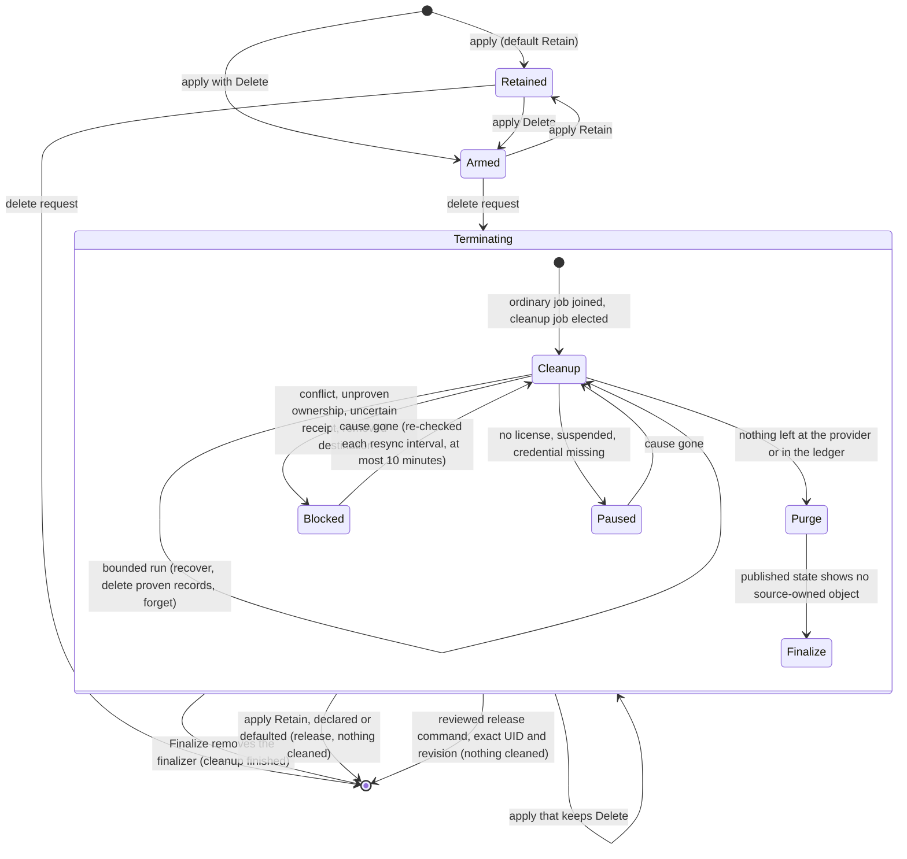

- **SQLite** decides the finalizer at admission, inside `Apply`: the
  defaulted policy `Delete` arms it in the same write as the spec, so every
  write of a `Delete` Integration stores it armed. A manager's whole-object
  apply without finalizers, a `Force` takeover and an apply during
  termination all keep it. Changing the policy to `Retain` removes it, which
  on a terminating object is the release. The rule reads the defaulted
  policy, so a document that omits `deletionPolicy` is a change to `Retain`
  too. The audit row of an apply that drops the finalizer says so
  (`disarmed: ...` on a live object, `released without cleanup: ...` on a
  terminating one, where the action is `integration.finalize`), because no
  cleanup ran.
- Admission acts on writes only. A live `Delete` Integration that is stored
  without the finalizer (a database written before admission armed it, or a
  live finalizer removal) is not armed by being read. The file reconciler
  closes that gap for declared objects: it applies the document of such an
  object on its next pass even though the document is unchanged, which arms
  the object and changes nothing else. Until that pass the object is unarmed,
  so the SQLite root checks the finalizer inside every transaction of a
  `Delete` instance (fence, intent, budget charge, receipt, source commit and
  status): an unarmed one gets no provider call and owns no external state.
  The host reports it as `Paused` with reason `CleanupFinalizerMissing`.
- A delete request is the file reconciler's orphan delete, because
  Integrations are file-declared on SQLite. It is made and counted once:
  while the object waits with its deletion timestamp, later passes leave it
  alone and report nothing. Re-adding the document with `Delete` does not
  finalize or revive the object. Re-adding it with `Retain`, or without a
  `deletionPolicy` line, releases it; the reconciler logs that pass as
  `objects: finalized` instead of an ordinary update.
- **Kubernetes** has no kudurru admission, so the driver never arms the
  finalizer on its own; the Kubernetes root does (see
  [Delete on Kubernetes](#delete-on-kubernetes)). The driver
  carries that finalizer through server-side apply and
  through the `Force` takeover, which otherwise removes every field the new
  manager omits. The reconciler's extra apply of an unchanged `Delete`
  document is a no-op at the apiserver there and is reported as unchanged.
- The only other writer is `store.FinalizerWriter.UpdateFinalizer`, a
  metadata-only change bound to the exact UID and resource version the
  caller observed. It keeps manager, spec, status and generation, never
  retries on a newer object, and removes a terminating object when its last
  finalizer goes. SQLite offers it inside a command transaction
  (`CommandTx.UpdateFinalizer`), so finalization can commit together with
  its checks and audit; Kubernetes uses a merge patch under the separate
  field manager `kudurru-finalizer`. The patch replaces the whole finalizer
  list, so it carries the observed resource version as the apiserver's
  optimistic lock: a change between the driver's read and its write is a
  conflict, and a finalizer another actor added in between survives.

The planner has an explicit cleanup mode (`plan.Input.Cleanup`). It refuses
desired records and per-record policies and plans deletes only. A record set
is deleted when every row carries this cluster and Integration UID marker (or
the ledger-proven legacy marker), every provider ID is listed in the confirmed
ledger baseline of that record set, and its name has no conflict. For those
record sets `Delete` overrides the destination's and the ledger's retained
`upsert-only` or `create-only` policy. A marker alone never authorizes a
delete, because a marker can be copied with a record. Every record set of the
owner that the plan leaves in place is listed in `Plan.Retained` with its
reason (conflict at the name, a record set shared with rows of another owner,
or a marker without ledger evidence); a destination is clean exactly when a
cleanup plan from a fresh complete snapshot has neither operations nor
retained entries. The flag is part of the plan digest, and ordinary plans
keep the digests and operation IDs they had before.

`ledger.Repository.Forget` is the only transition that deletes private
publication state. It removes one record's ledger row and its operations by
exact UID and resource version, row first. It refuses a pending row, a
partially applied operation, and a baseline that still lists provider content
unless the host supplies a fresh complete observation that the provider no
longer holds the record. The SQLite root commits a forget in one fenced
command under the same lease, configuration and writer checks as every ledger
write, and can name only ledger and operation rows: the shared request budget
is out of its reach and survives every instance. The host counts the ledger
rows of a whole Integration incarnation across destinations, so rows of a
destination that was removed from the spec are found and reported instead of
being ignored. It reads the rows themselves one configured destination at a
time, as a sync does, and the operations in bounded batches and stored pages:
nothing removes an operation while an instance lives, so a history has no
bound and is never held or committed as a whole.

### The terminating job

The host decides from each captured object what it runs, and every job holds
one mode for its lifetime (`ExecutionGuard.Mode`). A change of mode replaces
the job like any other change of authority: the old job is canceled and
joined before the next one may be elected on the same per-instance key.

| Captured object | Job | Mode |
| --- | --- | --- |
| live, armed or policy `Retain` | ordinary lease | normal |
| live, policy `Delete`, finalizer missing | none: `Paused/CleanupFinalizerMissing` | none |
| deleting, cleanup finalizer, policy `Delete` | cleanup | `cleanup` |
| deleting, cleanup finalizer, any other policy | release | `release` |
| deleting, no cleanup finalizer | none: `Paused/Deleting` | none |

The SQLite root repeats that rule on its own (`integrationGuardAdmits`), in
three places: against its captured cut, against the stored object before an
effect, and against the object it reads in the transaction of every effect.
Each time it needs the same UID and resource version and a state that is what
the guard's mode claims. A guard never widens what its object allows, so a
host that claimed the wrong mode would get no provider call, no commit and no
finalization from root. Operator commands are refused for a
terminating job, and its lease takes a concurrency slot for each bounded run
only, so a blocked cleanup waits without holding one.

A cleanup lease repeats runs, each bounded by the operation timeout and each
on a freshly captured frame (the job's own status write is a new resource
version of the object), until the finalizer is gone:

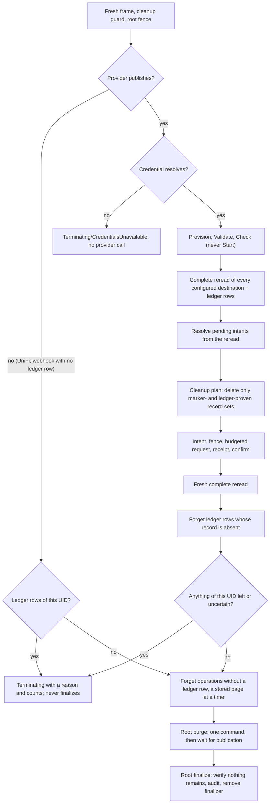

- **Recovery.** A pending intent is settled before anything is planned, by
  the unchanged rules: an observed complete outcome is confirmed, an untouched
  one abandoned, a partial one resumed only while it is still authorized. In
  the cleanup mode a partially applied delete is resumed even if the
  credential or the configuration changed since it was recorded, because its
  authority is the proven ownership of the rows plus the terminating guard.
  Any other partial intent stays pending: nothing is desired any more, so
  finishing a create or an update is not authorized, and the instance stays
  `Terminating/PendingRecovery` until the operator releases it. A run that
  cannot settle a pending intent stops there, before any delete.
- **Deletes.** Cleanup plans carry nothing desired and are executed by the
  same code as an ordinary sync. Proven record sets are deleted even when
  other record sets block finalization; nothing is ever deleted on a marker
  or on a ledger row alone.
- **Forget.** After a fresh complete reread, a ledger row goes when its
  baseline is absent (a confirmed delete) or when the snapshot holds none of
  its provider IDs and no row with the owner's marker at its key (a record
  someone else removed). A row whose provider IDs still exist without the
  marker is kept and reported. A row leaves with the operations of its record
  that one bounded batch holds (4,096 operations, 8 MiB). What a longer
  history leaves behind, and intents that never got a ledger row, are
  forgotten once no ledger row is left, one stored page at a time, until a
  complete read finds none. A run that reaches its bound there has made
  progress, and the next one continues.
- **Blocked.** `RecordsConflict` (a conflict at the name, or a record set
  shared with another owner's rows), `OwnershipUnproven` (a marker without
  ledger evidence, or ledger provider IDs that still exist without the
  marker), `PendingRecovery`, `DestinationRemoved` (ledger rows of a
  destination the spec no longer names, or of an instance whose provider does
  not publish), `SnapshotIncomplete` and `LocalStateRemains` never finalize.
  The reason and the counts (records not yet forgotten, record sets left in
  place, uncertain writes) are in the host status, and the job that holds the
  lease also writes them to the object's `Ready` condition and
  `status.records`. The records not yet forgotten are counted when a run
  starts, so a run that stops early reports them too, and a run that root
  fences before it could count keeps the counts of the last one. A blocked
  cleanup is re-evaluated at the instance's resync interval, at most every
  ten minutes, and at once when the object changes.
- **Paused.** `LicenseUnavailable` and `Suspended` start no job, so only the
  host status shows them and the object keeps the condition last written;
  `CredentialsUnavailable` ends the lease before any provider call. All three
  resume by themselves when the cause is gone. `BudgetExhausted`,
  `RateLimited`, `ProviderFailed` and `ProvisionFailed` back off and retry;
  the shared request budget row is charged like any other request and is
  never removed.
- **Local failures.** `CleanupFailed` is a failed read or write of the local
  store, `ProviderUnavailable` a type this build has no provider for, and
  `ReleaseFailed` a release whose finalizer removal was refused. All are
  repeated at the resync interval, except a `CleanupFailed` run that its
  30-second bound cut without any progress in one of the cleanup's own local
  steps (a ledger count, a ledger or history read, a fence, an intent,
  receipt or confirmation commit, a forget, the purge or the finalization):
  a store too slow for the bound backs off and retries like a provider
  failure, and is not reported as `ProviderFailed`. A provider request that
  itself returned only after the bound is `ProviderFailed`, even though the
  receipt commit that follows it on the expired bound fails too.
  `CapacityExceeded` is a bounded read that met more than it admits, from
  which nothing was decided: more than 100,000
  ledger rows in the store or more than a sync admits per destination on the
  host side, and on the root side more than 200,000 stored rows of one kind
  that the purge or the finalization scans in its transaction. That root
  bound is not reached first: root's capture begins with
  `ReadGeneration`, which refuses a store of more than 100,000 objects or
  256 MiB of documents of all kinds (the replication image defaults), and
  then no integration job gets a frame. Operations, which ordinary life
  never prunes, count toward that store limit; it is the open limit on an
  instance's history.
- **Long histories.** Operations leave in bounded commits: a ledger row with
  the first of its record's operations, at most
  `ledger.MaxForgetOperations` (1,024), the rest a stored page at a time once
  no ledger row is left. A run that already made progress yields before its
  next commit once less of its bound is left than one and a half times the
  last commit took (or an eighth of the bound), and a run that its bound cut
  inside a commit without any progress halves the commit size for the rest
  of the lease instead of being reported as a provider failure.
- **Purge.** `integrationRuntime.purge` removes, in one SQLite command, the
  record sets and zones the instance's source owns (each must still be the
  UID and resource version of the captured cut), its source head and chunks,
  its name allocations and its deliveries, and withdraws its clients from the
  global inventory. Every delete names the exact UID and resource version
  read in that transaction. It then waits until the published bundle shows
  none of it, so a finalized instance leaves no record answering. A complete
  image never holds a head without its chunks or allocation evidence without
  its allocation, which is why this is one command.
- **Finalize.** `integrationRuntime.finalize` verifies in its transaction
  that no ledger row, operation, source head or chunk, name allocation,
  delivery or source-owned object of the incarnation is left, removes the
  finalizer with `CommandTx.UpdateFinalizer` by the guard's exact UID and
  resource version, and records an `integration.cleanup` audit row with what
  the finalizing lease deleted, forgot and purged. Earlier leases wrote their
  own audit rows when they committed. Anything left is `LocalStateRemains`.
- **Release.** A terminating object that carries the finalizer under any
  policy other than `Delete` is finalized by the release job: no provider is
  built, nothing is cleaned, and neither the license, the credential nor
  suspension matters. Its audit row is `integration.release` and lists what
  stays behind. SQLite admission already releases such an object in the
  apply that changes the policy, so on SQLite this job only meets state that
  no apply stored; it is the path a Kubernetes host needs.
- **Reviewed release command.** `POST /integrations/{namespace}/{name}/release`
  (`kudurru integrations release NAME --uid --revision`, permission
  `integrations.release`) is root's, not the host's
  (`integrationRuntime.IntegrationRelease`). It binds the operator's review:
  the object in the request's published snapshot and the one read in the
  command must both be the reviewed UID and resource version, be deleting and
  carry the finalizer, under any policy. ONE current command re-authorizes the
  original credential, counts what stays, removes the finalizer with
  `CommandTx.UpdateFinalizer` by that exact identity and records
  `integration.release`. It needs no license, credential or provider and does
  not take the per-instance lease: a cleanup run that holds the lease is
  fenced by the removal at its next effect, and a provider request already in
  flight leaves its ledger row with a pending intent, like any released
  incarnation. Summaries (`GET /integrations`, `GET /integrations/{namespace}/{name}`)
  carry `deletionPolicy`, `terminating` and `deletionRequestedAt` from the
  stored object and, while the host's status for that revision is
  `Terminating`, its `remaining`, `blocked` and `uncertain` counts.

Failover needs no extra state: the finalizer, the ledger and the operations
are durable, a fenced writer can neither record a receipt nor finalize, and
the next lease starts from a complete reread. Mounted tests stop and reopen
the whole SQLite runtime in the middle of a cleanup (with an unreadable
record list, and after a batch whose answer was lost), promote a replica
while the old writer's delete batch is held at the provider, and let the
license expire while a batch is held; in each the batch is sent once and the
next writer settles it by a reread.

Automatic inventory-only polling retains its configured future schedule after an
original-frame fence while both the job and lease remain active. The refused
acquisition stays refused; the next timer event captures and authorizes its own
frame. A changed source still cancels and joins the old job before replacement.
This scheduling rule does not apply to outbound Publishers, explicit commands,
canceled jobs or permanent provider errors (D284).

## Cloudflare adapter

`ee/integration/cloudflare` uses the official Cloudflare Go v7 SDK. A provider
captures its exact cluster and Integration UID, configuration and named token.
It resolves each destination to the verified account and zone IDs and checks
the configured apex. Complete bounded pagination is read twice; disagreement,
duplicate IDs or malformed observations rejects the destination. These checks
detect observed drift; Cloudflare does not supply a transactional snapshot or
record compare-and-swap.

Preview and apply share the host planner and the same provider normalization.
Original source endpoints include public-only records. Provider defaults,
per-target options, translations, TTL, proxy and plan-specific metadata limits
are validated before remote effects. The comment ownership suffix binds both
cluster and Integration UID. Foreign or ambiguous markers stay protected;
explicit adoption may use unowned records or recognized external-dns heritage.

Every actual HTTP attempt enters the original host request context and durable
budget. SDK retries and redirects are disabled. Batches contain at most 200
effects with cancellation-aware cadence; uncertain outcomes require complete
rereads before another effect. Confirmed provider IDs and partial facts feed
the durable receipt ledger. No provider call runs on a DNS request.

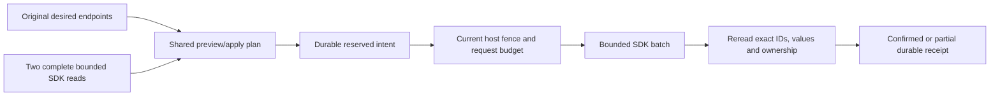

Actual SDK tests against local HTTP servers cover UID-bound ownership, paging
drift, wire records, partial batches, ambiguous responses and restart recovery.
Host recovery covers mixed intermediate attributes. SQLite production mounting
uses this adapter and the same durable ledger protocol; local root acceptance
also exercises a publisher double through actual fenced ledger and budget writes.

## Durable inventory evidence

`internal/inventory/persistence` stores the complete global inventory in the
replication runtime section: one versioned root and immutable digest-addressed
chunks. It retains source revisions, original observation and expiry timestamps,
and winning, removed or ambiguous address ownership. Restart and replica install
do not renew observations or reconstruct history from the current client list.

The owner is limited to 257 rows and 64 MiB. Concrete SQLite commands check the
literal owner prefix's row and byte totals before loading payloads. Replacement
checks the exact root digest and generation, then stages one generation advance
in the same transaction as the caller's source authority. A failed callback or
final admission rolls back all staged rows.

Writable SQLite startup initializes an explicit empty root only when no prior
inventory rows or private source authority exist. Followers receive the root
through replication. Complete image validation requires it, and the
`inventory-state-v1` feature prevents peers without this owner from silently
omitting it. The complete serving builder derives inventory from this same
candidate image as DNS and authentication. Held requests keep their original
snapshot and expiry even after replacement or store shutdown; a missing or
malformed owner rejects the candidate. The SQLite root source command stages
source-owned desired objects, permanent allocations, source head/chunks and
global inventory in one transaction. Publication acknowledgment waits for the
exact source root and admitted desired-record receipts in a complete bundle;
complete omission also settles old same-manager receipts on current primary heads.

The pure `ee/integration/inbound` adapter now encodes complete original source
observations in bounded digest chunks. It validates target, generated-record,
allocation and private group evidence without inventing object UIDs or resource
versions. Strict decoding rejects duplicate or aliased JSON fields and incomplete
payloads; bounds cover metadata before serialization. Stable name allocation
retains reservations across omission, and returns new rows as create-only intent.
Complete image decoding binds every source, allocation, private group and global
inventory watermark to one validated image. It rejects missing ownership evidence,
target mismatches and duplicate inventory slots before preparing an overlay;
actual SQLite restart, replica installation and promotion preserve those proofs.
Its serving overlay suppresses ineligible live claims while retaining original
watermarks and merging authorized MAC contributions into detached public groups.
These functions confer no write authority. The root source command separately
admits and saves all components together, then acknowledges exact publication.
Private MAC grants compile separately from manual public members, bound to the
original inventory source, group UID and exclusive absolute expiry. Identification
checks these immutable predicates at the original request time; another source
using the same MAC cannot inherit them.

The host's preferred source callbacks now retain one original observation
capability from acquisition through commit and acknowledgment. Its request ID,
execution lease, source identity and deadline cannot be replaced during a retry.
Bounds and pure validation precede copying. The root can hold host replacement
exclusion through the actual SQLite command and register a memory-only final
check, including for deduplication. A committed observation whose publication
fails retains its receipt and pending state. Actual SQLite rollback, cancellation
and final-check tests cover this seam; mounted SQLite tests additionally cover real
UniFi HTTPS acquisition, desired DNS publication, ownership rollback, omission,
credential rotation, joined replacement and replica promotion.

## UniFi inventory adapter

`ee/integration/unifi` polls the official UniFi Network API over verified HTTPS.
The supported read contract is Network 10.6.106. It uses local wire structs and a standard HTTP request builder; every request passes
through the host's original context and durable request budget. Redirects,
ambient proxies and hidden retries are disabled. An explicit leaf-certificate
pin replaces CA trust while retaining hostname and certificate-time checks.

Site, network and connected-client pagination has bounded pages, bytes, attempts
and total observations. Complete client assignments are read twice, followed by
site/network/version verification; observed drift publishes nothing. Optional
legacy enrichment is limited to supported local Network 9/10 endpoints. Saved
names and notes can enrich metadata, but historical timestamps and fixed-IP
reservations never create a fresh address claim.

Successful connected-client observations produce absolute expiry, normally three
poll intervals, floored to a whole second at acquisition so durable endpoint
evidence retains exactly the same expiry. Failed polls retain that original deadline; complete omission
withdraws an address immediately. Restart and replicas retain finite original
evidence without renewal; only a new successful poll creates new authority. Ambiguous
address claims never fall back to an older owner. Two clients of one poll that
claim an address with equal observation times keep it out of forward and reverse
records, names and groups, but reach the inventory as a tied claim, so
`GET /inventory` lists the address as ambiguous on both and no older claim of
another source can win it (D397). Queries read only the immutable
published inventory, including after the controller becomes unavailable.

When DNS inventory is enabled, the host lends the provider a copy of its original
captured destination zone. Forward records retain each observation's expiry.
Explicit authenticated network prefixes define bounded reverse-zone coverage;
PTRs require a live, unambiguous address and a unique allocated forward name.
Network/note groups contribute MAC matchers only, preserving IP reassignment
semantics. Devices without MACs cannot acquire group membership through an IP.

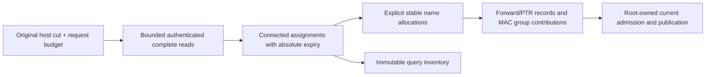

Collision names require an explicit allocation map; absent ambiguous allocations
fail closed. Production durable allocation, source-owned record/group merging,
manual membership preservation and reverse-child lifecycle admission remain root
integration work. Local HTTPS and actual host tests cover rotation, lease loss,
expiry, restart, drift, TLS, budget/cancellation and query-time memory isolation.
Optional DHCP DNS pushes, gateway mirroring and actions remain subsequent slices;
unsupported configured writes currently return an error.

## Direct Kubernetes DNSEndpoint source

Kubernetes can read `externaldns.k8s.io/v1alpha1` `DNSEndpoint` objects directly
(D303), independently of the webhook or the external-dns process. Install the
upstream CRD separately and enable the licensed integration in host configuration:

```yaml
store:
  driver: kube
externalDNS:
  crd:
    enabled: true
    namespace: apps
    zoneSelector:
      external-dns: enabled
```

With Helm, place the `externalDNS` block under `config.node`. An empty namespace
reads all namespaces allowed by Kubernetes RBAC. The existing chart already grants
only `get`, `list` and `watch` on `DNSEndpoint`; the adapter never changes a source's
spec, status, labels, finalizers or ownership. The source requires Kubernetes;
SQLite configuration is rejected before startup. Namespace and zone selection are
host-only settings that require restart.

The elected controller keeps derived `DNSRecordSet` children in each source's own
namespace, with a deterministic name, exact source UID and owner reference. Each
endpoint selects the longest matching primary-zone suffix. A zone's existing
`recordSetSelector` still checks the source namespace and labels. Existing endpoint
validation and native record conflict selection apply. Invalid source data withdraws
that source's old children; a conflicting destination is never taken over, and
unrelated sources can continue. Source deletion, UID replacement and zone-selection
changes remove only original, still-owned children. A manually adopted child is
left alone.

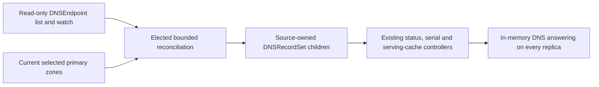

Watch events trigger fresh reads; a ten-second relist also covers zone changes.
A reconciliation retains its original term context and a maximum 30-second deadline.
Source and zone UID/version checks precede writes; creation requires absence,
updates require the observed destination version, and deletion retains both its UID
and version. The adapter does not retry a refused mutation or a lost write reply.
A later independent reconciliation may observe what actually committed.

Limits are 1,024 sources and 16 MiB of retained source data, 1,024 inspected zones,
1,000 endpoints and eight destination zones per source, and 8,192 inspected child
rows. Source pages and watch responses have a 2 MiB read bound. Missing CRDs,
RBAC refusals, partial lists and unavailable reads are errors, never an empty-source
signal authorizing cleanup. Disabling the controller stops reconciliation and
retains generated data; normal Kubernetes garbage collection still follows source
owner references. DNS serving does not depend on a live license check.

This follows Kubernetes controller convergence: source, zone and child are separate
API objects, so their checks and writes are not one atomic transaction. Cancellation
prevents undispatched work; an already accepted write may still commit.

A mounted two-replica test against a real API server
(`TestRunServeDirectDNSEndpointLeaseLossAndPartition`) covers partition and
lease loss: the partitioned leader loses the `kudurru-controller` Lease, the
other replica alone reconciles later source changes, the partitioned replica
keeps answering from its last valid data, and after healing the former leader
neither reclaims the Lease nor duplicates children. This qualifies controller
convergence; it is not a distributed fence around individual writes.

## external-dns webhook transport authentication

The external-dns webhook is an optional, licensed inbound listener. Authentication
is disabled by default for compatibility with existing webhook clients. Operators
can require a shared bearer token on every route, including protocol negotiation,
by setting this host-only startup configuration:

```yaml
externalDNS:
  webhook:
    enabled: true
    listen: 127.0.0.1:8888
    tokenFile: /run/secrets/external-dns-token
```

Supply a private regular file of at most 4 KiB containing a randomly generated
bearer token of at least 16 characters. The token uses RFC 6750 bearer syntax
(letters, digits, `-._~+/`, with optional trailing `=` padding); surrounding file
whitespace is trimmed. Mounted-secret symlinks are supported. A missing,
unreadable, special, oversized, empty or malformed configured file prevents the
enabled, licensed webhook from starting. The file must have a read permission
bit and be readable by the process. The constructor captures only a SHA-256
digest; replacing or removing the file does not change the running credential.
Restart kudurru after rotation. File errors disclose neither contents nor paths.

Clients must send exactly one `Authorization: Bearer <shared token>` header on
every webhook request. Missing, incorrect, duplicate or malformed credentials
return a generic HTTP 401 before route dispatch or body parsing. The digest
comparison takes constant time. This authenticates transport access only:
record changes still pass the existing current-command admission, validation,
namespace and zone restrictions, and ownership checks. A token does not grant
current write authority or authorize retrying a refused mutation.

Upstream external-dns v0.23.0 exposes `--webhook-provider-url`, but its
[documented flags](https://github.com/kubernetes-sigs/external-dns/blob/v0.23.0/docs/flags.md)
and [webhook client](https://github.com/kubernetes-sigs/external-dns/blob/v0.23.0/provider/webhook/webhook.go)
do not provide a custom Authorization header setting. With that version, enable
this option only when a trusted local proxy injects the header on every request;
point `--webhook-provider-url` at that proxy. Keep the proxy private and restrict
access to the webhook listener. The listener serves plain HTTP: a bearer token
does not encrypt traffic. The default loopback address supports a sidecar or
client on the same host; wider listeners require suitable network protection.

Kubernetes source selection stays in external-dns, including the Ingress,
Service, Gateway and CRD sources supported by that client. This option adds no
Kubernetes watch or direct `DNSEndpoint` source to kudurru. The webhook continues
to receive external-dns's computed endpoints, including its TXT registry records,
and preserves its existing record ownership rules.

### Pod-local webhook relay

`kudurru externaldns-webhook` is an explicit transport sidecar (D288). It accepts
only the four webhook method/path pairs on literal loopback, forwards to one
operator-configured upstream and injects the captured upstream token. It has no
store, local reconciliation, election or authority-writing capability. The
upstream remains the owner of records, namespaces, licensing and admission.

Each operation has its original request context and a bounded deadline, body,
headers and concurrency slot. A fresh HTTP/1 transport has no reused connection
or replayable body, proxies are disabled, and redirects refuse. CA/token files
are bounded startup inputs and cannot be supplied by request data. Cookies and
forwarding headers are discarded. A response is bounded before downstream
headers commit; uncertain responses remain errors and are never retried by the
relay. Remote upstreams require verified HTTPS; local development HTTP requires
a literal loopback destination.


## Reviewed API and CLI operations

Complete SQLite serving mounts bounded integration list/get, connection check,
preview, explicit sync and advertised-action routes under `/api/v1/integrations`.
The matching `integrations` CLI uses generated dispatch. Every execution requires
the reviewed Integration UID and resource version. Cloudflare sync additionally
requires `--mode publish --preview-digest DIGEST`; UniFi inventory acquisition
uses `--mode observe`. A command never fetches a replacement review or retries a
refused effect. Legacy/Kubernetes hosts explicitly refuse this execution
capability; direct Kubernetes object transport does not bypass that refusal.

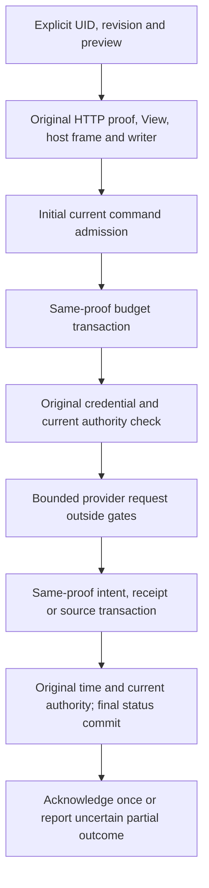

The first command requires the original complete HTTP publication. Its own
budget/receipt/source writes can advance publication, so later transactions
retain the original operation proof and independently reauthorize it against
that transaction's current View. Both aggregate dependency identities must
match. Original credential expiry, cancellation, Integration source, installed
credential fingerprint, host lease and writer episode remain required through
final acknowledgment. Provider I/O and installed-reference reads occur outside
publication and SQLite gates. Final status is deferred until the operation has
finished its effects, avoiding invalidation by its own resource-version update.
A reviewed sync or action records one audit row (`integration.sync` or
`integration.act`, naming the principal and the instance UID) in that same final
transaction. An effect that failed before it is audited as uncertain (result
`error`) when the final transaction can still commit; a refused final
transaction leaves neither status nor row (D379).

Reads expose public identity/type and a local status only when its observed
UID/revision matches the reviewed object. Status can conservatively be unknown
after a status publication; it grants no allocation or writer authority. Preview
exposes bounded DNS changes/conflicts and one aggregate digest, excluding remote
account/zone/row IDs, versions, credential references and private receipts.
Named credentials are rejected even when JSON-escaped. Action return bodies are
discarded; the built-in providers currently advertise no actions and unsupported
invocation returns501.

An obsolete preview before any effect returns409. A partially applied or
unacknowledged mutation returns an explicit uncertain result with confirmed
counts and pending/source-publication flags. The CLI disables mutation body
replay and redirects, bounds acknowledgments, and preserves the refusal. A
separate, intentional operator review is required before further work.

Qualification includes the real Cloudflare SDK and UniFi adapter against local
TLS peers, production router and generated CLI, stale-plan refusal, committed
writes, an applied-but-unreadable pending outcome, original cookie CSRF and
scoped-token/writer/revocation refusals. It does not claim contact with production
provider infrastructure. Kubernetes Cloudflare publication, its `Delete` cleanup and release, and
UniFi inventory and groups on two replicas with a holder partition are
qualified against envtest and the same local TLS peers; the remaining
all-driver/restart release gates remain separate work.

## Tier-B runtime client status

The SQLite production factory supports Cloudflare, UniFi and Tier-B webhook
clients, actions and hooks. The registered `ee/integration/webhook` constructor
advertises client inventory, actions and hooks, and names the separate
`hmacKey` signing credential. It also publishes records to a peer that
serves the external-dns record routes when the Integration names `domains`
(D380, see [Tier-B record ownership](#tier-b-record-ownership)). A hooks peer
without an `hmacKey` refuses negotiation, and so does a records-only peer
while no domains are configured. One Go type serves every Tier-B capability,
so the provider reports the roles its peer negotiated (`host.RoleProvider`):
the host polls only an inventory peer, drains and produces events only for a
hooks peer, and publishes only for a records peer with domains (D379, D380).
Root treats such an instance as a publisher: it selects sources for it, pins
them in every effect transaction and requires a reviewed preview digest for
its manual sync. Cloudflare and UniFi keep the type-assertion default. A
webhook instance with no ledger row owns nothing at its peer, so its cleanup
is local only.

It captures named bearer or mTLS material and request bytes, then routes each
bounded attempt through the original host request scope. Verified TLS, fresh
HTTP/1 connections, no redirects/body replay/proxy/cookies and fixed method/path
pairs keep one charge per actual attempt. Original cancellation and deadlines
cover response-body reads, and stopping the transport cancels in-flight work.
Status errors contain no peer bodies or credentials.

A successful response is wire evidence, never a receipt. Negotiation retains the
exact versioned media, capabilities, manifest, filters and action schemas as one detached
identity. It rejects malformed or ambiguous JSON, mismatched capabilities and
credential echoes; a later peer declaration cannot silently replace the retained
one. Action parameter semantics remain subject to host validation. The lifecycle
retains named credentials, freezes the first accepted
advertisement, and fences the instance after an observed change. It sends declared
actions once. Hook events are signed with the separate HMAC key, as described in
[Tier-B hook events](#tier-b-hook-events).

The inventory adapter requires complete bounded clients and networks
lists under one original operation. Genuine `LastSeen` determines a fixed
three-minute expiry; polling cannot renew an expired observation. Null rows,
duplicate identities, partial/paginated results, credential echoes and mismatched
network references refuse. `FixedIP` stays desired metadata and never becomes
an observed address. The adapter emits no desired DNS or ClientGroup writes,
and two remote lists do not establish an atomic remote snapshot. Mounted
SQLite/TLS/router tests cover original observation expiry, credential rotation,
action schema/scope refusals and uncertain single-attempt outcomes. The host accepts a negotiated observation schedule:
actions-only peers disable inventory sync, while client polling has a one-minute
maximum interval. A shorter `resync` wins; the generic ten-minute stored default
cannot exceed the provider's cap. This never extends observation expiry.

## Tier-B record ownership

The external-dns record protocol lists one endpoint per record set and
applies a Changes body; it has no row IDs, versions, owners or conditional
writes, and its 204 says only that the peer accepted a body. The webhook
publisher (`ee/integration/webhook/records.go`, D380) adds the ownership the
planner needs with a TXT registry kept at the peer, and confirms every
change from a reread (D298).

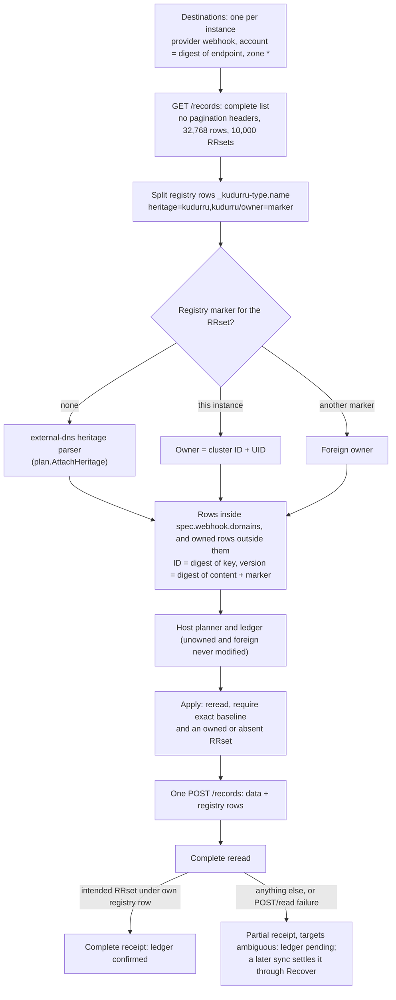

- **Registry.** One TXT row per managed record set, at
  `_kudurru-<type>.<name>` (a wildcard's `*` becomes a `-wildcard` suffix of
  that label), with the record set's set identifier and the single value
  `"heritage=kudurru,kudurru/owner=<SHA-256 of [cluster ID, UID]>"`. Registry
  rows are never shown to the planner. A desired name in the `_kudurru-`
  namespace, or one the peer's negotiated filter excludes, refuses the sync.
- **Owners.** This instance's marker means owned; another kudurru marker or
  an external-dns heritage claim means another owner's; no claim means
  unowned. Only rows inside the configured domains are the destination, so
  the peer may serve other names, but a row this instance's registry claims
  stays in the snapshot outside them: narrowing `domains` makes it an owned
  row that is no longer desired (deleted under sync, retained otherwise,
  removed by a Delete cleanup), never an absent one. Removing every domain
  ends publication: the instance still names its destination, for cleanup
  only, but the host syncs it only while its roles include Publisher, which
  needs domains, so its owned record sets stay as under Retain. A
  records-only peer without domains has no role at all: `Roles` refuses it,
  which ends an ordinary lease as ProvisionFailed, while `Check` accepts it,
  so a Delete cleanup (which provisions and checks but never asks for roles)
  still removes them. A registry row of another owner with no data row is a
  claim: the snapshot names it (`RemoteSnapshot.Claimed`) and the planner
  reports a conflict at its name (`plan.Input.Claimed`), so no create is
  planned there. Webhook peers offer no adoption.
- **Apply and Recover.** Apply rereads, requires the intent's Before hash,
  IDs and versions, sends one Changes body (create: data and, unless an own
  leftover exists, registry; update: old and new data; delete: data and own
  registry) and returns a complete receipt only when a second complete
  reread shows the After record set under this instance's registry row, or
  no record set for a delete. A POST that the verifying reread does not
  confirm, whatever its answer, marks its targets `ambiguous`, so host
  recovery never abandons it as untouched work. A delete needs no configured
  domain: its authority is the registry row the reread requires. Recover rereads independently of the host's snapshot. Adjust
  calls the peer's `/adjustendpoints`, as external-dns does, so the planned
  After state is what the peer stores.
- **Limits.** Nothing closes the window between the baseline reread and the
  POST; the verifying reread detects a concurrent writer, it does not prevent
  one. A peer must store TXT rows and underscore labels. Each change costs
  three requests of the instance's budget.

## Tier-B hook events

Root produces hook events from its own durable state on the instance's
elected lease (D379). There is no in-memory diff and no per-command outbox:
on every two-second event tick the host asks root for what changed since the
instance's durable cursor, queues the resulting events, advances the cursor,
then drains the queue.

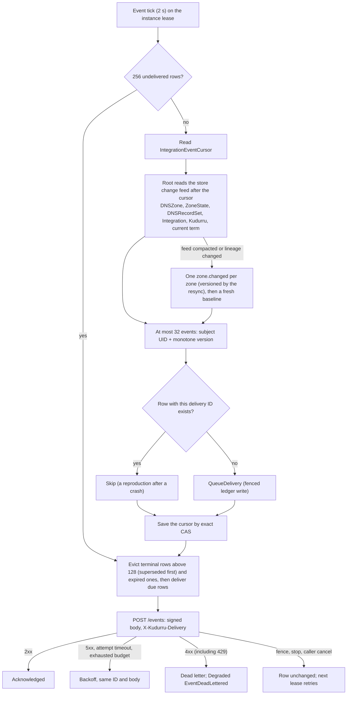

- **Source.** The store's resumable change feed (SQLite `changes`). A new
  instance takes a baseline and reports only later changes. A kind with no
  change keeps its position until the store head is 1,024 revisions ahead
  (or a quarter of the store's feed retention, if that is less, so a quiet
  kind is not compacted past while the ticks keep up), so an idle tick
  writes nothing (each cursor write itself advances the head). A cursor the feed can no longer resume (the store reports it
  compacted past the cursor, or a replica replacement or promotion changed
  the watch lineage) degrades to one `zone.changed` per zone with
  `change: "resync"`, versioned by that resync (a digest of the positions
  that could not resume) and carrying the committed serial, then a fresh
  baseline: never one event per object. The changes lost to the compaction
  are not reported one by one.
- **Topics shipped in v0.2.** `record.changed` (a DNSRecordSet generation or
  its deletion), `zone.changed` (a zone's committed serial, read from its
  private ZoneState head, or the DNSZone's deletion; a DNSZone write reports
  only a serial its own status carries, which is the same version, so each
  zone has one version per serial),
  `blocking.toggled` (a committed change of Kudurru `status.blocking`; a
  timed disable that runs out writes nothing and is no event, so the
  disabling event carries `disabledUntil`), `integration.error` (an
  Integration's Ready condition turned False; versioned by reason and
  transition time) and `cluster.leader_changed` (a new writer term). The
  provider advertises exactly these. `query.blocked`, `vip.master_changed`,
  `client.seen` and `client.left` are deferred: the first is per node on the
  query path, the second has no replay outside the node, and the client
  topics carry names and addresses that need the hide and redaction rules.
- **Guarantees.** At-least-once with a stable delivery ID, the SHA-256 of the
  instance UID, topic, subject UID and version. Producing the same change
  again (a crash between the queue and the cursor commit, a status write that
  does not change what the topic reports) finds the row and queues nothing
  while the row exists; once it is evicted or pruned, such a status write
  sends the same ID again, which the peer deduplicates. Count eviction takes
  superseded rows (an older version of a subject that has a newer row)
  first, because a status write reproduces only a subject's current version. Delivery is unordered across
  retries; each payload carries its version. The tick is the debounce.
- **Visibility.** Every hook instance receives the events of every
  namespace: record-set and Integration names and namespaces, zone names,
  error reasons and the primary ID. Creating a hooks Integration is
  therefore a cluster-level privilege; there is no namespace or zone
  subscription filter yet.
- **Retention.** All by exact UID and resource version. An instance holds at
  most 384 rows: production waits at 256 undelivered rows or 384 in all, and
  each drain evicts the instance's terminal rows above 128, superseded ones
  first, then the oldest. Rows expire 24 hours after creation and are pruned
  an hour after that. Every lease prunes the rows of other instances an hour
  past their deadline, delivered or not and whether or not their owner
  exists: an owner that runs any lease normally has dead-lettered its own
  rows at the deadline, within that hour. Hook leases do this on each drain;
  leases without the hook role every 300 poll intervals (10 minutes at the
  default 2 s) but at least every 15 minutes, when they also dead-letter their
  own undelivered rows past the deadline without an attempt (a peer that
  stopped advertising hooks). This is not guaranteed: a hook lease whose drain
  keeps failing before it delivers, or an owner that runs no lease during that
  hour, leaves a row that another lease deletes without `EventDeadLettered`.
  With no lease running at all nothing is pruned until one runs. With at most
  128 instances per
  host, delivery rows stay under 50,000 objects. The retention scan pages
  through all rows and keeps only this instance's and 64 prunable ones in
  memory, so it never stops at a listing size.
- **Wire format.** The signed body is the JSON of `integration.Event`,
  `{"topic":...,"time":...,"payload":{...}}`, with lowercase payload keys
  that name identities and versions, never record data or credentials. The
  signature is `X-Kudurru-Signature: sha256=<hex HMAC-SHA256 of the exact
  body>` with the instance's `hmacKey` (32 to 4096 bytes); a retry sends the
  same body, ID and signature, and a rotated key re-signs pending rows.
- **Budgets.** Each HTTP attempt charges one request against the instance's
  own budget account (its UID), 1,000 requests per 300 seconds; an exhausted
  budget is retried after five minutes, never dropped.
- **Status.** A dead letter (a 4xx answer or a row past its day) sets the
  instance Degraded with reason `EventDeadLettered` and publishes it, which in
  turn is an `integration.error` event.

## Standalone webhook protocol checks

`internal/integrationconformance` implements the explicitly invoked
`integrations webhook conformance` command (D295). Its target is an external
webhook, so it uses the versioned external-dns/Tier-B protocol directly. The
ordinary integration administration commands continue to use generated Kudurru
OpenAPI dispatch. This runner does not acquire a serving View, provider host,
writer, local ledger or runtime integration authority.

```mermaid
flowchart LR
    Input["Explicit URL, trust, credential and probe files"] --> Capture["One bounded capture; original run deadline"]
    Capture --> Negotiate["Verified target; version and capability checks"]
    Negotiate --> Reads["Bounded advertised read probes"]
    Reads --> OptIn["Explicit mutation opt-in and selected inputs"]
    OptIn --> Once["One attempt per selected mutation"]
    Once --> ReadBack["Optional record read-back: records_contain, records_absent"]
    ReadBack --> Report["Sanitized acknowledgment or uncertain outcome"]
```

The target has no ambient API credential, proxy, cookie jar or Kubernetes
lookup. CA, bearer or mTLS material and input bodies are detached before
network work. Capture has one process-wide worker slot; a blocked filesystem
call may retain it after caller cancellation, but cannot publish late inputs
or create replacement workers. Every request retains the original run context
and an earlier per-request bound.

Each attempt uses a fresh HTTP/1 connection and a nonreplayable body. Redirects,
automatic retries and cleanup mutations are disabled. Events use the exact
captured body and documented signature/delivery headers. Unknown capabilities,
duplicate JSON fields, invalid shapes and over-limit bodies refuse. Action
selection is checked before any mutation. An uncertain effect stops all later
mutation probes without interpreting a replacement response as success.
An explicit expectation file (`--expect-endpoints-file`, D380) rereads the
record list once after any apply and checks that named endpoints are present
and others absent, so a provider author can check read-your-writes and TXT
registry support; it is a read and needs no mutation opt-in.

The report records only fixed protocol check names and safe outcomes. Untested
mutations and other advertised actions keep it incomplete. Successful responses
do not prove persistence, provider lifecycle activation or external DNS effects.
See the [operator guide](../deploy/integrations.md#check-an-external-webhook)
for explicit inputs and limits.
