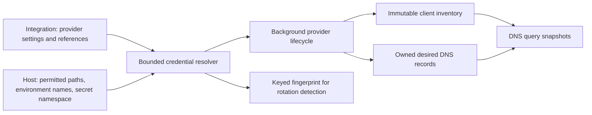

# Background integrations

The public `Integration` object describes Cloudflare publication, UniFi
inventory, or a Tier-B webhook. It is namespaced and uses the same generated
schema in SQLite and Kubernetes. Provider blocks must match `spec.type`;
Cloudflare requires an `apiToken` reference and UniFi an `apiKey` reference.
Deletion defaults to `Retain`, and every optional UniFi write defaults to off.
The [sample](../../config/samples/kudurru.io_v1alpha1_integration.yaml) starts
suspended so applying an example cannot publish records.

This is the schema and credential foundation. Provider execution, election,
ownership-ledger reconciliation, and its API/dashboard controls are subsequent
parts of the full [v0.2 implementation](../v0.2/README.md).

`internal/credentials` accepts exactly one Secret, file, or environment
reference. File and environment references require explicit host allowlists.
Secret references cannot choose a namespace: the operator supplies it to the
resolver. These capabilities are captured immutably and replaced on host reload.
The resolver bounds credential sizes, returns private copies, and removes
provider error bodies before reporting lookup failures. A keyed HMAC fingerprint
detects changes without publishing a plain hash of the credential. Secret values
belong only to the provider instance; they never enter object spec, status,
query logs, or audit details.

The host and providers must remain outside the DNS query path. Queries consume
the inventory and zone snapshots already published in memory, including during
a provider outage. Source identity includes the Integration UID and relevant
spec identity, so deleting and recreating a provider cannot adopt stale client
claims or another instance's external records.
