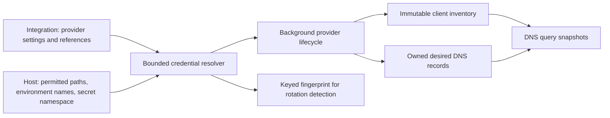
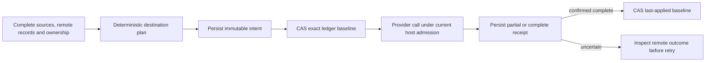
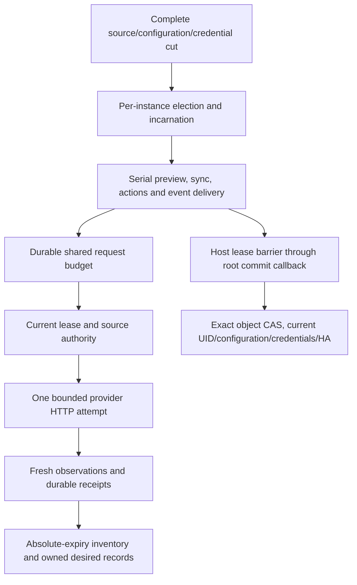

# Background integrations

The public `Integration` object describes Cloudflare publication, UniFi
inventory, or a Tier-B webhook. It is namespaced and uses the same generated
schema in SQLite and Kubernetes. Provider blocks must match `spec.type`;
Cloudflare requires an `apiToken` reference and UniFi an `apiKey` reference.
Deletion defaults to `Retain`, and every optional UniFi write defaults to off.
The [sample](../../config/samples/kudurru.io_v1alpha1_integration.yaml) starts
suspended so applying an example cannot publish records.

The schema, credential resolver, publication planner, durable ownership ledger
and background host are implemented. Provider modules, production commit
adapters and API/dashboard controls remain parts of the full
[v0.2 implementation](../v0.2/README.md).

`internal/credentials` accepts exactly one Secret, file, or environment
reference. File and environment references require explicit host allowlists.
Secret references cannot choose a namespace: the operator supplies it to the
resolver. These capabilities are captured immutably and replaced on host reload.
The resolver bounds credential sizes, returns private copies, and removes
provider error bodies before reporting lookup failures. A keyed HMAC fingerprint
detects changes without publishing a plain hash of the credential. Secret values
belong only to the provider instance; they never enter object spec, status,
query logs, or audit details.

The host and providers must remain outside the DNS query path. Queries consume
the inventory and zone snapshots already published in memory, including during
a provider outage. Source identity includes the Integration UID and relevant
spec identity, so deleting and recreating a provider cannot adopt stale client
claims or another instance's external records.

## Publication plans and receipts

`ee/integration/plan` selects original admitted record objects, including
public-only endpoints withheld from internal DNS. Global selection and zone
publication rules share type/domain/exclusion limits; endpoint labels override
record-set labels. Disabled or expired endpoints are omitted. Ambiguous rules
and incomplete source or remote snapshots refuse planning. Preview identity
includes source, configuration, credential fingerprint, remote versions and
private ledger versions, so stale preview cannot silently authorize new work.

One plan covers a complete destination with per-record `sync`, `upsert-only`
or `create-only` policy. The ledger retains the previous policy for removed
sources. Foreign ownership and CNAME conflicts protect the entire affected
owner. Adoption must be explicit. Ownership binds the cluster and Integration
UID; a legacy cluster-only remote marker additionally requires private ledger
evidence for the exact provider IDs.

`ee/integration/ledger` writes an immutable operation intent before reserving
an exact ledger baseline. Partial receipts retain provider IDs and completed
targets; they cannot regress or advance the baseline. Only a confirmed complete
receipt advances it. A current same-UID guard may record recovered historical
facts, but does not authorize replay under stale configuration or credentials.
Abandonment terminalizes the intent before releasing the reservation and requires
fresh authenticated before-state evidence after provider calls have stopped.

IntegrationLedger, IntegrationOperation, IntegrationBudget and IntegrationDelivery
are bounded private runtime kinds. The shared runtime registry includes them in
both store drivers, full backups and complete replication manifests, including
empty kinds. Safe configuration exports omit them. Real SQLite tests cover
fenced receipt recovery across restart; carrier tests cover native Kubernetes
Secrets, validation, exact creation semantics and safe export. External side
effects are not atomic with database commits.

## Background execution

`ee/integration/host` captures complete original sources and exact named
credentials, then elects and serializes each Integration UID. Replacement waits
for the old provider to stop. Missing credentials or incomplete input cancel
execution; failed inventory polls retain observations only until their original
absolute expiry. Source changes schedule a new reconciliation, while the host's
own receipt/status writes do not invalidate its desired-source identity.

Every actual provider request, including a retry or batch fallback, must enter
the host's request adapter with its original operation context. A cluster-wide
Cloudflare budget survives token/instance replacement. Rate limits and temporary
failures use bounded backoff; permanent failures wait for changed input or an
explicit command. Preview binds all destinations, and sync rejects a changed
preview before effects. Unknown or foreign remote outcomes remain pending until
a complete reread establishes ownership and outcome.

Actions validate advertised bounded schemas and redact named credentials from
responses. Event delivery persists sanitized input and a stable delivery ID
before callbacks, retries to the original 24-hour deadline, and retains terminal
records for deduplication and audit. Delivery is at least once. Guarded retention
cleanup remains necessary before sustained production feeds.

The host's `WithLease` holds instance admission through the root writer callback;
the production adapter must still check current configuration, credentials and
HA authority inside the actual transaction or carrier CAS. The host does not
replace that commit check with a preliminary leader check. Real production
adapters, provider modules and multi-node failover acceptance remain open.
