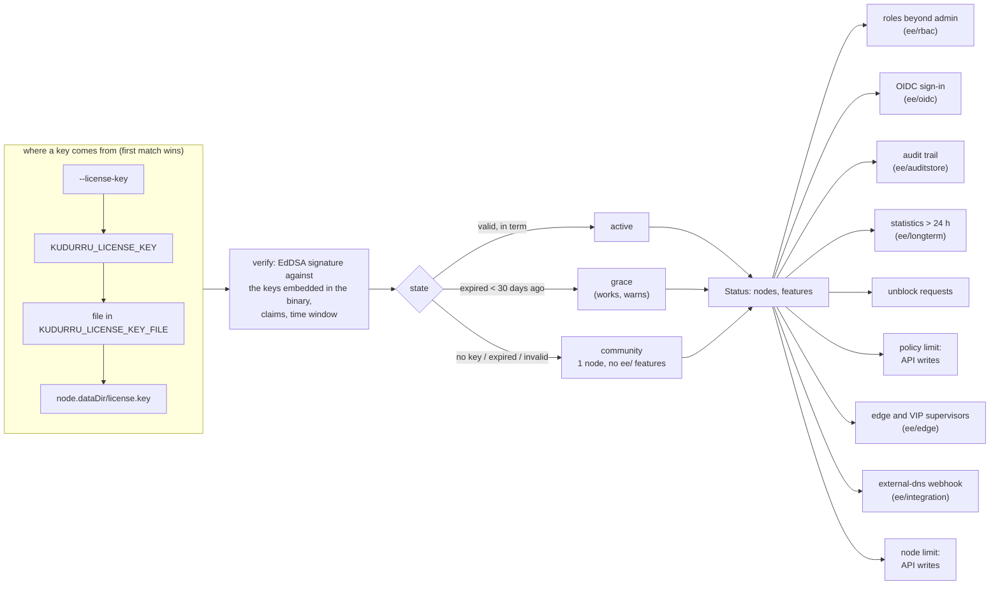

# Licensing and license keys

kudurru is source-available under the PolyForm Noncommercial License 1.0.0.
Personal use is free and a business needs an agreement ([LICENSING.md](../../LICENSING.md)
has the rules for people). This page shows how a **license key** reaches a
node and what each state of the key changes. One promise holds in every
state: **licensing never touches the DNS data path**. Queries are answered
the same with no key, an expired key or a forged one.

Code: `internal/license` (verification, states, metrics), `ee/` (the licensed
features), `cmd/kudurru/license.go` (the CLI and the supervisor gate),
`internal/api/license.go` (the API and the node-limit gate),
`hack/licensegen` (the licensor's signing tool; not in the binary).

## From a key to a decision



The manager rereads the sources every minute, so a renewed Secret or a key
written into the data directory takes effect without a restart, and it logs
every change of state. An invalid key never leaves the previous key in
force: a typo is visible at once.

## The key

A key is a compact JWS signed with Ed25519 by the licensor. The header names
the signing key (`kid`); the binary embeds the matching public keys in
`internal/license/keys/<kid>.pub`, so verification needs no network and no
license server. The payload carries:

| Claim | Meaning |
|---|---|
| `jti` | license id |
| `iss` | always `kudurru` |
| `sub` | licensee, a person or a company |
| `plan` | `personal` (free, noncommercial), `business`, `enterprise` or `trial` |
| `nodes` | node limit |
| `features` | licensed features; empty means every feature this build knows |
| `iat`, `nbf`, `exp` | issued, not before, expires (Unix seconds); `exp` is required |

The signature does not make a key a licence: the licence is the agreement,
and a personal key does not widen the noncommercial terms.

## What each state changes

| | community (no key, expired, invalid) | active or grace |
|---|---|---|
| DNS, blocking, zones, the block page, the dashboard, short-term statistics, local users, API tokens | unchanged | unchanged |
| Nodes | 1 | `nodes` of the key |
| Policies | 2 (existing ones are never removed) | unlimited |
| Roles beyond the built-in administrator (`ee/rbac`) | none: the engine allows the built-in administrator and peer nodes only; bindings stay configured and grant nothing, `GET /info/messages` says why | role bindings, scoped roles, Kubernetes RBAC |
| OIDC sign-in and bearer ID tokens (`ee/oidc`) | off; the providers stay configured, `GET /info/messages` says why | on |
| Audit trail (`ee/auditstore`) | the log lines are written; nothing is stored through the recorder, `GET /audit` answers 402 | stored, readable, exportable |
| Statistics older than 24 hours (`ee/longterm`) | `402 license_required`; rollups are still collected | readable |
| Unblock requests | the block page has no form and refuses the post; `/unblockrequests` answers 402 | on |
| `kudurru edge run` and `kudurru vip run` (`ee/edge`) | refuse to start | start |
| external-dns webhook (`ee/integration`) | not started, a warning is logged | started |

Two details matter for an operator:

- **The node and policy limits narrow only configuration writes.** The policy
  limit refuses to create a third `Policy` through the API (`402`) and never
  touches an existing one. When the cluster has
  more nodes than the key allows (`Membership.Peers`, cached for 10 seconds),
  `POST`, `PUT`, `PATCH` and `DELETE` on `/api/v1` answer `402 license_required`,
  except sign-in (`/auth/*`), `/dns/query`, `/dns/blocking`, `/cache/flush`
  and `/queries/*`. Reads always work. If membership cannot be read, the
  gate lets the request through: an outage never blocks an operator. Changes
  made outside the API (file-managed objects, `kubectl`) are not gated; the
  limit is a management-plane check, backed by the licence terms.
- **The audit trail keeps being written and shipped.** The sqlite driver
  records one hash-chained row per store mutation in `state.db` whatever the
  license says, the spool and the shipper of the cluster-wide audit log
  (`AuditLog` objects, or the central database; D155 to D161) keep running, and
  every event goes to the log. What the license gates is the API recorder's
  extra rows (denials, runtime actions) and reading the trail back at the API
  (`GET /audit`, the export, the dashboard page), whichever store answers. A key
  that arrives later shows the history that was kept meanwhile.
- **The supervisors check once, at start.** They are separate processes (the
  `kudurru-dnsdist` and `kudurru-keepalived` images), often PID 1 of a
  container. A key that expires later never stops a running one, and the
  30-day grace period covers a restart in between.

## Operating it

| Task | How |
|---|---|
| Give a node its key | `KUDURRU_LICENSE_KEY`, or `KUDURRU_LICENSE_KEY_FILE`, or `license.key` in the data dir, or `--license-key`; Helm: `license.key` or `license.existingSecret`; Compose: `KUDURRU_LICENSE_KEY` in the environment |
| See what a node would run with | `kudurru license status [--json]`, `kudurru license verify KEY` (offline) |
| See what a running node runs with | `GET /api/v1/license` (needs `settings.read`), the `kudurru_license_*` metrics |
| Alert before expiry | `kudurru_license_expires_timestamp_seconds - time()` |

The edge supervisors read the key from their own environment, so Helm and
Compose pass `KUDURRU_LICENSE_KEY` to every kudurru container. Without it an
edge deployment does not start.

## The dashboard

`GET /api/v1/license` feeds the License page and the banner
(`web/src/pages/LicensePage.tsx`, `components/LicenseBanner.tsx`; see
docs/m3/ui.md, "Licensed features"). A page whose feature is locked shows a
short explanation instead of its content and makes none of the requests the
server would refuse with 402. The license text is published from the one `LICENSE` file on kudurru.io
(`/license/text/`, rendered by `www/src/markdown.ts`, with a plain text
download) and in the docs (`site/hugo.yaml` mounts `LICENSE` and `LICENSING.md`
as `/project/license/` and `/project/licensing/`); the dashboard, the README and
the key form link to them. The public page is [kudurru.io/license](https://kudurru.io/license)
(`www/src/pages/license.ts`, content in `www/src/content.ts`); its "Request a
key" form sends a personal request to the license server and opens a mail to
hello@kudurru.io for anything else (`www/README.md`, "The Request a key form"), and the
administrator guide has a chapter on it (`docs/guide/admin/13-license.md`).

## Test builds

The dashboard's Playwright suite needs a node with a license, and it cannot
have the licensor's signing key. A binary built with `-tags licensetest`
(`make web-e2e` does it) also trusts a throwaway key, `e2e-test`, whose
private half was discarded after it signed `internal/license/testdata/e2e-license.key`
(all features, 10 nodes, expires in 2126). A default build trusts only the
keys in `internal/license/keys/`, and `TestDefaultBuildTrustsNoTestKey` fails
if that ever changes. Never build a release with the tag.

## For the licensor

```sh
go run ./hack/licensegen keygen -kid kudurru-2027-1 -dir .   # once per signing key
go run ./hack/licensegen sign -key kudurru-2027-1.key -kid kudurru-2027-1 \
    -licensee "Homelab Hank" -plan personal -nodes 3 -days 1095 > hank.key
# without the private key touching disk: -key - reads it from stdin
# (or set KUDURRU_LICENSE_SIGNING_KEY), e.g. piped from Infisical
go run ./hack/licensegen inspect hank.key
```

Commit only `<kid>.pub`, into `internal/license/keys/`. The `.key` file is the
private signing key and lives in Infisical. To rotate, add the new
public key, ship a release, start signing with the new key, and remove the
old public key only when no key signed with it is in the field. A leaked
private key means shipping a release that drops its public key; keys it
signed stop verifying with it.
