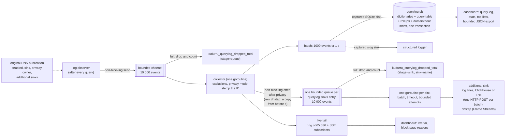
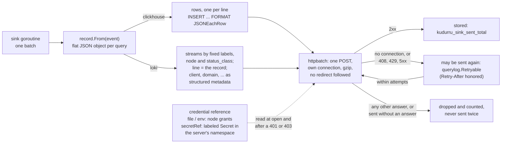
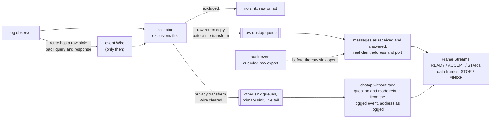
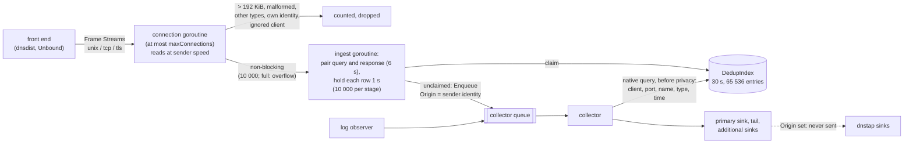
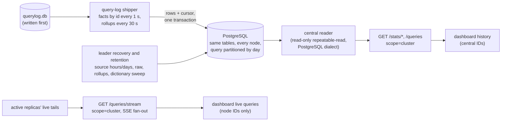
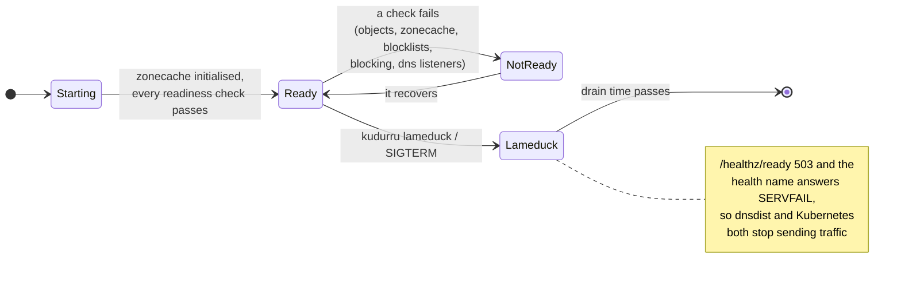
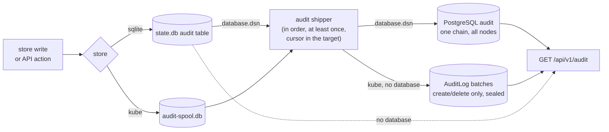

# Observability

Three signals, three homes, and none of them goes through the store:

| Signal | Answers | Where |
|---|---|---|
| **Query log** | which client asked what, and why it got that answer | `querylog.db` on each node, plus an in-memory tail |
| **Metrics** | how much, how fast, how healthy | Prometheus, from `:9153/metrics` |
| **Health** | can this node take traffic now? | `:8081/healthz/*` |
| **Traces** | where one query spent its time, across dnsdist, kudurru and upstreams | an OpenTelemetry collector, over OTLP/HTTP (off by default) |

Plus the **audit** trail of who changed what. Code: `internal/stages/log`,
`internal/querylog` (collector, privacy, tail, additional-sink host) and
`internal/querylog/sqlitelog` (writer, rollups, retention, reader),
`internal/metrics`, `internal/health`, `internal/audit`, `internal/tracing`
(tracer, TRACEPARENT) and `internal/tracing/otlp` (exporter).

SQLite exports `kudurru_cluster_fenced` from its current local authority, with
no database read during a scrape. It is 1 for a higher-term fence, conflicting
promotions, divergent images, or an in-memory fence when persistence fails.
Persisted fences survive restart. Installing an accepted successor image as a
follower or explicitly resolving a conflict clears the signal when the store
transition succeeds. A healthy read-only follower or unenrolled mirror reports
0; zero does not establish writable readiness. Valid last-good DNS can continue
while fenced. Kubernetes nodes do not export this SQLite authority signal.
The Grafana cluster/store row and immediate `KudurruClusterFenced` alert use it;
inspect authority and storage errors before attempting explicit recovery.

The human `GET /healthz` response includes `leader` and `snapshotAge` strings.
`leader` is the locally observed controller holder, empty when unknown or when
an old self identity has no active term. It does not resolve peer addresses or
verify a remote holder's present authority. `snapshotAge` is the rounded duration
since the currently served `local.db` snapshot was written, including stale
snapshots; it is empty while serving live data or when no saved image is served.
Both fields are local observations and do not change readiness or liveness.

The Nodes page also polls `GET /api/v1/edge` every ten seconds. In Helm,
the server discovers every separate edge pod through the headless
`<release>-edge-status` Service's EndpointSlices, then reads `/status` on
the supervisors' health listeners (8084 for dnsdist, 8085 for keepalived)
in parallel with two-second request deadlines. Unready pods remain in
discovery. The response includes aggregate readiness, each supervisor,
backends as observed by each edge, and each VIP's state and priority.
`MASTER` identifies the node holding a VIP; `BACKUP` reports only that
node's own state. An unavailable supervisor cannot report a live owner.
Older supervisors use `/healthz/ready` to supplement their status
document. dnsdist's private API key stays inside the edge pod.

For a local edge outside Helm, set `KUDURRU_EDGE_STATUS_URL` and, when
keepalived runs alongside it, `KUDURRU_VIP_STATUS_URL` to the health
listeners (for example, `http://127.0.0.1:8084` and port 8085). The Compose
examples set these automatically.

## Serving diagnostics

SQLite `GET /info/messages` reads policy diagnoses, enabled-list readiness and
secondary/stub coverage from the original authenticated HTTP installation.
It observes absolute expiry once for the whole response, including required RPZ
data. An unavailable copy produces a serving-unavailable message; the captured
owners do not invent transfer-attempt history. Missing or inconsistent owners
return 503 rather than consulting live policy, cache or transfer managers.
The diagnoses entry in `/doctor` uses that same request context.

Loader failures, node health, read-only process mode and central-database
reachability are separately labeled current operational observations. They do
not identify which configuration is serving. The combined response has bounded
fields, count and aggregate size; overflow fails instead of silently omitting
messages. Legacy Kubernetes diagnostics keep their existing sources.

When `audit.store: auditlog` is selected, the Diagnosis page, `/doctor` and
`kudurru doctor` include a separate current AuditLog observation for licensed
`audit.read` users. The probe inherits the guarded Kubernetes transport and
lists only metadata in the release namespace; it reads no batch contents and
does not verify audit integrity or shipping. Permission, original credential
expiry and the audit license are checked before acquisition and again before
disclosure. Failure of the original captured diagnosis source does not invoke
this probe as a fallback.

The scan permits one active caller, 500 objects per page, at most 101 pages,
2 MiB per decoded response and 64 MiB total, within three seconds. A complete
coherent list reports an exact batch-object count up to 50,000. At 50,001 it
stops and recommends central database storage or retention review, explicitly
as a lower bound. Missing/denied endpoints, unavailable APIs, expired cursors,
malformed responses and exhausted bounds have distinct nonhealthy results;
there is no discovery, redirect or full-object fallback.

The lazy probe can observe an API resource that was missing at startup. That
observation does not activate the startup-disabled cluster audit reader or
shipper: restart replicas after installing the CRD. DNS readiness remains
independent. Doctor treats informational successful scans as OK rather than
turning every nonempty diagnosis list into a warning.

## The query log pipeline



`GET /queries/export` delegates to the same scoped history reader as
`GET /queries`, with `querylog.read` permission and the existing privacy,
filter and cursor semantics. It buffers one page (default/max 1,000 rows,
16 MiB output, 15-second operation context) before sending a JSON attachment
with `Cache-Control: no-store`. Cancellation or encoding/size failure sends
no partial attachment. Counts, continuation cursor, source and per-node partial
errors remain in the file. It does not read the live tail, unredacted events,
or automatically combine pages into a snapshot.

The answer never waits for the log: when the channel is full, the event is
dropped and counted. The health name and the dashboard's built-in dig are
never logged.

`querylog.enabled` and `querylog.sink` reload without restarting. One bounded
queue, consumer and tail survive every toggle, including disabled startup.
Complete SQLite requests use the enabled decision, destination and privacy of
their original DNS publication through emission. Each queued item retains that
owner; the consumer flushes before crossing destinations. Disabled successor
requests collect nothing, while held enabled requests finish at their original
sink. DNS admission never waits for sink preparation, writes or final drain.

The root prepares sinks before accepting a complete publication. Failure keeps
the previous coherent DNS/logging bundle and reports unavailable readiness.
The primary route has at most one slog sink and one lazily opened SQLite writer. Once opened,
local history, purge, retention, maintenance and configured central shipping keep
that writer through disabled/slog modes. A disabled or slog restart opens retained
local history too; a missing database remains lazy unless enabled SQLite needs
one. A rejected candidate cannot change its retention. The queue and tail keep their event-ID sequence across reloads.

Shutdown stops admission and drains accepted records once under a bounded
context, then closes SQLite after the consumer joins. A timed-out batch is
canceled and counted, never replayed at a successor sink. The caller returns on
its deadline even if an external slog handler ignores cancellation; that single
pending consumer keeps its sink and is not replaced or closed underneath I/O.

### Additional sinks

`querylog.sinks` lists up to eight additional destinations that receive every
recorded query next to the primary sink (`querylog.sink`). The collector
remains the only reader of the hand-off queue. After it has applied the
exclusions and the privacy mode, stamped the ID and published to the tail, it
offers the same immutable event to the queue of each additional sink without
waiting. Everything behind that offer belongs to the one sink
(`internal/querylog/sinkhost.go`, decision D371):

| Per sink | Default | What it bounds |
|---|---|---|
| `queueSize` | 10 000 events | memory; when the queue is full the event is dropped for this sink only and counted |
| `batchSize`, `flushInterval` | 1000 events, 1 s | one write per batch or interval, whichever comes first |
| `timeout` | 10 s | opening the destination and each write attempt |
| `attempts`, `retryBackoff` | 3, 1 s doubling to 30 s | how often one batch is written when nothing was sent or the destination says it may be sent again |

A slow, stalled or failing sink therefore cannot delay a DNS answer, the
SQLite commit or the live tail: the query path only ever does the
non-blocking hand-off to the collector, and the collector only ever does a
non-blocking offer to a sink queue. The sink's goroutine is the only thing
that waits for the destination. While it waits, its own queue fills and its
own overflow is counted.

A batch is written again only when the sink reports that the destination did
not apply it (a refused connection, an explicit "try again", optionally with
the wait the destination asked for). Any other failure has an unknown outcome
and drops the batch at once; it is never replayed and never moved to another
sink. An exhausted attempt budget drops the batch too. Queue overflow, an
abandoned batch, what a retiring sink could not write within its drain bound
and a query caught by the replacement of its sink (below) are each counted in
`kudurru_querylog_dropped_total{stage="sink",sink="<name>"}` and logged at
the first loss and at each tenfold total.

The privacy transform runs before the sink queues, so an additional sink
never holds or sees an untransformed event, and an excluded query never
enters a sink queue. Under `nothing` no per-query event is offered to an
additional sink, the rule the live tail follows. `querylog.enabled: false`
stops every sink. The one exception is a dnstap sink with `raw: true`, the
audited override below: it receives a copy of each admitted event from
before the transform, under every mode. Excluded queries reach no sink,
raw or not.

Sinks follow the captured-publication model of the primary sink. Preparing a
configuration builds the sink objects but opens nothing; a sink is opened
from its own goroutine when the first event reaches it, and the open is tried
again with backoff until it succeeds, so an unreachable exporter never delays
startup or a reload. The host opens a sink once: a sink type that holds a
connection re-establishes it inside its own writes. Every prepared route
holds one reference on each of its sinks:

- an entry that did not change keeps its queue, goroutine and connection
  across reloads and publications;
- a new entry starts with the first query answered under a publication that
  names it, and is never fed from the tail or from `querylog.db`;
- an entry that is removed, or changed in any field, stops accepting once the
  last publication that named it is released and the collector has offered it
  everything that was already queued; it then writes what its queue holds
  within five seconds, counts the rest, and closes.

Removal takes effect for new queries at once: they are answered under the new
publication, which does not name the sink. The close follows the release of
the older publication, so a request that still holds it (a held DNS query, or
an open dashboard stream on the complete SQLite runtime) delays the close and
keeps the sink's series visible, but sends it nothing new.

On the complete SQLite runtime a publication returns its references only
after its last request, so a request never reaches a sink that has stopped.
On Kubernetes, settings are applied through the reload subscriber, where a
query reads the adopted route and is then queued. A reload that lands between
those two steps leaves the query with the route it read, and its sink may
have retired by the time the collector offers it. Such a query is never
handed to the sink that replaced it: a route's privacy mode and its sinks are
one captured decision. When the entry was changed, the name is still
configured and the query is counted as dropped for it; when the entry was
removed, no sink was to receive it and nothing is counted. In both cases the
primary sink and the live tail have the query.

Shutdown drains the collector first, then closes `querylog.db` while the
additional sinks drain beside it under the same deadline of five seconds. A
destination that is stalled or unreachable at that moment therefore holds the
process for the rest of that deadline, and no longer. Its sink loses what it
had not written and is named in the warning `additional query-log sink did
not drain`, with the number of events still queued. The warning `query log
flush incomplete` is about the collector and `querylog.db` only. When the
collector itself does not flush in time, the deadline has already passed when
the sinks are stopped, so they are not named one by one: one warning,
`additional query-log sinks stopped because the query log did not flush`,
lists every sink that was running. A sink that ignores cancellation keeps its goroutine and is never closed under its own
write.

The settings schema accepts exactly the types the server can build:

| Type | What one batch is | Code |
|---|---|---|
| `slog` | one structured log line per query next to the database (at most one, and not together with `querylog.sink: slog`) | `internal/querylog/slog_sink.go` |
| `clickhouse` | one `INSERT ... FORMAT JSONEachRow` request to the ClickHouse HTTP interface | `internal/querylog/sinks/clickhouse` |
| `loki` | one push to `/loki/api/v1/push` in Loki's JSON format | `internal/querylog/sinks/loki` |
| `dnstap` | dnstap messages in Frame Streams data frames, written whole on one connection | `internal/querylog/sinks/dnstap` |

#### The HTTP sinks

`clickhouse` and `loki` are direct sinks: the server sends the batches
itself, with the standard library HTTP client
(`internal/querylog/sinks/httpbatch`) and no vendor SDK (D371, with the
binary budget of D138 and D260 in mind). D371 keeps dnstap with a collector
such as DNS-collector as the route to other destinations and to consumers of
the DNS messages themselves; that is the dnstap sink below (D372).



Both types export the same record (`internal/querylog/sinks/record`): the
ClickHouse row and the Loki log line are one flat JSON object per query,
whose field names are a contract with the table and the queries on the
operator page. It is built from the event after the privacy transform, so a
destination holds exactly what the local query log keeps. Loki streams
carry only labels with few values (the fixed labels of the settings, the
node and the status class); the values that differ per query are structured
metadata.

Each batch uses its own connection. That makes the two failure classes
exact: an error before the connection exists means nothing was sent, and
every later error without an answer means the outcome is unknown. Only the
first is repeated. A body of 64 KiB or more is sent with
`Expect: 100-continue` (waiting at most 2 s for the interim answer), so a
destination that refuses a request at its headers and closes the
connection is heard instead of resetting it under the body. An attempt
with 4 s or less left (a sink `timeout` of a few seconds) sends the body at
once without asking, because a server that ignores the header would
otherwise get it too late for an answer within the attempt; a refusal at
the headers is then heard as described next. ClickHouse
sends "100 Continue" before it checks the password and then resets the
connection under the body; the client's connections therefore hide the
write error of a reset, so that the transport reads the answer that
arrived before it. A 2xx that arrives before the whole body was written (also
one to the headers alone, for which the transport sends no body at all),
or on a connection that was reset under it, is an unknown outcome.
An answer of
408, 429 or 5xx is repeated within the attempt budget: the destination
says that it did not store the batch, or (a 5xx from a gateway, a
ClickHouse insert that failed half way) does not know, and the documented
ClickHouse table and Loki drop the duplicate a repeat can then make. Every
other answer drops the batch. Errors name the destination, the status and, for
ClickHouse, the numeric exception code. They never repeat a response body,
which can quote rows.

A sink holds no credential in its settings, only a reference. The reference
is resolved by the node's credential resolver (`internal/credentials`,
`cmd/kudurru/querylog_sink_credentials.go`) with the rule stored provider
objects follow: a file or an environment variable must be listed in the
node's own `credentials.allowedFiles` or `credentials.allowedEnvironment`.
A Secret is read only in the namespace the server runs in, and only when it
carries the label `kudurru.io/query-log-sink: "true"`: the server's
ServiceAccount can read every Secret there, its own keys included. A
settings change alone can therefore not make a node send a file or a Secret
to a destination. A reference that cannot be read keeps that sink from
opening;
the host retries the open with backoff. A sink reads the reference again
when the destination answers 401 or 403, and repeats the refused batch when
the value changed, which is how a rotated credential is picked up.

#### The dnstap sink and the raw override

A `dnstap` sink (D372) turns each event into dnstap messages
(`dnstap.proto`) and sends them in Frame Streams to a collector on a Unix
socket, over TCP or over TLS (`caRef`, and `certRef` with `keyRef` for
mutual TLS). The protocol buffers encoding and the Frame Streams framing
are written by hand in `internal/querylog/sinks/dnstap` (two messages and
five control frames), so no dnstap or framestream module is linked.



Each answered query becomes `CLIENT_QUERY` and `CLIENT_RESPONSE`, or
`AUTH_QUERY` and `AUTH_RESPONSE` when a local zone or local record answered
(with `query_zone`). `FORWARDER_QUERY` and `FORWARDER_RESPONSE` (off by
default) mark a query that went to an upstream: kudurru does not record its
upstream exchanges, so they carry the question, the response code, the
client's times and the upstream's name in `extra`, and no addresses. `extra`
is `status=... list=... upstream=... client=... trace=...`. The identity is
`node.name` unless the entry sets one; the version is `kudurru/<version>`.

Without `raw` a message follows `querylog.privacy` exactly as the local log
does: it is rebuilt from the transformed event, so it carries the question
and the response code but never answer records, the name `hidden` where the
mode hides names, the client address as logged (a /24 or /48 prefix,
`0.0.0.0`, or none for a pseudonym) and no client port. Under `nothing` such
a sink receives nothing.

`raw: true` sends the DNS messages as the server received the query and
produced the answer (before the transport truncates or pads it), the real
client address and its port, whatever the privacy mode says, also under
`nothing`. Its contract:

- the log observer packs the two messages only while the route holds a raw
  sink (`querylog.WireRetainer`), and the collector copies the event before
  the transform only for such a route, so the default path packs and copies
  nothing; the collector clears `Wire` before the primary sink, the live tail
  and every other sink see the event;
- the exclusions (`querylog.exclude.*`, the health name, the built-in dig)
  apply first: an excluded client or domain is never sent, raw or not;
- a settings change of `querylog.sinks` or of `querylog.exclude.*` that
  leaves a raw sink in place needs `querylog.raw` besides `settings.write` (only the admin role holds it); the
  API checks it, audits a refusal and audits the change as `querylog.raw`,
  and the complete SQLite runtime checks it again against the original
  credential at commit; removing raw needs only `settings.write`;
- every node records `querylog.raw.export` (actor `System/query-log`) before
  a raw sink opens, also when the setting came from a file or a ConfigMap;
  a sink whose audit event is not recorded does not open and is retried.

A batch is written whole on one connection after the handshake. A batch of
which nothing was written (no connection, a refused handshake, a write that
failed before its first byte) is retryable; one written in part is dropped
and counted, and the next batch connects again. Before each batch the sink
checks that the collector has not closed the connection. A collector that
stops reading stalls only this sink: each write ends at the sink's timeout,
its queue fills and overflows into the drop counter, and the sink reconnects
when the collector reads again. Closing sends STOP and waits up to a second
for FINISH.

[Additional query-log sinks](../deploy/query-log-sinks.md) is the operator
guide, with the ClickHouse table definition, the Loki mapping and the
dnstap collectors.

#### dnstap listen

`listeners.dnstap` (D372, host setting, restart) binds Frame Streams
listeners (`internal/querylog/sinks/dnstap/listen.go`) that turn the dnstap
messages of a front end into events of the same collector.



`CLIENT_*` and `AUTH_*` messages become events; a query waits up to 6 s for
its response (same identity, client address and port, DNS ID, name and
type) and the pair is one event; 6 s outlasts the pipeline's own 5 s bound
(`dnsserver.DefaultQueryTimeout`), so a lone query is checked only after a
query this node answered slowly has reached the index. Each event is held 1 s, so that a query
this node answered itself has passed the collector, and is then checked
against the `DedupIndex`: the collector records every query it admits from
the log observer there, before the privacy transform, keyed by client
address, source port, name, type and class. A match within the message's
time window (2 s either side) cancels one message, which is how dnsdist in
front of kudurru logging every response still gives one row per client
query (the DNS ID is not part of the key, because dnsdist renumbers forwarded
queries). Messages of an identity in `unforwardedIdentities` (a managed
edge, which logs only answers it gave itself) skip the check: the cache
miss the edge forwarded a moment before, from the same client port, must
not cancel its cache hit. Each time of a message is checked on its own
(D382): one more than 5 minutes from the node's clock takes the value of
the message's other time when that is sane, or the receive time when it is
not, before the row is dated and its dedup window is built. The collector clears
`ClientPort` before any consumer sees an event. An ingested event carries `Origin`, the sender's identity; a dnstap
sink never sends such an event, and messages with the node's own identity
(node name or a dnstap sink's identity) are dropped at the listener, so no
sink and listener pair can loop. Every stage is bounded and none waits:
connections are read at the sender's pace, at most 10 000 messages wait in
each stage (the item channel, the queries waiting for a response with a
pairing FIFO compacted at twice that, the held rows), overflow is dropped
and counted, and the collector's `Enqueue` never blocks DNS. A failed
accept is retried after 5 ms to 1 s, logged at most once a minute with the
count since the last line, and never ends the listener; the
`querylog-dnstap` runnable always returns nil, so the runner never shuts
the node down because of ingest.

The managed edge renders a dnstap logger and two response rules
(`kudurru-dnstap-cache-hit`, `kudurru-dnstap-self-answered`) when
`edge.dnstapTarget` is set (`ee/edge/dnsdist`), so dnsdist reports only the
answers kudurru never sees; its identity belongs in the listener's
`unforwardedIdentities`.

**Privacy is applied once, at the collector**, before anything is stored or
shown: `full`, `anonymize_client` (a /24 or /48 prefix, or a daily
pseudonym), `hide_domains`, `hide_domains_clients`, or `nothing` (only the
per-minute totals). Changing the mode does not rewrite queries already
logged. Daily pseudonyms keep the same process-local key when a reload only
changes exclusions or preserves the same anonymizing transform. The old filter
and its replacement share midnight rotation, so an in-flight lookup agrees
with ingestion. Changing the privacy mode or anonymization method starts a new
key lifecycle; restarting the process also changes pseudonyms. Keys are never
persisted, exported or derived from database values.

### What one event holds

Time, latency, node, transport, client address, client group, policy, name,
type, class, rcode, **status**, upstream (`<group>/<server>`), zone, matched
**list** and **rule**, answer count and a short answer summary, the first
EDE code, flags (RD, CD, DO, ECS, TC, AD, cached, stale, prefetch), the
ECS prefix and the DNSSEC state (`secure`, `insecure` or `bogus` for answers
from recursive groups, cached ones included; `unknown` otherwise). The status, list and rule are what let the dashboard explain an
answer in one line.

### Storage and retention

| Table | Granularity | Kept |
|---|---|---|
| `query` (facts) | one row per query | `querylog.retention.raw` (720 h) and `maxDBBytes` (10 GiB) |
| `query_domain_hour` | retained fact counts per hour/node/domain, plus source centrally | exactly the retained facts |
| `rollup_1m`, `_client_1m`, `_qtype_1m`, `_upstream_1m` | minute | 35 days |
| `rollup_1h`, `_client_1h`, `_qtype_1h`, `_upstream_1h`, `_domain_1h`, `_list_1h`, `_zone_1h` | hour | 400 days |
| `rollup_1d`, `_client_1d`, `_domain_1d` | day | forever |

Current-hour unique/top-domain queries use a transaction-maintained index,
including above 100,000 distinct names. Whole domain/hour entries contribute
exact totals; entries crossing a requested interval edge read their matching
raw facts through the domain/time index. Conservative first/last timestamps
after deletion may cause extra edge reads, never approximate counts. Space
scales with retained domain/hour pairs; adversarial ragged intervals can still
read every matching boundary fact. Local readers pin a real WAL snapshot while
copying pending totals, after acquiring a reader connection and before releasing
the writer lock. SQL facts, index cells and pending totals describe one cut.

Names, clients, upstreams, zones, lists and policies are stored once in
`dict_*` tables and referenced by ID. Charts read the rollups, so a 30-day
chart does not scan 30 days of rows. The database is per node: in a
multi-node install each node logs what it answered. **All nodes**
(`scope=cluster`) asks every replica over `:8082` and merges the answers;
a replica that is down makes the answer partial. With a central PostgreSQL
database (`database.dsn`), every node also copies its rows and rollups
there, and **All nodes** reads the database instead
([postgres.md](../deploy/postgres.md)):



A node keeps the rows it has not shipped, even past its own retention, so
an outage of the database delays the cluster view but loses nothing the
node still holds. Dictionary hints are revalidated under row locks inside
the shipping transaction; every fact and rollup dictionary reference also has
a foreign key. After raw/rollup retention, the leader selects at most 256 IDs
per dictionary per hourly pass and deletes only entries with no retained
reference, including daily rollups from retired sources. Durable bounded
keyset sweeps wrap and resume after restart. The two-second pass deadline
bounds lock ownership; failed passes roll back deletions and sweep progress.
Read-only repeatable-read snapshots retain matching dictionary data while a
concurrent sweep commits. See the PostgreSQL guide for the schema 4/5 upgrade
boundary and migration cost.

Schema 5 retains per-file source ownership across all central rollup families.
The leader synthesizes closed hours after two hours of inactivity and reconciles
closed days, using bounded work and the same metric accumulators as local
compaction. Official returns replace their own source contribution atomically.
Pending input is retained. Legacy node-only cells keep NULL ownership and remain
visibly partial until their absent provenance can be established; a new file
cannot assume that ownership. Scoped status and evidence verification expose
these gates without raw DNS data. The [source recovery contract](central-stopped-source-rollups.md)
describes the schema, limits, exact-once receipts and unresolved legacy input.

The live tail follows the active replicas directly, even with a central
database. While enabled, the dashboard shows only incoming queries; it
does not merge node IDs with central history. Stopping the tail refreshes
history from the database.

Central historical selection uses an immutable exact node selector. Every
fact and rollup relation binds that node before grouping, counting or limiting;
dictionary reads require a retained reference in the same scope. Progress,
node metadata and rows come from one read-only repeatable-read snapshot.
Explicit other-node history uses central storage even after membership retires
the node. Unknown names return 404; central failures return 503 without a local
or peer fallback. Live tails retain their separate membership transport. Query
row actions keep the central ID namespace and pass only the selected immutable
domain into the existing current command and its original authorization proof.

## Query tracing

With `tracing.enabled` (D382) the chain the DNS transport calls starts one
trace per standard query (opcode QUERY; UPDATE and NOTIFY are never touched,
so their TSIG digests stay intact). Code: `internal/tracing`,
`internal/pipeline` (`Chain.SetTracer`, `serveTraced`, `finishTrace`),
`internal/upstream/server.go` (attempt spans and propagation),
`internal/stages/log` (trace id and exemplar), mounted in
`cmd/kudurru/tracing_runtime.go`.

```mermaid
sequenceDiagram
    participant E as dnsdist (edge)
    participant C as Chain.Serve
    participant S as stages
    participant U as upstream attempt
    participant L as log observer
    participant X as export queue
    E->>C: PROXYv2 (secret TLV) + query with TRACEPARENT
    C->>C: remove every TRACEPARENT; trusted peer? continue its trace
    C->>S: kudurru.dns.query (server span) > kudurru.<stage> spans
    S->>U: kudurru.upstream.exchange (client span) per attempt
    U-->>S: option re-added only for tracePropagation groups
    S-->>C: response
    C->>C: keep? sampled, failed or slow (tail rule)
    C->>L: trace id on the event, exemplar on the histogram (kept only)
    C->>X: non-blocking offer; full queue drops and counts
```

1. **Option and trust.** `tracing.Begin` removes every EDNS option with the
   configured code (`tracing.ednsOptionCode`, 65500) from the query before
   any stage runs, whoever sent it: no stage, cache key, answer or log sees
   it. It continues the sender's trace only when the request's PROXYv2 header
   passed the proxy policy (`Client.ProxiedFrom` is set: exact peer or CIDR
   plus the shared-secret TLV, D45/D56/D72) and `tracing.acceptTraceparent`
   is on. From any other client, and for the API's synthetic dig, the option
   is ignored and `kudurru_tracing_traceparent_total{result="untrusted"}`
   counts it. The wire form is the version 0 option of
   draft-edns-otel-trace-ids (version, reserved, 16-byte trace id, 8-byte
   parent id, flags: 27 octets, as dnsdist 2.1.3 sends it); the 26- and
   18-octet forms of earlier draft revisions are read too.
2. **Spans.** The root span `kudurru.dns.query` (kind server) is the child of
   the edge's span. Each stage runs inside `kudurru.<stage>` (internal); the
   stages are middleware, so a stage's span contains the stages it called.
   Each upstream server attempt is a `kudurru.upstream.exchange` client span
   with the server's metrics label (`<group>/<name>`), the transport and the
   response code; a lost race is marked canceled, not failed. A trace holds
   at most 64 spans; more are counted, not recorded.
3. **Propagation.** Upstream queries never carry client EDNS options
   (`PrepareQuery`). Only for a forward group with `tracePropagation: true`
   does each attempt add a fresh TRACEPARENT whose parent id is that
   attempt's span, and only when the trace is sampled (head sampler or a
   continued edge trace), with the sampled flag set. A receiver takes the
   option's presence as the decision to trace, as kudurru does for its own
   edges, so sending it for every traced query would make the next hop
   keep everything; a trace kept later by the tail rule records its
   attempts but has no downstream link. Recursive groups refuse the flag.
4. **Keep rule.** When the query is answered the trace is kept if it
   continues a trusted peer's trace (the peer sends the option only for
   queries it traces, so its presence is the parent's decision; dnsdist
   2.1.3 leaves the flags octet 00), if the head sampler picked it
   (`tracing.sampleRate` per million, OpenTelemetry's trace-id ratio rule),
   if it failed (the status says SERVFAIL from upstream failure or timeout,
   DNSSEC bogus or an unsynced zone, or a pipeline error; the status
   decides, not the rcode, so the drain answer for the health names and a
   cached SERVFAIL do not count, nor do refusals and drops) or if it took
   at least `tracing.slowThreshold` (250 ms). Traces kept only by those two
   tail rules are capped at 100 in any one second per node (a sliding
   window of the last 100 keep times, not a calendar second, so a burst
   across a second boundary cannot keep 200), so a client asking for
   failing or slow names cannot force an export per query; the excess
   counts as `kudurru_tracing_traces_total{result="tail_limited"}`. A tail
   trace that the full export queue drops (`queue_full`) gives its
   allowance back. Every query is recorded
   while tracing is on, so the tail rule needs no second pass. Spans and
   attributes are recorded into arrays inline in the `Trace` (16 spans, 32
   attributes: the root, every stage and a few upstream attempts), and the
   per-span attribute slices are built only when a kept trace is read for
   export. A query that is not kept therefore costs two allocations, the
   `Trace` (about 5 KB) and the trace context of the upstream stage, plus
   about 3 µs of span ids and clock reads; a kept one costs about the same
   on the query path, 3 to 4 µs (`TestTracedChainAllocations` and
   `BenchmarkTracedChain` in `internal/pipeline`, over every stage of the
   order). With tracing off a query allocates exactly what it did before
   tracing existed: the chain, the cache stage, the upstream strategies
   and the UDP listener benchmarks match the pre-tracing commit in
   allocations and bytes, and `Request` keeps its 448-byte size class
   (`TestRequestKeepsItsSizeClass`; the measurement is in
   `docs/deploy/tracing.md`).
5. **Links.** A kept trace's id goes on the query event (`trace_id` in
   `querylog.db`, `GET /queries`, the live tail and every sink) and on the
   `kudurru_dns_request_duration_seconds` observation as an OpenMetrics
   exemplar. Traces that were not kept leave no id, so every stored id
   exists at the collector unless its export failed. The root span carries
   the question name only under `querylog.privacy` full or anonymize_client
   and the client address only under full.
6. **Export.** Kept traces are offered to a bounded queue
   (`tracing.queueSize`) without blocking; a full queue drops and counts
   (`kudurru_tracing_traces_total{result="queue_full"}`). One goroutine sends
   batches of up to 256 traces every two seconds as an OTLP/HTTP protobuf
   `ExportTraceServiceRequest`, written by hand with `protowire` (the
   generated OTLP package would link gRPC and its gateway). It reuses the
   query-log HTTP batch client (one connection per request, no redirects,
   the bearer token from a file or environment reference). A refused or
   unanswered batch is dropped and counted, never sent again; shutdown
   exports what is queued within five seconds.

Off (the default), nothing reads or removes the option and the chain does
one nil check per stage.

## Metrics

All metric labels are bounded: list names, upstream names and status values,
never client addresses or query names.

| Family | Examples |
|---|---|
| DNS | `kudurru_dns_requests_total{proto,qtype}`, `kudurru_dns_responses_total{proto,rcode,status}`, `kudurru_dns_request_duration_seconds{proto,status_class}`, `kudurru_dns_dropped_total{reason}` |
| Rate limiting | `kudurru_ratelimit_buckets`, `kudurru_ratelimit_slipped_total` (UDP TC=1 decisions, distinct from drops; no client labels) |
| Upstreams, recursion and cache | see [upstreams and the cache](upstreams-and-cache.md#metrics) (`kudurru_upstream_*`, `kudurru_recursor_*`, `kudurru_cache_*`) |
| Store and zonecache | `kudurru_store_operations_total`, `kudurru_store_snapshot_age_seconds`, `kudurru_zonecache_rebuild_duration_seconds`, `kudurru_zone_serial`, `kudurru_zone_records` |
| Control plane | `kudurru_leader`, `kudurru_controller_reconcile_duration_seconds`, `kudurru_objects_diagnoses` |
| Blocking | `kudurru_blocking_enabled`, `kudurru_blockpage_requests_total` |
| Query log | `kudurru_querylog_events_total`, `kudurru_querylog_dropped_total{stage,sink}`, `kudurru_querylog_db_bytes`, `kudurru_querylog_write_duration_seconds` |
| Additional query-log sinks | `kudurru_sink_sent_total{sink}`, `kudurru_sink_errors_total{sink}` (failed attempts to open, write, flush or close), `kudurru_sink_queue_length{sink}`, `kudurru_sink_last_success_timestamp_seconds{sink}`; one series per configured `querylog.sinks` name, removed with the sink. `GET /querylog/sinks` returns the same state of the answering node (`SinkHost.Status`) |
| Tracing | `kudurru_tracing_traceparent_total{result}` (accepted, untrusted, ignored, malformed), `kudurru_tracing_traces_total{result}` (not_kept, tail_limited, exported, queue_full, export_failed, shutdown), `kudurru_tracing_queue_length`; kept traces add a `trace_id` exemplar to `kudurru_dns_request_duration_seconds` |
| API | `kudurru_api_requests_total`, `kudurru_api_request_duration_seconds` |
| Edge and VIP | `kudurru_edge_renders_total`, `kudurru_edge_dnsdist_restarts_total`, `kudurru_edge_backend_up`, `kudurru_vip_master` (on the supervisors' own ports) |

`deploy/prometheus/rules.yaml` and `deploy/grafana/kudurru-overview.json`
(also in the chart) are generated and tested against these names.

## Health



| Endpoint (`:8081`, no auth) | Meaning |
|---|---|
| `GET /healthz/startup` | the zonecache has initialised (from the store or from `local.db`) |
| `GET /healthz/ready` | every component is ready and the node is not in lameduck |
| `GET /healthz/live` | the self-check loop ran in the last 30 s; never load-based |
| `GET /healthz` | JSON roll-up with every component, for `kudurru health` and Docker's `HEALTHCHECK` |
| `GET/POST/DELETE /lameduck` | read or set lameduck (writes from loopback only) |

`GET /api/v1/nodes/{name}/health` requires `cluster.read` and returns the
selected node's readiness plus its `/healthz` JSON document. Self reads use the
local checker. Remote reads resolve the name only through cluster membership
and call `GET /internal/health` over the existing TLS and cluster bearer-token
transport; public caller credentials are not forwarded, and redirects are
refused. The peer endpoint shares the internal listener's authentication and
rate limit. It reports an unhealthy checker as a successful observation with
`ready: false`, preserving that peer's component details without adding local
components.

Remote discovery and the request share a two-second deadline, and peer health
responses are capped at 1 MiB. The response node must match membership; derived
node certificates must also identify that member. Configured service
certificates retain their configured TLS verification and use the response's
node identity. An unknown member returns 404. Failed discovery, a missing
internal client/address, an older peer without this endpoint, unreachable or
slow peers, and malformed, oversized or mismatched responses return 503 with
redacted messages. An unavailable peer does not report healthy. Check internal
listener connectivity and cluster credentials when those reads fail.

These readiness documents are current operational observations. They do not
replace captured canonical objects or establish which publication served a
configuration read. `GET /nodes` retains its separate peer-status behavior,
including unknown readiness for failed or older peers.

Upstream reachability is **never** a readiness condition: a node whose
upstreams are down still answers its zones and its cache, and taking it out
of rotation would make things worse.

On SQLite, readiness requires an eligible complete publication and admitted,
available committed routing for every desired primary and forward zone in that
same publication, including the bootstrap root forwarder. A desired-only
placeholder or a pending lifecycle cannot
make the node ready. Secondary and stub acquisition failures remain local to
their zones and do not make an otherwise healthy node unready.

## Audit

| Store | Where audit records go |
|---|---|
| sqlite | the `audit` table in `state.db`, hash-chained, written in the same transaction as the change; `GET /api/v1/audit` reads it; pruned after `audit.retention` (400 days) by the leader |
| kube | the store is wrapped so every successful write is recorded; each pod keeps its events in `audit-spool.db` (hash-chained) and ships them into immutable `AuditLog` objects (`audit.kudurru.io`) in the release namespace, which every replica reads; the leader deletes batches after `audit.retention` |
| either, with `database.dsn` | the node's own store (`state.db` or the spool) is shipped into one hash chain in the central database, which every replica reads |

Every event is also a JSON line on stdout (`"log":"audit"`) for the
cluster's log pipeline, and the apiserver's own audit log covers CRD
writes. Client-controlled text is sanitized (valid UTF-8, no NUL) before an
event is hashed.



Store writes are audited by the driver. The API adds what no store write
covers: denied requests, the blocking toggle, cache flushes, query-log
purges, NOTIFY and list refreshes.

Token creation and revocation are actual `apitoken.create` and
`apitoken.delete` store writes. Their audit documents keep an allowlist of
the label, owner, expiry and scopes; the token and its hash are excluded.
Both SQLite and Kubernetes store events carry request ID, client IP,
User-Agent, method, path and the authorization path. SQLite stores these in
separate columns authenticated by the row hash; they are never reconstructed
from the human-readable reason. Existing external-event reason suffixes remain
for compatibility. Admin-socket writes name the admitted local-root peer
instead of falling back to `system`. The dashboard shows safe token
details and offers an `APIToken` kind filter. Older events with no token
document cannot recover that information after the token is revoked.

New recordings use one document policy before persistence, size capping and
hashing. Documents for every private runtime kind (identity/security, committed
zones and integration execution/source carriers) are omitted, except for the
existing token allowlist. Public and virtual-resource documents retain safe
record fields and credential references, while credential-bearing fields,
arbitrary annotations and managed fields are removed recursively. Malformed,
ambiguous duplicate-key or excessively nested JSON is omitted. An incoming
truncation marker cannot retain an untrusted raw prefix or digest. SQLite's
4 KiB summary contains a prefix and SHA-256 of the **redacted** document only;
spool and API-action summaries retain only its safe size. This is structural
redaction, not inspection of arbitrary free text: never put credentials in
record targets, labels, descriptions, reasons or other ordinary text fields.

Schema 6 adds SQLite attribution and a versioned chain. Upgrading leaves every
existing row, document and hash unchanged as version 1, and records the last
legacy ID in metadata. All new rows use the domain-separated version 2 hash,
which authenticates every attribution column. Verification checks the recorded
transition boundary and supported version before hashing; it never tries a
legacy algorithm after a version 2 failure. Invalid versions, unauthenticated
legacy attribution and missing/invalid boundary metadata are integrity errors.
The boundary survives pruning, and verification reads it with the rows in one
SQLite snapshot. Older binaries refuse schema 6: restore a pre-upgrade backup
to roll back, rather than changing the schema marker by hand.

List and export responses apply the same redactor to historical documents.
Previously retained raw credentials are **not retroactively removed** from the
database, backups or existing shipped copies. Protect those files and let the
normal retention policy retire evidence; upgrading does not erase it. Source
shipping keeps original source bytes and hashes. New spool recordings and the
independent central PostgreSQL chain redact before their own hash is generated;
central rows retain the original source hashes. Historical verification always
reads original stored bytes, never a redacted response or a newly prepared event.
Exported hashes therefore describe the stored data and cannot necessarily be
recomputed from redacted response documents. Attribution unavailable on old
rows remains empty.

The dashboard's separate **Audit Log** page supports newest/oldest order,
cursor pagination and event details. `GET /api/v1/audit/verify` requires
`audit.read` and the audit license, and checks the complete retained store
with a 30-second deadline. It verifies the original SQLite chain, the central
PostgreSQL chain including its retention anchor and head, or fresh Kubernetes
batches and their independent signatures plus the local pending spool. The
response reports verification success or a generic integrity failure;
storage errors and timeouts return 503 with a generic message, with details
logged on the server. Concurrent requests under the same trust revision share
one scan; scan results (including backend unavailability) are cached for 30
seconds per serving process. Failed trust capture or a superseded trust cut
returns unavailable without caching a successful assertion.
Kubernetes AuditLog storage uses an operator-provisioned `audit.keySecret`
(default `kudurru-audit-keys`) in the release namespace. Its bounded versioned
`ring.json` contains a random trust domain, the original cluster UID and namespace,
one independent Ed25519 seed, and at most 128 retained public keys. New seals
bind those fields, the full public-key fingerprint and the original batch spec.
Rotation discards the old private seed while retaining every public key; it does
not rewrite source hashes or old batches. Revocation explicitly withdraws trust
in affected history. Session/master rotations do not change AuditLog keys.

The runtime performs bounded authenticated Secret GETs over the original
cluster-pinned transport: no informer, full-Secret cache, redirect, automatic
provisioning or master-derived fallback. Signing loads fresh trust for each
batch. Verification captures an immutable ring without its active private seed.
Cache and singleflight identities include the Secret UID, revision and ring
content; each response checks that its original revision is still current.
Supersession refuses that scan instead of repairing it from a successor. The
existing 30-second scan budget includes trust capture and checks. Permission
and license gates precede trust reads and cached responses. There is no network
verification on the DNS query path.

**AuditLog upgrades require explicit provisioning before shipping resumes.**
Missing, unavailable, wrong-cluster or malformed trust suspends shipping and
verification while DNS and local durable spooling remain available, subject to
spool caps and retention. Later requests recover when valid trust appears.
Historical HMAC batches require explicit purpose-key import and a fixed past
cutover; only nonzero apiserver creation times strictly before it are admitted.
Unknown/unsigned history cannot gain trust through an algorithm fallback.

Back up the private ring Secret and AuditLog history separately: configuration
backups and saved store snapshots contain neither. Recreating the identical ring
in the same trusted cluster retains history and invalidates old cache cuts; new
cluster UIDs never rebind automatically. Restoring legacy objects with new
creation metadata may lose cutoff admission. Existing workload RBAC permits
other Secret operations, so the ring is not isolated from a compromised signing
pod or namespace administrator. See the [key lifecycle and upgrade runbook](../deploy/runbooks.md#auditlog-key-provisioning-and-upgrades).
Hash chains provide
tamper evidence, not protection from an administrator who can rewrite the
entire database and its chain. External log copies or exports provide an
independent record. Deleting complete oldest or newest unanchored batches
cannot be detected from the surviving batches alone.
