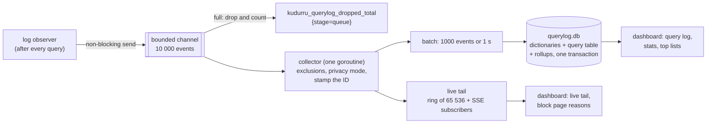
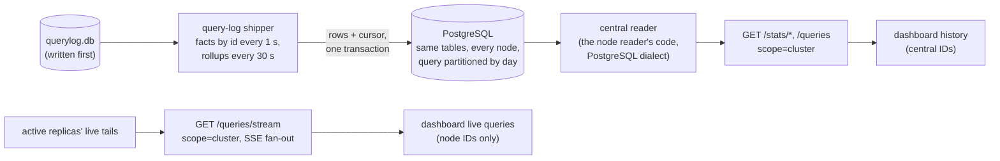
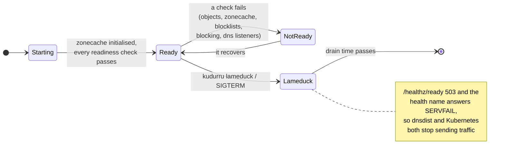
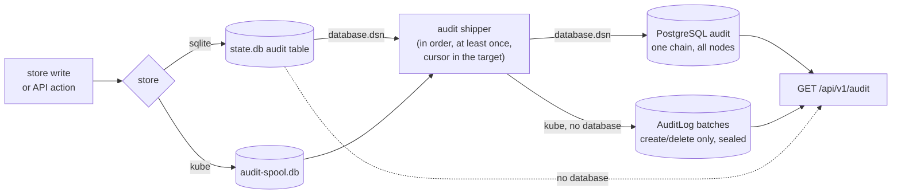

# Observability

Three signals, three homes, and none of them goes through the store:

| Signal | Answers | Where |
|---|---|---|
| **Query log** | which client asked what, and why it got that answer | `querylog.db` on each node, plus an in-memory tail |
| **Metrics** | how much, how fast, how healthy | Prometheus, from `:9153/metrics` |
| **Health** | can this node take traffic now? | `:8081/healthz/*` |

Plus the **audit** trail of who changed what. Code: `internal/stages/log`,
`internal/querylog` (collector, privacy, tail) and
`internal/querylog/sqlitelog` (writer, rollups, retention, reader),
`internal/metrics`, `internal/health`, `internal/audit`.

The Nodes page also polls `GET /api/v1/edge` every ten seconds. In Helm,
the server discovers every separate edge pod through the headless
`<release>-edge-status` Service's EndpointSlices, then reads `/status` on
the supervisors' health listeners (8084 for dnsdist, 8085 for keepalived)
in parallel with two-second request deadlines. Unready pods remain in
discovery. The response includes aggregate readiness, each supervisor,
backends as observed by each edge, and each VIP's state and priority.
`MASTER` identifies the node holding a VIP; `BACKUP` reports only that
node's own state. An unavailable supervisor cannot report a live owner.
Older supervisors use `/healthz/ready` to supplement their status
document. dnsdist's private API key stays inside the edge pod.

For a local edge outside Helm, set `KUDURRU_EDGE_STATUS_URL` and, when
keepalived runs alongside it, `KUDURRU_VIP_STATUS_URL` to the health
listeners (for example, `http://127.0.0.1:8084` and port 8085). The Compose
examples set these automatically.

## The query log pipeline

The answer never waits for the log: when the channel is full, the event is
dropped and counted. The health name and the dashboard's built-in dig are
never logged.

**Privacy is applied once, at the collector**, before anything is stored or
shown: `full`, `anonymize_client` (a /24 or /48 prefix, or a daily
pseudonym), `hide_domains`, `hide_domains_clients`, or `nothing` (only the
per-minute totals). Changing the mode does not rewrite queries already
logged.

### What one event holds

Time, latency, node, transport, client address, client group, policy, name,
type, class, rcode, **status**, upstream (`<group>/<server>`), zone, matched
**list** and **rule**, answer count and a short answer summary, the first
EDE code, flags (RD, CD, DO, ECS, TC, AD, cached, stale, prefetch) and the
ECS prefix. The status, list and rule are what let the dashboard explain an
answer in one line.

### Storage and retention

| Table | Granularity | Kept |
|---|---|---|
| `query` (facts) | one row per query | `querylog.retention.raw` (720 h) and `maxDBBytes` (10 GiB) |
| `rollup_1m`, `_client_1m`, `_qtype_1m`, `_upstream_1m` | minute | 35 days |
| `rollup_1h`, `_client_1h`, `_qtype_1h`, `_upstream_1h`, `_domain_1h`, `_list_1h`, `_zone_1h` | hour | 400 days |
| `rollup_1d`, `_client_1d`, `_domain_1d` | day | forever |

Names, clients, upstreams, zones, lists and policies are stored once in
`dict_*` tables and referenced by ID. Charts read the rollups, so a 30-day
chart does not scan 30 days of rows. The database is per node: in a
multi-node install each node logs what it answered. **All nodes**
(`scope=cluster`) asks every replica over `:8082` and merges the answers;
a replica that is down makes the answer partial. With a central PostgreSQL
database (`database.dsn`), every node also copies its rows and rollups
there, and **All nodes** reads the database instead
([postgres.md](../deploy/postgres.md)):

A node keeps the rows it has not shipped, even past its own retention, so
an outage of the database delays the cluster view but loses nothing the
node still holds.

The live tail follows the active replicas directly, even with a central
database. While enabled, the dashboard shows only incoming queries; it
does not merge node IDs with central history. Stopping the tail refreshes
history from the database.

## Metrics

All metric labels are bounded: list names, upstream names and status values,
never client addresses or query names.

| Family | Examples |
|---|---|
| DNS | `kudurru_dns_requests_total{proto,qtype}`, `kudurru_dns_responses_total{proto,rcode,status}`, `kudurru_dns_request_duration_seconds{proto,status_class}`, `kudurru_dns_dropped_total{reason}` |
| Upstreams and cache | see [upstreams and the cache](upstreams-and-cache.md#metrics) |
| Store and zonecache | `kudurru_store_operations_total`, `kudurru_store_snapshot_age_seconds`, `kudurru_zonecache_rebuild_duration_seconds`, `kudurru_zone_serial`, `kudurru_zone_records` |
| Control plane | `kudurru_leader`, `kudurru_controller_reconcile_duration_seconds`, `kudurru_objects_diagnoses` |
| Blocking | `kudurru_blocking_enabled`, `kudurru_blockpage_requests_total` |
| Query log | `kudurru_querylog_events_total`, `kudurru_querylog_dropped_total{stage,sink}`, `kudurru_querylog_db_bytes`, `kudurru_querylog_write_duration_seconds` |
| API | `kudurru_api_requests_total`, `kudurru_api_request_duration_seconds` |
| Edge and VIP | `kudurru_edge_renders_total`, `kudurru_edge_dnsdist_restarts_total`, `kudurru_edge_backend_up`, `kudurru_vip_master` (on the supervisors' own ports) |

`deploy/prometheus/rules.yaml` and `deploy/grafana/kudurru-overview.json`
(also in the chart) are generated and tested against these names.

## Health

| Endpoint (`:8081`, no auth) | Meaning |
|---|---|
| `GET /healthz/startup` | the zonecache has initialised (from the store or from `local.db`) |
| `GET /healthz/ready` | every component is ready and the node is not in lameduck |
| `GET /healthz/live` | the self-check loop ran in the last 30 s; never load-based |
| `GET /healthz` | JSON roll-up with every component, for `kudurru health` and Docker's `HEALTHCHECK` |
| `GET/POST/DELETE /lameduck` | read or set lameduck (writes from loopback only) |

Upstream reachability is **never** a readiness condition: a node whose
upstreams are down still answers its zones and its cache, and taking it out
of rotation would make things worse.

## Audit

| Store | Where audit records go |
|---|---|
| sqlite | the `audit` table in `state.db`, hash-chained, written in the same transaction as the change; `GET /api/v1/audit` reads it; pruned after `audit.retention` (400 days) by the leader |
| kube | the store is wrapped so every successful write is recorded; each pod keeps its events in `audit-spool.db` (hash-chained) and ships them into immutable `AuditLog` objects (`audit.kudurru.io`) in the release namespace, which every replica reads; the leader deletes batches after `audit.retention` |
| either, with `database.dsn` | the node's own store (`state.db` or the spool) is shipped into one hash chain in the central database, which every replica reads |

Every event is also a JSON line on stdout (`"log":"audit"`) for the
cluster's log pipeline, and the apiserver's own audit log covers CRD
writes. Client-controlled text is sanitized (valid UTF-8, no NUL) before an
event is hashed.

Store writes are audited by the driver. The API adds what no store write
covers: denied requests, the blocking toggle, cache flushes, query-log
purges, NOTIFY and list refreshes.
