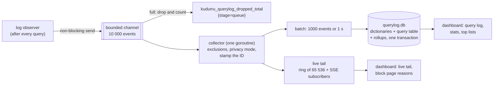
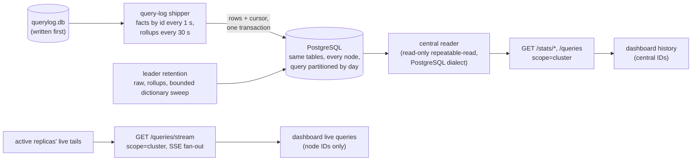
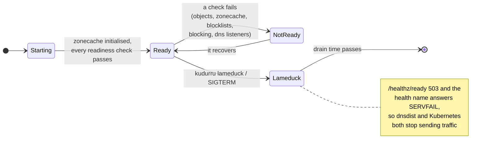
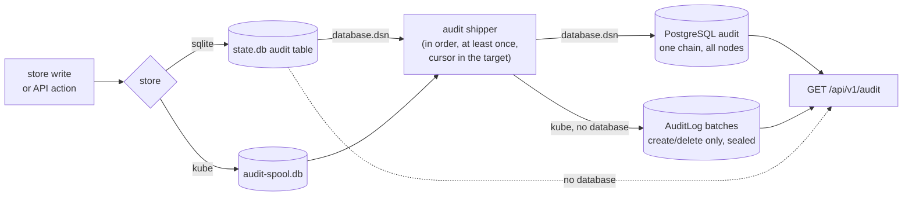

# Observability

Three signals, three homes, and none of them goes through the store:

| Signal | Answers | Where |
|---|---|---|
| **Query log** | which client asked what, and why it got that answer | `querylog.db` on each node, plus an in-memory tail |
| **Metrics** | how much, how fast, how healthy | Prometheus, from `:9153/metrics` |
| **Health** | can this node take traffic now? | `:8081/healthz/*` |

Plus the **audit** trail of who changed what. Code: `internal/stages/log`,
`internal/querylog` (collector, privacy, tail) and
`internal/querylog/sqlitelog` (writer, rollups, retention, reader),
`internal/metrics`, `internal/health`, `internal/audit`.

SQLite exports `kudurru_cluster_fenced` from its current local authority, with
no database read during a scrape. It is 1 for a higher-term fence, conflicting
promotions, divergent images, or an in-memory fence when persistence fails.
Persisted fences survive restart. Installing an accepted successor image as a
follower or explicitly resolving a conflict clears the signal when the store
transition succeeds. A healthy read-only follower or unenrolled mirror reports
0; zero does not establish writable readiness. Valid last-good DNS can continue
while fenced. Kubernetes nodes do not export this SQLite authority signal.
The Grafana cluster/store row and immediate `KudurruClusterFenced` alert use it;
inspect authority and storage errors before attempting explicit recovery.

The human `GET /healthz` response includes `leader` and `snapshotAge` strings.
`leader` is the locally observed controller holder, empty when unknown or when
an old self identity has no active term. It does not resolve peer addresses or
verify a remote holder's present authority. `snapshotAge` is the rounded duration
since the currently served `local.db` snapshot was written, including stale
snapshots; it is empty while serving live data or when no saved image is served.
Both fields are local observations and do not change readiness or liveness.

The Nodes page also polls `GET /api/v1/edge` every ten seconds. In Helm,
the server discovers every separate edge pod through the headless
`<release>-edge-status` Service's EndpointSlices, then reads `/status` on
the supervisors' health listeners (8084 for dnsdist, 8085 for keepalived)
in parallel with two-second request deadlines. Unready pods remain in
discovery. The response includes aggregate readiness, each supervisor,
backends as observed by each edge, and each VIP's state and priority.
`MASTER` identifies the node holding a VIP; `BACKUP` reports only that
node's own state. An unavailable supervisor cannot report a live owner.
Older supervisors use `/healthz/ready` to supplement their status
document. dnsdist's private API key stays inside the edge pod.

For a local edge outside Helm, set `KUDURRU_EDGE_STATUS_URL` and, when
keepalived runs alongside it, `KUDURRU_VIP_STATUS_URL` to the health
listeners (for example, `http://127.0.0.1:8084` and port 8085). The Compose
examples set these automatically.

## Serving diagnostics

SQLite `GET /info/messages` reads policy diagnoses, enabled-list readiness and
secondary/stub coverage from the original authenticated HTTP installation.
It observes absolute expiry once for the whole response, including required RPZ
data. An unavailable copy produces a serving-unavailable message; the captured
owners do not invent transfer-attempt history. Missing or inconsistent owners
return 503 rather than consulting live policy, cache or transfer managers.
The diagnoses entry in `/doctor` uses that same request context.

Loader failures, node health, read-only process mode and central-database
reachability are separately labeled current operational observations. They do
not identify which configuration is serving. The combined response has bounded
fields, count and aggregate size; overflow fails instead of silently omitting
messages. Legacy Kubernetes diagnostics keep their existing sources.

When `audit.store: auditlog` is selected, the Diagnosis page, `/doctor` and
`kudurru doctor` include a separate current AuditLog observation for licensed
`audit.read` users. The probe inherits the guarded Kubernetes transport and
lists only metadata in the release namespace; it reads no batch contents and
does not verify audit integrity or shipping. Permission, original credential
expiry and the audit license are checked before acquisition and again before
disclosure. Failure of the original captured diagnosis source does not invoke
this probe as a fallback.

The scan permits one active caller, 500 objects per page, at most 101 pages,
2 MiB per decoded response and 64 MiB total, within three seconds. A complete
coherent list reports an exact batch-object count up to 50,000. At 50,001 it
stops and recommends central database storage or retention review, explicitly
as a lower bound. Missing/denied endpoints, unavailable APIs, expired cursors,
malformed responses and exhausted bounds have distinct nonhealthy results;
there is no discovery, redirect or full-object fallback.

The lazy probe can observe an API resource that was missing at startup. That
observation does not activate the startup-disabled cluster audit reader or
shipper: restart replicas after installing the CRD. DNS readiness remains
independent. Doctor treats informational successful scans as OK rather than
turning every nonempty diagnosis list into a warning.

## The query log pipeline

The answer never waits for the log: when the channel is full, the event is
dropped and counted. The health name and the dashboard's built-in dig are
never logged.

**Privacy is applied once, at the collector**, before anything is stored or
shown: `full`, `anonymize_client` (a /24 or /48 prefix, or a daily
pseudonym), `hide_domains`, `hide_domains_clients`, or `nothing` (only the
per-minute totals). Changing the mode does not rewrite queries already
logged. Daily pseudonyms keep the same process-local key when a reload only
changes exclusions or preserves the same anonymizing transform. The old filter
and its replacement share midnight rotation, so an in-flight lookup agrees
with ingestion. Changing the privacy mode or anonymization method starts a new
key lifecycle; restarting the process also changes pseudonyms. Keys are never
persisted, exported or derived from database values.

### What one event holds

Time, latency, node, transport, client address, client group, policy, name,
type, class, rcode, **status**, upstream (`<group>/<server>`), zone, matched
**list** and **rule**, answer count and a short answer summary, the first
EDE code, flags (RD, CD, DO, ECS, TC, AD, cached, stale, prefetch), the
ECS prefix and the DNSSEC state (`secure`, `insecure` or `bogus` for answers
from recursive groups, cached ones included; `unknown` otherwise). The status, list and rule are what let the dashboard explain an
answer in one line.

### Storage and retention

| Table | Granularity | Kept |
|---|---|---|
| `query` (facts) | one row per query | `querylog.retention.raw` (720 h) and `maxDBBytes` (10 GiB) |
| `rollup_1m`, `_client_1m`, `_qtype_1m`, `_upstream_1m` | minute | 35 days |
| `rollup_1h`, `_client_1h`, `_qtype_1h`, `_upstream_1h`, `_domain_1h`, `_list_1h`, `_zone_1h` | hour | 400 days |
| `rollup_1d`, `_client_1d`, `_domain_1d` | day | forever |

Names, clients, upstreams, zones, lists and policies are stored once in
`dict_*` tables and referenced by ID. Charts read the rollups, so a 30-day
chart does not scan 30 days of rows. The database is per node: in a
multi-node install each node logs what it answered. **All nodes**
(`scope=cluster`) asks every replica over `:8082` and merges the answers;
a replica that is down makes the answer partial. With a central PostgreSQL
database (`database.dsn`), every node also copies its rows and rollups
there, and **All nodes** reads the database instead
([postgres.md](../deploy/postgres.md)):

A node keeps the rows it has not shipped, even past its own retention, so
an outage of the database delays the cluster view but loses nothing the
node still holds. Dictionary hints are revalidated under row locks inside
the shipping transaction; every fact and rollup dictionary reference also has
a foreign key. After raw/rollup retention, the leader selects at most 256 IDs
per dictionary per hourly pass and deletes only entries with no retained
reference, including daily rollups from retired sources. Durable bounded
keyset sweeps wrap and resume after restart. The two-second pass deadline
bounds lock ownership; failed passes roll back deletions and sweep progress.
Read-only repeatable-read snapshots retain matching dictionary data while a
concurrent sweep commits. See the PostgreSQL guide for the schema 4 upgrade
boundary and migration cost.

The live tail follows the active replicas directly, even with a central
database. While enabled, the dashboard shows only incoming queries; it
does not merge node IDs with central history. Stopping the tail refreshes
history from the database.

## Metrics

All metric labels are bounded: list names, upstream names and status values,
never client addresses or query names.

| Family | Examples |
|---|---|
| DNS | `kudurru_dns_requests_total{proto,qtype}`, `kudurru_dns_responses_total{proto,rcode,status}`, `kudurru_dns_request_duration_seconds{proto,status_class}`, `kudurru_dns_dropped_total{reason}` |
| Rate limiting | `kudurru_ratelimit_buckets`, `kudurru_ratelimit_slipped_total` (UDP TC=1 decisions, distinct from drops; no client labels) |
| Upstreams, recursion and cache | see [upstreams and the cache](upstreams-and-cache.md#metrics) (`kudurru_upstream_*`, `kudurru_recursor_*`, `kudurru_cache_*`) |
| Store and zonecache | `kudurru_store_operations_total`, `kudurru_store_snapshot_age_seconds`, `kudurru_zonecache_rebuild_duration_seconds`, `kudurru_zone_serial`, `kudurru_zone_records` |
| Control plane | `kudurru_leader`, `kudurru_controller_reconcile_duration_seconds`, `kudurru_objects_diagnoses` |
| Blocking | `kudurru_blocking_enabled`, `kudurru_blockpage_requests_total` |
| Query log | `kudurru_querylog_events_total`, `kudurru_querylog_dropped_total{stage,sink}`, `kudurru_querylog_db_bytes`, `kudurru_querylog_write_duration_seconds` |
| API | `kudurru_api_requests_total`, `kudurru_api_request_duration_seconds` |
| Edge and VIP | `kudurru_edge_renders_total`, `kudurru_edge_dnsdist_restarts_total`, `kudurru_edge_backend_up`, `kudurru_vip_master` (on the supervisors' own ports) |

`deploy/prometheus/rules.yaml` and `deploy/grafana/kudurru-overview.json`
(also in the chart) are generated and tested against these names.

## Health

| Endpoint (`:8081`, no auth) | Meaning |
|---|---|
| `GET /healthz/startup` | the zonecache has initialised (from the store or from `local.db`) |
| `GET /healthz/ready` | every component is ready and the node is not in lameduck |
| `GET /healthz/live` | the self-check loop ran in the last 30 s; never load-based |
| `GET /healthz` | JSON roll-up with every component, for `kudurru health` and Docker's `HEALTHCHECK` |
| `GET/POST/DELETE /lameduck` | read or set lameduck (writes from loopback only) |

`GET /api/v1/nodes/{name}/health` requires `cluster.read` and returns the
selected node's readiness plus its `/healthz` JSON document. Self reads use the
local checker. Remote reads resolve the name only through cluster membership
and call `GET /internal/health` over the existing TLS and cluster bearer-token
transport; public caller credentials are not forwarded, and redirects are
refused. The peer endpoint shares the internal listener's authentication and
rate limit. It reports an unhealthy checker as a successful observation with
`ready: false`, preserving that peer's component details without adding local
components.

Remote discovery and the request share a two-second deadline, and peer health
responses are capped at 1 MiB. The response node must match membership; derived
node certificates must also identify that member. Configured service
certificates retain their configured TLS verification and use the response's
node identity. An unknown member returns 404. Failed discovery, a missing
internal client/address, an older peer without this endpoint, unreachable or
slow peers, and malformed, oversized or mismatched responses return 503 with
redacted messages. An unavailable peer does not report healthy. Check internal
listener connectivity and cluster credentials when those reads fail.

These readiness documents are current operational observations. They do not
replace captured canonical objects or establish which publication served a
configuration read. `GET /nodes` retains its separate peer-status behavior,
including unknown readiness for failed or older peers.

Upstream reachability is **never** a readiness condition: a node whose
upstreams are down still answers its zones and its cache, and taking it out
of rotation would make things worse.

On SQLite, readiness requires an eligible complete publication and admitted,
available committed routing for every desired primary and forward zone in that
same publication, including the bootstrap root forwarder. A desired-only
placeholder or a pending lifecycle cannot
make the node ready. Secondary and stub acquisition failures remain local to
their zones and do not make an otherwise healthy node unready.

## Audit

| Store | Where audit records go |
|---|---|
| sqlite | the `audit` table in `state.db`, hash-chained, written in the same transaction as the change; `GET /api/v1/audit` reads it; pruned after `audit.retention` (400 days) by the leader |
| kube | the store is wrapped so every successful write is recorded; each pod keeps its events in `audit-spool.db` (hash-chained) and ships them into immutable `AuditLog` objects (`audit.kudurru.io`) in the release namespace, which every replica reads; the leader deletes batches after `audit.retention` |
| either, with `database.dsn` | the node's own store (`state.db` or the spool) is shipped into one hash chain in the central database, which every replica reads |

Every event is also a JSON line on stdout (`"log":"audit"`) for the
cluster's log pipeline, and the apiserver's own audit log covers CRD
writes. Client-controlled text is sanitized (valid UTF-8, no NUL) before an
event is hashed.

Store writes are audited by the driver. The API adds what no store write
covers: denied requests, the blocking toggle, cache flushes, query-log
purges, NOTIFY and list refreshes.

Token creation and revocation are actual `apitoken.create` and
`apitoken.delete` store writes. Their audit documents keep an allowlist of
the label, owner, expiry and scopes; the token and its hash are excluded.
Kubernetes store events also carry the authenticated principal and HTTP
request context. Admin-socket writes name the admitted local-root peer
instead of falling back to `system`. The dashboard shows safe token
details and offers an `APIToken` kind filter. Older events with no token
document cannot recover that information after the token is revoked.

Audit list and export responses redact historical token documents with the
same allowlist and omit documents for other internal identity kinds. New
SQLite identity mutations also omit those documents. Stored records and
their hashes remain unchanged; verification reads the original store, not
the redacted response. Exported hashes describe the original stored data
and cannot be recomputed from redacted documents.

The dashboard's separate **Audit Log** page supports newest/oldest order,
cursor pagination and event details. `GET /api/v1/audit/verify` requires
`audit.read` and the audit license, and checks the complete retained store
with a 30-second deadline. It verifies the original SQLite chain, the central
PostgreSQL chain including its retention anchor and head, or fresh Kubernetes
batches and their available HMAC seals plus the local pending spool. The
response reports verification success or a generic integrity failure;
storage errors and timeouts return 503 with a generic message, with details
logged on the server. Concurrent requests share one scan, and every result
(including unavailability) is cached for 30 seconds per serving process.
Current and previous encryption keys verify batches retained across rotation.
Keep the previous key until the old-sealed batches have been pruned before
dropping it or rotating again; see [the rotation runbook](../deploy/runbooks.md#rotating-the-encryption-key).
Hash chains provide
tamper evidence, not protection from an administrator who can rewrite the
entire database and its chain. External log copies or exports provide an
independent record. Deleting complete oldest or newest unanchored batches
cannot be detected from the surviving batches alone.
