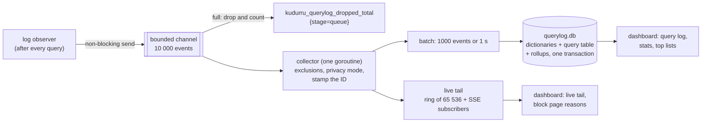
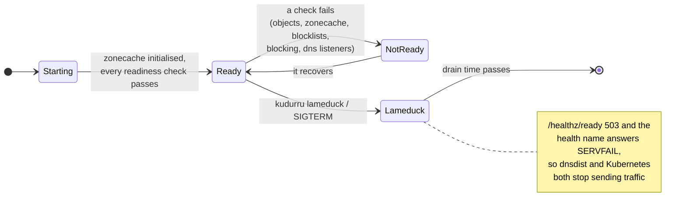

# Observability

Three signals, three homes, and none of them goes through the store:

| Signal | Answers | Where |
|---|---|---|
| **Query log** | which client asked what, and why it got that answer | `querylog.db` on each node, plus an in-memory tail |
| **Metrics** | how much, how fast, how healthy | Prometheus, from `:9153/metrics` |
| **Health** | can this node take traffic now? | `:8081/healthz/*` |

Plus the **audit** trail of who changed what. Code: `internal/stages/log`,
`internal/querylog` (collector, privacy, tail) and
`internal/querylog/sqlitelog` (writer, rollups, retention, reader),
`internal/metrics`, `internal/health`, `internal/audit`.

## The query log pipeline

The answer never waits for the log: when the channel is full, the event is
dropped and counted. The health name and the dashboard's built-in dig are
never logged.

**Privacy is applied once, at the collector**, before anything is stored or
shown: `full`, `anonymize_client` (a /24 or /48 prefix, or a daily
pseudonym), `hide_domains`, `hide_domains_clients`, or `nothing` (only the
per-minute totals). Changing the mode does not rewrite queries already
logged.

### What one event holds

Time, latency, node, transport, client address, client group, policy, name,
type, class, rcode, **status**, upstream (`<group>/<server>`), zone, matched
**list** and **rule**, answer count and a short answer summary, the first
EDE code, flags (RD, CD, DO, ECS, TC, AD, cached, stale, prefetch) and the
ECS prefix. The status, list and rule are what let the dashboard explain an
answer in one line.

### Storage and retention

| Table | Granularity | Kept |
|---|---|---|
| `query` (facts) | one row per query | `querylog.retention.raw` (720 h) and `maxDBBytes` (10 GiB) |
| `rollup_1m`, `_client_1m`, `_qtype_1m`, `_upstream_1m` | minute | 35 days |
| `rollup_1h`, `_client_1h`, `_qtype_1h`, `_upstream_1h`, `_domain_1h`, `_list_1h`, `_zone_1h` | hour | 400 days |
| `rollup_1d`, `_client_1d`, `_domain_1d` | day | forever |

Names, clients, upstreams, zones, lists and policies are stored once in
`dict_*` tables and referenced by ID. Charts read the rollups, so a 30-day
chart does not scan 30 days of rows. The database is per node: in a
multi-node install each node logs what it answered (scatter-gather across
nodes is planned).

## Metrics

All metric labels are bounded: list names, upstream names and status values,
never client addresses or query names.

| Family | Examples |
|---|---|
| DNS | `kudurru_dns_requests_total{proto,qtype}`, `kudurru_dns_responses_total{proto,rcode,status}`, `kudurru_dns_request_duration_seconds{proto,status_class}`, `kudurru_dns_dropped_total{reason}` |
| Upstreams and cache | see [upstreams and the cache](upstreams-and-cache.md#metrics) |
| Store and zonecache | `kudurru_store_operations_total`, `kudurru_store_snapshot_age_seconds`, `kudurru_zonecache_rebuild_duration_seconds`, `kudurru_zone_serial`, `kudurru_zone_records` |
| Control plane | `kudurru_leader`, `kudurru_controller_reconcile_duration_seconds`, `kudurru_objects_diagnoses` |
| Blocking | `kudurru_blocking_enabled`, `kudurru_blockpage_requests_total` |
| Query log | `kudurru_querylog_events_total`, `kudurru_querylog_dropped_total{stage,sink}`, `kudurru_querylog_db_bytes`, `kudurru_querylog_write_duration_seconds` |
| API | `kudurru_api_requests_total`, `kudurru_api_request_duration_seconds` |
| Edge and VIP | `kudurru_edge_renders_total`, `kudurru_edge_dnsdist_restarts_total`, `kudurru_edge_backend_up`, `kudurru_vip_master` (on the supervisors' own ports) |

`deploy/prometheus/rules.yaml` and `deploy/grafana/kudurru-overview.json`
(also in the chart) are generated and tested against these names.

## Health

| Endpoint (`:8081`, no auth) | Meaning |
|---|---|
| `GET /healthz/startup` | the zonecache has initialised (from the store or from `local.db`) |
| `GET /healthz/ready` | every component is ready and the node is not in lameduck |
| `GET /healthz/live` | the self-check loop ran in the last 30 s; never load-based |
| `GET /healthz` | JSON roll-up with every component, for `kudurru health` and Docker's `HEALTHCHECK` |
| `GET/POST/DELETE /lameduck` | read or set lameduck (writes from loopback only) |

Upstream reachability is **never** a readiness condition: a node whose
upstreams are down still answers its zones and its cache, and taking it out
of rotation would make things worse.

## Audit

| Driver | Where audit records go |
|---|---|
| sqlite | the `audit` table in `state.db`, hash-chained, written in the same transaction as the change; `GET /api/v1/audit` reads it; pruned after 400 days by the leader |
| kube | a JSON line on stdout (`"log":"audit"`) for the cluster's log pipeline; the apiserver's own audit log covers CRD writes |

Store writes are audited by the driver. The API adds what no store write
covers: denied requests, the blocking toggle, cache flushes, query-log
purges, NOTIFY and list refreshes.
