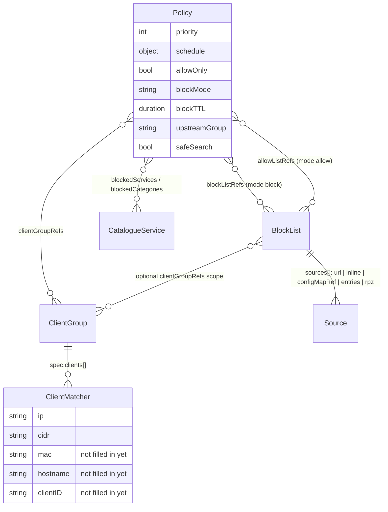
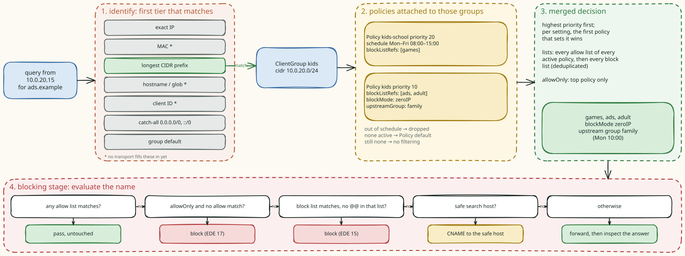
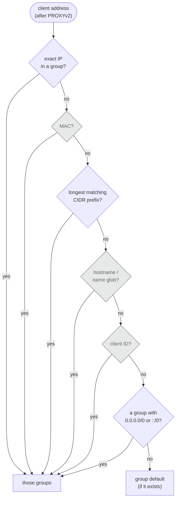
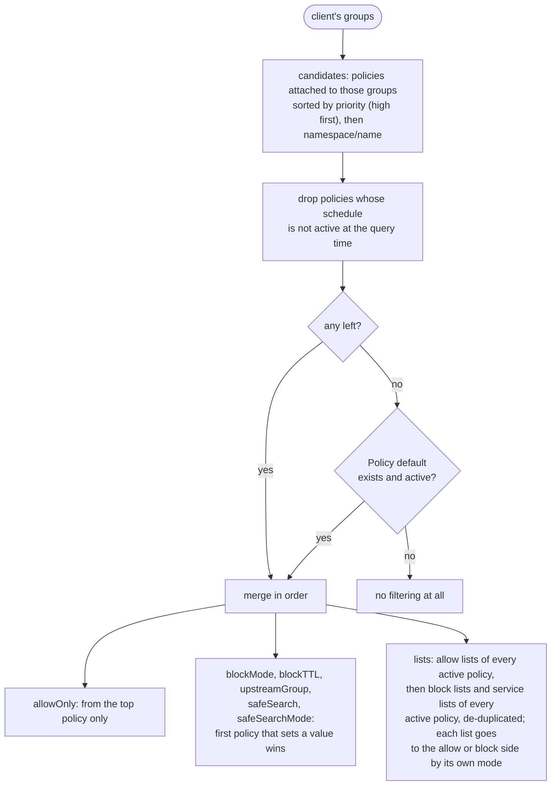
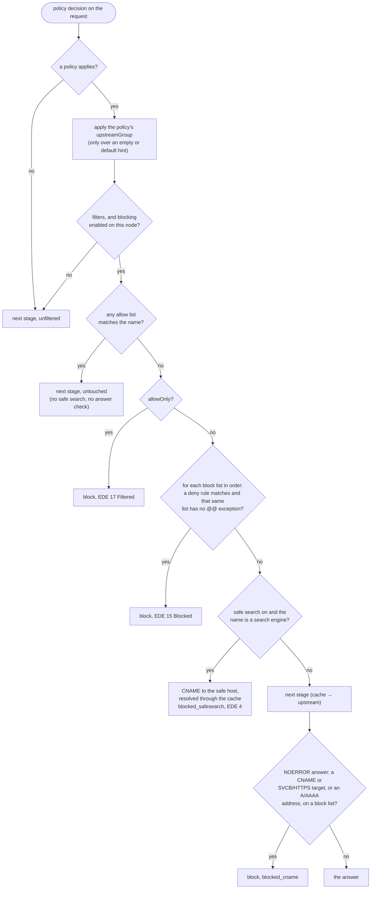
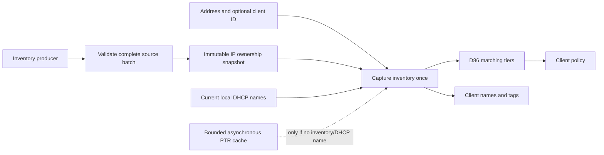

# Clients, policies and blocking

Blocking in kudurru is per client. Two stages decide it: `identify` works out
who is asking and which policy applies, and `blocking` judges the name
against that policy's lists. Between them sit four kinds of object:



Code: `internal/policy` (the index, matching, merging, schedules),
`internal/stages/identify`, `internal/stages/blocking`, `internal/blocking`
(the compiled lists and the matchers), `internal/domainlist`,
`internal/unblock`, `internal/blockpage`, `internal/listdata/catalogue`.



## 1. Who is asking

The policy index is rebuilt (as part of the zonecache snapshot) whenever a
ClientGroup, Policy or BlockList changes. At query time `Identify` walks
**tiers** and stops at the first tier with a hit; only that tier's groups
are used. A client in an IP group and a CIDR group belongs to the IP group
only. Two groups that claim the same address in the same tier both apply
(and the index reports a `Tie`).



The grey tiers exist in the index, but nothing feeds them yet: no transport
sets a MAC or a DoT/DoH client ID, and no hostname resolver is wired. Today
clients are matched by exact IP, by CIDR, or fall through to the catch-all.
The bootstrap `ClientGroup default` lists `0.0.0.0/0` and `::/0`, which is
how "default matches everybody" works.

## 2. Which policy applies

Every Policy attached to any of the client's groups is a candidate. The
index precomputes the merged result for each combination of scheduled
policies being on or off, so the query path only picks the right one.



A schedule is `{weekdays, start, end, tz}`. An `end` earlier than `start`
crosses midnight and belongs to the start day; `start == end` means 24 hours;
no weekdays means every day. A schedule that does not parse makes the policy
**always active** (it fails closed) and raises a diagnosis.

`queryLog` is merged into the decision but nothing reads it yet, and
`rewrites` is ignored (planned for v0.2).

## 3. Is this name blocked?

The diagram below describes ordinary list evaluation. The transferred RPZ
adapter inserts ordered feed evaluation after explicit allow/allow-only and
before ordinary denies, rewrites and safe search. It uses one resolved response
for both RPZ and ordinary answer inspection; required unavailable feeds fail
closed. Production wiring remains open. See
[transferred RPZ](block-lists.md#transferred-rpz-foundation) for that flow and
its current implementation boundary.



Rules worth remembering:

- **Allow wins across policies.** An allow list of any active policy beats
  every block list of every active policy.
- **`@@` exceptions are per list.** An exception in list A does not cancel a
  match in list B.
- **The answer is checked too.** Up to 64 names and addresses from the
  answer are checked against the same lists (an allow match skips that
  item), so a CNAME into a tracker domain is blocked even when the asked
  name is clean. This also applies to cached answers.

### What a block looks like

The mode comes from the BlockList that matched (`spec.response`), else the
policy's `blockMode`, else `blocking.defaultResponse`:

| Mode | A / AAAA | Other types |
|---|---|---|
| `zeroIP` (default) | `0.0.0.0` / `::` | NODATA |
| `nxdomain` | NXDOMAIN (no SOA) | NXDOMAIN |
| `customIP` | the list's or the configured address | NODATA |
| `blockPage` | the block page addresses (zeroIP when none is set) | NODATA |
| `refused` | REFUSED | REFUSED |

The TTL is the policy's `blockTTL`, else `blocking.blockTTL`, else 10
minutes. When the client sent EDNS, the answer carries EDE 15 (or 17 for
allow-only) with the list name as extra text. The query log records the
list (`namespace/name` or `service:<id>`) and the rule, which is how the
dashboard explains every block. The status is `blocked_regex` for a regex
rule, `blocked_exact` for an exact or suffix rule from a list made only of
inline entries, and `blocked_list` otherwise.

### Turning blocking off for a while

`POST /api/v1/dns/blocking {blocking: false, timer: 300}` disables blocking
**on the node that receives the request**, in memory, until the timer ends
or the process restarts. The API reports `scope: "node"`. The cluster-wide
toggle that the design record describes is not built: the replication hook
exists, but nothing implements it.

## Blocked services and safe search

The blocked-services catalogue is a kudurru-authored JSON document embedded
in the binary (and optionally replaced from `blocking.catalogue.url`, which
the leader downloads and the other nodes pull over `:8082`, like a list).

- Each **service** compiles to a block list named `service:<id>`, in the
  same compiled snapshot as the BlockLists. A policy's `blockedServices`
  plus the services of its `blockedCategories`, minus `allowedServices`,
  are appended after its block lists.
- Each **search engine** has a safe host. With `safeSearch` on, a query for
  the engine's name is answered with a CNAME to the safe host (`strict` or,
  where the engine has one, `moderate`), and kudurru resolves the target
  itself so the client gets addresses in one answer.

## Allow and deny from the dashboard

The **Allowlist** and **Denylist** pages do not edit policies directly. They
write structured entries into four managed BlockLists, and a leader loop
keeps those lists attached to the right policies:

| List | Holds | Attached to |
|---|---|---|
| `ui-allow` / `ui-deny` | entries for everyone | every writable policy in the namespace |
| `ui-allow-<group>` / `ui-deny-<group>` | entries for one group | the policies that name that group |

Policies owned by files or integrations are never edited; they are reported
as skipped.

Attachment makes a list available to a policy; `BlockList.spec.clientGroupRefs`
restricts it to the captured winning membership of the query. These optional
namespace-local names form a set: any matching group permits the list, including
ties in the winning tier. Lower tiers and groups from another namespace do not.
The policy index copies this scope and filters list references before building
its immutable selection, including fallback decisions. Serving never reads the
store for scope, and a held request keeps its original complete publication.

General lists without this field remain unrestricted. Reserved
`ui-allow-<group>` and `ui-deny-<group>` names keep their exact group meaning for
legacy objects too; dashboard and unblock writers materialize that scope on the
list. Admission rejects an explicit scope that contradicts a reserved name.
`ui-allow` and `ui-deny` retain their everyone meaning. A shared policy can
therefore carry a group's allow or deny list without applying it to other groups.
Content and regex caches stay shared behind the scoped selection; cached raw
responses are inspected under the original request's selection.

## The block page and unblock requests

With `blockMode: blockPage`, a blocked web site resolves to the block page
listener. The page explains the block and lets the user ask for an
exception; an administrator approves it in the dashboard.

```mermaid
sequenceDiagram
    autonumber
    actor U as user (10.0.20.15)
    participant D as kudurru DNS
    participant BP as block page :80
    participant Q as query log / policy index
    participant S as store
    actor A as administrator
    U->>D: A ads.example
    D-->>U: A = blockPage.ipv4
    U->>BP: GET / (Host: ads.example)
    BP->>Q: why? query log tail (10 min), else re-evaluate the policy
    BP-->>U: "blocked by dns/ads: ||ads.example^" + request form
    U->>BP: POST /.kudurru/request (same origin, rate limited)
    BP->>S: Apply UnblockRequest ur-<HMAC(client, domain)> (Pending)
    A->>S: approve under original current proof and writer (scope, match, duration)
    S->>S: one SQLite transaction: entry, policy references, request decision
    Note over A,S: decide permission delegates only these derived effects; final credential and license checks
    Note over S,D: every node: list recompiles → new snapshot → allow list wins
    A->>D: the API flushes the name from this node's cache
    U->>D: A ads.example (after the old block TTL)
    D-->>U: the real address
```

- One request object exists per (client, domain): the name is an HMAC of
  both, so repeated submissions update one object. The client address is
  stored according to `querylog.privacy`.
- A leader janitor runs every minute: on SQLite its original elected writer
  atomically applies current canonical retention/expiry policy. Time-limited
  approvals expire (and
  their allow entry is removed), pending requests expire after 14 days, and
  decided requests are deleted after 30 days.
- The block page finds the reason in the query log first. Under the
  stricter privacy modes it cannot, and falls back to evaluating the policy
  for the client's address (which cannot see CNAME blocks).

Next: [Block lists](block-lists.md) shows how the lists behind all of this
are fetched and compiled.

## Captured client identity

The identify stage captures one immutable inventory snapshot before matching.
It supplies normalized MACs, hostnames and tags to the policy and modifier
engines. Group IDs are policy membership, not inventory tags. The fixed order
is exact IP, MAC, longest nonzero CIDR, exact hostname, hostname glob, ClientID,
catch-all CIDR, then default group. All matches within a tier join; in
particular, multiple MAC addresses cannot make group selection depend on order.
A known-empty inventory result stays empty for that query and its dependencies.

Inventory producers replace complete bounded batches off the DNS query path.
Observed and expiry timestamps describe the device observation, not a repeated
poll. The newest IP claim wins; equal-time conflicting claims are ambiguous.
Expired or removed claims do not expose an older device at a reassigned IP.
Failures retain the previous batch only until its existing expiry. The holder
is shared by integrations; queries never call a provider or perform PTR lookups.



### Optional reverse-PTR name fallback

`clientNames.reversePTR.enabled` opts the host into background name acquisition.
The operator must provide one to four unicast IP:port DNS servers and one to 32
client CIDRs in `networks`. These node settings are host-only and require restart;
API updates and null resets are refused. The default is disabled.

Identification samples the memory cache only when captured inventory and local
DHCP provide no name. A cold or expired lookup returns immediately and requests
background work through a bounded nonblocking queue. Two workers and 4,096 cache
entries are the defaults (limits: eight workers, 65,536 entries, 256 queued
addresses). Exact IP, MAC and nonzero CIDR matching retain higher precedence.
The resulting names and membership remain pinned to the original request and its
dependencies. PTR is an operator-selected DNS observation, never authentication.

Acquisition uses direct UDP with a single original timeout across configured
sources. Only a direct, unambiguous PTR target with matching ID/question/owner,
IN class and nonzero TTL is admitted. Truncated answers, CNAME chasing and invalid
hostnames are refused. Positive lifetime starts at acquisition and is capped by
`maxAge`; failed/negative acquisitions use `negativeTTL` backoff. No stale name is
returned while refreshing. Shutdown cancels and joins the fixed workers and
invalidates local observations. This source is independent of the resolver's
ordinary DNS cache and never uses system name resolution or the query pipeline.
