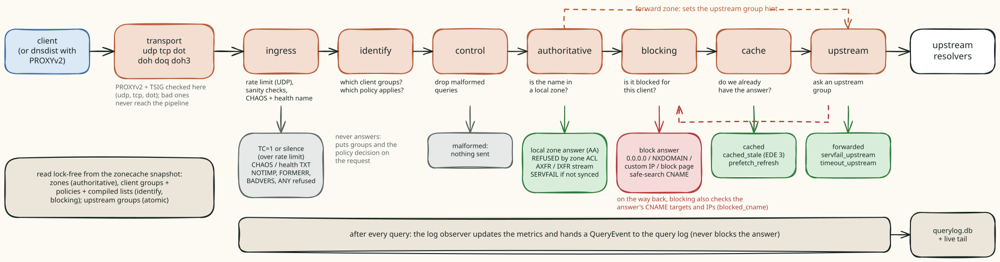
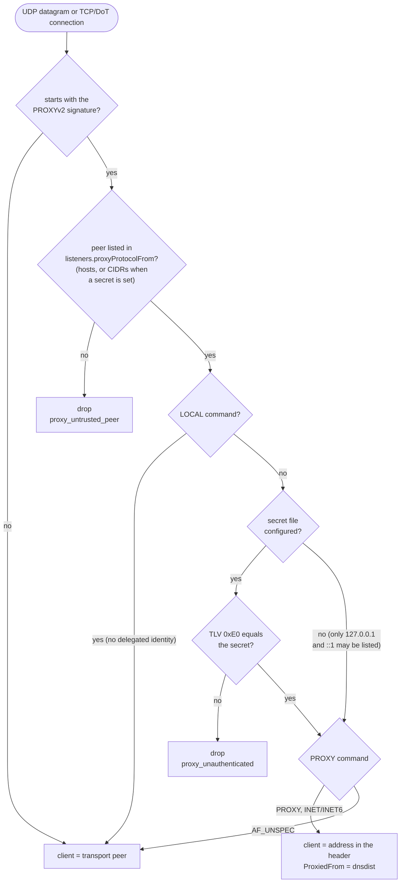
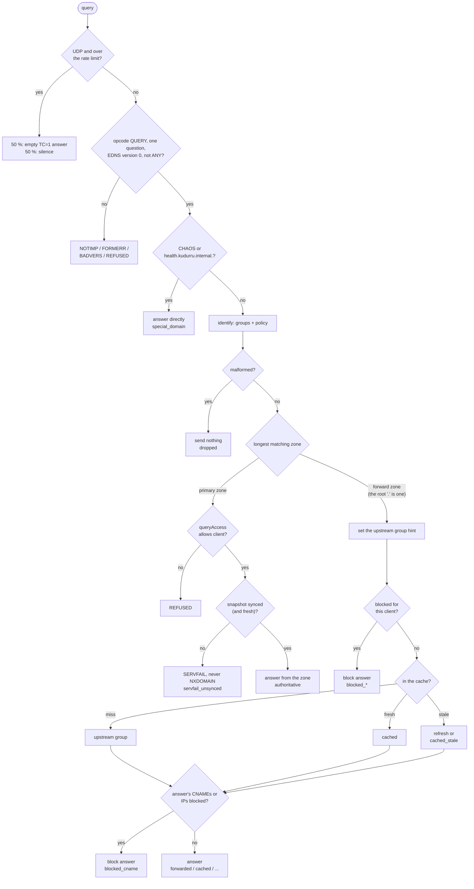
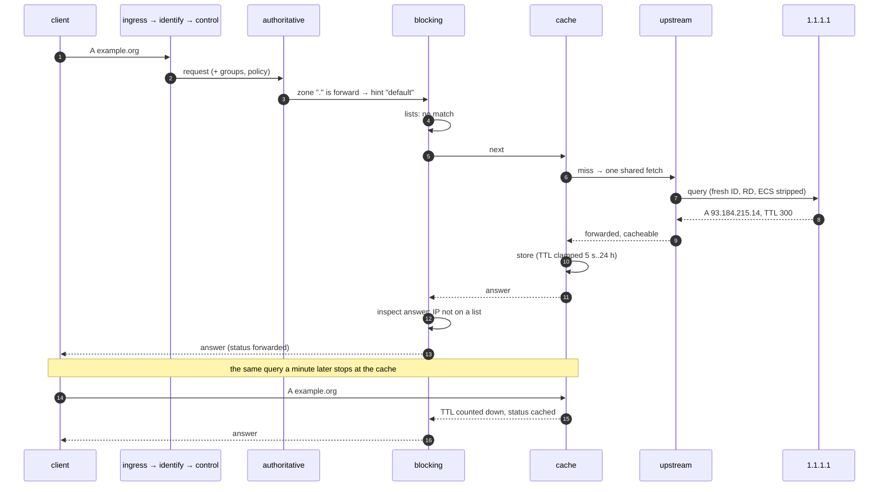
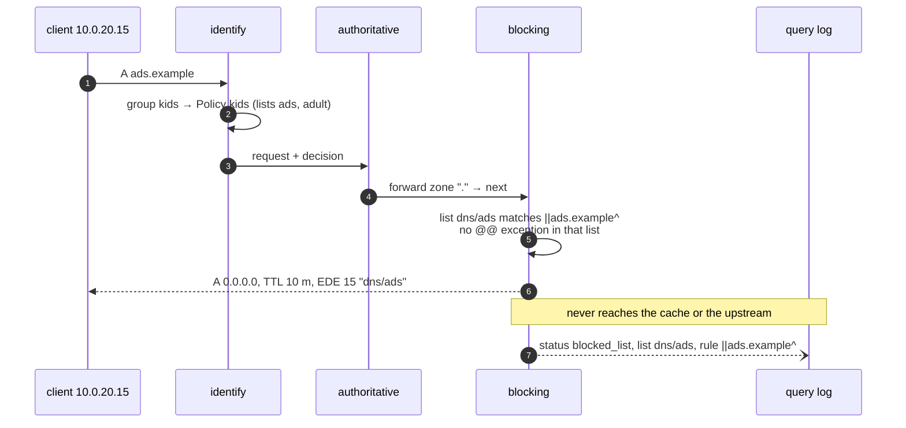
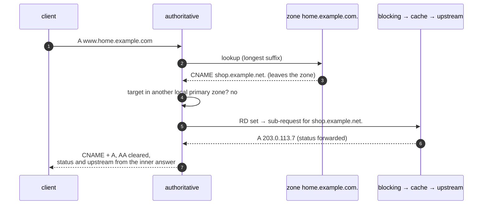

# A query's journey

Every DNS query, on every transport, goes through the same fixed chain of
seven stages. A stage either answers (and the query goes no further), or
calls the next stage and may look at the answer on the way back. When the
chain returns, an observer records the outcome. This page walks that path.

Code: `internal/dnsserver` (transports), `internal/pipeline` (the chain and
the status taxonomy), `internal/stages/*` (one package per stage), and the
wiring in `cmd/kudurru/serve.go`.

## Before the pipeline: transports

| Transport | Implementation | PROXYv2 | TSIG |
|---|---|---|---|
| Do53 UDP | miekg/dns, one `SO_REUSEPORT` socket per CPU | yes | yes |
| Do53 TCP | miekg/dns, one socket per CPU | yes | yes |
| DoT | miekg/dns `tcp-tls`, ALPN `dot` | yes | yes |
| DoH (HTTP/1.1, HTTP/2) | `net/http`, GET `?dns=` or POST | no | no |
| DoQ | quic-go, ALPN `doq` | no | no |
| DoH3 | quic-go HTTP/3 | no | no |

Every transport ends in one handler that stamps `Received` and a 5 s
deadline, runs the chain and writes the reply. DoH, DoQ and DoH3 give the
pipeline a fresh message ID, because their clients send ID 0.

### Who is the client? (PROXYv2)

When dnsdist fronts kudurru, the real client address arrives in a PROXYv2
header. kudurru trusts that header only from known peers, because the client
address decides policies, ACLs and the query log.

Dnsdist health checks use LOCAL without the query-rule TLV.
For LOCAL, Kudurru keeps the transport peer and applies no advertised identity.
The peer allowlist still applies. PROXY commands still require the shared secret.

Drops never reach the pipeline; they are counted in
`kudurru_dns_dropped_total{reason}`. A bad TSIG signature is answered with
NOTAUTH by the transport, also before the pipeline.

## The stages

| # | Stage | Question it answers | Can answer with | Status values |
|---|---|---|---|---|
| 1 | `ingress` | Is this query sane, and is the client within its rate? | TC=1 or silence over the UDP rate limit; NOTIMP for any opcode but QUERY; FORMERR; BADVERS; REFUSED for `ANY`; CHAOS `id.server`/`version.bind`; the `health.kudurru.internal.` TXT | `blocked_rate_limit`, `dropped`, `refused_acl`, `special_domain` |
| 2 | `identify` | Which client groups, which policy? | never answers; attaches `Client.GroupIDs` and the policy decision | none |
| 3 | `control` | Is the message malformed? | nothing (a drop) | `dropped` |
| 4 | `authoritative` | Is the name in a local zone? | the zone's answer (AA), REFUSED by the zone ACL, an AXFR/IXFR stream, SERVFAIL while unsynced; for a forward zone it sets the upstream group and passes on | `authoritative`, `refused_acl`, `servfail_unsynced` |
| 5 | `blocking` | Is the name blocked for this client? | a block answer, a safe-search CNAME; after the next stages return, it checks CNAME targets and IPs in the answer | `blocked_list`, `blocked_exact`, `blocked_regex`, `blocked_cname`, `blocked_safesearch` |
| 6 | `cache` | Is the answer already known? | a cached, stale or prefetching answer | `cached`, `cached_stale`, `prefetch_refresh` |
| 7 | `upstream` | Who knows the answer? | always answers (it is the last stage); a recursive group resolves from the root servers and validates DNSSEC | `forwarded`, `servfail_upstream`, `timeout_upstream`, `dnssec_bogus` |

The order puts the cheap and the certain first. Authoritative answers come
before blocking, so your own zones are never blocked. Blocking comes before
the cache, so a block is never cached and one cached answer can serve every
client; blocking also wraps the cache, so cached answers are still inspected
on the way out.

### The whole decision as one flowchart

The bootstrap creates a root forward zone `.` pointing at the `default`
upstream group, so in practice every name matches some zone: names in
primary zones are answered locally, everything else takes the forward branch.

## Three journeys

### A name on the internet, first time and second time

When the group is recursive (`mode: recursive`), steps 7 and 8 become a
walk from the root servers with DNSSEC validation
([recursive groups](upstreams-and-cache.md#recursive-groups)). The status is
still `forwarded`, the upstream is `default/recursive`, and the query log's
`dnssec` column records `secure`, `insecure` or `bogus`, for the cached
copy too.

### A blocked name

### A local name that points outside

A CNAME chase follows other local primary zones first, stops at 20 hops
(SERVFAIL on a loop), and returns only the partial chain when the client
did not set RD or the target zone refuses the client.

## Answer, error, or silence

What the client receives depends on the transport when a stage decides to
send nothing:

| Outcome | UDP | TCP / DoT | DoH / DoH3 | DoQ |
|---|---|---|---|---|
| an answer | datagram, truncated to the EDNS size | message | HTTP 200, `Cache-Control: max-age=<min TTL>` | stream |
| a drop (`ErrDrop`, rate limit) | nothing | connection closed | stream reset | `DOQ_REQUEST_CANCELLED` |
| a pipeline error | SERVFAIL | SERVFAIL | SERVFAIL | SERVFAIL |
| an unparsable message | miekg rejects it | miekg rejects it | HTTP 400/413/414/415 | `DOQ_PROTOCOL_ERROR` |

## Status values

Statuses below 16 mean the query was answered normally; 16 to 23 mean it
was blocked; 24 and above mean an error. The query log, the
`kudurru_dns_responses_total{status}` metric and the dashboard colours all
use this list (`internal/pipeline/status.go`).

| Class | Values produced today | Reserved, not produced yet |
|---|---|---|
| answered | `forwarded`, `cached`, `cached_stale`, `authoritative`, `prefetch_refresh`, `special_domain` | `local_record`, `retried`, `in_progress` |
| blocked | `blocked_list`, `blocked_regex`, `blocked_exact`, `blocked_cname`, `blocked_safesearch`, `blocked_rate_limit` | `blocked_upstream`, `blocked_rpz` |
| error | `refused_acl`, `dropped`, `servfail_upstream`, `timeout_upstream`, `servfail_unsynced`, `dnssec_bogus` | none |

## What the stages read

No stage takes a lock or touches the store on the query path. Each one reads
an immutable value that something else swaps atomically:

| Value | Read by | Replaced by |
|---|---|---|
| zonecache snapshot: zones, the policy index, compiled lists | authoritative, identify, blocking | the zonecache rebuild after a store event or a list change ([configuration](configuration-and-store.md)) |
| upstream groups | upstream, cache (ECS subnet) | a reload of `upstreams.*` |
| cache settings | cache | a reload of `cache.*` |
| blocking defaults, the blocking toggle | blocking | a reload of `blocking.*`; `POST /api/v1/dns/blocking` |
| rate limits | ingress | a reload of `ratelimit.*` |
| safe-search catalogue | blocking | the catalogue refresher |
| query log privacy | query log collector | a reload of `querylog.*` |

## After the chain: the observer

When the chain returns, the log observer runs synchronously but never waits:
it updates the DNS metrics and makes a non-blocking hand-off of a
`QueryEvent` to the query log. The health name and the dashboard's built-in
dig are not logged. [Observability](observability.md) follows the event from
there.

## Not built yet

`local` (custom host records, `.local`/`.onion`/RFC 6303 answers), `rewrite`
(DNS rewrites, views, DNS64), `dnssec` (validation of forwarded answers) and
`postprocess` (rebinding protection) are planned stages whose names are
reserved in `pipeline.Order`; no package implements them. Recursive upstream
groups already answer the RFC 6303 and special-use names themselves and
validate their own answers inside the upstream stage. NSID is not implemented, and
the `epoch` in the health TXT is always `0`. The control stage has no
configuration keys yet, so it only drops malformed queries.
