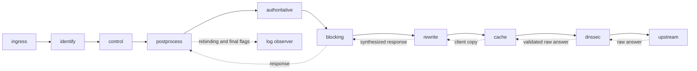
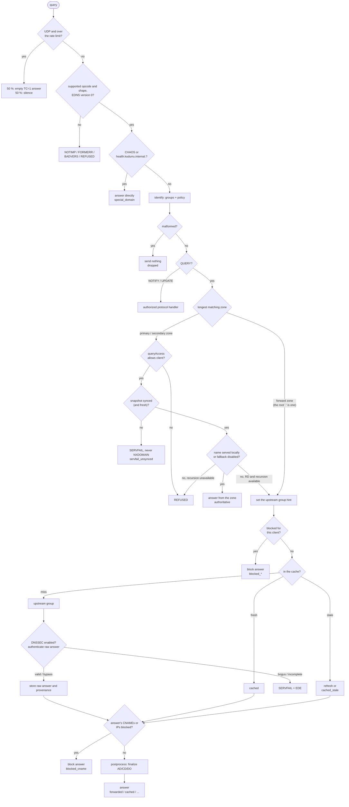
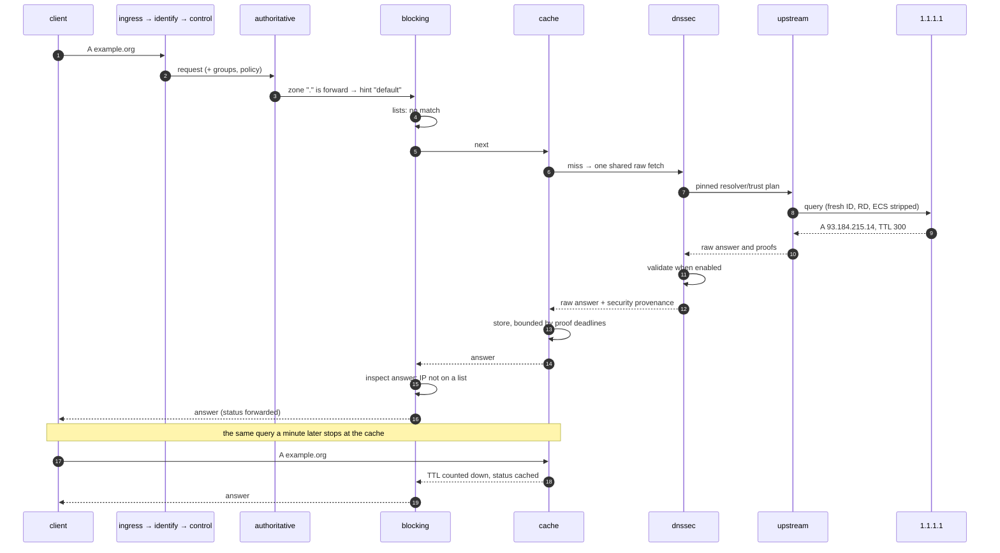
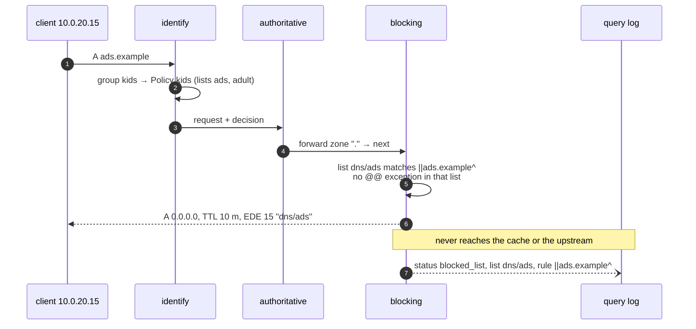
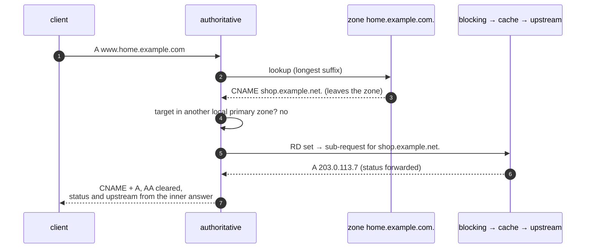

# A query's journey

Every DNS query, on every transport, goes through the same fixed chain of
ten installed stages. A stage either answers (and the query goes no further), or
calls the next stage and may look at the answer on the way back. When the
chain returns, an observer records the outcome. This page walks that path.

Code: `internal/dnsserver` (transports), `internal/pipeline` (the chain and
the status taxonomy), `internal/stages/*` (one package per stage), and the
wiring in `cmd/kudurru/serve.go`.

`postprocess` is a wrapper: it runs on the way back from the answering
stages. `upstream` stays terminal. The reserved `local` stage fits after
postprocess. `rewrite` wraps the raw cache so every hit receives the current
client policy before response blocking and rebinding checks.

## Before the pipeline: transports

| Transport | Implementation | PROXYv2 | TSIG |
|---|---|---|---|
| Do53 UDP | miekg/dns, one `SO_REUSEPORT` socket per CPU | yes | yes |
| Do53 TCP | miekg/dns, one socket per CPU | yes | yes |
| DoT | miekg/dns `tcp-tls`, one socket per CPU, ALPN `dot` | yes | yes |
| DoH (HTTP/1.1, HTTP/2) | `net/http`, GET `?dns=` or POST | no | no |
| DoQ | quic-go, ALPN `doq` | no | no |
| DoH3 | quic-go HTTP/3 | no | no |

On Linux, `listeners.sockets` controls UDP, TCP and DoT reuse-port groups
(default: one socket per `GOMAXPROCS` CPU). Each DoT socket has its own accept
loop and uses the same reloadable TLS certificate owner. TLS/PROXYv2 wrapping,
per-connection query and idle limits, and shutdown apply on every socket.
Other platforms bind one socket. QUIC listeners still bind independently;
this TCP connection distribution does not supply connection-ID-aware routing
for DoQ or DoH3.

Every transport ends in one handler that stamps `Received` and a 5 s
deadline, runs the chain and writes the reply. DoH, DoQ and DoH3 give the
pipeline a fresh message ID, because their clients send ID 0.

Native listeners share host-only `listeners.limits` settings, applied separately
to each connection or listener at startup:

| Key | Default | Applies to |
|---|---|---|
| `maxTCPQueries` | `0` (unlimited) | Queries on one TCP or DoT connection |
| `quicMaxConns` | `0` (unlimited) | Concurrent connections per DoQ or DoH3 listener |
| `idleTimeout` | `10s` | Idle TCP, DoT and DoH connections |
| `quicIdleTimeout` | `30s` | Idle DoQ and DoH3 connections |

Zero durations select these defaults; negative values are rejected. Restart
to apply changes. For example, `listeners: {limits: {maxTCPQueries: 1000,
quicMaxConns: 256, idleTimeout: 30s, quicIdleTimeout: 1m}}` limits native
listeners without changing a separate dnsdist edge. A connection cap refuses
excess QUIC connections; HTTP/3 rejection during the handshake appears as the
QUIC application error rather than an HTTP response. QUIC peers may detect an
idle close later than the server, according to their timeout implementation.

### HTTP/3 discovery

Native DoH responses advertise `Alt-Svc: h3=":443"; ma=60` (using the actual
bound port) only while a matching DoH3 listener is running. Both listeners must
bind the same address and port, use the same certificate/key files, and share
the request path and client-ID policy. An alternative never changes the HTTPS
origin, path or client selector. Different ports, interfaces, certificates or
paths are not automatically advertised. Plaintext requests and requests carrying
forwarding headers receive no native advertisement; neither does a request whose
HTTPS authority port differs from the bound port.

For direct service, configure matching `listeners.doh` and `listeners.doh3`
entries and expose that port on both TCP and UDP. A bound listener cannot prove
reachability through a firewall or NAT; deployers must make both transports
reachable. Reverse proxies own their public HTTP/3 advertisement: strip or
replace backend Alt-Svc and advertise only their externally reachable endpoint.
This is especially necessary for proxies that omit forwarding headers while
preserving the backend port. No public route is inferred from proxy headers.

### Encrypted response padding

A DoT, DoH, DoQ or DoH3 request with EDNS version 0 and a PADDING option
receives zero-filled response padding following RFC 7830 and RFC 8467. The
transport captures negotiation before the pipeline changes EDNS, then pads a
detached reply immediately before writing. PADDING is the last EDNS option;
other options and DNSSEC flags remain intact. It never enters the shared cache
or changes the original request or signed credential evidence.

Replies target multiples of 468 DNS-message bytes, excluding TCP/QUIC length
prefixes and including any final TSIG trailer and MAC. If the next full block
exceeds the client's advertised payload limit, padding uses only the remaining
budget. If even the option cannot fit, the answer is retained without padding;
records are never truncated to make room. Advertised sizes below 512 mean 512,
and the DNS message ceiling remains 65,535 bytes. Signed DoT transfers keep
chained signatures, and signature refusals remain refusals. Plaintext UDP/TCP
and requests without a padding offer do not receive generated padding; inherited
padding is stripped from their unsigned response copies.

### Built-in HTTP query

On SQLite, `POST /dns/query` clones the complete lease already retained by HTTP
authentication. Root composition wraps that clone for the DNS pipeline, which
uses it without capturing another publication. Policy, committed zone records,
lists and resolver membership therefore come from the same installation as the
authorized HTTP request. CNAME and DNS64 subqueries inherit it. Missing, released
or canceled request ownership returns 503; the handler closes any response or
unused transfer before releasing its clone.

The caller-selected address and protocol remain synthetic diagnostic inputs.
They confer no verified TSIG identity, and the query log does not record them as
client traffic. Absolute data expiry is checked at execution time. Latency,
cache hits and remote DNS answers are current observations using the retained
resources, rather than historical answers frozen by the lease. Legacy Kubernetes
construction keeps its existing independent DNS capture.

### Who is the client? (PROXYv2)

When dnsdist fronts kudurru, the real client address arrives in a PROXYv2
header. kudurru trusts that header only from known peers, because the client
address decides policies, ACLs and the query log.

Dnsdist health checks use LOCAL without the query-rule TLV.
For LOCAL, Kudurru keeps the transport peer and applies no advertised identity.
The peer allowlist still applies. PROXY commands still require the shared secret.

Drops never reach the pipeline; they are counted in
`kudurru_dns_dropped_total{reason}`. A bad TSIG signature is answered with
NOTAUTH by the transport, also before the pipeline.

## The stages

| # | Stage | Question it answers | Can answer with | Status values |
|---|---|---|---|---|
| 1 | `ingress` | Is this query sane, and is the client within its rate? | TC=1 or silence over the UDP rate limit; NOTIMP for opcodes other than QUERY, NOTIFY and UPDATE; FORMERR; BADVERS; REFUSED for `ANY`; CHAOS `id.server`/`version.bind`; the `health.kudurru.internal.` TXT | `blocked_rate_limit`, `dropped`, `refused_acl`, `special_domain` |
| 2 | `identify` | Which client groups, which policy? | never answers; attaches `Client.GroupIDs` and the policy decision | none |
| 3 | `control` | Is the message malformed, the client outside allowed networks, or the query type blocked? | silence for malformed messages; REFUSED with EDNS EDE 18 for global admission rules | `dropped`, `refused_acl` |
| 4 | `postprocess` | What may this client receive? | captures response settings; on response unwinding, checks rebinding and finalizes AD/CD/DO on a private copy | preserves the answering status |
| 5 | `authoritative` | Is the name in a local zone? | the zone's answer (AA), REFUSED by the zone ACL, an AXFR/IXFR stream, SERVFAIL while unsynced; for a forward zone it sets the upstream group and passes on | `authoritative`, `refused_acl`, `servfail_unsynced` |
| 6 | `blocking` | Is the name blocked for this client? | a block answer, a safe-search CNAME; after the next stages return, it checks CNAME targets and IPs in the answer | `blocked_list`, `blocked_exact`, `blocked_regex`, `blocked_cname`, `blocked_safesearch` |
| 7 | `rewrite` | What response does this client need? | configured rewrites, DNS64, AAAA filtering and NXDOMAIN handling; synthesis clears AD and obsolete proofs | `local_record` for configured rewrites; otherwise preserves source status |
| 8 | `cache` | Is the answer already known? | a cached, stale or prefetching answer | `cached`, `cached_stale`, `prefetch_refresh` |
| 9 | `dnssec` | Is the raw forwarded answer authentic? | validates proofs when enabled; SERVFAIL and EDE for bogus or indeterminate data | `dnssec_bogus` |
| 10 | `upstream` | Who knows the answer? | always answers (it is the last stage); recursive groups resolve from the root and validate DNSSEC | `forwarded`, `servfail_upstream`, `timeout_upstream`, `dnssec_bogus` |

The order puts the cheap and the certain first. Global [DNS controls](../deploy/dns-controls.md)
run before local, cached and upstream answers. Authoritative answers come
before ad blocking, so your own zones are exempt from ad blocking. Blocking comes before
the cache, so a block is never cached and one raw cached answer can serve clients with the same resolution context; blocking also wraps the cache, so cached answers are still inspected
on the way out.

### The whole decision as one flowchart

The bootstrap creates a root forward zone `.` pointing at the `default`
upstream group, so in practice every name matches some zone: names in
primary zones are answered locally unless their optional
[fallback](zones.md#local-overrides-with-fallback) applies; everything else
takes the resolver branch. Fallback can use forwarding or native recursion.

## Three journeys

### A name on the internet, first time and second time

When the group is recursive (`mode: recursive`), steps 7 and 8 become a
walk from the root servers with DNSSEC validation
([recursive groups](upstreams-and-cache.md#recursive-groups)). The status is
still `forwarded`, the upstream is `default/recursive`, and the query log's
`dnssec` column records `secure`, `insecure` or `bogus`, for the cached
copy too.

### A blocked name

### A local name that points outside

A CNAME chase follows other local primary zones first, stops at 20 hops
(SERVFAIL on a loop), and returns only the partial chain when the client
did not set RD or the target zone refuses the client.

## Answer, error, or silence

What the client receives depends on the transport when a stage decides to
send nothing:

| Outcome | UDP | TCP / DoT | DoH / DoH3 | DoQ |
|---|---|---|---|---|
| an answer | datagram, truncated to the EDNS size | message | HTTP 200, `Cache-Control: max-age=<min TTL>` | stream |
| a drop (`ErrDrop`, rate limit) | nothing | connection closed | stream reset | `DOQ_REQUEST_CANCELLED` |
| a pipeline error | SERVFAIL | SERVFAIL | SERVFAIL | SERVFAIL |
| an unparsable message | miekg rejects it | miekg rejects it | HTTP 400/413/414/415 | `DOQ_PROTOCOL_ERROR` |

## Status values

Statuses below 16 mean the query was answered normally; 16 to 23 mean it
was blocked; 24 and above mean an error. The query log, the
`kudurru_dns_responses_total{status}` metric and the dashboard colours all
use this list (`internal/pipeline/status.go`).

| Class | Values produced today | Reserved, not produced yet |
|---|---|---|
| answered | `forwarded`, `cached`, `cached_stale`, `authoritative`, `prefetch_refresh`, `special_domain` | `local_record`, `retried`, `in_progress` |
| blocked | `blocked_list`, `blocked_regex`, `blocked_exact`, `blocked_cname`, `blocked_safesearch`, `blocked_rate_limit` | `blocked_upstream`, `blocked_rpz` |
| error | `refused_acl`, `dropped`, `servfail_upstream`, `timeout_upstream`, `servfail_unsynced`, `dnssec_bogus` | — |

## What the stages read

No stage takes a lock or touches the store on the query path. Each one reads
an immutable value that something else swaps atomically:

| Value | Read by | Replaced by |
|---|---|---|
| zonecache snapshot: zones, the policy index, compiled lists | authoritative, identify, blocking | the zonecache rebuild after a store event or a list change ([configuration](configuration-and-store.md)) |
| captured route/trust plan and cache epoch | upstream, DNSSEC, cache | one atomic replacement on `upstreams.*` or `dnssec.*` reload |
| cache settings | cache | a reload of `cache.*` |
| blocking defaults, the blocking toggle | blocking | a reload of `blocking.*`; `POST /api/v1/dns/blocking` |
| rate limits | ingress | a reload of `ratelimit.*` |
| safe-search catalogue | blocking | the catalogue refresher |
| query log privacy | query log collector | a reload of `querylog.*` |

## DNSSEC and raw cache provenance

Recursive groups retain the native resolver's validation result through the raw
cache and final response flags. The forwarded-answer validator does not replace
recursive trust settings. Cache reuse is bounded by the returned TTLs and
signature deadlines. Each complete SQLite publication owns its recursive
resolver, so held requests keep their original root hints, validation settings
and recursive negative trust anchors. Recursive exceptions are configured at
`upstreams.recursion.negativeTrustAnchors`; they share bounded matching rules
with forwarded exceptions but have independent authority. Their absolute expiry
changes native and raw-cache scope and fences late fills without a reload.
Every recursive cached answer is conservatively bounded by the next active
recursive exception expiry, including after durable cache restore.

Validation defaults off; a forward zone can override the global setting.
The validator uses shipped IANA root anchors and explicit operator anchors,
with bounded proof queries on the captured route. NTAs expire absolutely,
including on cache hits. AD comes only from locally secure, unmodified data
with current proofs; CD bypasses validation in a separate cache context.
The cache retains raw proof material and validation metadata before response
personalization, and stale serving cannot outlive a proof deadline. A flush,
route/trust reload or NTA expiry fences detached cache insertions. Restarted
cache data rebinds only to an identical semantic context. See the
[operator runbook](../deploy/dnssec-validation.md).

## After the chain: the observer

When the chain returns, the log observer runs synchronously but never waits:
it updates the DNS metrics and makes a non-blocking hand-off of a
`QueryEvent` to the query log. The health name and the dashboard's built-in
dig are not logged. [Observability](observability.md) follows the event from
there.

## Not built yet

`local` (custom host records, `.local`/`.onion`/RFC 6303 answers) remains
reserved in `pipeline.Order`; client-group authoritative views remain subsequent
work. [Response processing](../deploy/response-processing.md) implements
configured rewrites, DNS64, AAAA filtering, NXDOMAIN handling and rebinding.
Recursive upstream groups already answer RFC 6303 and special-use names and validate their answers. NSID is not implemented, and
the `epoch` in the health TXT is always `0`.

## DHCP lease records (v0.1.0)

Identification samples DHCP hostnames alongside the captured provider inventory.
Alias and dependency queries retain those original names; a new client query
observes current lease names.

The authoritative stage can answer A/PTR records from committed in-memory
[DHCP lease snapshots](dhcp.md#lease-dns-and-policy-names). The optional hook
runs after the unsynced gate when no zone matches or the match is the
catch-all root forward zone. Specific configured zones and a primary root
retain precedence. It does not add a pipeline stage or modify zone contents.

### ClientGroup rate-limit exemptions

`ClientGroup.spec.rateLimitExempt: true` skips the UDP per-prefix limiter for
clients selected into that group. Global disabled, transport, loopback,
configured-prefix and health-name exemptions retain precedence. For other UDP
queries, ingress asks the normal identify stage to resolve the original
captured policy index and inventory snapshot early. The normal stage and
synchronous dependencies reuse the same membership, decision, source identity
and request time; DNS never reads the store for this decision.

The existing identification tiers apply: exact IP, MAC, longest CIDR,
hostname/name glob, client ID, catch-all CIDR, then default group. Any true value
among tied groups in the winning tier exempts; lower-tier or disabled groups do
not contribute. Exemption does not bypass message validation, DNS policy or
ACLs, and grants no authentication. Unmatched and non-exempt clients retain
the existing shared prefix budgets, slip/drop behavior and bucket bounds.
