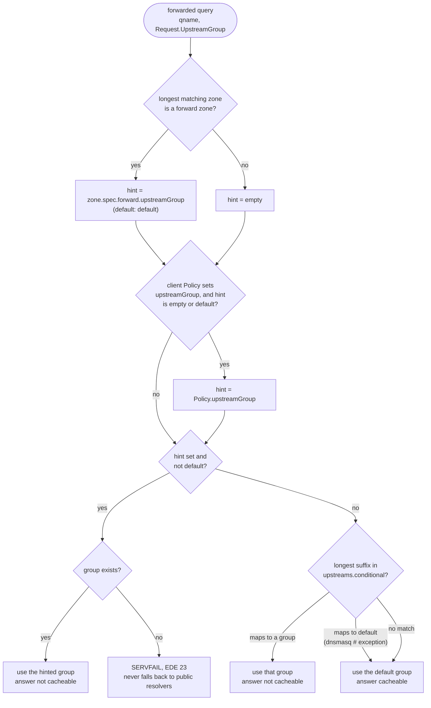
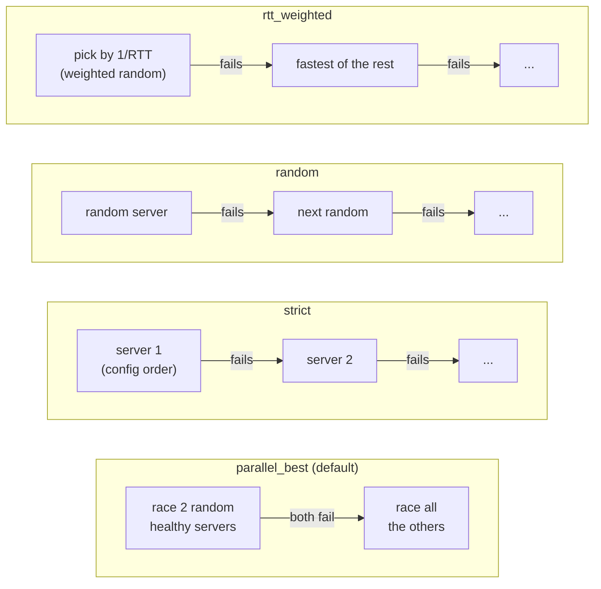
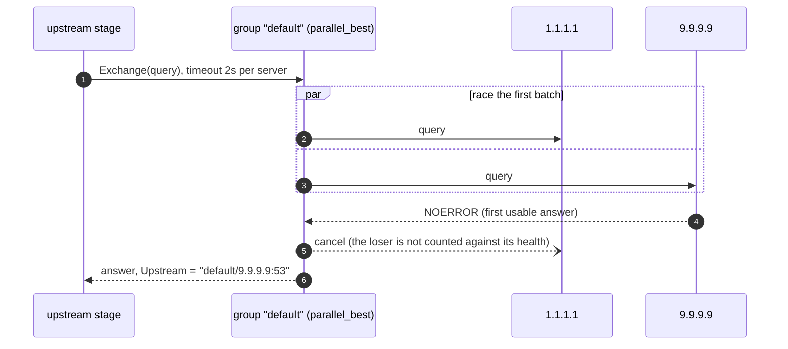
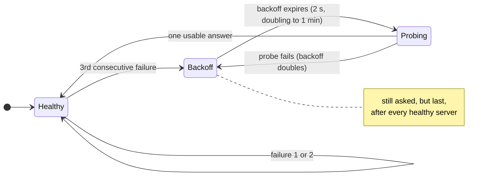
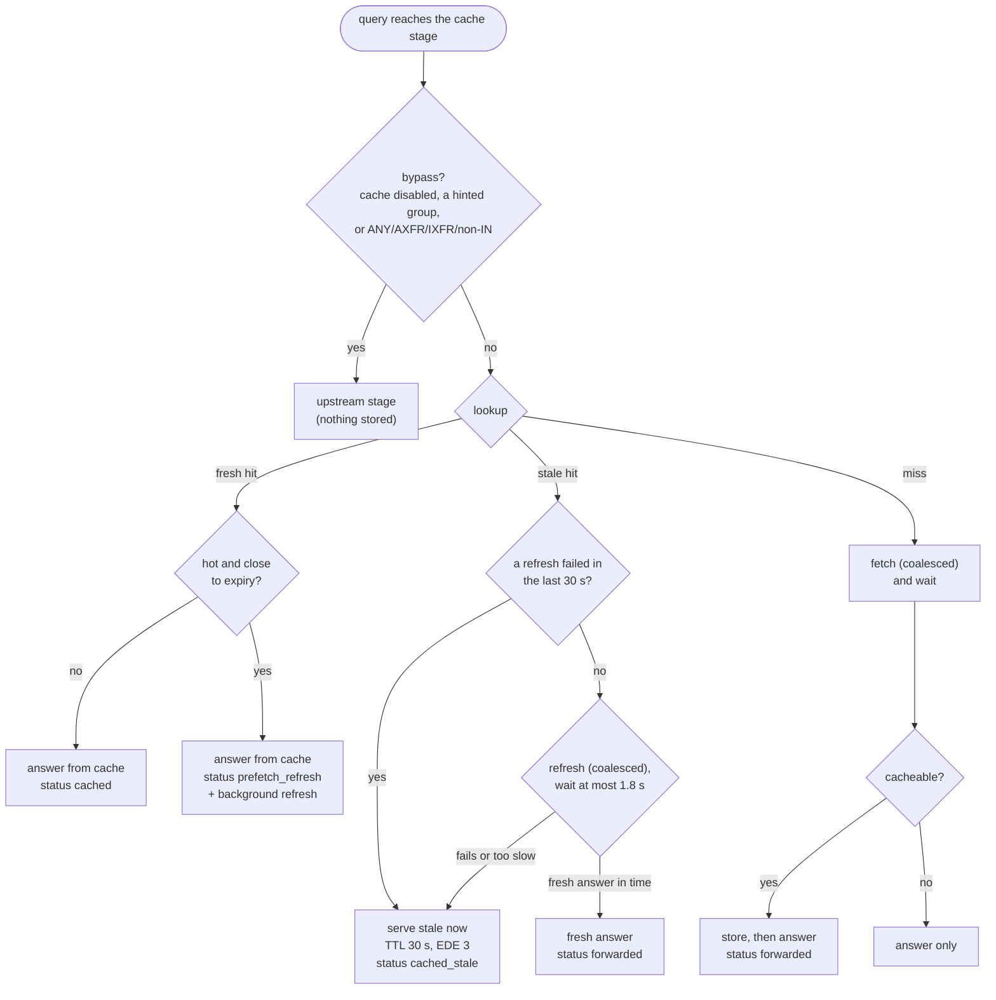
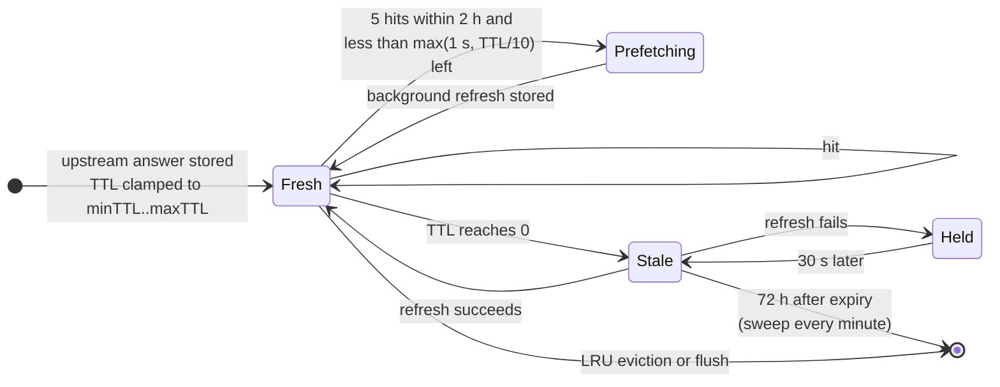
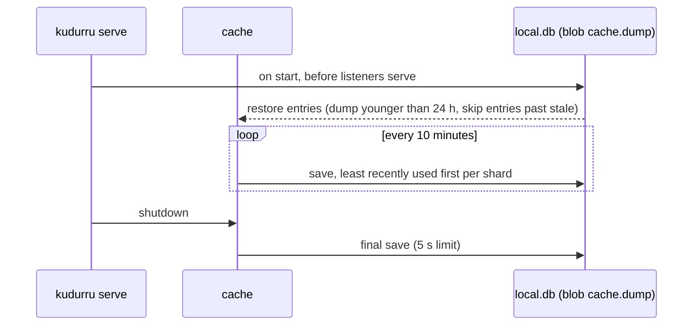

# Upstreams and the response cache

kudurru is a forwarding resolver. It does not walk the DNS tree itself: a
name that no local zone answers goes to an **upstream group**, and the
**response cache** sits in front of the groups so that most queries never
leave the node. This page follows a forwarded query from the moment the
pipeline decides it is not authoritative.

Code: `internal/upstream` (groups, strategies, health, ECS),
`internal/cache` (the sharded LRU), `internal/stages/cache` and
`internal/stages/upstream` (the DNS rules on top), `cmd/kudurru/reload.go`
(hot reload).


## Which group answers

Three places can name a group, and they are checked in a fixed order. The
authoritative stage sets a hint for a `forward` zone, the blocking stage can
replace it with the client's Policy, and the upstream stage turns the hint
(or the absence of one) into a group with `Set.Route`.



The precedence, from strongest to weakest:

1. A forward zone's own group, when it is not `default`.
2. The client's `Policy.upstreamGroup` (the highest-priority Policy that sets one).
3. The longest suffix in `upstreams.conditional`.
4. The `default` group, which must exist.

The bootstrap root zone `.` is a forward zone to `default`, so on a fresh
install every name that no other zone claims takes the default path and
still consults the conditional map. A Policy beats that root zone, but not a
forward zone with a group of its own.

## Inside a group

```yaml
upstreams:
  groups:
    default:     { servers: ["1.1.1.1:53", "9.9.9.9:53"], strategy: parallel_best, timeout: 2s }
    internal-ad: { servers: ["dc1=10.0.0.5:53", "dc2=10.0.0.6:53"], strategy: strict }
  bootstrap: ["1.1.1.1:53"]          # plain IP resolvers for upstream host names
  conditional: { "corp.example.": internal-ad, "[/10.in-addr.arpa/]": internal-ad }
  ecs: { mode: strip }               # strip | forward | add
```

A server is a dnsproxy address with an optional `name=` prefix. The scheme
picks the transport: bare `ip:port` or `udp://` (UDP, TCP on truncation),
`tcp://`, `tls://` (DoT), `https://` (DoH), `h3://` (DoH3), `quic://` (DoQ)
and `sdns://` (DNSCrypt or a DoH stamp). The query log and the metrics name
a server `<group>/<name or address>`.

### Strategies

Every strategy first splits the servers into healthy ones and ones in
backoff. Servers in backoff always go **last**, earliest recovery first, so a
group never fails without asking every server. The strategy then cuts the
order into batches: a batch of two or more is raced and the first usable
answer wins; batches run one after the other until one succeeds.



There is no retry beyond this failover, with one exception: a DoT server that
answers REFUSED is asked once more on a fresh connection.



### Server health

Health is per server and lives in memory. Timeouts, network errors and
REFUSED count as failures. A SERVFAIL is not usable, but it proves that the
server is alive, so it resets the failure count instead. RTT is an EWMA
(α = 0.3) that `rtt_weighted` uses. The thresholds have no configuration
keys.



`kudurru_upstream_healthy{upstream}` follows this state, and the
**Upstreams** page of the dashboard shows it next to the traffic each server
carried (`GET /api/v1/stats/upstreams`).

### What goes upstream

kudurru builds its own query: a fresh ID, RD set, the client's DO and CD
bits, an EDNS buffer of 1232 bytes, the first question only. No other client
EDNS option is forwarded. EDNS Client Subnet follows `upstreams.ecs.mode`:

| Mode | What the upstream sees |
|---|---|
| `strip` (default) | no ECS at all |
| `forward` | the client's own ECS option, shortened to at most /24 (IPv4) or /56 (IPv6) |
| `add` | as `forward`; when the client sent none, a prefix of the client's address, for public unicast addresses only |

## The response cache

The cache stores packed answers in a sharded LRU (up to 256 shards, each with
its own lock). The key is `(qname, qtype, qclass, DO, CD, ECS subnet sent
upstream)`. Client identity and Policy are **not** in the key: blocking runs
before the cache on the way in and inspects the answer again on the way out,
so one cached answer can serve every client safely.

### What the cache stage does with a query



Identical misses share one fetch (singleflight on the key). The fetch runs
detached from the client with its own 5 s limit, so a client that gives up
does not cancel the refresh that the next client needs.

### The life of an entry



| Setting | Default | Effect |
|---|---|---|
| `cache.maxEntries` | 200000 | `0` turns the stage off (and flushes it) |
| `cache.minTTL` / `maxTTL` | 5s / 24h | clamp on every stored TTL |
| `cache.negativeTTL` | 5m | cap for NXDOMAIN and NODATA, which use the SOA minimum |
| `cache.prefetch.threshold` / `window` | 5 / 2h | hits needed inside the window; `0` turns prefetch off |
| `cache.serveStale.ttl` | 72h | how long an expired entry is kept; `0` turns serve-stale off |
| `cache.serveStale.answerTTL` | 30s | TTL of a stale answer, and the hold after a failed refresh |
| `cache.serveStale.maxWait` | 1800ms | how long a stale hit waits for a refresh |

### Never cached

- Answers from local zones: the authoritative stage answers before the cache.
- Blocked and safe-search answers: the blocking stage answers before the cache.
- Queries routed to a hinted group (a forward zone with its own group, or a
  Policy group), and conditional routes to a group other than `default`.
- SERVFAIL, REFUSED and other error rcodes, truncated answers and TTL 0.
- ANY, AXFR, IXFR, non-IN classes and multi-question queries.

### Persistence and flushing



The cache is per node and so is a flush. `POST /api/v1/cache/flush` empties
the whole cache, or one name across the common query types. Deleting a zone
flushes its apex, approving an unblock request flushes the name, and any
change under `upstreams.*` flushes everything, because a cached answer may
have come from a server that is no longer configured.

## When the answer is an error

| Situation | Client gets | Status | EDE |
|---|---|---|---|
| hinted group does not exist | SERVFAIL | `servfail_upstream` | 23 Network Error |
| every server failed, at least one sent SERVFAIL or REFUSED | that message, rcode SERVFAIL | `servfail_upstream` (`timeout_upstream` if every error was a timeout) | the upstream's own |
| every server failed, none answered | SERVFAIL | `timeout_upstream` / `servfail_upstream` | 22 No Reachable Authority / 23 Network Error |
| stale entry, refresh failed or slow | the stale answer, TTL 30 s | `cached_stale` | 3 Stale Answer |

EDE options appear only when the client sent EDNS. A failure on a **miss**
reaches the client as SERVFAIL; a failure on a **stale hit** yields the
stale answer and holds the entry for 30 s, so a dead upstream is not asked
again on every query.

## Hot reload

Every key under `upstreams.*` reloads without a restart. The reloader builds
a new set of groups, swaps it in atomically, retires the old set after 30 s
(in-flight queries finish on it) and flushes the cache. Cache settings
reload in place; new limits apply to entries stored from then on.

## Metrics

| Metric | Meaning |
|---|---|
| `kudurru_upstream_healthy{upstream}` | 1 healthy, 0 in backoff |
| `kudurru_upstream_requests_total{upstream,proto}` | every exchange, race losers included |
| `kudurru_upstream_responses_total{upstream,rcode}` | every response |
| `kudurru_upstream_errors_total{upstream,error}` | `timeout`, `network`, `refused`, `servfail` |
| `kudurru_upstream_request_duration_seconds{upstream}` | exchanges that returned a response |
| `kudurru_upstream_inflight{upstream}` | exchanges in progress |
| `kudurru_cache_entries{kind}` | positive and negative entries, stale ones included |
| `kudurru_cache_requests_total`, `kudurru_cache_hits_total{kind,stale}` | lookups and hits; bypassed queries are not counted |
| `kudurru_cache_evictions_total{reason}` | `capacity`, `expired`, `flush` |
| `kudurru_cache_prefetches_total` | background refreshes |

Next: [Zones and transfers](zones.md) covers the queries that never reach
this page because kudurru is the authority.
