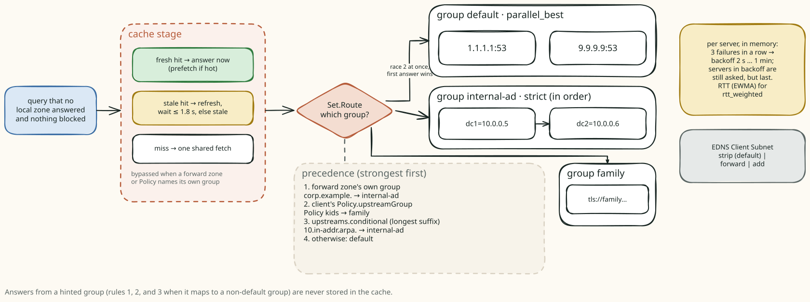
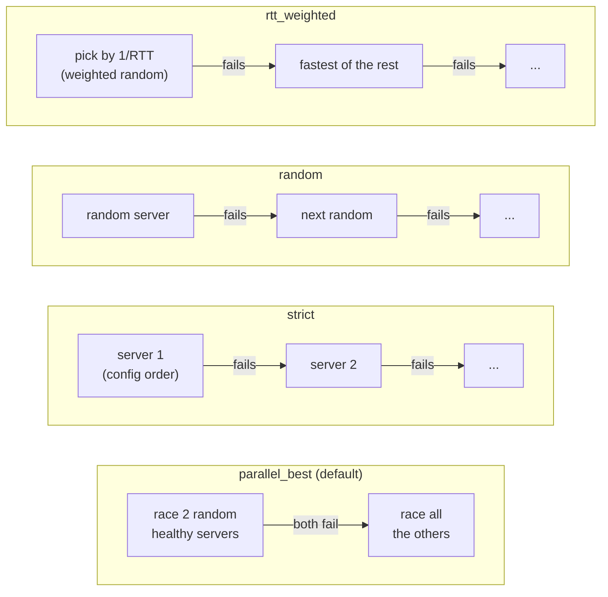
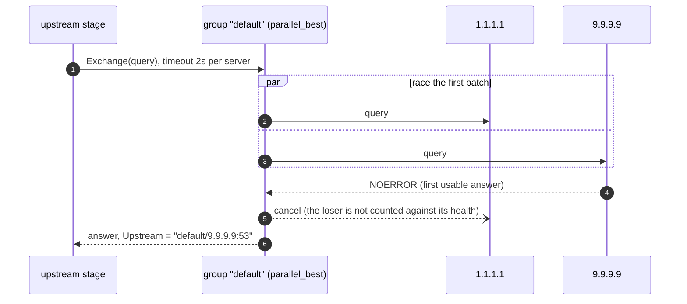
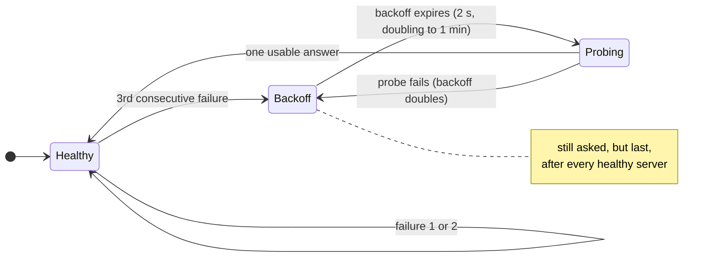
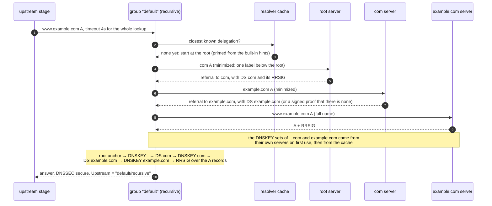
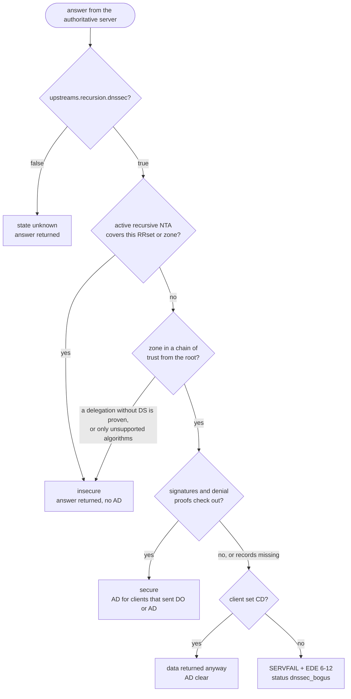
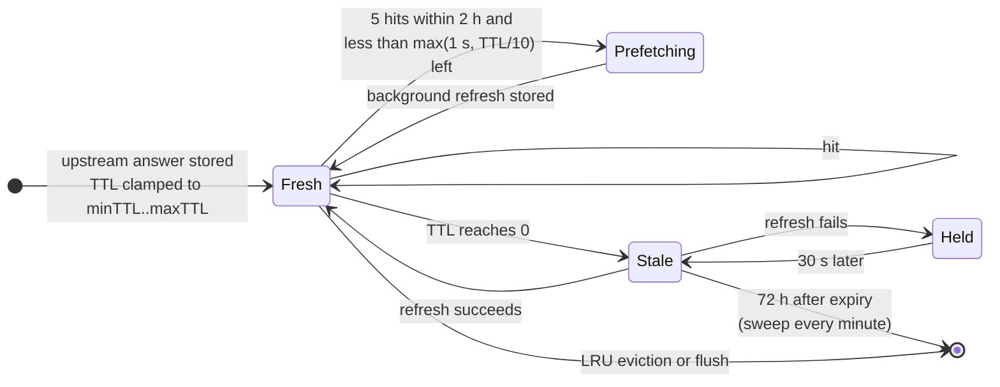
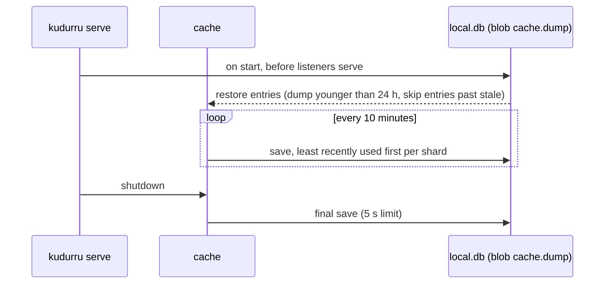

# Upstreams and the response cache

A name that no local zone answers goes to an **upstream group**. A group
either forwards to the servers you list (`mode: forward`, the default) or
walks the DNS tree itself from the root servers and validates DNSSEC
(`mode: recursive`, see [recursive groups](#recursive-groups)). The
**response cache** sits in front of the groups so that most queries never
leave the node. This page follows such a query from the moment the
pipeline decides it is not authoritative.

Code: `internal/upstream` (groups, strategies, health, ECS),
`internal/recursor` (the recursive resolver and DNSSEC validator),
`internal/cache` (the sharded LRU), `internal/stages/cache` and
`internal/stages/upstream` (the DNS rules on top), `cmd/kudurru/reload.go`
(hot reload).



## Settings ownership

In Kubernetes, upstreams start as GitOps-managed. **DNS > Upstreams** can
explicitly adopt the complete section into UI management, preserving every
group and routing rule. UI-owned settings use a separate API-owned ConfigMap,
survive Helm reconciliation and restart, and reach every replica through the
settings watcher. Conflicting file declarations are reported and ignored for
this section. A return to GitOps requires matching exported Helm values first.
See [configuration and the store](configuration-and-store.md#settings) for
revision checks, environment locks, persistence and the handoff flow.
Changes still swap the upstream set and flush cached answers as described below.

## Which group answers

Three places can name a group, and they are checked in a fixed order. The
authoritative stage sets a hint for a `forward` zone, the blocking stage can
replace it with the client's Policy, and the upstream stage turns the hint
(or the absence of one) into a group with `Set.Route`.


The precedence, from strongest to weakest:

1. A forward zone's or primary zone fallback's own group, when it is not `default`.
2. The client's `Policy.upstreamGroup` (the highest-priority Policy that sets one).
3. The longest suffix in `upstreams.conditional`.
4. The `default` group, which must exist.

The bootstrap root zone `.` is a forward zone to `default`, so on a fresh
install every name that no other zone claims takes the default path and
still consults the conditional map. A Policy beats that root zone, but not a
forward zone with a group of its own.

## Inside a group

```yaml
upstreams:
  groups:
    default:     { servers: ["1.1.1.1:53", "9.9.9.9:53"], strategy: parallel_best, timeout: 2s }
    internal-ad: { servers: ["dc1=10.0.0.5:53", "dc2=10.0.0.6:53"], strategy: strict }
  bootstrap: ["1.1.1.1:53"]          # plain IP resolvers for upstream host names
  conditional: { "corp.example.": internal-ad, "[/10.in-addr.arpa/]": internal-ad }
  ecs: { mode: strip }               # strip | forward | add
```

A server is a dnsproxy address with an optional `name=` prefix. The scheme
picks the transport: bare `ip:port` or `udp://` (UDP, TCP on truncation),
`tcp://`, `tls://` (DoT), `https://` (DoH), `h3://` (DoH3), `quic://` (DoQ)
and `sdns://` (DNSCrypt or a DoH stamp). The query log and the metrics name
a server `<group>/<name or address>`.

### Strategies

Every strategy first splits the servers into healthy ones and ones in
backoff. Servers in backoff always go **last**, earliest recovery first, so a
group never fails without asking every server. The strategy then cuts the
order into batches: a batch of two or more is raced and the first usable
answer wins; batches run one after the other until one succeeds.



There is no retry beyond this failover, with one exception: a DoT server that
answers REFUSED is asked once more on a fresh connection.



### Server health

Health is per server and lives in memory. Timeouts, network errors and
REFUSED count as failures. A SERVFAIL is not usable, but it proves that the
server is alive, so it resets the failure count instead. RTT is an EWMA
(α = 0.3) that `rtt_weighted` uses. The thresholds have no configuration
keys.



`kudurru_upstream_healthy{upstream}` follows this state, and the
**Upstreams** page of the dashboard shows it next to the traffic each server
carried (`GET /api/v1/stats/upstreams`).

### What goes upstream

kudurru builds its own query: a fresh ID, RD set, the client's DO and CD
bits, an EDNS buffer of 1232 bytes, the first question only. No other client
EDNS option is forwarded. EDNS Client Subnet follows `upstreams.ecs.mode`:

| Mode | What the upstream sees |
|---|---|
| `strip` (default) | no ECS at all |
| `forward` | the client's own ECS option, shortened to at most /24 (IPv4) or /56 (IPv6) |
| `add` | as `forward`; when the client sent none, a prefix of the client's address, for public unicast addresses only |

Recursive groups never send ECS, whatever the mode.

## Recursive groups

```yaml
upstreams:
  groups:
    default: { mode: recursive }               # no servers; timeout bounds a whole lookup (default 4s)
    router:  { servers: ["192.168.1.1:53"] }   # mode: forward is the default
  conditional: { "lan.": router, "[/168.192.in-addr.arpa/]": router }
  recursion:                                   # shared by every recursive group
    dnssec: true                               # validate (default)
    qnameMinimization: true                    # RFC 9156 (default)
    ipv6: auto                                 # auto | on | off: ask name servers over IPv6
    trustAnchors: []                           # empty: built-in root KSK-2017 (20326) and KSK-2024 (38696)
    negativeTrustAnchors: []                   # temporary domain/reason/absolute expiresAt exceptions
    rootHints: []                              # empty: built-in IANA root server addresses
```

A recursive group lists no servers (validation rejects it if it does) and
ignores `strategy`. Every recursive group uses the same resolver, which the
group wraps as one server named `<group>/recursive` (proto `recursive`), so
routing, server health, metrics, the query log and the response cache work
as for any other group. Any group can be recursive: a Policy, a forward
zone or a conditional rule can send some clients or names to recursion and
the rest to forwarders. The resolver outlives settings reloads; it drops
its cache when `trustAnchors`, `rootHints`, `dnssec` or
`negativeTrustAnchors` change. Native cache keys also include active exception
state, so an expiry immediately prevents reuse without a reload.
Forwarding to 1.1.1.1 and 9.9.9.9 stays the default for new installs
(D170).

### How a name is resolved



- **Start.** The resolver begins at the closest delegation it has cached.
  The root server addresses are built in (IANA's `named.root`, or
  `rootHints`) and refreshed from the roots at first use (priming,
  RFC 9609); the result is kept for at most 24 h.
- **Referrals.** Glue is accepted only for names inside the delegating zone
  (bailiwick). Name servers without glue are resolved when needed, at most
  3 per question. CNAME and DNAME chains are followed across zones (at
  most 12 hops). Answers that come back truncated are asked again over TCP;
  the EDNS buffer is 1232 bytes.
- **QNAME minimization** (RFC 9156, relaxed). Each server sees one label
  more than the zone it serves, asked as type A. After four one-label steps
  the steps get bigger, with at most 10 per name. Some servers answer
  NXDOMAIN for a name that only has names below it, so an NXDOMAIN for a
  minimized name is retried once with the full name.
- **Picking a name server.** Each server's RTT is tracked; the resolver
  picks at random among the servers within 100 ms of the fastest, asks
  servers in backoff last and asks at most 8 per question. A server's timeout is
  three times its smoothed RTT (150 ms to 2 s; 800 ms when unknown). With
  `ipv6: auto`, IPv6 addresses are used when the host has a route to the
  root servers over IPv6.
- **Anti-spoofing.** Random query IDs and source ports, random letter case
  in the query name (0x20, with a fallback for servers that do not echo
  it), a strict match of the question, and bailiwick scrubbing of every
  section. Loopback name server addresses are never asked.
- **No probing of the local network.** With the built-in root hints, name
  server addresses in private, link-local, CGNAT, documentation and other
  non-public ranges (after unmapping `::ffff:` forms) are dropped, so a
  remote zone cannot delegate to `169.254.169.254` or `10.x` and make
  kudurru query hosts inside your network. Custom `rootHints` describe a
  private tree and allow them.

### Names that never leave the network

The resolver answers these itself, so their queries never reach a root or
TLD server:

| Names | Answer |
|---|---|
| reverse zones of private, loopback, link-local, CGNAT and documentation space (RFC 6303): `10.in-addr.arpa`, `16.172` … `31.172.in-addr.arpa`, `168.192.in-addr.arpa`, `64.100` … `127.100.in-addr.arpa`, `127.in-addr.arpa`, `254.169.in-addr.arpa`, `0.in-addr.arpa`, `d.f.ip6.arpa` (fd00::/8), `8.e.f` … `b.e.f.ip6.arpa` (fe80::/10), `::1`, `2001:db8::/32` and the TEST-NETs | NXDOMAIN |
| special-use names `home.arpa`, `local`, `test`, `invalid`, `onion`, `alt`, `internal` | NXDOMAIN |
| `localhost` | 127.0.0.1 and ::1 |

Forward zones and conditional rules are checked before the group is
chosen, so a rule such as `"[/168.192.in-addr.arpa/home.arpa/]": router`
still sends those names to the router. Names such as `lan` or `fritz.box`
are not special-use: without a conditional rule they go to the root
servers, which answer NXDOMAIN, so route the router's local domain to a
forwarding group that holds the router.

### DNSSEC validation



The chain of trust starts at the built-in root trust anchors (KSK-2017 and
KSK-2024; `trustAnchors` replaces them) and is built lazily, only for zones
whose data is validated. DS records that came with a referral are kept and
checked when the zone's keys are first needed; otherwise DS is asked at the
parent. Positive answers, wildcard expansions, NXDOMAIN and NODATA (NSEC,
and NSEC3 with opt-out) are proven. Unsigned data below a signed zone is
insecure only when the delegation without DS is proven, otherwise it is
bogus.

`upstreams.recursion.negativeTrustAnchors` supplies temporary recursive
exceptions with typed absolute RFC3339 `expiresAt`, `domain` and `reason`.
It is independent of forwarded `dnssec.negativeTrustAnchors`. Both use the
same bounded exception compiler: at most 128 canonical domains, reasons up
to 256 bytes, expiry no more than seven days away. Expired entries are valid
configuration but inactive. A match treats covered data or a zone's trust
chain as insecure, never secure; aliases outside the domain still validate.
CD and DO retain their normal meanings. An exception cannot set AD. Native
validation records exactly which RRsets used the exception, so raw expired
signatures for those RRsets can remain available to DO clients without
relaxing authenticated proof deadlines for an outside alias target. Forwarded
responses cannot supply this native provenance; restored raw answers must
match their original recursive context and absolute deadlines.

The native delegation/key/address cache and the raw response cache both
include active recursive exception state. For conservative isolation, any
recursive exception expiry changes the native cache context and bounds all
recursive response reuse, including unrelated names, at the next expiry.
Minimum TTLs and stale windows cannot extend that absolute deadline.
Expired in-flight exception work is refused without retrying it. Reload,
complete SQLite publications, settings restore and cache dump/load retain
the original instant; none turns it into a fresh duration. Each complete
publication keeps its own resolver and exception plan. See the
[exception runbook](../deploy/dnssec-validation.md#recursive-exceptions).

Algorithms: RSASHA1, RSASHA1-NSEC3-SHA1, RSASHA256, RSASHA512,
ECDSAP256SHA256, ECDSAP384SHA384 and ED25519; DS digests SHA-1, SHA-256 and
SHA-384. A zone signed only with other algorithms (ED448, unknown ones) or
with NSEC3 iterations above 150 (RFC 9276) is treated as insecure.

| Why the answer is bogus | EDE |
|---|---|
| no signature verifies | 6 DNSSEC Bogus |
| signature expired / not yet valid | 7 Signature Expired / 8 Signature Not Yet Valid |
| no usable DNSKEY for the zone | 9 DNSKEY Missing |
| signed zone, unsigned data | 10 RRSIGs Missing |
| no proof that the name or type does not exist | 12 NSEC Missing |

The EDE text names the zone or record that failed. RRSIG, NSEC and NSEC3
records are returned only to clients that sent DO (or asked for that type). The state (secure,
insecure, bogus; unknown when validation is off and for forwarded answers)
is stored with the cached answer and fills the query log's `dnssec`
column, cache hits included. New root keys arrive with kudurru releases or
through `trustAnchors`; there is no automatic RFC 5011 rollover.

A SERVFAIL from **any** upstream that carries EDE 6-12, a validating
forwarder such as 1.1.1.1 included, is logged as `dnssec_bogus` instead of
`servfail_upstream`. Like other upstream failures, it lets serve-stale
answer with the cached copy (for a recursive group, one that was validated
when it was stored).

### Authority DNS Cookies

The native resolver automatically negotiates DNS Cookies with authoritative
servers (RFC 7873 and RFC 9018). These are outbound transport credentials,
separate from cookies in an incoming client query or a forwarded response.
They never establish DNSSEC security or AD, and never enter DNS answer caches
or client replies. The resolver still validates the original answer under its
captured DNSSEC and recursive NTA settings.

The connected socket determines the actual local IP and authority IP/port.
A random 64-bit client cookie and the authority's opaque server cookie are
scoped to that address pair. Echoes must match exactly; malformed cookies,
incorrect echoes and missing cookies from established cookie peers refuse the
response. Only the authority can verify its server-cookie MAC; the resolver
checks response correlation, the connected peer, echo and length. Later COOKIE
options are ignored as specified by RFC 7873.

The transport cache holds at most 4,096 address pairs and is memory only.
Server cookies expire after one hour without renewal by an identical echo;
changed cookies replace them. Client cookies rotate after a separately jittered
14.4–24 hours, or on restart/eviction. A changed local address gets a separate
pair. Authorities without cookies remain usable: probes stop for five minutes,
then retry with a fresh client cookie, never the previously exposed value.

A valid BADCOOKIE response permits one UDP retry with its new server cookie.
A second BADCOOKIE falls back once to TCP; BADCOOKIE on TCP fails. Truncated
UDP answers also use the existing TCP fallback. Each packet exchange, including
cookie recovery and lowercase fallback, consumes the original query budget.
The existing UDP and TCP timeouts and caller cancellation still apply. There
are no settings or persisted cookie files. Cookies protect against off-path
forgery; they do not authenticate an on-path observer or replace DNSSEC.

### Limits per client query

| Limit | Value |
|---|---|
| queries to name servers | 120 |
| nesting depth (name server addresses, keys) | 20 |
| referral and minimization steps per name | 48 |
| name servers asked per question | 8 |
| name servers without glue resolved per question | 3 |
| CNAME and DNAME hops | 12 |
| signature checks | 8 per RRset, 96 per query (KeyTrap, CVE-2023-50387) |
| NSEC3 hash computations | 64 per query (CVE-2023-50868) |
| the whole lookup | the group `timeout`, 4 s by default (the query deadline is 5 s) |

A lookup that runs out of servers answers SERVFAIL with EDE 22 (No
Reachable Authority); one that hits a limit answers SERVFAIL with EDE 0 and
the text "recursion limit reached".

### The resolver cache and health

Delegations, name server addresses and DS and DNSKEY sets live in the
resolver's own cache: 50,000 entries, TTLs capped at 24 h, failures
remembered for 30 s. The answers to clients go through the response cache
below like forwarded ones, with prefetch, serve-stale and coalescing, so a
repeated name costs no outgoing query. A cold lookup takes a few round
trips, typically 50 to 500 ms.

The group's single server follows the [health](#server-health) rules,
with one difference: a lookup that times out counts against it only when
no authoritative server has answered in the last 30 s, because one domain
with dead name servers says nothing about the resolver. After 3 such
timeouts in a row `<group>/recursive` is in backoff, and the log warns that
outbound DNS (UDP and TCP port 53 to the internet) may be blocked. Recursion needs that egress to any address; forwarding needs only
the configured servers. Firewalls, Kubernetes NetworkPolicies and ISPs that
intercept port 53 break it.

## The response cache

The cache stores packed answers in a sharded LRU (up to 256 shards, each with
its own lock). The key is `(qname, qtype, qclass, DO, CD, ECS subnet sent
upstream)`. Client identity and Policy are **not** in the key: blocking runs
before the cache on the way in and inspects the answer again on the way out,
so one cached answer can serve every client safely.

### What the cache stage does with a query


Identical misses share one fetch (singleflight on the key). The fetch runs
detached from the client with its own 5 s limit, so a client that gives up
does not cancel the refresh that the next client needs.

### The life of an entry



| Setting | Default | Effect |
|---|---|---|
| `cache.maxEntries` | 200000 | `0` turns the stage off (and flushes it) |
| `cache.minTTL` / `maxTTL` | 5s / 24h | clamp on every stored TTL |
| `cache.negativeTTL` | 5m | cap for NXDOMAIN and NODATA, which use the SOA minimum |
| `cache.prefetch.threshold` / `window` | 5 / 2h | hits needed inside the window; `0` turns prefetch off |
| `cache.serveStale.ttl` | 72h | how long an expired entry is kept; `0` turns serve-stale off |
| `cache.serveStale.answerTTL` | 30s | TTL of a stale answer, and the hold after a failed refresh |
| `cache.serveStale.maxWait` | 1800ms | how long a stale hit waits for a refresh |

### Never cached

- Answers from local zones: the authoritative stage answers before the cache.
- Blocked and safe-search answers: the blocking stage answers before the cache.
- Queries routed to a hinted group (a forward zone with its own group, or a
  Policy group), and conditional routes to a group other than `default`.
- SERVFAIL, REFUSED and other error rcodes, truncated answers and TTL 0.
- ANY, AXFR, IXFR, non-IN classes and multi-question queries.

### Persistence and flushing



The cache is per node and so is a flush. In complete SQLite serving,
`POST /api/v1/cache/flush` empties the whole cache or one exact name across all
resolution scopes, types, classes, DO/CD flags and ECS subnets. A named flush
preserves descendants and suffix lookalikes; an explicit `.` removes only the
root name. Results report the canonical name and the actual number removed under
the cache locks. Even a flush that finds no entry advances the invalidation
generation, so an older detached fill cannot repopulate the cache afterward.
New queries can fill it again after invalidation.

The original HTTP proof must pass a current no-op transaction for cluster
`cache.flush`, including final deadline and writer checks. Only then does the
command invalidate the same cache used by DNS, outside transaction and dependency
pins. This admission is primary-local: followers return 503 without forwarding
to another node's cache. Local memory invalidation cannot be rolled back; a
cancellation or writer loss after admission may return an error after entries
were removed. Audit records retain that count. No configuration or durable
generation changes, and no publication acknowledgment is required.

The legacy Kubernetes route retains its existing common-type name invalidation.
Zone deletion and settings changes have their own cache invalidation paths;
unconverted SQLite unblock-request mutations remain unavailable.

## When the answer is an error

| Situation | Client gets | Status | EDE |
|---|---|---|---|
| hinted group does not exist | SERVFAIL | `servfail_upstream` | 23 Network Error |
| every server failed, at least one sent SERVFAIL or REFUSED | that message, rcode SERVFAIL | `servfail_upstream` (`timeout_upstream` if every error was a timeout) | the upstream's own |
| every server failed, none answered | SERVFAIL | `timeout_upstream` / `servfail_upstream` | 22 No Reachable Authority / 23 Network Error |
| the SERVFAIL carries a DNSSEC EDE (a recursive group's bogus answer, or a validating forwarder's) | SERVFAIL | `dnssec_bogus` | 6-12, from the validator |
| a recursive lookup found no name server that answers, or hit a limit (the group timeout running out is `timeout_upstream`, above) | SERVFAIL | `servfail_upstream` | 22 No Reachable Authority, or 0 "recursion limit reached" |
| stale entry, refresh failed or slow | the stale answer, TTL 30 s | `cached_stale` | 3 Stale Answer |

EDE options appear only when the client sent EDNS. A failure on a **miss**
reaches the client as SERVFAIL; a failure on a **stale hit** yields the
stale answer and holds the entry for 30 s, so a dead upstream is not asked
again on every query.

## Hot reload

Every key under `upstreams.*` reloads without a restart. The reloader builds
a new set of groups, swaps it in atomically, retires the old set after 30 s
(in-flight queries finish on it) and flushes the cache. The recursive
resolver is kept across the swap with its own cache; `upstreams.recursion.*`
is applied to it in place. Cache settings
reload in place; new limits apply to entries stored from then on.

## Metrics

| Metric | Meaning |
|---|---|
| `kudurru_upstream_healthy{upstream}` | 1 healthy, 0 in backoff |
| `kudurru_upstream_requests_total{upstream,proto}` | every exchange, race losers included |
| `kudurru_upstream_responses_total{upstream,rcode}` | every response |
| `kudurru_upstream_errors_total{upstream,error}` | `timeout`, `network`, `refused`, `servfail` |
| `kudurru_upstream_request_duration_seconds{upstream}` | exchanges that returned a response |
| `kudurru_upstream_inflight{upstream}` | exchanges in progress |
| `kudurru_recursor_outgoing_queries_total{result}` | queries recursive groups sent to name servers: `ok`, `timeout`, `error` |
| `kudurru_recursor_validations_total{result}` | recursive answers by DNSSEC state: `secure`, `insecure`, `bogus`, `unknown` |
| `kudurru_recursor_cache_entries` | delegations, name server addresses and keys in the resolver cache |
| `kudurru_cache_entries{kind}` | positive and negative entries, stale ones included |
| `kudurru_cache_requests_total`, `kudurru_cache_hits_total{kind,stale}` | lookups and hits; bypassed queries are not counted |
| `kudurru_cache_evictions_total{reason}` | `capacity`, `expired`, `flush` |
| `kudurru_cache_prefetches_total` | background refreshes |

Next: [Zones and transfers](zones.md) covers the queries that never reach
this page because kudurru is the authority.
