# Upstreams and the response cache

A name that no local zone answers goes to an **upstream group**. A group
either forwards to the servers you list (`mode: forward`, the default) or
walks the DNS tree itself from the root servers and validates DNSSEC
(`mode: recursive`, see [recursive groups](#recursive-groups)). The
**response cache** sits in front of the groups so that most queries never
leave the node. This page follows such a query from the moment the
pipeline decides it is not authoritative.

Code: `internal/upstream` (groups, strategies, health, ECS),
`internal/recursor` (the recursive resolver and DNSSEC validator),
`internal/cache` (the sharded LRU), `internal/stages/cache` and
`internal/stages/upstream` (the DNS rules on top), `cmd/kudurru/reload.go`
(hot reload).

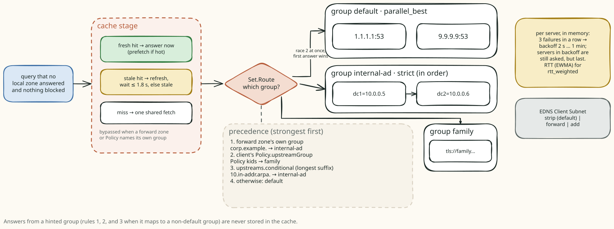

## Settings ownership

In Kubernetes, upstreams start as GitOps-managed. **DNS > Upstreams** can
explicitly adopt the complete section into UI management, preserving every
group and routing rule. UI-owned settings use a separate API-owned ConfigMap,
survive Helm reconciliation and restart, and reach every replica through the
settings watcher. Conflicting file declarations are reported and ignored for
this section. A return to GitOps requires matching exported Helm values first.
See [configuration and the store](configuration-and-store.md#settings) for
revision checks, environment locks, persistence and the handoff flow.
Changes still swap the upstream set and flush cached answers as described below.

## File-authored routing imports

The host-only `upstreams.importFile` setting expands a bounded dnsmasq/dnsproxy
file during ordinary configuration loading. Relative paths use the node file's
directory. One parser also backs `upstream.ImportDnsmasq`; reports identify
unsupported lines without repeating their contents. No network request or
query-path file read is introduced.

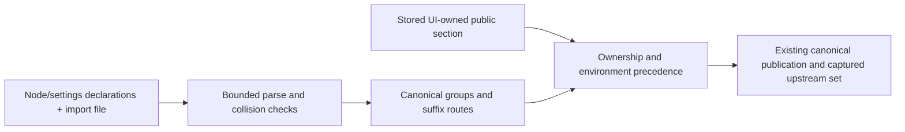

Unsupported local-answer/address/DHCP directives, malformed input or conflicting
named groups/suffixes reject the entire source. Repeated server rules combine
ordered alternatives; conditional groups use strict failover. This does not
emulate dnsmasq's adaptive upstream scheduling. Unscoped servers replace only
the compiled default, and conflict with an explicit default declaration.
Environment locks still win. An explicitly UI-owned section skips the stale
file source; adoption stores public canonical values, never the host file path.
Revision/handoff checks include imported effective routing, and release needs
an available matching file source. Existing persisted canonical cluster settings
retain authority; setting this path does not reseed them or add a file watcher.

## Which group answers

Three places can name a group, and they are checked in a fixed order. The
authoritative stage sets a hint for a `forward` zone, the blocking stage can
replace it with the client's Policy, and the upstream stage turns the hint
(or the absence of one) into a group with `Set.Route`.

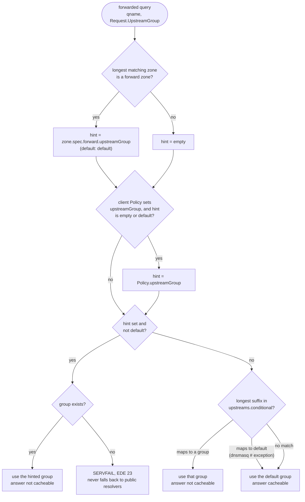

The precedence, from strongest to weakest:

1. A forward zone's or primary zone fallback's own group, when it is not `default`.
2. The client's `Policy.upstreamGroup` (the highest-priority Policy that sets one).
3. The longest suffix in `upstreams.conditional`.
4. The `default` group, which must exist.

The bootstrap root zone `.` is a forward zone to `default`, so on a fresh
install every name that no other zone claims takes the default path and
still consults the conditional map. A Policy beats that root zone, but not a
forward zone with a group of its own.

## Inside a group

```yaml
upstreams:
  groups:
    default:     { servers: ["1.1.1.1:53", "9.9.9.9:53"], strategy: parallel_best, timeout: 2s }
    internal-ad: { servers: ["dc1=10.0.0.5:53", "dc2=10.0.0.6:53"], strategy: strict }
  bootstrap: ["1.1.1.1:53"]          # plain IP resolvers for upstream host names
  conditional: { "corp.example.": internal-ad, "[/10.in-addr.arpa/]": internal-ad }
  ecs: { mode: strip }               # strip | forward | add
```

A server is a dnsproxy address with an optional `name=` prefix. The scheme
picks the transport: bare `ip:port` or `udp://` (UDP, TCP on truncation),
`tcp://`, `tls://` (DoT), `https://` (DoH), `h3://` (DoH3), `quic://` (DoQ)
and `sdns://` (DNSCrypt or a DoH stamp). The query log and the metrics name
a server `<group>/<name or address>`.

### Strategies

Every strategy first splits the servers into healthy ones and ones in
backoff. Servers in backoff always go **last**, earliest recovery first, so a
group never fails without asking every server. The strategy then cuts the
order into batches: a batch of two or more is raced and the first usable
answer wins; batches run one after the other until one succeeds.

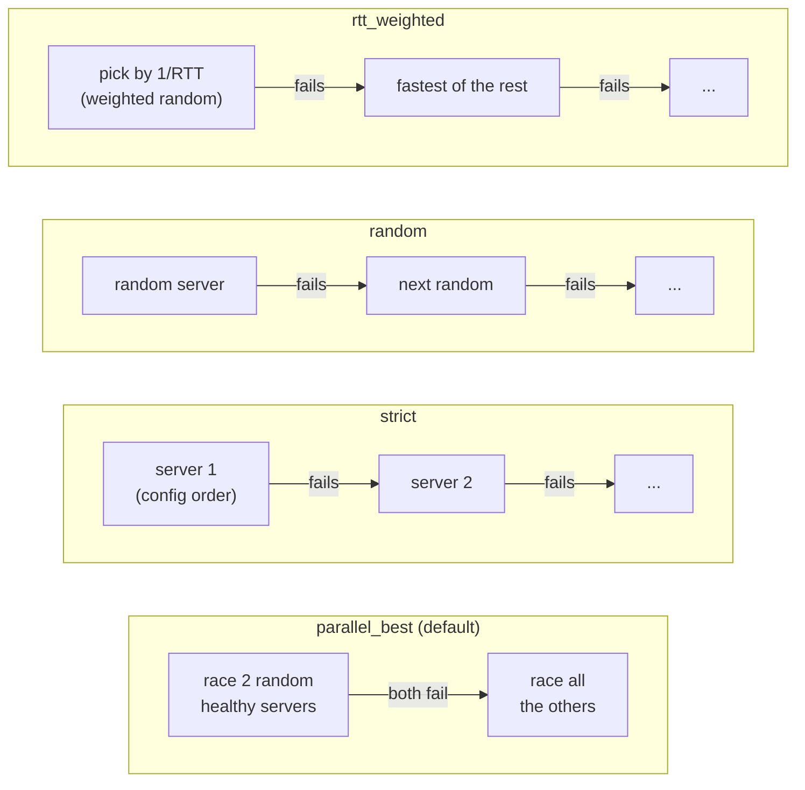

There is no retry beyond this failover, with one exception: a DoT server that
answers REFUSED is asked once more on a fresh connection.

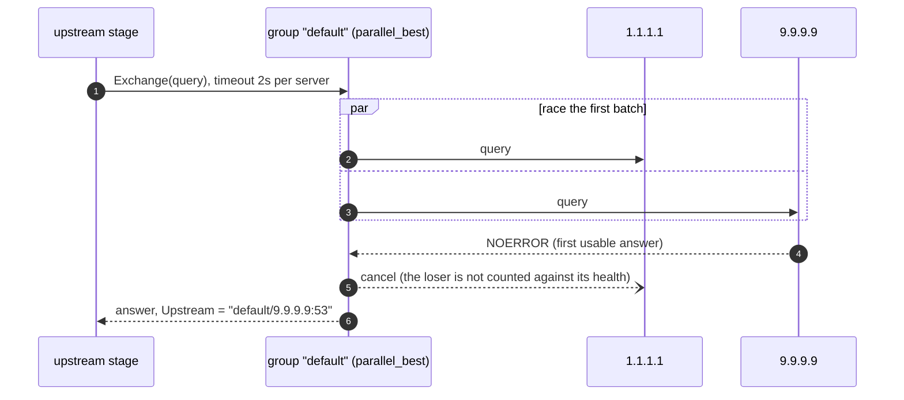

### Server health

Health is per server and lives in memory. Timeouts, network errors and
REFUSED count as failures. A SERVFAIL is not usable, but it proves that the
server is alive, so it resets the failure count instead. RTT is an EWMA
(α = 0.3) that `rtt_weighted` uses. The thresholds have no configuration
keys.

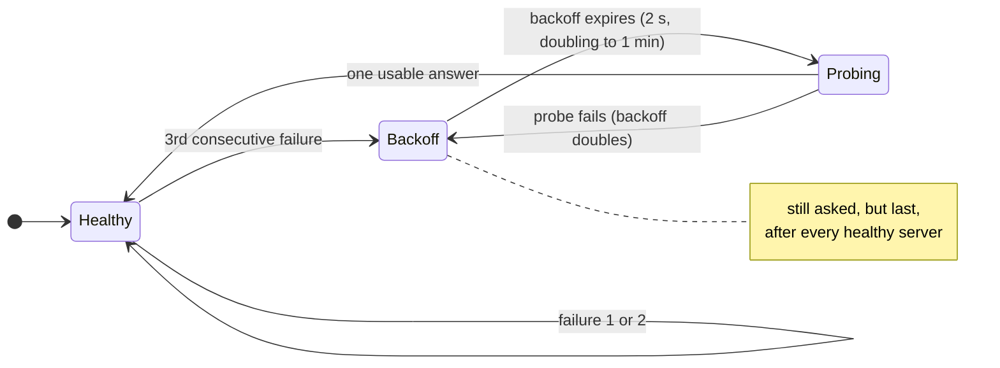

`kudurru_upstream_healthy{upstream}` follows this state, and the
**Upstreams** page of the dashboard shows it next to the traffic each server
carried (`GET /api/v1/stats/upstreams`).

### What goes upstream

kudurru builds its own query: a fresh ID, RD set, the client's DO and CD
bits, an EDNS buffer of 1232 bytes, the first question only. No other client
EDNS option is forwarded. EDNS Client Subnet follows `upstreams.ecs.mode`:

| Mode | What the upstream sees |
|---|---|
| `strip` (default) | no ECS at all |
| `forward` | the client's own ECS option, shortened to at most /24 (IPv4) or /56 (IPv6) |
| `add` | as `forward`; when the client sent none, a prefix of the client's address, for public unicast addresses only |

Recursive groups never send ECS, whatever the mode.

## Recursive groups

```yaml
upstreams:
  groups:
    default: { mode: recursive }               # no servers; timeout bounds a whole lookup (default 4s)
    router:  { servers: ["192.168.1.1:53"] }   # mode: forward is the default
  conditional: { "lan.": router, "[/168.192.in-addr.arpa/]": router }
  recursion:                                   # shared by every recursive group
    dnssec: true                               # validate (default)
    qnameMinimization: true                    # RFC 9156 (default)
    ipv6: auto                                 # auto | on | off: ask name servers over IPv6
    trustAnchors: []                           # empty: built-in root KSK-2017 (20326) and KSK-2024 (38696)
    negativeTrustAnchors: []                   # temporary domain/reason/absolute expiresAt exceptions
    rootHints: []                              # empty: built-in IANA root server addresses
```

A recursive group lists no servers (validation rejects it if it does) and
ignores `strategy`. Every recursive group uses the same resolver, which the
group wraps as one server named `<group>/recursive` (proto `recursive`), so
routing, server health, metrics, the query log and the response cache work
as for any other group. Any group can be recursive: a Policy, a forward
zone or a conditional rule can send some clients or names to recursion and
the rest to forwarders. The resolver outlives settings reloads; it drops
its cache when `trustAnchors`, `rootHints`, `dnssec` or
`negativeTrustAnchors` change. Native cache keys also include active exception
state, so an expiry immediately prevents reuse without a reload.
Forwarding to 1.1.1.1 and 9.9.9.9 stays the default for new installs
(D170).

### How a name is resolved

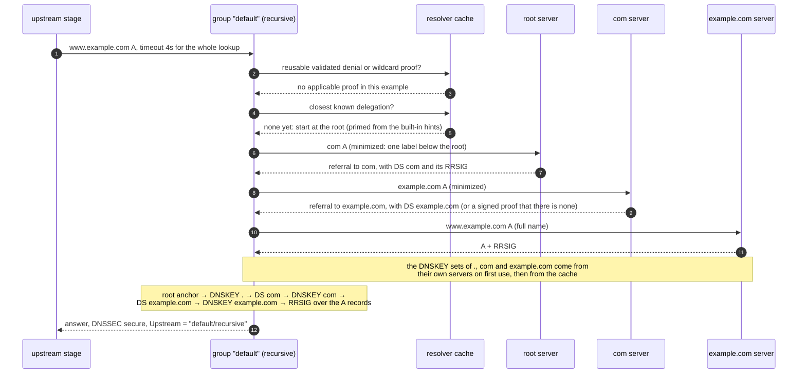

- **Start.** After local-name handling, the resolver checks its bounded
  authenticated denial cache (RFC 8198). A complete proof can answer a new
  covered name or type without network traffic. Otherwise, it begins at the
  closest delegation it has cached.
  The root server addresses are built in (IANA's `named.root`, or
  `rootHints`) and refreshed from the roots at first use (priming,
  RFC 9609); the result is kept for at most 24 h.
- **Referrals.** Glue is accepted only for names inside the delegating zone
  (bailiwick). Name servers without glue are resolved when needed, at most
  3 per question. CNAME and DNAME chains are followed across zones (at
  most 12 hops). Answers that come back truncated are asked again over TCP;
  the EDNS buffer is 1232 bytes.
- **QNAME minimization** (RFC 9156, relaxed). Each server sees one label
  more than the zone it serves, asked as type A. After four one-label steps
  the steps get bigger, with at most 10 per name. Some servers answer
  NXDOMAIN for a name that only has names below it, so an NXDOMAIN for a
  minimized name is retried once with the full name.
- **Picking a name server.** Each server's RTT is tracked; the resolver
  picks at random among the servers within 100 ms of the fastest, asks
  servers in backoff last and asks at most 8 per question. A server's timeout is
  three times its smoothed RTT (150 ms to 2 s; 800 ms when unknown). With
  `ipv6: auto`, IPv6 addresses are used when the host has a route to the
  root servers over IPv6.
- **Anti-spoofing.** Random query IDs and source ports, random letter case
  in the query name (0x20, with a fallback for servers that do not echo
  it), a strict match of the question, and bailiwick scrubbing of every
  section. Loopback name server addresses are never asked.
- **No probing of the local network.** With the built-in root hints, name
  server addresses in private, link-local, CGNAT, documentation and other
  non-public ranges (after unmapping `::ffff:` forms) are dropped, so a
  remote zone cannot delegate to `169.254.169.254` or `10.x` and make
  kudurru query hosts inside your network. Custom `rootHints` describe a
  private tree and allow them.

### Automatic root-anchor lifecycle status

Static trust anchors remain the default. SQLite nodes can explicitly
select `upstreams.recursion.managedTopology: direct` in host configuration, then
`anchorMode: managed` with DNSSEC enabled and explicit DS seeds. Direct declares
that every client reaches the node's listeners without dnsdist or another caching
proxy; configured PROXYv2 peers are rejected. This declaration cannot discover
undeclared proxies. It is host-only, requires restart, and is separate from the
cluster's root policy. The default `disabled` topology never activates managed
serving. The Kubernetes store driver refuses `anchorMode: managed` as a
validation error at startup, on a settings reload and on a settings change,
and keeps the previous value (D370); it supports static anchors only.
Enrolled primary writers use the elected updater; every member without
one (a follower, and a fenced or conflicted member serving its last-good DNS)
mounts an independent deny-only supervisor. Edge deployments use the explicit
`edges` topology described below. Full enrolled HA orchestration/acceptance
is still separate.

For dnsdist deployments, set `managedTopology: edges` and list **every caching
edge** in host-only `upstreams.recursion.managedEdges`. Each entry contains the
edge's `node`, its managed observation TLS `address`, the expected retained
`deployment` identity, and this node's exact `backendAddress` and
`backendInternalAddress` in that edge's installed membership. The backend name
must match `node.name`. Use the same internal credentials as the edges. Start
edges with retained `managedCacheBypass` and `managedObservationAddress`; obtain
the public deployment identity from their local `/status` for host provisioning.
That diagnostic value alone does not authorize activation.

Before serving, the backend captures one complete local image/authority token
and a finite startup attempt, then authenticates the installed bypass and exact
membership of every declared edge. It adopts only that original observation
under the Store's original-token barrier. Missing credentials, any unavailable
or mismatched peer, expired work or an intervening local image/authority change
refuses startup without replay. A node without an installed image never enters
this lane: an unenrolled receiver (a join that never installed its first image)
with either topology, and any image-less node with edges, is refused before any
edge or root contact with an error that names `cluster join --offline` and
`cluster join-reconcile --offline` (D370). The offline join is the only
first-image lane; see the [runbook](../deploy/runbooks.md#add-a-follower-behind-managed-edges).
A direct follower enrolled without an image (no production path creates one)
still waits for installation.
A fenced or conflicted backend restarts under the same complete fleet
observation, adopted with its token's own DNS-only disposition; it is refused
like any other backend when one edge is missing, mismatched or the local
authority changes during the observation.
Neither declaration discovers omitted proxies or unmanaged independent daemons.

Successful edge admission retains the runtime lifetime. Its safety across an
edge child restart relies on D315's persistent immutable bypass: both pools stay
uncached and every child starts with the skip-cache rule. Replacing or rolling
back the edge deployment storage is outside that guarantee. Backend restart
requires a fresh installed observation of the same explicitly configured fleet.
This permission never replaces canonical history, elected writer, local denial,
complete publication or per-output checks. Actual pinned dnsdist/backend tests
exercise both edge pools over UDP/TCP, edge and backend restarts, and no cached
answer after backend shutdown. This does not qualify every external topology.

The root runtime adopts direct topology under bounded startup preparation and
retains that exact admission through its lifetime. It mounts one elected updater
and the complete managed builder only for that admitted owner. Initial provider
readiness waits before the first anchor capture; it cannot retry a refused anchor
operation. The first bounded anchor attempt finishes before other elected
provider/primary services start, so their startup writes cannot invalidate that
initial capture. Every outcome releases those services; terminal refusal keeps
only the anchor child parked. Successful preparation cancellation does not expire a published input.
The pure `internal/trustanchors` state remains distinct from durable acceptance
and root publication authority.

Its immutable state retains explicit DS seeds, every actual authenticating
supporter, original hold-down times and permanent bounded revocation tombstones.
Only checkpointed monotonic progress in the same process session counts toward
addition; restart or failover receives no unproved downtime credit. Addition also
requires a fresh authenticated observation after the hold-down. Missing trusted
keys remain trusted; self-revocation uses the received REVOKE flags and changed
key tag. Loss of every anchor quarantines validation. Canonical self-revocation drains
active output before local denial and the paired history update commit. Reopening
the same database retains quarantine and permanent revocations; choosing static
keys or disabling the managed topology cannot reset that history or restore
protected publication. Offline operator recovery uses the explicit command below.

The recovery primitives accept operator-selected replacement DS trust only from
an already quarantined owner and after a fresh matching signed DNSKEY response.
They preserve initial policy/seed identity and every revoked key, without crediting
pending hold-down. Pure format 2 adds bounded permanent recovery records (at most
32), each binding the prior complete digest, generation, receipt time and selected
DS records. Ordinary updates preserve that exact history; follower installation
rejects rewrites of its already accepted prefix. Format 1 retains its existing
serialization. Recovery proposals have separate opaque proofs checked against the
original captured writer, complete before/after states and receipt lifetime through
commit. These primitives do not authorize an operator or replace a transactional
audit. `kudurru anchors status|recover` now opens an existing current-schema WAL
database under the exclusive process lock, without initialization/migration or
repair. Local OS file permissions authorize this offline operation; a required
stopped-process acknowledgment, exact expected envelope digest, bounded audit
reason and explicit replacement DS records precede acquisition. The original
complete image token is checked before network and under the command's actual
writer lock through commit. The hash-chained audit commits with the trust change;
actual completion, including committed-with-error, remains distinct from output
success. Restart keeps the original configured policy/seeds and publishes through
the usual complete admission path. See the [recovery runbook](../deploy/runbooks.md#recover-a-quarantined-managed-root-anchor).

Mixed versions (D370). Members exchange anchor history only inside complete
images, and every image exchange requires the exact store schema (9) and the
exact required-feature list; a member with a different schema or list refuses
the image as incompatible and keeps its own last image. The inner formats
(pure format 1 and recovery format 2, owner envelope format 1, local carrier
format 1) are not negotiated separately. Recovery format 2 was added at
schema 8, before schema 9, and the only earlier release (v0.1.0, schema 1)
has no managed anchors, so no binary that can exchange a v0.2.0 image reads
only format 1. Committed golden documents pin each inner format's bytes, unknown
inner formats are refused without changing the receiver, and a tripwire test
pins the whole tuple: a later inner format change must come with a schema or
required-feature bump. Process-level acceptance against released binaries is
tracked separately.

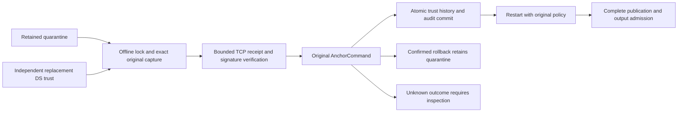

Bootstrap and updates retain an opaque original observation bounded by received
DNSKEY/RRSIG TTLs, signed original TTL and signature expiration. Final admission
checks both wall and monotonic age without restamping. Encoding a proposed state
does not commit its checkpoint or grant a writer.

The accepted-owner and SQLite adapters add bounded dormant/managed
history, envelope and state-version CAS, and original writer/context/evidence
checks through commit. A section-prefix fence rejects any later actual owner
mutation in the same command, including ABA; genuine no-ops and unrelated owners
remain independent. A staged result is only a proposal until the outer command
succeeds. Schema 7 creates a non-granting physical marker; schema 8 adds a
private local-denial carrier. The admitted startup command initializes dormant
history and its local binding in one transaction, then binds committed evidence.
Managed restart validates retained history and local denial without resetting
either. Complete images require both `managed-root-anchors-v1` and
`managed-root-runtime-v1`. Followers capture their original receiver state before
source acquisition, then install the primary's history without initializing a
new one. Old images and binaries refuse across the schema/feature boundary;
received images are never converted. Direct activation mounts the elected
updater or local follower supervisor and immutable complete-image resolver
publication. Edge topology additionally requires the installed fleet barrier.

The SQLite poll bridge captures the normal update, local denial and paired
post-denial update from one committed owner/authority cut before acquisition.
One opaque receipt stamp binds the original clock sample to that operation;
copies share consumption, and matching timestamps cannot substitute ownership.
Raw verification authenticates once and chooses either the normal or self-revoke
branch. Self-revocation commits local denial before any granting policy pins;
only its own confirmed effect can admit the paired update. A completion error
preserves its actual commit disposition but supplies no continuation.

The root wire helper captures up to three numeric endpoints and one finite
operation before acquisition. Each endpoint has at most four seconds within the
original 30-second lifetime. It samples the receipt synchronously at the first
complete frame, before parsing or correlation; that response is terminal even
when malformed, truncated or refused. The updater scheduler selects TCP upfront,
without resolver lookup, cached responses or a second receipt after truncation.
These helpers retain the original socket/signature and SQLite boundaries when
used by the admitted direct writer.

The private updater scheduler retains one original elected target, borrowed host
and session clock. Each due acquisition has a fresh lifetime bounded to 30 seconds
before capture. Successful completion schedules a new committed-state read;
only that accepted owner's `NextRefresh` controls the next poll. Incomplete
transport acquisition can schedule a new attempt using `RetryDue`, or the minimum
refresh interval before bootstrap. Its cooldown binds the exact owner, policy and
settings identity. A complete malformed response, authentication refusal, changed
admission or SQL/completion error stops that scheduler permanently; actual denial
and update dispositions remain separate from errors. One refusal is not terminal
(F28-EF-1). An ordinary commit, such as a zone status write at startup or an API
change, can move the canonical generation between the image read and the
capture, or while the reply is in flight. Then the capture or the update
transaction refuses with the store's authority CAS and a definite rollback. That
refusal changes nothing, and the scheduler discards the reply without replaying
it. A later step captures the new generation and makes a new acquisition, paced
at 1, 2, 4 and so on up to 64 seconds while the race repeats. An accepted-owner
change, an uncertain outcome, a committed denial or a lost term stays terminal.
Each such retry logs a warning ("root anchor update raced an ordinary commit")
with the next attempt time and the consecutive count. A revocation denial that
an ordinary commit rolls back is not retried: the failed denial closes the
anchor source and fails closed for the writer term, as before (a recorded
follow-up). Generation broadcasts and
bounded checks wake scheduling without consuming the publisher's local-denial
notice. Cancellation joins the original socket/wait before return. The writer
episode mounts it only with the root runtime's private topology admission.
Installed edge activation admission and full retirement/interoperability
acceptance remain separate requirements.

Its writer adapter retains a terminal failure in the runtime for the original
elected term and incarnation, across both host replacement and cluster-runner
restarts. The failed anchor child waits for cancellation while other writer
services continue; the caller joins it before releasing the borrowed host. A
complete receipt remains terminal even when cancellation races final admission.
Cancellation of an incomplete socket acquisition can join without inventing a
received observation. Only a new elected term or incarnation clears the terminal
record. Direct writer episodes mount this adapter after admission.

A separate private follower adapter captures actual installed managed history,
canonical policy and the local denial attempt before its own numeric TCP
acquisition. The first complete frame receives that operation's opaque local
stamp. Only an authenticated self-revoke can reach the deny-only transaction;
normal observations cannot bootstrap, advance or checkpoint history. The adapter
has no API for leader observations or supplied raw bytes. It refuses a changed
original authority before acquisition, but a known revoke arriving during
promotion still reaches the driver's original-cut check: a refused/unknown
denial closes local admission without relabeling canonical progress. Durable
local denial survives follower reopen. The legacy one-shot denial API still
refuses a normal response. A separate explicit authenticated-normal result lets
the private follower poller schedule a new independent acquisition without
creating accepted progress.

That poller retains one member, authority term and role, plus its own session
clock. Each operation retains its exact local incarnation. Only after an
authenticated normal observation completes with its original authority check may
a later fresh capture adopt a newer installed incarnation in that same member,
term and role. The one other case is a poller that has started no acquisition
and whose last operation only deferred for this node's clock (below): nothing
was held, received or refused, so its next fresh capture may adopt a newer
installed incarnation in the same way. No failed or held operation can use
either path; its original token remains immutable.
Its first observation is immediate; a normal receipt imposes
only a local one-hour minimum refresh cadence. Incomplete transport uses the
accepted state's retry interval. Both cooldowns bind the exact owner, policy and
settings identity. Authentication, complete-input, admission, completion or
promotion refusal stops the loop; confirmed local denial also stops it.
Generation/authority broadcasts and bounded waits preserve the publisher's
separate denial notice. Caller and runtime cancellation join the original socket
and wait. The admitted direct runtime mounts a supervisor around this worker.
Before the first operation, only absent initial images and actual awaiting or
dormant owners may wait for a managed install. Once started, a captured operation's
refusal is terminal. Its supervisor retains that result across ordinary installs,
which increment SQLite's local incarnation; only a different member, authority
term or role can admit another child. It cancels and joins old children before
moving to a successor, and parks failures without stopping unrelated serving work.
A successful local denial retires the exact published input and survives reopen;
no follower observation changes the canonical accepted owner. A same-term install
can invalidate an in-flight operation's exact incarnation, but cannot rescue that
refused operation. A completed normal operation may be followed by a new captured
source; an unchanged owner/settings identity retains its existing cooldown, and a
changed one (a cluster settings change, for example) makes the follower check the
root again at once. A capture or readiness classification refused only because an
ordinary install replaced the installed cut between its read and its final check
acquired nothing: it waits one second and captures the new cut, and like a clock
wait it may then adopt the newer incarnation if no acquisition has started (D369).
The separate-process enrolled tests (`TestEnrolledManagedAnchors*` in `test/e2e`)
run join, follower supervision, partition, promotion, rejoin, conflict
resolution and restarts with managed anchors.

#### Fenced and conflicted members, and member clock skew (D369)

Managed admission is split in two. Serving admission lets a member publish and
answer from its last accepted managed owner in every role that can hold one.
Updater admission stays with the elected writer of the original term.

| Local authority | Publication | Root-anchor worker |
|---|---|---|
| Writable standalone or primary | Complete | Elected updater; the only path that advances accepted history |
| Follower | Complete | Deny-only supervisor |
| Fenced (a higher term was observed, or the installed image diverged) | DNS-only last-good | Deny-only supervisor |
| Conflict (another term in the same epoch was observed) | DNS-only last-good | Deny-only supervisor |
| Unenrolled or no installed image | None | None |

Every follower is fenced from the moment it observes a promoted successor until
it installs that term's image, an old primary is fenced when it returns, and a
conflicted member stays in that role until an operator runs
`cluster resolve --offline`. In each case the member keeps answering DNS from its
last-good image with its last accepted trust anchors, restarts in that role
(direct and edges topology), keeps protected HTTP, authentication and writer
work closed, and never polls as a writer. Its supervisor still acquires the
root DNSKEY set independently. A signed revocation commits the same durable
local denial as on a follower and retires the DNS-only output; no observation
in these roles changes accepted history or authority. The supervisor starts one
child per member, term and role. A role change inside a term (fenced to follower
by install, or to conflict or divergence) is a durable authority transition, so
it joins the old child and admits one new child; ordinary installs still cannot
rearm a terminal result.

The poller and the updater compare this node's wall clock with the wall time of
the committed checkpoint before acquiring. A node whose clock trails that
checkpoint by at most five minutes (`trustanchors.ClockTolerance`) waits until
its own clock reaches it and then continues: the follower or DNS-only poller
acquires once, and the updater returns to the accepted refresh schedule. The
wait acquires nothing, writes nothing and logs a time-synchronization warning.
Ordinary writes and replica installs that land during the wait do not end it.
A poller child that has only waited captures the newly installed cut on its next
step, in the same member, term and role, and keeps waiting or polls; a role
change still ends it, and a child whose acquisition already failed still cannot
move. The updater captures a fresh operation under its original writer term on
every step. A larger gap remains a terminal clock refusal for that authority
epoch or writer term. Hold-down credit is unaffected: it still comes only from
checkpointed monotonic progress inside one process session.

#### Divergent owner history across promotion, rejoin and resolution (D369)

Every authenticated observation by an elected writer adds one generation to the
accepted owner. Two writers of one history therefore count separately: an old
primary that polled after its follower's last pull, a promoted follower that
polled after its promotion, and both sides of a promotion conflict. Their
generations and update times do not order their branches. The authority term
does.

| Install | Rule for a different managed owner |
|---|---|
| Same term as the installed image | Strict successor: greater envelope and pure generation, update time not earlier, recovery records retained, every installed revocation retained |
| Higher term than the installed image (`InstallReplica` after a promotion or a resolution) | Adopted by term, whatever its generation or update time |
| The branch a resolution keeps (`ResolveConflict`, `ResolveAudited`) | Adopted by term, in the transaction that allocates the new term |

An unchanged owner, the first install on a joined receiver and the first
managed owner over a dormant one are not adoptions and keep their existing rules.
A managed owner is never replaced by a dormant one.

Adoption still requires the same cluster, history, initialization time, policy,
seed digest and resolver domain, and the incoming state must retain every
recovery record the member accepted. Without that the install is refused, the
member stays fenced and keeps serving its own branch as DNS-only data.

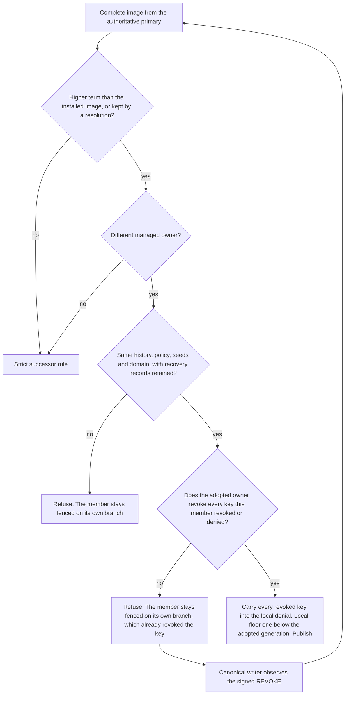

No revocation is lost by adopting a branch that has not seen it, and none is
made pending by one. Adoption requires the adopted owner to revoke every key
the abandoned owner revoked and every key in the member's node-local denial,
the same rule an install inside one term applies to a pending denial. Otherwise
the install is refused before any write: the member stays fenced, keeps serving
its own branch as DNS-only data (that branch already revoked the key, or its own
denial already retired it) and takes no later image from the new term. The first
scheduled pull after the canonical writer has recorded the same revocation
adopts the branch, and the member publishes it at once. The same rule refuses a
resolution that would keep a branch still trusting such a key. A carrier that
was already terminal, or a denial that no longer fits its bounded list, stays
terminal.

The node-local floor and the in-memory retirement gate are rebased onto the
adopted owner in the same transaction as the owner rows, the image and the
quarantine of the abandoned branch, because that branch's floor can lie at or
above the adopted generation. `Change.StageRebase` is the only gate transition
that can lower the floor. It needs an installed owner of the same domain and a
floor that retires every generation below the adopted one, and it clears the
registration, so nothing issued for the replaced owner can read again. The
adopted owner can be one the member held before (an old primary returns to the
owner its promoted follower never left), so the gate also counts rebases and
refuses every write attempt captured before one, even when its expected mark is
installed again; the source's exact cursor identity refuses such an attempt
independently. A restart restores exactly the same gate from the committed
carrier. A denial receipt that named a generation above the adopted owner is
restated at the adopted owner.

##### States that hold a member back, and what ends each

A refused install or resolution changes nothing on the member: owner rows,
image, carrier, authority, quarantine and the published resolver input stay as
they were, and anchor admission stays open. The member repeats the pull at
every interval (a complete image fetch each time) and refuses again until one
of the following ends the state. None of them clears a carrier, installs a
branch that lacks a carried key, or replaces managed history with a dormant or
static owner. While it refuses, the member cannot be promoted, because
promotion needs a follower. Every recovery in the table therefore needs the
current primary, or a member that follows it and can be promoted. When the
primary and every member that followed it are lost for good, the explicit
abandonment of their term (`cluster resolve --offline --abandon-term`, see
[configuration-and-store.md](configuration-and-store.md)) makes the refusing
member the writer of a new term on its own unchanged owner, and a returning
member of the abandoned term adopts that branch under the same rules.

| State | The member answers | What ends it |
|---|---|---|
| Fenced; its owner revoked a key that the primary's owner has not revoked | DNS-only from its own branch | The primary's writer records the same REVOKE at its own refresh, then the next pull adopts. Never, if the root has stopped publishing the key (the primary keeps it as Missing, which stays trusted) or if the primary's history never held the key (a REVOKE of an unknown key is not recorded): replace the member |
| Follower or fenced; its own root check denied a key (pending local denial) | `SERVFAIL` | It installs an owner that revokes every denied key. Promotion does not end it: as the writer it cannot commit an observation that omits the REVOKE, and its own observation of the REVOKE commits the tombstone |
| Fenced; the recovery records of the two branches disagree (`RetainsRecoveryHistory`) | DNS-only from its own branch | Nothing; a second recovery writes another record. Replace the member |
| Fenced; it holds managed history and the primary's owner is dormant | DNS-only from its own branch | The primary bootstraps managed anchors from the same seeds; that owner is another branch of the same history and domain and is adopted by term. With other seeds, or a primary that stays static: replace the member |
| Fenced; another history, policy or seed digest | DNS-only from its own branch | Nothing. Replace the member |
| Terminal carrier (the bounded denial list is full) | `SERVFAIL` | Nothing. Replace the member |
| Fenced or refusing, and the primary and every member that followed it are lost for good | DNS-only from its own branch (or `SERVFAIL` with a pending local denial) | `cluster resolve --offline --abandon-term` with the reviewed term's epoch: a new term on the member's own owner and carrier, unchanged. A pending local denial still ends only with the writer's own observation of the REVOKE |
| Anchor admission closed for the process: unknown SQL completion, or a verified REVOKE that could not be written because an install replaced the owner it was captured for | `SERVFAIL` | Restart. The committed cut binds again, and the next root check records the REVOKE against it |

##### Reading these states

Each state above is visible without reading the database by hand (D369):

- `GET /cluster/anchors` (`kudurru cluster anchors`, permission `cluster.read`)
  on any serving member: the accepted owner (phase, envelope and pure
  generation, digest, every key with its DS key tag, RFC 5011 status, first
  seen, remaining add hold-down and revocation time, quarantine, recovery
  record generations, checkpoint and next refresh); the node-local carrier
  (denied keys, `revokedByOwner` false for a pending local denial, the
  retired floor, `retired` and `terminal`); the authority (mode, term and
  installed term epochs, `fencedBehindTerm`, conflict); whether managed
  serving admission is still held by the process; the elected updater and the
  deny-only supervisor (`running`, `clock_wait`, `retry`, `raced`,
  `waiting_image`, `retired`, `stopped` with its fixed error category); and on
  a member that pulls, the last pull (`installed`, `unreachable`, `rejected`
  or `refused`) with the refusal class (`carried_revocation` with the key tags,
  `recovery_history`, `dormant_owner`, `policy`, `history`, `not_successor`)
  and when the refusal began. Fixed `warnings` name each held-back state. The
  response grants nothing.
- A fenced or conflicted member's HTTP API is closed (its cut is DNS-only), so
  the same signals are also metrics on its metrics listener:
  `kudurru_root_anchor_worker_state{worker,state}`,
  `kudurru_root_anchor_adoption_refused{reason}` and
  `kudurru_root_anchor_admission_current`. A refusal also logs one warning when
  it begins or changes class and one line when an install ends it.
- On a stopped node, `kudurru anchors status --offline` prints the same owner,
  carrier and authority projection from the retained database.
- `kudurru doctor` on a host with `anchorMode: managed` reads the route and
  fails on lost trust or a terminal carrier, and warns on every warning.

The store classifies a refused owner with `sqlite.AnchorRefusal`, which still
matches `accepted.ErrCAS`; the classification changes no admission rule.

Replacing a member is the first-image join of a new receiver (D355). It takes
the primary's owner and a carrier that denies exactly the keys that owner
revokes; nothing of the replaced database is transferred. Enrollment refuses an
invitation for the name or the internal address of an active member, and no
member revocation is mounted, so the replacement needs its own name and
address and the replaced member stays in the roster. Operator steps are in
[docs/deploy/sqlite-join.md](../deploy/sqlite-join.md).

The `resolverstate` projection derives canonical SHA-256 DS records
only from Valid/Missing keys. Dormant and quarantined histories yield explicit
states with no fallback keys. Detached domain and owner identities bind history,
policy, seed and both envelope and pure-state versions, including checkpoint-only
changes. This structural input can also describe an uncommitted proposal; it
does not authenticate an image, certify durable acceptance or permit serving.

The `retirement` package adds bounded local read/write exclusion and
a monotone owner cursor. Original contexts and deadlines bound admission;
queued writers exclude new readers. Prepared confirmed effects retire the
previous owner before release, even if cancellation follows the durable effect.
An unresolved or ambiguous effect closes managed admission. Scope exit and
cursor changes share one atomic state, so escaped operations cannot change a
successor. `ReadScope.Check` is only an instantaneous check: output must finish
or join within the synchronous read callback to retain exclusion. This primitive
authenticates neither durable state nor the response it protects. The SQLite
command, replica installation and conflict-resolution paths enforce original
admission and durable local denial around their actual transactions.

The SQLite publication adapter captures an exact committed owner, local carrier
and original complete-image token. The complete publisher can carry that opaque
attempt through preparation, take retirement exclusion before the Store writer
lock, and apply its preallocated registration immediately before the whole-bundle
pointer swap. The driver resolves the actual callback disposition under the same
exclusion. An error after a swap does not release the publisher's live reference
or imply rollback. Managed composition must opt into the publisher's original
bounded preparation lifetime before the image read. A successful registration
survives cancellation of preparation; each later read has its own finite original
lifetime. The adapter exposes no raw retirement snapshot or claimed-outcome API.
Its `Current` predicate observes the exact source, local carrier and installed
gate mark even before first publication; it does not grant a read or retain the
preparation lifetime. A fixed cache domain binds the full accepted owner, local
carrier and a fresh input incarnation, including across equal-key checkpoints
and Store reopen. The builder puts this full domain in every managed raw-cache
partition, including forwarded and CD answers, and disables managed disk-entry
promotion. Transport output uses the private
root component and a separately captured original read attempt.

The Store also owns a monotone Static/Managed/Closed mode. A real first primary
bootstrap or follower installation takes its exclusive hold before retirement
exclusion and the SQL writer lock, draining counted static callbacks first.
Static input derives only from bound committed history and creates no managed
snapshot. Admission bounds active plus waiting readers to 256 and writers to 16;
FIFO queueing prevents barging behind an enqueued writer. Original finite
contexts remain distinct from private queue cancellation. Canceling or closing
never releases an active callback's hold before return. Actual SQL/publication
disposition resolves the writer scope; an entered unresolved callback, panic or
unknown completion closes admission. Scope exit and resolution use the same
atomic state, so a late escaped resolution cannot reopen a closed scope.

Root composition binds the actual Store source and requires a private complete
root component after concrete builder preparation. Its original preparation is
bounded before the image read; published inputs survive preparation cancellation.
A joined source notice worker wakes rebuilding without granting admission.
SQLite DNS listeners capture that component before work and hold common mode
(and retirement exclusion for a managed input) through actual synchronous output.
Native writes, HTTP body/header flush and DoQ FIN retain the original deadlines;
late errors preserve actual completed effects. A bare guarded Resolve call
refuses to export answer data outside a final handoff. API dig retains its
original lease and response through bounded typed serialization, then writes
and explicitly flushes HTTP output inside its pre-pipeline root attempt.
Request cancellation and earlier proof expiry bound that actual write.

Detached raw-cache leaders capture a separate finite insertion attempt from
their original cloned complete lease before fetching. Encoding precedes the
attempt's mode/retirement hold; insertion, security-failure deletion and
failed-refresh metadata changes finish under that hold before releasing the
lease. Queuing never renews the original TTL origin. Static restored promotion
uses the same admission order; a dump cannot reconstruct a managed registration.
An ordinary canonical commit can supersede the data generation while a held
recursive/policy query still owns valid dependencies and anchor input. In that
case the raw-cache attempt is consumed without performing its mutation, and the
held query can finish. Anchor retirement, dependency loss and original expiry
still refuse the operation. Native resolver mutations below are treated the
same way (D377): their writes still need the complete data generation, so after
such a commit each native cache attempt is consumed without writing, and the
resolution, which starts under the retained recursive policy, continues and
answers. Without its own writes, the uncached part of such a lookup asks the
authorities again for delegations, DS and DNSKEY records it would otherwise
remember: a cold validating lookup costs several times the authority queries
(TestNativeMutationSkippedWritesStillResolve), still within the per-query
budget. Names already in the cache are unaffected.
Native recursion captures a trusted mutation source from the original complete
request immediately before exchange. It retains the private root component and
finite query lifetime, never a replacement publication. Each child acquisition
gets its own one-shot attempt under an equal or earlier deadline. Managed
builders require the source and match its domain to the immutable resolver;
a domain alone grants no authority. Standalone static callers retain their
existing nil-source behavior.

Priming, delegation/referral DS, address, DNSKEY, DS and authenticated denial or
wildcard fills use pre-acquisition batches. Proof validation, copies and nested
lookups finish outside exclusion. A response commits its bounded batch before
following another alias; DS lookup batches its proof and DS state together.
Final mutation takes mode/retirement exclusion before native cache locks, with
no network, Store access or resource release inside. The single-primer busy
flag is nonwaiting, avoiding a native mutex across admission. Entries retain
their original absolute TTL expiry; actual cache locks protect checks of flush
epoch, proof/exception expiry, cancellation and elapsed original deadline.

The edge now has an immutable host option, `edge.managedCacheBypass`, that emits
an unconditional skip-cache rule before every pool and prevents its sole cache
worker from attaching either pool. Readiness binds a concrete console
acknowledgment of the loaded policy and both synchronous detachments to the
running child and original membership epoch. Old observations cannot reattach;
unknown acknowledgment retires that child. Managed backend projections refuse
both fresh remote cache leases, including before a local-denial rebuild.

The coordinator must still bind backend activation to the installed edge's
original evidence, and the complete retirement acceptance matrix remains
required before activation. A status boolean is not this authority. Managed recursive
input will not alter forwarded DNSSEC's independent anchors and exception policy.

Planned managed mode also refuses an ordinary switch back to static/default
anchors after managed history exists: a shipped seed could otherwise restore a
permanently revoked key. Static-only installations retain their existing
semantics. Recovery requires a separate explicit path that preserves revocation
history; no reset or recovery path is mounted yet.

Managed activation also requires retirement of held answers at final local
response admission and durable follower quarantine. The current remote cache
eligibility lease cannot guarantee immediate retirement; managed pools need
proven cache bypass installed before activation or a stronger per-hit protocol.
The local installed-policy prerequisite has real dnsdist coverage; its backend
activation admission is still pending. Neither is supplied by the pure package.

### Names that never leave the network

The resolver answers these itself, so their queries never reach a root or
TLD server:

| Names | Answer |
|---|---|
| reverse zones of private, loopback, link-local, CGNAT and documentation space (RFC 6303): `10.in-addr.arpa`, `16.172` … `31.172.in-addr.arpa`, `168.192.in-addr.arpa`, `64.100` … `127.100.in-addr.arpa`, `127.in-addr.arpa`, `254.169.in-addr.arpa`, `0.in-addr.arpa`, `d.f.ip6.arpa` (fd00::/8), `8.e.f` … `b.e.f.ip6.arpa` (fe80::/10), `::1`, `2001:db8::/32` and the TEST-NETs | NXDOMAIN |
| special-use names `home.arpa`, `local`, `test`, `invalid`, `onion`, `alt`, `internal` | NXDOMAIN |
| `localhost` | 127.0.0.1 and ::1 |

Forward zones and conditional rules are checked before the group is
chosen, so a rule such as `"[/168.192.in-addr.arpa/home.arpa/]": router`
still sends those names to the router. Names such as `lan` or `fritz.box`
are not special-use: without a conditional rule they go to the root
servers, which answer NXDOMAIN, so route the router's local domain to a
forwarding group that holds the router.

### DNSSEC validation

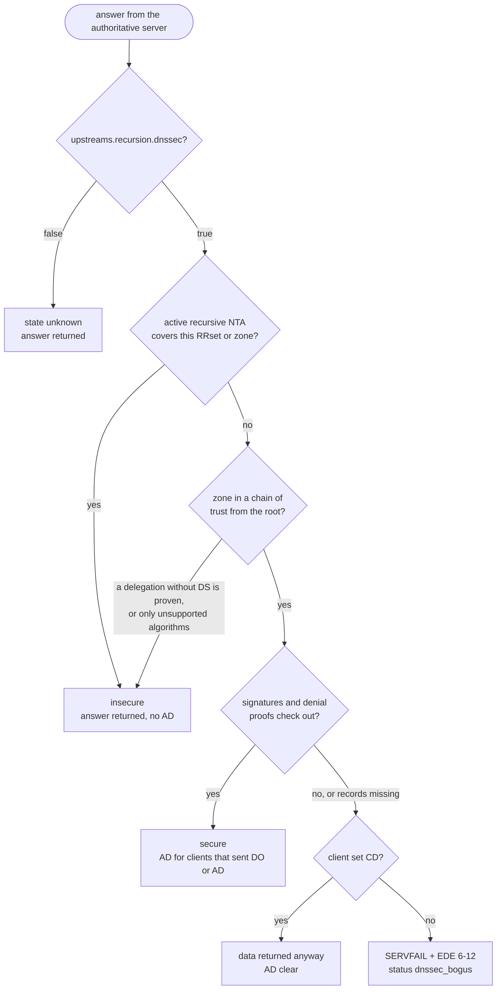

The chain of trust starts at the built-in root trust anchors (KSK-2017 and
KSK-2024; `trustAnchors` replaces them) and is built lazily, only for zones
whose data is validated. DS records that came with a referral are kept and
checked when the zone's keys are first needed; otherwise DS is asked at the
parent. Positive answers, wildcard expansions, NXDOMAIN and NODATA (NSEC,
and NSEC3 with opt-out) are proven. Unsigned data below a signed zone is
insecure only when the delegation without DS is proven, otherwise it is
bogus.

`upstreams.recursion.negativeTrustAnchors` supplies temporary recursive
exceptions with typed absolute RFC3339 `expiresAt`, `domain` and `reason`.
It is independent of forwarded `dnssec.negativeTrustAnchors`. Both use the
same bounded exception compiler: at most 128 canonical domains, reasons up
to 256 bytes, expiry no more than seven days away. Expired entries are valid
configuration but inactive. A match treats covered data or a zone's trust
chain as insecure, never secure; aliases outside the domain still validate.
CD and DO retain their normal meanings. An exception cannot set AD. Native
validation records exactly which RRsets used the exception, so raw expired
signatures for those RRsets can remain available to DO clients without
relaxing authenticated proof deadlines for an outside alias target. Forwarded
responses cannot supply this native provenance; restored raw answers must
match their original recursive context and absolute deadlines.

The native delegation/key/address cache and the raw response cache both
include active recursive exception state. For conservative isolation, any
recursive exception expiry changes the native cache context and bounds all
recursive response reuse, including unrelated names, at the next expiry.
Minimum TTLs and stale windows cannot extend that absolute deadline.
Expired in-flight exception work is refused without retrying it. Reload,
complete SQLite publications, settings restore and cache dump/load retain
the original instant; none turns it into a fresh duration. Each complete
publication keeps its own resolver and exception plan. See the
[exception runbook](../deploy/dnssec-validation.md#recursive-exceptions).

Algorithms: RSASHA1, RSASHA1-NSEC3-SHA1, RSASHA256, RSASHA512,
ECDSAP256SHA256, ECDSAP384SHA384 and ED25519; DS digests SHA-1, SHA-256 and
SHA-384. A zone signed only with other algorithms (ED448, unknown ones) or
with NSEC3 iterations above 150 (RFC 9276) is treated as insecure.

| Why the answer is bogus | EDE |
|---|---|
| no signature verifies | 6 DNSSEC Bogus |
| signature expired / not yet valid | 7 Signature Expired / 8 Signature Not Yet Valid |
| no usable DNSKEY for the zone | 9 DNSKEY Missing |
| signed zone, unsigned data | 10 RRSIGs Missing |
| no proof that the name or type does not exist | 12 NSEC Missing |

The EDE text names the zone or record that failed. RRSIG, NSEC and NSEC3
records are returned only to clients that sent DO (or asked for that type). The state (secure,
insecure, bogus; unknown when validation is off and for forwarded answers)
is stored with the cached answer and fills the query log's `dnssec`
column, cache hits included. Static root keys arrive with kudurru releases or
through `trustAnchors`. Automatic rollover requires the explicit managed
recursive topology and policy described above; it does not change forwarded
validation's root lifecycle.

A SERVFAIL from **any** upstream that carries EDE 6-12, a validating
forwarder such as 1.1.1.1 included, is logged as `dnssec_bogus` instead of
`servfail_upstream`. Like other upstream failures, it lets serve-stale
answer with the cached copy (for a recursive group, one that was validated
when it was stored).

### Authority DNS Cookies

The native resolver automatically negotiates DNS Cookies with authoritative
servers (RFC 7873 and RFC 9018). These are outbound transport credentials,
separate from cookies in an incoming client query or a forwarded response.
They never establish DNSSEC security or AD, and never enter DNS answer caches
or client replies. The resolver still validates the original answer under its
captured DNSSEC and recursive NTA settings.

The connected socket determines the actual local IP and authority IP/port.
A random 64-bit client cookie and the authority's opaque server cookie are
scoped to that address pair. Echoes must match exactly; malformed cookies,
incorrect echoes and missing cookies from established cookie peers refuse the
response. Only the authority can verify its server-cookie MAC; the resolver
checks response correlation, the connected peer, echo and length. Later COOKIE
options are ignored as specified by RFC 7873.

The transport cache holds at most 4,096 address pairs and is memory only.
Server cookies expire after one hour without renewal by an identical echo;
changed cookies replace them. Client cookies rotate after a separately jittered
14.4–24 hours, or on restart/eviction. A changed local address gets a separate
pair. Authorities without cookies remain usable: probes stop for five minutes,
then retry with a fresh client cookie, never the previously exposed value.

A valid BADCOOKIE response permits one UDP retry with its new server cookie.
A second BADCOOKIE falls back once to TCP; BADCOOKIE on TCP fails. Truncated
UDP answers also use the existing TCP fallback. Each packet exchange, including
cookie recovery and lowercase fallback, consumes the original query budget.
The existing UDP and TCP timeouts and caller cancellation still apply. There
are no settings or persisted cookie files. Cookies protect against off-path
forgery; they do not authenticate an on-path observer or replace DNSSEC.

### Limits per client query

| Limit | Value |
|---|---|
| queries to name servers | 120 |
| nesting depth (name server addresses, keys) | 20 |
| referral and minimization steps per name | 48 |
| name servers asked per question | 8 |
| name servers without glue resolved per question | 3 |
| CNAME and DNAME hops | 12 |
| signature checks | 8 per RRset, 96 per query (KeyTrap, CVE-2023-50387) |
| NSEC3 hash computations | 64 per query (CVE-2023-50868) |
| the whole lookup | the group `timeout`, 4 s by default (the query deadline is 5 s) |

A lookup that runs out of servers answers SERVFAIL with EDE 22 (No
Reachable Authority); one that hits a limit answers SERVFAIL with EDE 0 and
the text "recursion limit reached".

### The resolver cache and health

Delegations, name server addresses and DS and DNSKEY sets live in the
resolver's own cache: 50,000 entries, TTLs capped at 24 h, failures
remembered for 30 s. The answers to clients go through the response cache
below like forwarded ones, with prefetch, serve-stale and coalescing, so a
repeated name costs no outgoing query. A cold lookup takes a few round
trips, typically 50 to 500 ms.

A separate authenticated denial cache implements RFC 8198 for recursive
validation. It keeps complete NSEC or NSEC3 proof bundles from one validated
response and signer, including the exact signature that verified each RRset.
Negative synthesis requires the validated zone SOA; positive wildcard synthesis
requires the original wildcard RRset and a proof that the requested name cannot
exist more specifically. Synthesized CNAMEs use the normal alias loop. Exact
NODATA, wildcard NODATA, empty non-terminals, delegation boundaries and DNAMEs
retain their DNSSEC proof rules. Opt-out ranges, mixed chains or parameters,
incomplete proofs, CD and disabled validation fall back to ordinary resolution.

Each resolver retains at most 1,024 bundles and 4 MiB of encoded proof records
and index keys, with at most 48 records/16 KiB per bundle and 16 bundles per
signer context. Each lookup examines at most 32 candidates. All cache probes across one
original client query, including aliases and nested lookups, share a cumulative
allowance of 16 NSEC3 hashes. Each probe also reserves at least half the
remaining shared hash allowance for ordinary validation. These are conservative cache limits;
a capacity or work limit causes a miss. Records from different responses are
not combined into a new proof.

The absolute deadline is the earliest original record TTL, signature original
TTL/expiry, applicable SOA minimum, active exception expiry, or three hours.
There is no five-second minimum, hit renewal or signature replacement. Each
consumer receives copied records with aged TTLs. Native validation also carries
the original absolute deadline into the outer response cache, so delayed
insertion, configured minimum TTLs, stale serving and dump/load cannot extend
it. Trust settings and active exception identity partition the cache. Flush
advances a separate epoch, preventing work captured before the flush from
refilling its successor. An alias walk rechecks its earliest proof deadline
and original cancellation before returning.

The group's single server follows the [health](#server-health) rules,
with one difference: a lookup that times out counts against it only when
no authoritative server has answered in the last 30 s, because one domain
with dead name servers says nothing about the resolver. After 3 such
timeouts in a row `<group>/recursive` is in backoff, and the log warns that
outbound DNS (UDP and TCP port 53 to the internet) may be blocked. Recursion needs that egress to any address; forwarding needs only
the configured servers. Firewalls, Kubernetes NetworkPolicies and ISPs that
intercept port 53 break it.

## The response cache

The cache stores packed answers in a sharded LRU (up to 256 shards, each with
its own lock). Both complete-publication reloads and legacy settings reloads
resize this same storage owner. Capacity changes adjust the shard count under
the cache publication lock, briefly pausing lookups and fills while moving
existing entries without copying their payloads. The exact entry bound holds
after each resize; shrinking evicts per-shard LRU entries. Growth preserves
cache scopes, invalidation epochs, absolute TTL/security deadlines and refresh
claims; it does not replace any captured request policy. The key is `(qname, qtype, qclass, DO, CD, ECS subnet sent
upstream)`. Client identity and Policy are **not** in the key: blocking runs
before the cache on the way in and inspects the answer again on the way out,
so one cached answer can serve every client safely.

Query lookups load immutable shard addressing, lock the selected shard, and
confirm that exact descriptor is still installed. They avoid a shared reader
counter on the normal path. Complete cache mutations suspend this admission;
a racing lookup releases its shard before waiting at the publication lock and
resamples time after the wait. Every completed mutation publishes a fresh
descriptor identity, including flushes without a topology change. Resizing drains
all old shard locks before moving entries and releases retired map capacity.
Fills, dumps, inspections and invalidations keep their existing lock order,
generation fencing, accounting and deadlines (D348).

### What the cache stage does with a query

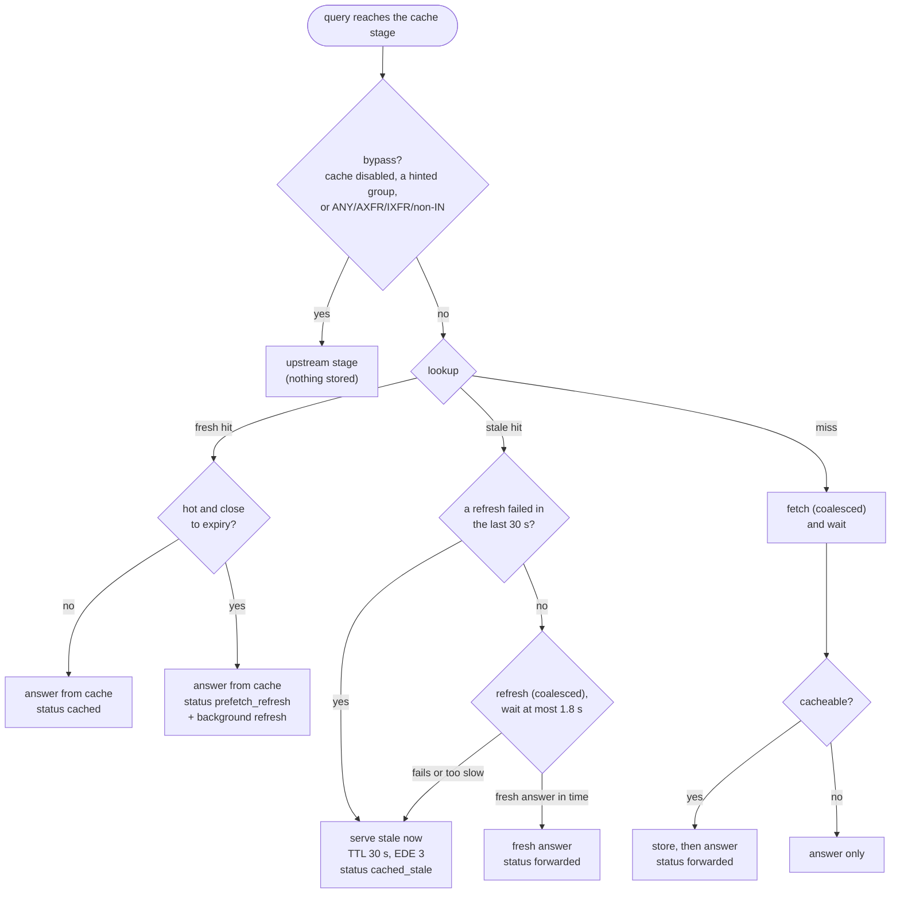

Identical misses share one fetch (singleflight on the key). The fetch runs
detached from the client with its own 5 s limit, so a client that gives up
does not cancel the refresh that the next client needs.

### The life of an entry

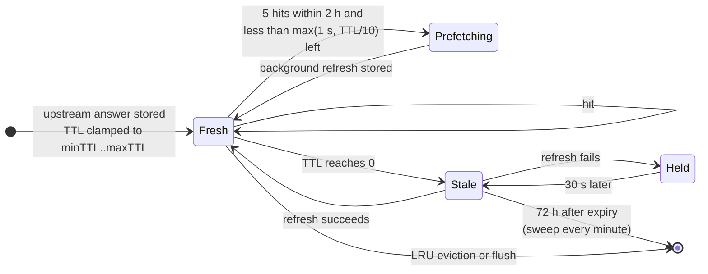

| Setting | Default | Effect |
|---|---|---|
| `cache.maxEntries` | 200000 | `0` turns the stage off (and flushes it) |
| `cache.minTTL` / `maxTTL` | 5s / 24h | clamp on every stored TTL |
| `cache.negativeTTL` | 5m | cap for NXDOMAIN and NODATA, which use the SOA minimum |
| `cache.prefetch.threshold` / `window` | 5 / 2h | hits needed inside the window; `0` turns prefetch off |
| `cache.serveStale.ttl` | 72h | how long an expired entry is kept; `0` turns serve-stale off |
| `cache.serveStale.answerTTL` | 30s | TTL of a stale answer, and the hold after a failed refresh |
| `cache.serveStale.maxWait` | 1800ms | how long a stale hit waits for a refresh |

### Never cached

- Answers from local zones: the authoritative stage answers before the cache.
- Blocked and safe-search answers: the blocking stage answers before the cache.
- Queries routed to a hinted group (a forward zone with its own group, or a
  Policy group), and conditional routes to a group other than `default`.
- SERVFAIL, REFUSED and other error rcodes, truncated answers and TTL 0.
- ANY, AXFR, IXFR, non-IN classes and multi-question queries.

### Persistence and flushing

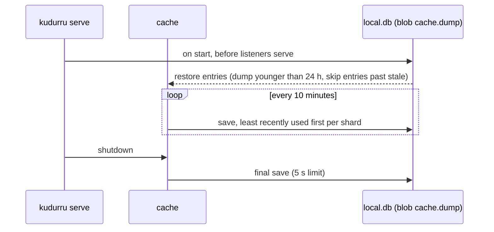

The cache is per node and so is a flush. In complete SQLite serving,
`POST /api/v1/cache/flush` empties the whole cache or one exact name across all
resolution scopes, types, classes, DO/CD flags and ECS subnets. A named flush
preserves descendants and suffix lookalikes; an explicit `.` removes only the
root name. Results report the canonical name and the actual number removed under
the cache locks. Even a flush that finds no entry advances the invalidation
generation, so an older detached fill cannot repopulate the cache afterward.
New queries can fill it again after invalidation.

The original HTTP proof must pass a current no-op transaction for cluster
`cache.flush`, including final deadline and writer checks. Only then does the
command invalidate the same cache used by DNS, outside transaction and dependency
pins. This admission is primary-local: followers return 503 without forwarding
to another node's cache. Local memory invalidation cannot be rolled back; a
cancellation or writer loss after admission may return an error after entries
were removed. Audit records retain that count. No configuration or durable
generation changes, and no publication acknowledgment is required.

The legacy Kubernetes route retains its existing common-type name invalidation.
Zone deletion and settings changes have their own cache invalidation paths, and
an unblock-request approval or denial flushes the decided name from the
answering node's cache. Every registered unblock-request mutation (approve, deny
and delete) is a complete current command, so SQLite no longer refuses that
route family with `503 current_command_unavailable`; a path that is not a route
answers the router's `404`.

## When the answer is an error

| Situation | Client gets | Status | EDE |
|---|---|---|---|
| hinted group does not exist | SERVFAIL | `servfail_upstream` | 23 Network Error |
| every server failed, at least one sent SERVFAIL or REFUSED | that message, rcode SERVFAIL | `servfail_upstream` (`timeout_upstream` if every error was a timeout) | the upstream's own |
| every server failed, none answered | SERVFAIL | `timeout_upstream` / `servfail_upstream` | 22 No Reachable Authority / 23 Network Error |
| the SERVFAIL carries a DNSSEC EDE (a recursive group's bogus answer, or a validating forwarder's) | SERVFAIL | `dnssec_bogus` | 6-12, from the validator |
| a recursive lookup found no name server that answers, or hit a limit (the group timeout running out is `timeout_upstream`, above) | SERVFAIL | `servfail_upstream` | 22 No Reachable Authority, or 0 "recursion limit reached" |
| stale entry, refresh failed or slow | the stale answer, TTL 30 s | `cached_stale` | 3 Stale Answer |

EDE options appear only when the client sent EDNS. A failure on a **miss**
reaches the client as SERVFAIL; a failure on a **stale hit** yields the
stale answer and holds the entry for 30 s, so a dead upstream is not asked
again on every query.

## Hot reload

Every key under `upstreams.*` reloads without a restart. The reloader builds
a new set of groups, swaps it in atomically, retires the old set after 30 s
(in-flight queries finish on it) and flushes the cache. The recursive
resolver is kept across the swap with its own cache; `upstreams.recursion.*`
is applied to it in place. Cache settings
reload in place; new limits apply to entries stored from then on.

## Inspecting one cached response

`GET /api/v1/cache/inspect?name=www.example.org&type=A` requires cluster
`cache.read`. Optional `do` and `cd` select the raw DNS flags; `client` defaults
to `127.0.0.1` and only derives the configured ECS partition. The response says
whether the raw default route is cacheable and whether that exact entry exists,
with positive/negative kind, fresh/stale state, age, original and remaining TTL,
wire size and validation state. Missing, expired and mismatched entries return
`found: false`; disabled caching and conditional routes return `cacheable: false`.

The bounded single-key read uses the original HTTP request's resolver and cache
incarnations. It does not query upstreams, refresh data, count a hit, change LRU
order or adopt restored entries. A retained request can inspect its retained
incarnation; a successor cannot read it after a settings replacement. Responses
use `Cache-Control: no-store` and omit answer bodies, stored client subnets and
upstream endpoints. This is raw cache metadata: authority, blocking and rewrites
can still decide that a client should receive a different answer. It does not
list clients or cached names, or inspect the separate recursive resolver cache.

## Metrics

| Metric | Meaning |
|---|---|
| `kudurru_upstream_healthy{upstream}` | 1 healthy, 0 in backoff |
| `kudurru_upstream_requests_total{upstream,proto}` | every exchange, race losers included |
| `kudurru_upstream_responses_total{upstream,rcode}` | every response |
| `kudurru_upstream_errors_total{upstream,error}` | `timeout`, `network`, `refused`, `servfail` |
| `kudurru_upstream_request_duration_seconds{upstream}` | exchanges that returned a response |
| `kudurru_upstream_inflight{upstream}` | exchanges in progress |
| `kudurru_recursor_outgoing_queries_total{result}` | queries recursive groups sent to name servers: `ok`, `timeout`, `error` |
| `kudurru_recursor_validations_total{result}` | recursive answers by DNSSEC state: `secure`, `insecure`, `bogus`, `unknown` |
| `kudurru_recursor_cache_entries` | delegations, name server addresses and keys in the resolver cache |
| `kudurru_cache_entries{kind}` | positive and negative entries, stale ones included |
| `kudurru_cache_requests_total`, `kudurru_cache_hits_total{kind,stale}` | lookups and hits; bypassed queries are not counted |
| `kudurru_cache_evictions_total{reason}` | `capacity`, `expired`, `flush` |
| `kudurru_cache_prefetches_total` | background refreshes |

Next: [Zones and transfers](zones.md) covers the queries that never reach
this page because kudurru is the authority.


### Cache provenance storage

Raw-cache entries retain complete scope, validation, absolute security deadlines
and upstream metadata by value at the API boundary. Internally, an entry with
exactly zero metadata uses the smaller entry allocation. Nonzero metadata shares
one allocation with its entry; no security or scope field is omitted or inferred.
Both forms keep the existing version-2 dump encoding. Rebinding a restored entry
replaces its immutable metadata value so an in-progress dump can finish with its
original matching key and scope. Invalidation, TTL origins, stale limits and
managed-cache admission are unchanged.
