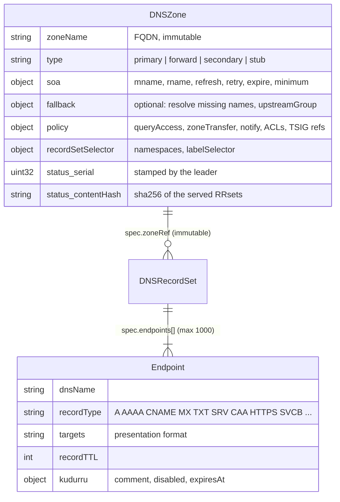
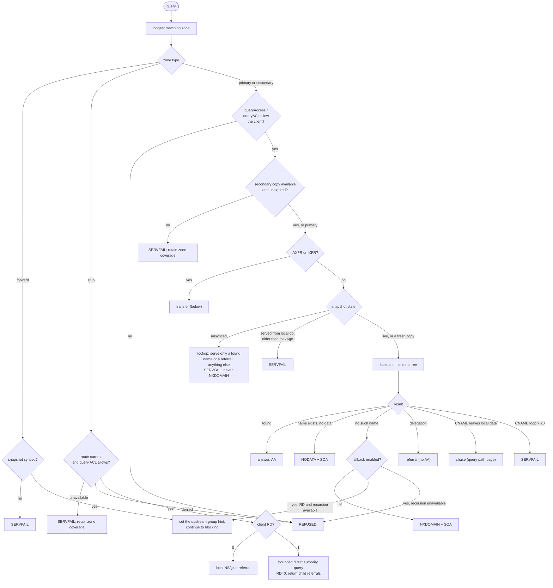
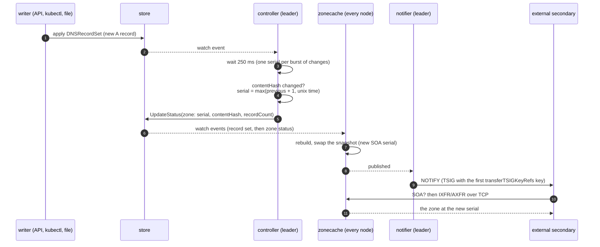
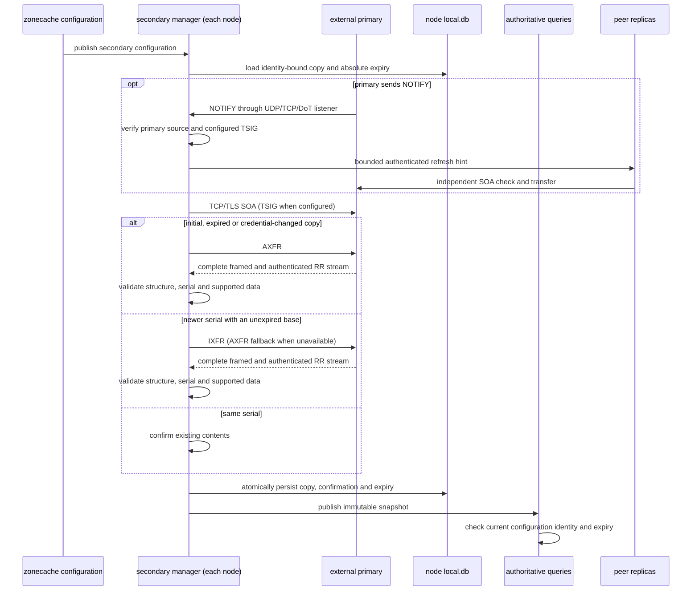
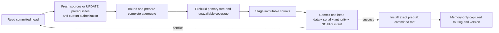
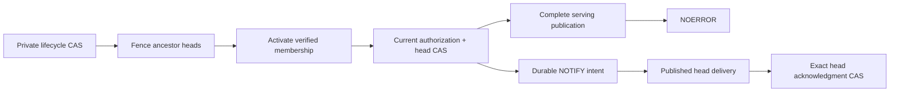
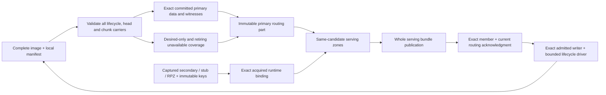

# Zones and transfers

A primary `DNSZone` normally grants authority for every name at or below
its apex. An opt-in `spec.fallback` makes it a local overlay: absent names
continue through resolver routing. Records do not live in the zone object; they live in
`DNSRecordSet` objects that point at the zone, so an application team can
own its own records without owning the zone. The zone is the stone; the
record sets and the copies held by secondaries are the clay copies.

Code: `api/v1alpha1/dnszone_types.go`, `dnsrecordset_types.go`,
`internal/zone` (the tree, lookups, transfers), `internal/zoneview` (the
zonecache view), `internal/controller` (status and serials),
`internal/notifier`, `internal/secondary` (independent inbound transfers and
durable copies), `internal/stub` (authority discovery and direct queries),
`internal/stages/authoritative`.



Primary, forward, secondary, and stub zones are served. The other
types in the schema (`external`, `catalog`) are accepted but get
`Ready=False, reason Unsupported`.

Use one DNSZone per canonical apex. If different objects claim the same
apex, the serving builder logs the conflict and installs unavailable coverage
for that apex. This v0.2 rule supersedes v0.1's last-good duplicate selection:
neither ambiguous primary authority nor an acquired secondary may answer.
Unrelated zones continue rebuilding, including on cold start. Removing the
duplicate lets the affected zone publish its current data. Cross-object
admission does not reject duplicates, so remove the conflicting object
to recover serving at that apex.

| Type | kudurru does | Example |
|---|---|---|
| `primary` | answers from its own records, with SOA and serial | `home.example.com.` |
| `forward` | sends the name to an upstream group ([upstreams](upstreams-and-cache.md)) | `corp.example.` → `internal-ad`; the bootstrap root zone `.` → `default` |
| `secondary` | transfers an external primary's data independently on each node | `partner.example.` from `192.0.2.53:53` |
| `stub` | discovers the zone's authorities and routes directly to them | `corp.example.` via `tcp://192.0.2.53:5353` |

## Answering from a zone

The authoritative stage picks the zone with the **longest matching suffix**
and then checks, in order:



The rule "**never NXDOMAIN while unsynced**" matters: a replica that has not
loaded its zones must not tell the world that names do not exist, because
resolvers cache negative answers. Wildcards (RFC 4592) and DNAME are handled
inside the lookup. Records with `disabled: true` or a past `expiresAt` are
left out when a primary zone is built, and the zone is rebuilt at the next
record expiry. Alias targets reselect the most specific configured zone before
continuing, including a secondary nested under a primary. An unavailable
secondary cannot be bypassed by a parent wildcard or the root forwarder.

`queryAccess` and `zoneTransfer` take one of six modes: `deny`, `allow`,
`allowOnlyPrivate`, `allowOnlyZoneNameServers`, `useNetworkACL` (the ordered
`!`-able CIDR list, first match wins, default deny) and
`zoneNameServersAndACL`.

## Local overrides with fallback

`spec.fallback: {}` on a primary zone enables resolution of missing names
using ordinary client-policy, conditional and default-group routing.
`spec.fallback.upstreamGroup` selects a group instead, with the same
precedence as a forward zone's group. Either group mode (`forward` or
`recursive`) works. Continuation starts after the authoritative stage,
so native recursion consults the public DNS tree without reentering the
overlay. Fallback queries still pass through blocking and the response cache.

Only absent names fall back. An existing name, an empty non-terminal or a
wildcard match without the requested type answers NODATA locally. Generated
apex SOA/NS (and management ANY queries) stay local, but other apex types
fall back until a record set explicitly defines the apex. Disabled, expired
and view-withheld records are absent and do not suppress fallback. More
specific zones still win. ACL refusals and stale/unsynced snapshots never
trigger public fallback; a missing name queried without RD is REFUSED.

Local CNAME/DNAME chains can continue to a missing target through its
zone's fallback group. Mixed local/public answers clear AA and AD and do
not claim DNSSEC validation for the whole chain. Public-only answers retain
their normal DNSSEC state, including validation failures and extended errors.

Every lookup checks local data before the response cache, so adding a local
override immediately masks cached public answers for that name and its
missing types. A specific non-default group bypasses that cache as for
forward zones. Fallback settings participate in the content hash and serial
so edge packet caches are flushed when routing changes. Transfers and
NOTIFY are disabled for overlay zones: an ordinary secondary cannot reproduce
the missing-name behavior from an AXFR. BIND exports contain only local data
and do not encode fallback settings.

## Which records are served

Several record sets can feed one primary zone, from several namespaces. The zone's
`recordSetSelector` says which namespaces and labels may contribute. The
controller and the dataplane apply the same rule, so the content hash always
matches what is served:

1. Order record sets oldest first (creation time, then namespace, then name).
2. An endpoint whose name is not under the apex is dropped: `OutsideZone`.
3. The identity of an endpoint is (name, type, setIdentifier). A later
   record set that repeats an identity loses that endpoint: `Duplicated`.
4. A record set from a namespace the selector does not allow is `NotSelected`;
   one that points at a missing zone is `ZoneNotFound`.

A record set stays `Ready` while at least one of its endpoints is served;
dropped endpoints raise `Degraded` with the reason.

## Serials

For primary zones, the leader's controller stamps the serial into the zone's
status, and every node serves `status.serial`. Secondary copies retain the
external primary's SOA and serial, including serial zero and RFC 1982 wrap.



The serial follows the rule `max(prev + 1, unix_now)` in RFC 1982
arithmetic, and changes only when the hash of the canonical RRsets (with the
SOA serial zeroed) changes, so a no-op write never bumps it. Because NOTIFY
waits for the publish, a secondary is never told about a serial that the
node does not serve yet.

## NOTIFY out

The notifier runs on the leader. It fires after every published snapshot,
and on gaining leadership it notifies every zone once.

- Targets: `notifyTargets` (modes `specified`, `both`) plus the apex NS
  hosts other than the SOA MNAME (modes `zoneNameServers`, `both`),
  resolved through in-zone glue or the resolver.
- Each target gets up to 5 attempts with backoff from 2 s to 1 minute; a
  newer serial replaces a round in progress.
- The source address is `notify.source`. In Kubernetes, NOTIFY leaves from
  the leader pod and is usually SNAT'ed, so the secondary must allow the
  node or egress address, not the Service address.

## Transfers out

| Request | Over UDP | Over TCP / DoT |
|---|---|---|
| AXFR | REFUSED | the full zone, SOA first and last, in ~64 KiB messages |
| IXFR, client serial current | one SOA | one SOA |
| IXFR, client serial older | one SOA (the client retries over TCP) | the full zone in AXFR form (there is no journal yet) |

A transfer needs `zoneTransfer` to allow the client address and, when
`transferTSIGKeyRefs` is set, a request signed with one of those keys. TSIG
keys are node settings (`tsigKeys`, write-only), not store objects. While
the snapshot is not open, transfers answer SERVFAIL. Every message of a
signed transfer is signed.

## Secondary copies

Every replica runs `secondary.Manager`; it does not depend on leadership.
Configuration and query ACLs come from the normal zonecache snapshot. Raw
transferred records never become `DNSRecordSet` objects.



The primary's SOA controls refresh, retry and expire. Failed or incomplete
transfers retain the previous copy until its original deadline. For an
unexpired copy, same-serial SOA confirmation renews expiry; loading from disk,
restarting or failing a refresh never does. At expiry the configured zone remains
in suffix matching and answers SERVFAIL. Recovery after expiry always requires a new AXFR, even
if the serial is unchanged. The obsolete local serial no longer prevents
recovery from a primary restored to an older serial; the new transfer must
still be at least as current as its authenticated SOA poll. Configuration older
than zonecache's `maxAge` also fails closed, even if transferred records have
not expired.

The versioned, checksummed `local.db` envelope binds records to object UID and
complete spec, a fingerprint of the selected TSIG credential, and a cluster
anchor derived from the cluster encryption key. A changed configuration,
recreated object, rotated encryption key or changed TSIG secret requires a
fresh transfer. Persisted copies require a persistent node data directory;
replacing an ephemeral volume loses that node's copy. Data is committed before
publication. Queries only read immutable memory, with no database/network I/O.

Transfers use the configured primary order, bounded concurrency (four zones),
a ten-second deadline per exchange, one million records and 64 MiB of wire
and expanded DNS data. Invalid framing, SOA mismatches, out-of-zone records,
serial regression, missing/invalid configured TSIG and size limits reject the
whole candidate. TCP and verified TLS support both SOA polling and transfers.
TLS verifies the configured endpoint hostname/IP against the node trust store;
there is no plaintext fallback. Both default to port 53; use an explicit :853
for the standard TLS port. The data model preserves DNSSEC and unknown RRs.
Signed copies are preflighted before persistence/publication: one coherent NSEC
or NSEC3 SHA-1 chain, matching type bitmaps, and applicable stored signatures.
NSEC3 permits opt-out with at most 150 iterations and 32 decoded salt bytes;
mixed denial chains and malformed/incomplete proofs reject the new copy.

With DO set, authoritative replies assemble the signatures and denial proofs
for positive, wildcard, alias, negative and delegation answers. This includes
parent-side DS and opt-out denial. No local trust validation is claimed and AD
is always clear. Ordinary DO answers require live applicable signatures;
expired proof material yields SERVFAIL. DO-clear answers remain available until
SOA expiry, and explicit DNSSEC-record questions expose stored diagnostic data,
including expired RRSIGs. SOA confirmation and restart never renew signatures.
Response TTLs are capped by zone expiry and attached signature lifetime; the
original transferred bytes and content hash remain unchanged. Each answer is
bounded to 64 RRsets, 1 MiB expanded data and 4096 NSEC3 hash rounds, with at
most 16 signatures per RRset. The immutable proof index is built off the query
path and published together with its zone.

IXFR applies authenticated deltas to a private copy, checking old/new SOA
continuity, serial wrap, matching deletes, duplicate additions and final
serial. It preserves raw records and publishes only the complete validated
result through the normal durable path. Primaries without journal history may
send AXFR format on the same connection; an authenticated NOTIMP may retry
AXFR with the same deadline and remaining byte budget. Invalid data and
authentication failures never trigger fallback. Initial, expired, and
credential-changed copies use AXFR. The receiver bounds live records, bytes,
cumulative edits and serial steps independently.

Inbound NOTIFY reaches the authoritative opcode handler through ingress. It
requires an exact secondary apex, an address belonging to a configured primary,
and the configured transfer TSIG key when present. Numeric primaries match
directly; hostname addresses refresh off the request path every 30 seconds and
expire after two minutes even during lookup failures. Key and source checks
are conjunctive. DoH/DoQ/DoH3 and synthetic API requests cannot submit hints.

Accepted hints coalesce in a bounded queue and cause at most one SOA check per
second per zone. A hint received during a transfer schedules another check.
An authenticated `/internal/events` POST fans the configuration identity to
peer replicas; those replicas only trigger their local manager and never
rebroadcast. Four bounded workers handle fan-out. Failed/dropped hints are
counted, and ordinary refresh/retry timers remain the recovery path. Neither
a hint nor its advertised serial changes data, confirmation, or expiry.

Shared secondary status has `Ready=Unknown`, reason `PerNodeTransfer`; the
controller clears legacy primary serial/hash/count fields. Zone API responses
and the dashboard show `secondaryRuntime` for the responding node, including
the last copy's serial, confirmation, expiry, next attempt and failures. An
expired serial describes retained data, not data currently served. The messages
API and `kudurru_secondary_*` metrics expose local failures and availability.
An unavailable secondary does not make an otherwise healthy node unready.
Duplicate configured apices publish unavailable coverage instead of retaining
an old routing view; unrelated zones continue to receive configuration updates.

## Stub routes

Each node's `stub.Manager` discovers SOA, apex NS/glue, then a confirming SOA
from one of the configured bootstrap servers. Discovery, hostname resolution
and persistence happen outside queries. A checksummed identity-bound envelope
in `local.db` stores the discovered servers and absolute validity; it is
committed before the immutable route is published. Config UID/spec and the
cluster key bind the copy. A failed refresh retains only an unexpired route;
restart and disk restore never extend its lifetime.

```mermaid
sequenceDiagram
    participant C as zonecache configuration
    participant M as stub manager (each node)
    participant B as bootstrap authority
    participant D as local.db
    participant Q as query pipeline
    participant A as discovered authority
    C->>M: current stub identity
    M->>B: SOA, apex NS/glue, confirming SOA
    M->>M: resolve endpoints; bound TTL and SOA expiry
    M->>D: persist before publishing
    M->>Q: immutable route
    alt client RD=0
        Q-->>Q: return aged NS/glue referral
    else client RD=1
        Q->>A: bounded direct query with RD=0
        A-->>Q: answer or child referral (no iterative chase)
    end
```

Bare and `udp://` bootstrap endpoints use UDP, retrying a matching truncated
response over TCP. `tcp://` uses TCP throughout. Both default to port 53;
TLS is unsupported. Discovered NS endpoints inherit the successful bootstrap
server's protocol and port. Only advertised in-bailiwick NS glue is trusted;
other names resolve with bounded background lookups. Validity is capped by
SOA expire, NS/glue TTLs, and five minutes for externally resolved addresses.
Refresh happens by half that validity or SOA refresh, whichever is earlier.

Queries capture the configured zone view once. They use pre-resolved addresses
and bounded authority exchanges without store or discovery calls. RD=0 returns
a non-authoritative referral; RD=1 directly asks an authority with RD=0 and
returns child referrals without iteration. CNAME targets reselect the most
specific captured zone, including unavailable coverage. Stub AXFR/IXFR is
refused. Raw DNSSEC data is preserved for DO clients, but stub responses are
not locally validated, never assert AD, and bypass the ordinary response cache.

Shared status reports `Ready=Unknown/PerNodeDiscovery`; invalid bootstrap
configuration reports `Ready=False/Invalid`. `stubRuntime` in zone API responses,
CLI and dashboard exposes the responding node's route, discovered endpoints,
last observed SOA serial, confirmation, expiry and failures. The observed serial
does not imply possession of a full zone. `kudurru_stub_*` gauges report local
availability and deadlines at scrape time. Unavailable or expired routes retain
coverage and answer SERVFAIL without making unrelated zones unavailable.

## Committed UPDATE storage foundation

The RFC 2136 engine in `internal/dynamicupdate` parses bounded requests and
evaluates prerequisites, key/owner/type permissions and managed-record
reservations against one immutable zone state. A failure changes nothing;
successful plans contain the complete next data and serial. Wire records keep
their original data, including unknown types.

`internal/zonestate` persists that result as a bounded immutable chunk set with
one `ZoneState` head. The head binds the cluster and zone UID, root digest,
serial, authorization epoch and durable NOTIFY intent. Source ownership,
reservations, frozen configuration and bounded receipts live in the verified
aggregate. The SQLite adapter commits through its writer transaction and term
fence. Kubernetes stages immutable Secrets and replaces the head using its
exact resourceVersion; a conflict requires a new read and a fresh plan.

`internal/primaryzone` reads the complete actual desired source set, bounded by
count, bytes, pages and time. SQLite pages share one transaction; Kubernetes
uses continuation tokens and checks the zone identity and intent around the
list. Failed or incomplete reads never remove committed records. Compilation
uses the primary builder's selector, oldest-source and set-identifier rules,
preserves dynamic records and reserves inactive managed names. Policy changes
advance the authorization epoch; data changes make one serial decision.

The coordinator prebuilds the actual primary tree before committing, then
publishes only that exact committed root. The materializer retains frozen ACLs,
raw RRs and serials, and serves unavailable primary coverage at exact expiry.
Restart loads the verified aggregate. Durable acceptance and local publication
are separate results; bounded desired-write receipts identify pending, committed,
equivalent and superseded inputs without ordering opaque resource versions.



Race tests exercise real SQLite and Kubernetes writers, API/file projections
alongside UPDATE, authorization changes, interrupted preparations, durable
reopen, immutable chunks and outages. Codec tests include a 100,004-record zone
and allocation limits before copying or decoding policy and receipt data.
Desired reconciliation and primary materialization tests also cover real-driver
source races, restarts, raw TXT/unknown records, exact-expiry failure coverage,
initial unavailable authority, bounded waiters and truthful desired receipts.
`internal/primaryruntime` now coordinates a private `ZoneLifecycle` ledger with
the committed heads. Its phases are preparing, fencing, active, retiring and
retired. Every replacement gets a new incarnation and RR authority, including
primary-to-forward-to-primary changes that retain the public object's UID.
Child activation requires durable reservations in each primary ancestor. A
later ancestor remains unavailable until existing children acquire the new
obligation; retirement preserves conservative coverage until fences can be
released. The driver admission adapter must recheck the complete current roster
and exact source read in the same transaction as each transition.



The runtime returns SERVFAIL when a durable UPDATE commit has not reached the
complete local publication boundary. Internal diagnostics distinguish this from
a failed commit. Receipt replay and rejected requests still cross current
admission. NOTIFY delivery is bounded and at least once: a crash after delivery
but before acknowledgment can duplicate a notification. Receipts currently have
a finite cap (256 by default), with no eviction until safe retention is defined.

The SQLite adapter now checks the complete desired/admitted roster, source
UID/resourceVersion/intent, head and lifecycle in one `CommandTx`. Current
credential publication remains pinned through the whole transaction, and the
original TSIG deadline also covers writer-lock waits and commit. Every outcome,
including a rejected or deduplicated request, crosses this admission. A child
stalled by conflicting dynamic parent data retries its unfinished fences after
an explicit authorized cleanup; it cannot activate without durable witnesses.

`primaryruntime/currentguard` uses the same immutable current keyring to compile
reader policy and validate the transaction's actual desired source. UPDATE needs
the issuer's policy validator from that same pin; an optional additional validator
cannot replace it. Key removal withholds grants and credentials so reconciliation
can revoke them. Default/deny and explicit allow policies are supported; client
ACL, private-network and nameserver modes remain unavailable until their required
client-policy capability is bound. Final command checks recheck cancellation and
the original TSIG deadline without acquiring locks or rereading the store.

`servingbuild.KeyringOwner` orders exclusion as publication, key replacement, then
SQLite. It retains current keys through the complete command, including its final
checks, and guards the actual serving pointer swap. Local generation identities
prevent A → B → A replacement from reviving an old candidate; they do not claim
a durable fresh-acquisition epoch. Held DNS leases keep their immutable old keys.
NOTIFY delivery and acknowledgment remain denied until an explicit current policy
validator and matching immutable sender are installed. The network adapter now
provides that pair: a private attempt retains the exact served member, head,
policy and keyring installation through delivery and acknowledgment. Current
commands compare the actual desired policy and pending head; the final check
also rejects ancestor expiry even when no pointer or generation changed. Partial
delivery, rotation and failed acknowledgment retain the whole durable intent.

`primaryruntime.PrepareImage` reconstructs committed primary routing from one
complete replication image and the explicit local kind manifest, including
zero-count kinds. It validates every head and chunk, including historical heads
and orphan chunks awaiting collection. Desired primaries without a committed
head install unavailable coverage with no invented durable version. Retiring
coverage remains until the persisted lifecycle permits removal or replacement.
Parent witnesses, source identity and effective head incarnation all come from
that same image. Its later `Cut(now)` calls evaluate only prepared memory and
absolute expiry; they never capture a live runtime or mark a head published.

`primaryruntime/driver` restores the complete durable roster under the actual
SQLite publication barrier, then runs one bounded fair reconciliation loop and
one NOTIFY worker. It keeps the caller's exact writer term and local incarnation;
source changes, replacement and surviving children are recovered from persisted
phases. Retiring a parent can release a child's exact historical tombstoned
witness without changing that old head. Nonprimary activation requires no RR
head. Diagnostics separate installed state, exact publication acknowledgment and
active local eligibility. A missing current background guard disables every
background write, including no-op reconciliation.

`servingbuild.PrimaryPublication` acknowledges commits through one protected
complete publisher lease. It compares the caller's exact writable term and local
incarnation, persisted lifecycle identity, sequence, phase, parent witnesses and
head version, then checks routing from that same bundle. Active primaries must
actually be admitted and available at the current time. Retirement can acknowledge
unavailable or removed coverage; a new desired placeholder cannot substitute for
the old persisted member. Authority and dependency changes invalidate eligibility,
and waiting retains no database, provider or runtime locks. Failed publication
does not repeat or roll back a durable commit.

`internal/servingzones` combines that primary part with the same candidate's
public DNS objects and captured secondary, stub and RPZ snapshots. Acquired
secondary/RPZ data must match an explicit immutable keyring and the exact
configuration identity. Binding uses the credential recorded with the acquired
durable copy, not the scheduler's later credential. Matching restored key bytes
may reuse an unexpired copy; this is not a fresh-acquisition guarantee.

Nonprimary replacements use persisted lifecycle admission, current source and
parent witnesses. A source name with an old lifecycle cannot bypass coordination
by being recreated with a new UID or apex. Admission has a precomputed earliest
ancestor deadline, checked from memory at query time. Missing or expired runtime
retains unavailable coverage; retiring primary coverage wins at an equal apex.
RPZ selection preserves ordered canonical list names and required unavailable
feeds. Unknown names reject selection; reserved service labels belong to the
same captured catalog. External zones still require their separate compiler.



The driver and complete publisher are exercised together on actual SQLite.
Native UDP/TCP/DoT UPDATE callbacks use the original verified request, select the
exact SOA apex, and return success only after complete publication. A committed
mutation whose publication fails returns SERVFAIL; retrying the retained original
proof can recover publication without repeating semantics. New native requests
receive new retry identities, so this does not claim cross-request deduplication.
Diagnostics cannot change the wire result even if their callback panics.

The command assembly binds these adapters to the original elected SQLite writer,
complete leases and the same current keyring/policy guard. Production `serve.go`
mounting and authenticated HA forwarding remain in progress. The Kubernetes test
adapter exercises exact-object CAS without claiming a multi-object transaction;
production Kubernetes UPDATE and durable NOTIFY require their own admission
barriers. Receipt capacity remains finite with no automatic eviction.

Native UDP/TCP/DoT listeners now admit bounded UPDATE framing before TSIG
verification. A successfully verified UPDATE using an immutable static keyring
carries a private context proof of its parsed message, client, transport,
signature deadline and exact key/provider version. Modifying the request or
reusing it on another transport invalidates that proof. Generic mutable keyrings
and DoH/DoQ/DoH3 do not issue it. This proof is local ingress evidence; it is not
an original-wire proof for authenticated forwarding and does not replace current
credential, zone or HA authorization at commit. Ordinary queries and transfers
retain their existing TSIG behavior.

Native signed NOTIFY has a separate opaque proof bound to its exact opcode,
message, client, transport and deadline. It cannot be reused as UPDATE evidence.
`secondary.NotifyReceiver.HandleCaptured` checks that proof against objects and
immutable keys from the request's complete serving lease, with no live configuration
fallback. The enclosing callback must retain that lease and check lifecycle
eligibility. An expired secondary may still accept an authorized refresh hint;
the hint never renews data itself. Existing production mounting continues to use
the legacy receiver until complete-owner assembly is installed.

### Transferred runtime publication

Secondary, stub and RPZ managers expose immutable installation cuts and broadcast
actual changes. Identical polling retains the same installation. A new copy,
credential provenance, expiry or diagnostic state gets a new identity; returning
to earlier bytes cannot revive an old cut. Captured zone objects keep their
original absolute expiry.

`servingbuild.TransferredRuntime` composes these cuts into the complete builder,
wakes the publisher and excludes replacement through its actual SQLite publication
callback. Current primary commands use the same manager gates through final commit,
including NOTIFY acknowledgment. Acquisition stays outside these gates. The global
order is publication, provider resources, host/license, keyring, catalog, secondary, stub,
RPZ, then SQLite. Acquiring a newer pin does not make an older prepared cut current.
These adapters have actual manager, complete-builder and SQLite acceptance;
production mounting remains separate work.

The complete root pin holds every dependency in that order through the actual
command, including its final admission check. Its mandatory current predicate
checks the original host, license, provider, key, catalog and manager cuts and
their absolute deadlines without locks or I/O. Holding a replacement gate does
not stop time: a deadline crossed while waiting for SQLite rejects UPDATE,
dedup/no-op responses and background lifecycle or NOTIFY acknowledgment alike.
The predicate also ends when the pin callback returns.

The catalog uses the same installation contract. Its runtime wrapper retains the
original restart-required source configuration, verifies actual acquired origins,
and permits the documented embedded/absent-import fallback explicitly. A catalog
refresh rebuilds the whole policy bundle even when SQLite is unchanged. Held DNS
requests keep their original service rules. Changing the configured URL cannot
relabel an earlier acquisition, and current publication/command pins exclude
catalog replacement through their complete callback.

### Committed primary status

The SQLite status adapter projects serial, served-record hash and record count
from the actual committed head in one protected complete lease. Dynamic UPDATE
records therefore appear in status even though they are absent from desired
DNSRecordSets. It checks the original writer context, exact public object,
lifecycle and head tokens, frozen configuration and serving deadlines through
the final status transaction. It preserves unrelated status fields and never
allocates a serial. Status-only source changes converge to a no-op.

Pending complete publication defers status without changing the source RV.
The controller retains desired-record conflict diagnostics, but delegates primary
status when the capability is installed. Kubernetes and unconfigured controllers
retain their existing behavior. The adapter and controller have actual SQLite,
native signed UPDATE and Kubernetes race acceptance; production mounting remains
open.

Primary serving also requires the committed head's source receipt and frozen
configuration to match the current DNSZone. Advancing a lifecycle source before
head compilation therefore keeps the zone and its coordinated descendants
unavailable, using the current desired query ACL. Durable versions and status
remain inspectable, and background reconciliation can repair the head. Equivalent
status-only changes do not require a new head or relabel an old receipt.

A DNSRecordSet-only create, edit or deletion leaves the last committed records
available until reconciliation. It neither mixes desired records into the old
head nor acknowledges their publication. Dynamic records, ownership reservations
and child boundaries survive the static replacement.

## Not built yet

Dynamic UPDATE (RFC 2136), an IXFR journal, catalog zones and DNSSEC signing are planned.
UPDATE reaches its reserved authoritative callback, which answers NOTIMP until
the atomic update handler is installed. Unknown opcodes remain NOTIMP.
