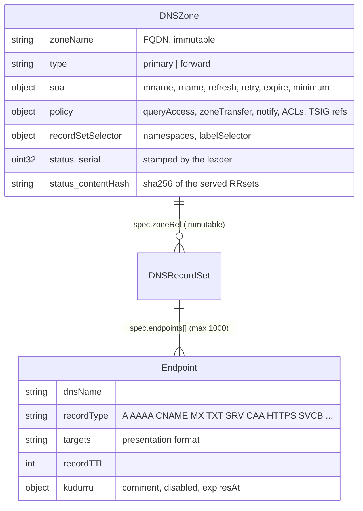
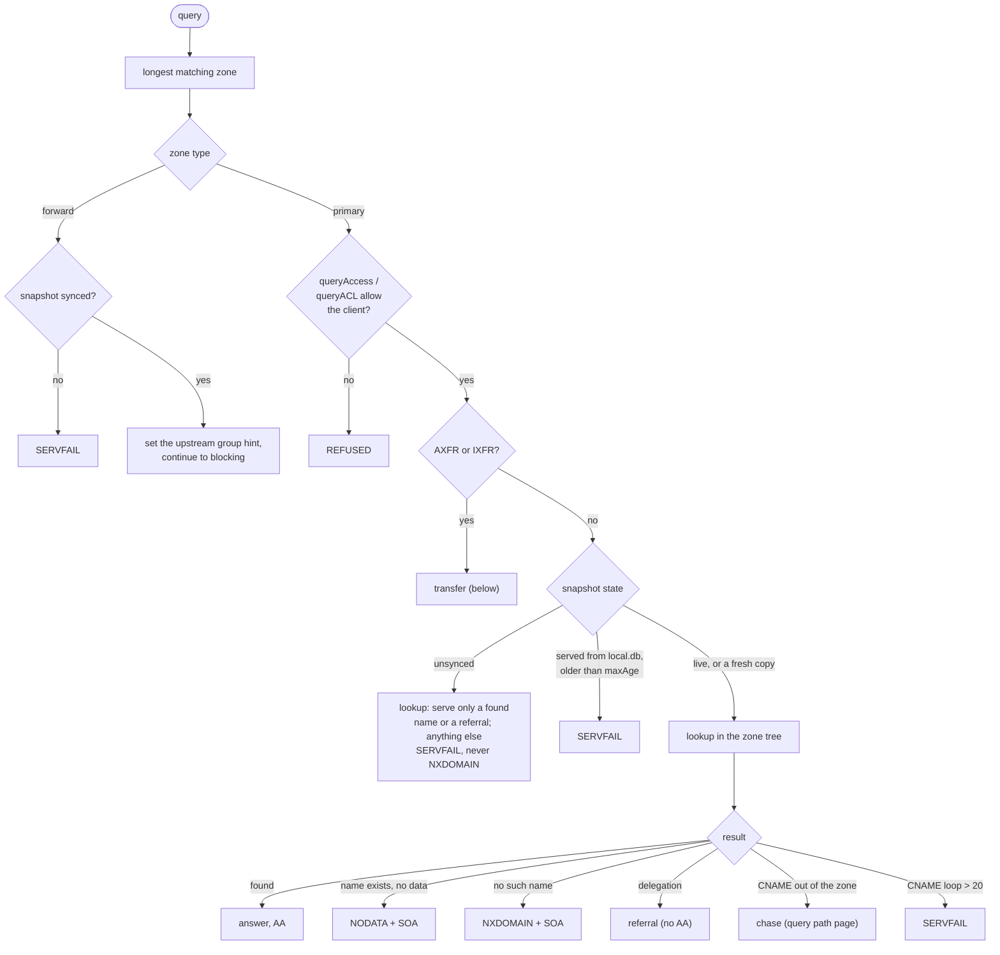
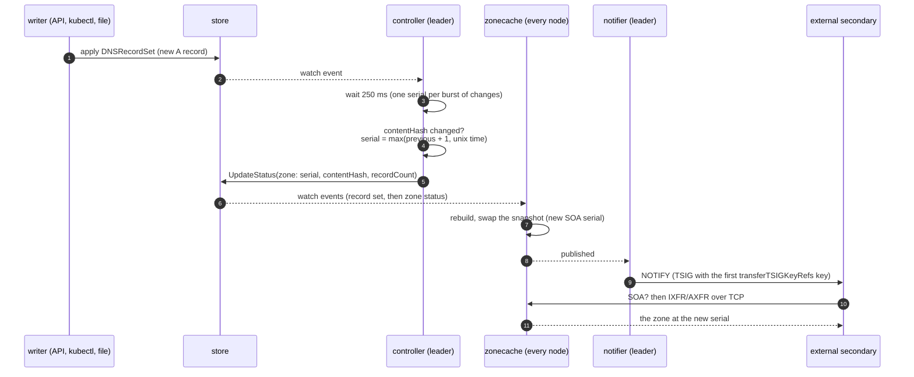

# Zones and transfers

A `DNSZone` is a grant of authority: kudurru answers for every name at or
below its apex. Records do not live in the zone object; they live in
`DNSRecordSet` objects that point at the zone, so an application team can
own its own records without owning the zone. The zone is the stone; the
record sets and the copies held by secondaries are the clay copies.

Code: `api/v1alpha1/dnszone_types.go`, `dnsrecordset_types.go`,
`internal/zone` (the tree, lookups, transfers), `internal/zoneview` (the
zonecache view), `internal/controller` (status and serials),
`internal/notifier`, `internal/stages/authoritative`.

Only `primary` and `forward` zones are served. The other types in the
schema (`secondary`, `stub`, `external`, `catalog`) are accepted but get
`Ready=False, reason Unsupported`.

Use one DNSZone per canonical apex. If different objects claim the same
apex, the serving builder logs the conflict and retains the previously
served zone for that apex. On cold start the first object by metadata name
wins deterministically. Other zones keep rebuilding, and removing the
duplicate lets the affected zone publish its current data. Cross-object
admission does not reject duplicates, so remove the conflicting object
rather than relying on this fallback.

| Type | kudurru does | Example |
|---|---|---|
| `primary` | answers from its own records, with SOA and serial | `home.example.com.` |
| `forward` | sends the name to an upstream group ([upstreams](upstreams-and-cache.md)) | `corp.example.` → `internal-ad`; the bootstrap root zone `.` → `default` |

## Answering from a zone

The authoritative stage picks the zone with the **longest matching suffix**
and then checks, in order:

The rule "**never NXDOMAIN while unsynced**" matters: a replica that has not
loaded its zones must not tell the world that names do not exist, because
resolvers cache negative answers. Wildcards (RFC 4592) and DNAME are handled
inside the lookup. Records with `disabled: true` or a past `expiresAt` are
left out when the zone is built, and the zone is rebuilt at the next expiry.

`queryAccess` and `zoneTransfer` take one of six modes: `deny`, `allow`,
`allowOnlyPrivate`, `allowOnlyZoneNameServers`, `useNetworkACL` (the ordered
`!`-able CIDR list, first match wins, default deny) and
`zoneNameServersAndACL`.

## Which records are served

Several record sets can feed one zone, from several namespaces. The zone's
`recordSetSelector` says which namespaces and labels may contribute. The
controller and the dataplane apply the same rule, so the content hash always
matches what is served:

1. Order record sets oldest first (creation time, then namespace, then name).
2. An endpoint whose name is not under the apex is dropped: `OutsideZone`.
3. The identity of an endpoint is (name, type, setIdentifier). A later
   record set that repeats an identity loses that endpoint: `Duplicated`.
4. A record set from a namespace the selector does not allow is `NotSelected`;
   one that points at a missing zone is `ZoneNotFound`.

A record set stays `Ready` while at least one of its endpoints is served;
dropped endpoints raise `Degraded` with the reason.

## Serials

Replicas never compute a serial. The leader's controller stamps it into the
zone's status, and every node serves `status.serial`.

The serial follows the rule `max(prev + 1, unix_now)` in RFC 1982
arithmetic, and changes only when the hash of the canonical RRsets (with the
SOA serial zeroed) changes, so a no-op write never bumps it. Because NOTIFY
waits for the publish, a secondary is never told about a serial that the
node does not serve yet.

## NOTIFY out

The notifier runs on the leader. It fires after every published snapshot,
and on gaining leadership it notifies every zone once.

- Targets: `notifyTargets` (modes `specified`, `both`) plus the apex NS
  hosts other than the SOA MNAME (modes `zoneNameServers`, `both`),
  resolved through in-zone glue or the resolver.
- Each target gets up to 5 attempts with backoff from 2 s to 1 minute; a
  newer serial replaces a round in progress.
- The source address is `notify.source`. In Kubernetes, NOTIFY leaves from
  the leader pod and is usually SNAT'ed, so the secondary must allow the
  node or egress address, not the Service address.

## Transfers out

| Request | Over UDP | Over TCP / DoT |
|---|---|---|
| AXFR | REFUSED | the full zone, SOA first and last, in ~64 KiB messages |
| IXFR, client serial current | one SOA | one SOA |
| IXFR, client serial older | one SOA (the client retries over TCP) | the full zone in AXFR form (there is no journal yet) |

A transfer needs `zoneTransfer` to allow the client address and, when
`transferTSIGKeyRefs` is set, a request signed with one of those keys. TSIG
keys are node settings (`tsigKeys`, write-only), not store objects. While
the snapshot is not open, transfers answer SERVFAIL. Every message of a
signed transfer is signed.

## Not built yet

Secondary and stub zones (transfers in), NOTIFY in, dynamic UPDATE
(RFC 2136), an IXFR journal, catalog zones and DNSSEC signing are planned.
Today any opcode other than QUERY is answered NOTIMP at ingress.
