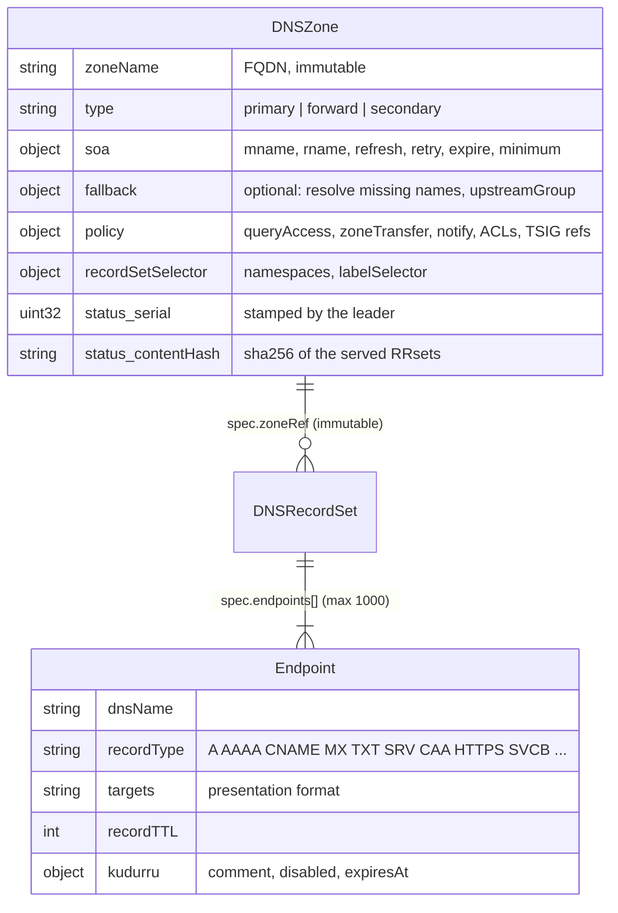
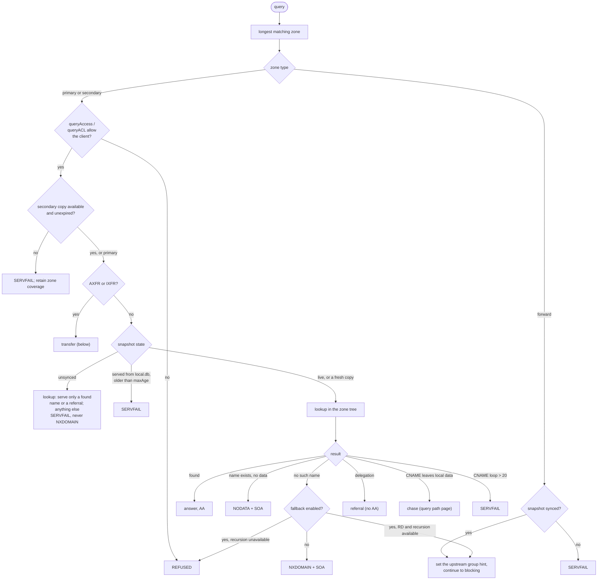
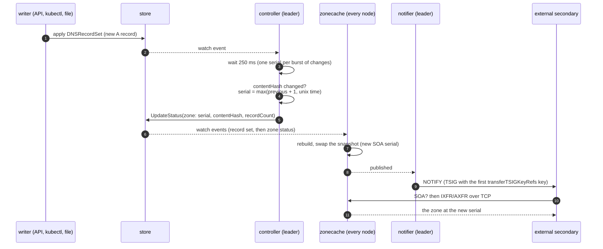
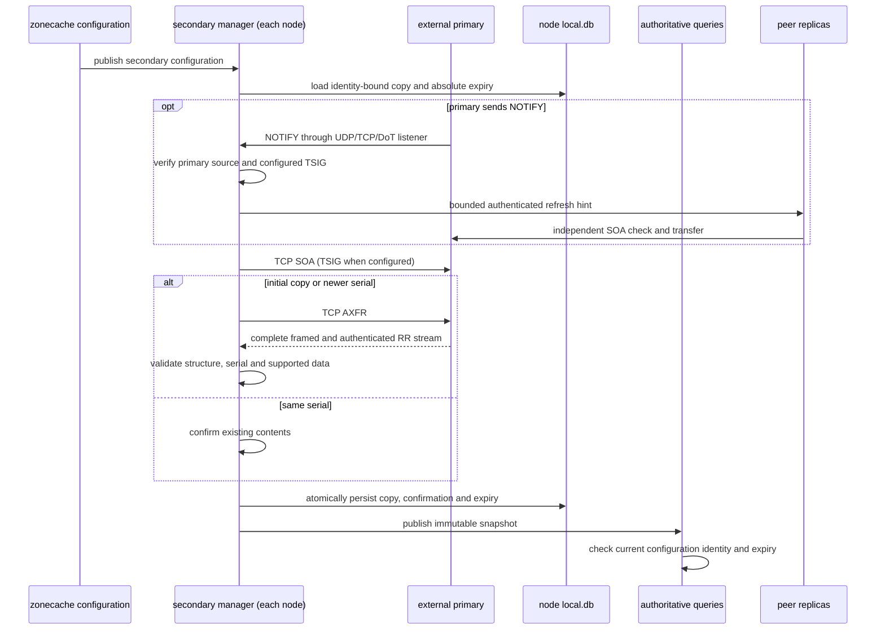

# Zones and transfers

A primary `DNSZone` normally grants authority for every name at or below
its apex. An opt-in `spec.fallback` makes it a local overlay: absent names
continue through resolver routing. Records do not live in the zone object; they live in
`DNSRecordSet` objects that point at the zone, so an application team can
own its own records without owning the zone. The zone is the stone; the
record sets and the copies held by secondaries are the clay copies.

Code: `api/v1alpha1/dnszone_types.go`, `dnsrecordset_types.go`,
`internal/zone` (the tree, lookups, transfers), `internal/zoneview` (the
zonecache view), `internal/controller` (status and serials),
`internal/notifier`, `internal/secondary` (independent inbound transfers and
durable copies), `internal/stages/authoritative`.

Primary, forward, and unsigned secondary zones are served. The other types in
the schema (`stub`, `external`, `catalog`) are accepted but get
`Ready=False, reason Unsupported`.

Use one DNSZone per canonical apex. If different objects claim the same
apex, the serving builder logs the conflict and retains the previously
served zone for that apex. On cold start the first object by metadata name
wins deterministically. Other zones keep rebuilding, and removing the
duplicate lets the affected zone publish its current data. Cross-object
admission does not reject duplicates, so remove the conflicting object
rather than relying on this fallback.

| Type | kudurru does | Example |
|---|---|---|
| `primary` | answers from its own records, with SOA and serial | `home.example.com.` |
| `forward` | sends the name to an upstream group ([upstreams](upstreams-and-cache.md)) | `corp.example.` → `internal-ad`; the bootstrap root zone `.` → `default` |
| `secondary` | transfers an external primary's data independently on each node | `partner.example.` from `192.0.2.53:53` |

## Answering from a zone

The authoritative stage picks the zone with the **longest matching suffix**
and then checks, in order:

The rule "**never NXDOMAIN while unsynced**" matters: a replica that has not
loaded its zones must not tell the world that names do not exist, because
resolvers cache negative answers. Wildcards (RFC 4592) and DNAME are handled
inside the lookup. Records with `disabled: true` or a past `expiresAt` are
left out when a primary zone is built, and the zone is rebuilt at the next
record expiry. Alias targets reselect the most specific configured zone before
continuing, including a secondary nested under a primary. An unavailable
secondary cannot be bypassed by a parent wildcard or the root forwarder.

`queryAccess` and `zoneTransfer` take one of six modes: `deny`, `allow`,
`allowOnlyPrivate`, `allowOnlyZoneNameServers`, `useNetworkACL` (the ordered
`!`-able CIDR list, first match wins, default deny) and
`zoneNameServersAndACL`.

## Local overrides with fallback

`spec.fallback: {}` on a primary zone enables resolution of missing names
using ordinary client-policy, conditional and default-group routing.
`spec.fallback.upstreamGroup` selects a group instead, with the same
precedence as a forward zone's group. Either group mode (`forward` or
`recursive`) works. Continuation starts after the authoritative stage,
so native recursion consults the public DNS tree without reentering the
overlay. Fallback queries still pass through blocking and the response cache.

Only absent names fall back. An existing name, an empty non-terminal or a
wildcard match without the requested type answers NODATA locally. Generated
apex SOA/NS (and management ANY queries) stay local, but other apex types
fall back until a record set explicitly defines the apex. Disabled, expired
and view-withheld records are absent and do not suppress fallback. More
specific zones still win. ACL refusals and stale/unsynced snapshots never
trigger public fallback; a missing name queried without RD is REFUSED.

Local CNAME/DNAME chains can continue to a missing target through its
zone's fallback group. Mixed local/public answers clear AA and AD and do
not claim DNSSEC validation for the whole chain. Public-only answers retain
their normal DNSSEC state, including validation failures and extended errors.

Every lookup checks local data before the response cache, so adding a local
override immediately masks cached public answers for that name and its
missing types. A specific non-default group bypasses that cache as for
forward zones. Fallback settings participate in the content hash and serial
so edge packet caches are flushed when routing changes. Transfers and
NOTIFY are disabled for overlay zones: an ordinary secondary cannot reproduce
the missing-name behavior from an AXFR. BIND exports contain only local data
and do not encode fallback settings.

## Which records are served

Several record sets can feed one primary zone, from several namespaces. The zone's
`recordSetSelector` says which namespaces and labels may contribute. The
controller and the dataplane apply the same rule, so the content hash always
matches what is served:

1. Order record sets oldest first (creation time, then namespace, then name).
2. An endpoint whose name is not under the apex is dropped: `OutsideZone`.
3. The identity of an endpoint is (name, type, setIdentifier). A later
   record set that repeats an identity loses that endpoint: `Duplicated`.
4. A record set from a namespace the selector does not allow is `NotSelected`;
   one that points at a missing zone is `ZoneNotFound`.

A record set stays `Ready` while at least one of its endpoints is served;
dropped endpoints raise `Degraded` with the reason.

## Serials

For primary zones, the leader's controller stamps the serial into the zone's
status, and every node serves `status.serial`. Secondary copies retain the
external primary's SOA and serial, including serial zero and RFC 1982 wrap.

The serial follows the rule `max(prev + 1, unix_now)` in RFC 1982
arithmetic, and changes only when the hash of the canonical RRsets (with the
SOA serial zeroed) changes, so a no-op write never bumps it. Because NOTIFY
waits for the publish, a secondary is never told about a serial that the
node does not serve yet.

## NOTIFY out

The notifier runs on the leader. It fires after every published snapshot,
and on gaining leadership it notifies every zone once.

- Targets: `notifyTargets` (modes `specified`, `both`) plus the apex NS
  hosts other than the SOA MNAME (modes `zoneNameServers`, `both`),
  resolved through in-zone glue or the resolver.
- Each target gets up to 5 attempts with backoff from 2 s to 1 minute; a
  newer serial replaces a round in progress.
- The source address is `notify.source`. In Kubernetes, NOTIFY leaves from
  the leader pod and is usually SNAT'ed, so the secondary must allow the
  node or egress address, not the Service address.

## Transfers out

| Request | Over UDP | Over TCP / DoT |
|---|---|---|
| AXFR | REFUSED | the full zone, SOA first and last, in ~64 KiB messages |
| IXFR, client serial current | one SOA | one SOA |
| IXFR, client serial older | one SOA (the client retries over TCP) | the full zone in AXFR form (there is no journal yet) |

A transfer needs `zoneTransfer` to allow the client address and, when
`transferTSIGKeyRefs` is set, a request signed with one of those keys. TSIG
keys are node settings (`tsigKeys`, write-only), not store objects. While
the snapshot is not open, transfers answer SERVFAIL. Every message of a
signed transfer is signed.

## Secondary copies

Every replica runs `secondary.Manager`; it does not depend on leadership.
Configuration and query ACLs come from the normal zonecache snapshot. Raw
transferred records never become `DNSRecordSet` objects.

The primary's SOA controls refresh, retry and expire. Failed or incomplete
transfers retain the previous copy until its original deadline. For an
unexpired copy, same-serial SOA confirmation renews expiry; loading from disk,
restarting or failing a refresh never does. At expiry the configured zone remains
in suffix matching and answers SERVFAIL. Recovery after expiry always requires a new AXFR, even
if the serial is unchanged. The obsolete local serial no longer prevents
recovery from a primary restored to an older serial; the new transfer must
still be at least as current as its authenticated SOA poll. Configuration older
than zonecache's `maxAge` also fails closed, even if transferred records have
not expired.

The versioned, checksummed `local.db` envelope binds records to object UID and
complete spec, a fingerprint of the selected TSIG credential, and a cluster
anchor derived from the cluster encryption key. A changed configuration,
recreated object, rotated encryption key or changed TSIG secret requires a
fresh transfer. Persisted copies require a persistent node data directory;
replacing an ephemeral volume loses that node's copy. Data is committed before
publication. Queries only read immutable memory, with no database/network I/O.

Transfers use the configured primary order, bounded concurrency (four zones),
a ten-second deadline per exchange, one million records and 64 MiB of wire
and expanded DNS data. Invalid framing, SOA mismatches, out-of-zone records,
serial regression, missing/invalid configured TSIG and size limits reject the
whole candidate. TCP is currently supported; configured TLS is diagnosed and
never silently downgraded. The data model preserves DNSSEC and unknown RRs,
but the runtime rejects signed zones until signature/proof response assembly
is implemented. IXFR remains a subsequent slice.

Inbound NOTIFY reaches the authoritative opcode handler through ingress. It
requires an exact secondary apex, an address belonging to a configured primary,
and the configured transfer TSIG key when present. Numeric primaries match
directly; hostname addresses refresh off the request path every 30 seconds and
expire after two minutes even during lookup failures. Key and source checks
are conjunctive. DoH/DoQ/DoH3 and synthetic API requests cannot submit hints.

Accepted hints coalesce in a bounded queue and cause at most one SOA check per
second per zone. A hint received during a transfer schedules another check.
An authenticated `/internal/events` POST fans the configuration identity to
peer replicas; those replicas only trigger their local manager and never
rebroadcast. Four bounded workers handle fan-out. Failed/dropped hints are
counted, and ordinary refresh/retry timers remain the recovery path. Neither
a hint nor its advertised serial changes data, confirmation, or expiry.

Shared secondary status has `Ready=Unknown`, reason `PerNodeTransfer`; the
controller clears legacy primary serial/hash/count fields. Zone API responses
and the dashboard show `secondaryRuntime` for the responding node, including
the last copy's serial, confirmation, expiry, next attempt and failures. An
expired serial describes retained data, not data currently served. The messages
API and `kudurru_secondary_*` metrics expose local failures and availability.
An unavailable secondary does not make an otherwise healthy node unready.
Duplicate configured apices publish unavailable coverage instead of retaining
an old routing view; unrelated zones continue to receive configuration updates.

## Not built yet

Stub zones, IXFR in, verified TLS transfers, signed secondary serving, dynamic UPDATE
(RFC 2136), an IXFR journal, catalog zones and DNSSEC signing are planned.
UPDATE reaches its reserved authoritative callback, which answers NOTIMP until
the atomic update handler is installed. Unknown opcodes remain NOTIMP.
