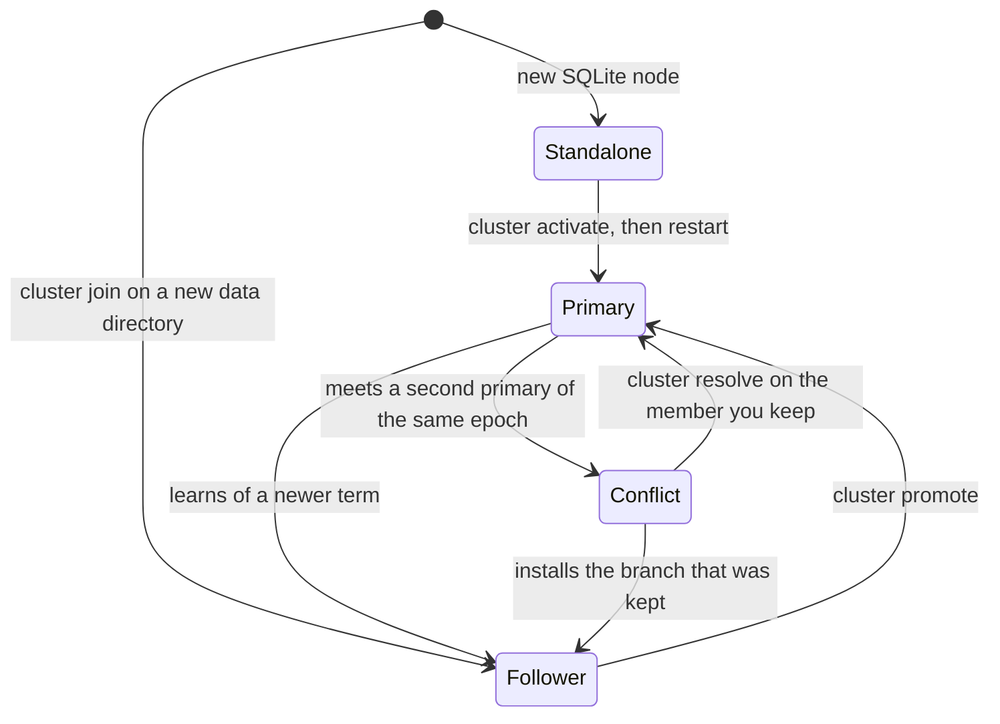

# Enrolled SQLite cluster: one primary and its followers

An enrolled cluster is a group of SQLite nodes (containers, packages or plain
binaries, no Kubernetes) that share one configuration. One member, the
*primary*, accepts every change. The other members, the *followers*, copy the
primary's complete state over the internal listener every five seconds and
answer DNS from their own copy, also while the primary is away. Nothing is
elected: when the primary is lost, an operator promotes a follower.

| | Static twins ([compose-ha.md](compose-ha.md)) | Enrolled cluster (this page) | Kubernetes ([helm.md](helm.md)) |
|---|---|---|---|
| Changes through the API and the dashboard | refused (`503 read_only`) | accepted by the primary; a follower forwards some of them | accepted by every replica |
| How the members get the same data | your tooling copies `kudurru.yaml` and `objects.d/` to every node | followers pull from the primary | the Kubernetes API |
| When the writing node is lost | there is none; every node is its own leader | an operator promotes a follower | a new leader is elected |

This page follows a cluster through its life: activate the first primary, add
followers, promote a follower, take the old primary back and recover from two
promotions. [sqlite-join.md](sqlite-join.md) has the details of the join step
and of the recovery procedures.



`mode` in the answer of `kudurru cluster enrollment` shows where a member is.

## Before you start

- **The same encryption key on every member, set explicitly.** Set
  `KUDURRU_ENCRYPTION_KEY_FILE` (or `KUDURRU_ENCRYPTION_KEY`) to the same value
  on every member. A single node that was started without one generated its
  key in `<node.dataDir>/keys/encryption.key`: use the content of that file for
  the other members. The offline join command refuses to run without the
  variable. A follower that is started without it generates a key of its own:
  it reports ready and answers DNS from the data it has, but it receives
  nothing new from the primary until you set the variable and restart it.
- **SQLite store, not static.** `store.driver` is `sqlite` and `cluster.role`
  is `auto` (both defaults). A node with `cluster.role: static` refuses these
  commands, and it refuses to start on a database that is already enrolled.
- **A name and a reachable internal address for every member.** A member name
  has up to 63 lowercase letters, digits and hyphens; use the member's
  `node.name`. The members reach each other on the internal listener
  (`listeners.internal.address`, TCP port 8082 by default, always TLS). You
  give each member's address as `host:port` when you activate or invite it.
  No command changes a name or an address later.
- **A license key that covers the members.** Without a key kudurru is
  licensed for one node; a cluster needs a key that covers its number of
  nodes ([LICENSING.md](../../LICENSING.md)). Put the key on every member.
  DNS answering never depends on the license.
- **An administrator and a token for every member.** The commands need the
  `admin` role (`cluster.read`, `cluster.join` and `cluster.promote`). Create
  an API token on the primary and save one CLI context for each member with
  it, for example
  `kudurru login --server https://node-b.example:8080 --name node-b --token-stdin`.
  A follower accepts a new token after its next pull, and it checks a token
  itself, also while the primary is away. Do not plan to sign in to a
  follower with a password: `kudurru login --username` and a password
  sign-in in the browser work against a follower, but the follower forwards
  them, and the CLI's token creation, to the primary, so they work only while
  the primary is reachable and fail in the very situation in which you want
  to promote.
- **Synchronized clocks.** An invitation is valid for at most ten minutes, and
  the members authenticate each other with certificates.

The examples use three members: `node-a` (10.0.0.11), `node-b` (10.0.0.12)
and `node-c` (10.0.0.13).

## 1. Activate the first primary

A new SQLite node is a *dormant standalone* owner: it has a cluster identity
but no members. Activation makes it the first member and the primary.

1. On the node that has the data you want to keep, read the enrollment state:

   ```sh
   kudurru --context node-a cluster enrollment
   ```

   ```yaml
   clusterID: 4adbbe69-f1a3-4ff7-bc83-6176229687d7
   dormant: true
   memberID: 7ed8a22b-7653-497c-834c-2e347b32e977
   mode: standalone
   ownerDigest: e0c57dff...   # 64 hexadecimal digits
   sourceDigest: d8f29605...  # 64 hexadecimal digits
   ```

2. Pass the four identity values back with the member's name, its internal
   address and a reason for the audit log:

   ```sh
   kudurru --context node-a cluster activate \
     --cluster-id 4adbbe69-f1a3-4ff7-bc83-6176229687d7 \
     --member-id 7ed8a22b-7653-497c-834c-2e347b32e977 \
     --source-digest d8f29605... --owner-digest e0c57dff... \
     --name node-a --address 10.0.0.11:8082 \
     --reason "start the cluster"
   ```

   The answer is `committed: true` and `restartRequired: true`.

3. Restart kudurru on that node. Until the restart the node works as before,
   and `cluster enrollment` already shows `mode: primary`, but the member
   listener is not running: `cluster promotion` answers `503 unavailable`.
   After the restart it answers with `reason: not_follower`.

The command sends one request with a lifetime of 30 seconds and never repeats
it. The digests describe the state you reviewed: any change between the two
commands answers `409 conflict`, and you read the enrollment again. If the
answer is lost or is `503 completion_unknown`, the activation may have
happened: read the enrollment and decide from what it shows. Do not send the
same command again without looking.

Activate at a quiet moment. While the node switches to the new state, a query
that arrives in that instant can be answered `SERVFAIL`.

Activation writes the member's private identity to
`<node.dataDir>/member-identity.json`. Keep this file with the database, also
in backups, and never copy it to another member.

## 2. Add a follower

The primary issues an invitation for one exact member name and address. The
new member consumes it with an offline command that creates its data
directory.

1. On the primary, read the enrollment again and issue the invitation. The
   digests change with every change of the primary's data, also with every
   activation, invitation and join, so read them immediately before each
   `join-token`. The invitation is a bearer secret: keep it out of logs and
   shell history, and send it over a private channel.

   ```sh
   umask 077
   kudurru --context node-a cluster enrollment
   kudurru --context node-a -o json cluster join-token \
     --cluster-id 4adbbe69-f1a3-4ff7-bc83-6176229687d7 \
     --member-id 7ed8a22b-7653-497c-834c-2e347b32e977 \
     --source-digest 2b076341... --owner-digest 22a58129... \
     --name node-b --address 10.0.0.12:8082 \
     --expires-at "$(date -u -d '+5 minutes' +%Y-%m-%dT%H:%M:%SZ)" \
     --reason "add node-b" > node-b-invitation.json
   ```

   `--expires-at` is an absolute time at most ten minutes ahead; a later time
   answers `409 conflict`, like an outdated review. Save the answer as JSON:
   the join command reads the JSON receipt or the bare invitation text.

2. On the new member, with kudurru stopped, the shared encryption key in the
   environment and a data directory that does not exist yet:

   ```sh
   kudurru cluster join --offline \
     --data-dir /var/lib/kudurru \
     --invitation-file /run/private/node-b-invitation.json \
     --confirm-name node-b --confirm-address 10.0.0.12:8082
   ```

   The result is JSON. Require `"committed": true` under `primary` and an
   `installed` generation with a `digest`.

3. Start kudurru on the new member with that data directory, the same
   `node.name` and internal address, the encryption key and the license key.
   Delete the invitation file.

[Join a new SQLite receiver](sqlite-join.md) explains every check of the join
command, what a failed join leaves behind and how
[`cluster join-reconcile`](sqlite-join.md#recover-an-incomplete-join) completes
a join whose first data copy did not arrive. Repeat the three steps for each
further follower.

## 3. Check the members

- `kudurru --context node-b cluster enrollment` shows `mode: follower` on a
  follower and `mode: primary` on the primary. All members show the same
  `clusterID`.
- Ask every member for a name of one of your zones, for example
  `dig @10.0.0.12 nas.home.example`. A follower answers a change made on the
  primary after its next pull, normally within a few seconds.
- `kudurru --context node-b cluster promotion` shows how the follower sees
  the primary: `missedPulls: 0` and `reason: awaiting_missed_pulls` while the
  primary answers.

`kudurru cluster status` shows the role of the node that answers in its
`ROLE` column (`primary`, `follower` or `standalone`), and on a follower
`LEADER` names the primary. It counts only the node that answers (`NODES`
is `1`), and `kudurru nodes` lists only that node. `cluster enrollment`
shows the member's identity and mode.

A follower keeps answering DNS from the last state it installed for as long as
the primary is unreachable, and it does so again after a restart.

## 4. Changes through a follower

Send changes to the primary when you can. A follower makes no change itself.
It passes a number of write requests on to the primary, each one once and
without a retry, and returns the primary's answer:

- writes of zones, record sets, block lists, client groups and policies from
  the dashboard, `kudurru delete` and `kudurru apply`;
- the record commands of a zone, such as `kudurru records add`;
- turning blocking off and on (`kudurru blocking disable`);
- a password sign-in in the browser;
- sign-out and revoking one of your own sessions;
- a change of the cluster settings (`kudurru settings set` of a cluster
  key, the dashboard's Settings page).

A follower runs a few commands itself, such as flushing its cache and
promotion. Every other change answers `503 primary_required` on a follower
and is not sent anywhere, for example a node setting (`log.level`), a user,
an API token, an authenticator or a stored TSIG key: make it on the primary.
[What a follower forwards, runs itself and refuses](sqlite-join.md#what-a-follower-forwards-runs-itself-and-refuses)
lists the routes, and [commands through a follower](sqlite-join.md#commands-through-a-follower)
explains the answers. A follower serves a change that
it passed on after its next pull, so a read immediately after the write can
still show the previous state.

| Answer of a follower | Meaning | What to do |
|---|---|---|
| `503 primary_required` | The change was not made: the follower does not pass this kind of change on. The message names the primary. | Make the change on the primary. |
| `503 unavailable` | The change was not made: the follower's data changed while the request ran ("the follower's source changed"), the primary refused it because the cluster's authority changed ("cluster authority changed"), or the request's 30-second lifetime ended. | Read the current state, then make the change on the primary. |
| `503 completion_unknown` | The follower did not receive the primary's answer and cannot say whether the change was made. This is also the answer while the follower cannot reach the primary. | Read the object, on the primary when you can, before you decide anything else. |

`kudurru apply` and `kudurru restore` send all their documents in one
request and report a result for each document. Deleting several objects at
once in the dashboard works the same way, with a result for each name.

- On the primary, one request applies every document. The same holds for a
  node that is not in a cluster. Each document is its own commit. DNS keeps
  answering throughout, for the node's own zones too, from the configuration
  the node published last; a document becomes visible in DNS when the node
  has published it. The same holds for every API write: right after a
  write is acknowledged, DNS can still answer the previous data (or
  `NXDOMAIN` for a new name, which resolvers may cache negatively), and a
  node that cannot publish keeps answering it, deleted records and zones
  included, until it can. Such a node reports `prepare_failed` in
  `kudurru health --ready` (`/healthz/ready` on the ops port) and logs
  `complete serving generation not published`. Other API requests, reads included, need a publication
  of everything committed so far and wait up to two seconds for one before
  they answer `503 generation_pending` (retry after one second). The request
  therefore pauses: when another caller's read (`GET` or `HEAD`) waits, and
  in any case after two seconds of work, it waits until the node has published the documents
  applied so far, then commits nothing for 200 milliseconds, and goes on.
  A read counts before the node checks its credential, so any client that
  can reach the API, signed in or not, can make the request pause at every
  document. The pauses are bounded either way: a request spends at most
  about as long in them as in its own work, so they make it at most about
  twice as slow. A waiting read is served whenever the node publishes within its two
  seconds. Measured on a shared test machine: 120 new record sets took 6
  seconds with a second caller reading all the time; DNS answered the whole
  time (the longest gap between two answers was typically under 0.1
  seconds, with an occasional single dropped query of about 0.3 seconds and,
  once in about 100 runs, an unexplained gap of 1.4 seconds; the zone never
  answered SERVFAIL) and every read succeeded. Under heavy
  load (race detector) the same request took about 2 minutes, DNS still
  answered throughout (no gap above 0.14 seconds), but one publication took
  several seconds, and most reads were refused. Split very large files
  (many hundreds of documents), or apply them when other API callers can
  wait.
- If something else is changed on the node while the request runs, the
  request stops at that point: every later document reports `unavailable`
  ("another change was committed on this node while the request ran") and is
  not applied, and the documents before stay applied. Such a change is
  another request that the node admitted in one of the pauses (a request
  that changes something or a sign-in), a change that a follower passes on,
  or a background command of the node, such as a migration step or an
  operator-started integration operation. The node's own work on the
  documents of the request, such as writing their status or a zone's
  published state, does not stop it. Neither do RFC 2136 updates, a
  command of the local admin socket, the declarative objects source or the
  node's provider and integration reconciliation, although they are made by
  someone else: the request does not detect them. Run the command again: it
  reports the documents that are already applied as `unchanged` and applies
  the rest.
- A request that begins while the node is still publishing other work can
  be refused as a whole before its first document: it answers `503
  generation_pending`, or every document reports `unavailable` ("current
  writable serving generation unavailable"). Nothing was applied. Send the
  same request again. Two such requests at the same time usually end this
  way for one of them; the dashboard therefore sends one request per
  namespace one after another.
- `kudurru apply` and `kudurru restore` wait up to five minutes for the
  answer, as long as the node lets one request run; other commands keep the
  30-second default of `--request-timeout`. An item that is reached after
  the five minutes reports `unavailable` ("the request's lifetime ended
  before this item was reached; it was not applied"). If you pass a shorter
  `--request-timeout` and it ends first, the command reports a failed
  request while the node goes on applying until it notices; read the
  objects before you decide anything else.
- Through a follower, a request applies documents until the follower's data
  changes. That happens at the follower's next pull after the primary has
  received the first document, at most five seconds later by default. The
  follower refuses every later document with `unavailable` ("the follower's
  source changed"), and the documents before stay applied. A file of a few
  documents usually fits between two pulls. A longer file does not, and
  repeating the command through the follower does not reliably finish it:
  the follower passes the documents that are already applied on again, and
  the primary records each of them, so the follower's data changes again at
  its next pull. In two test runs with 200 new record sets, the first run
  through a follower applied 15 and 116 of them, and four repeats through
  the follower added 107 and 0 more; the same file sent to the primary
  then applied the rest in one run.

Send a file of many documents, and every restore, to the primary.

RFC 2136 updates are not passed on: send them to the primary
([dynamic-updates.md](dynamic-updates.md#enrolled-sqlite-cluster)).

## 5. Promote a follower

Promote a follower only when the primary is lost or cut off and is going to
stay that way for now. kudurru does not do this by itself.

CAUTION: Promote one follower only, and make sure that the old primary is
really stopped or isolated. Promotion raises an epoch number; it is not a
vote among the members. If two followers are promoted while they cannot see
each other, both accept changes, and you must later
[discard one of the two branches](sqlite-join.md#recover-from-conflicting-promotions).

1. On the follower you chose, save the promotion review. Use the token-based
   context you prepared.

   ```sh
   kudurru --context node-b -o json cluster promotion > promotion-review.json
   ```

   Read the file. It names the `node`, the `installed` generation that
   becomes the new primary's data, and the eligibility:

   | `reason` | Meaning |
   |---|---|
   | `eligible` | The primary has been unreachable from this follower for two pulls in a row and at least ten seconds, and the follower serves the data it installed. |
   | `awaiting_missed_pulls` | The primary still answers, or it has been unreachable for less than that. A follower whose pulls are refused, for example because its encryption key is wrong, also stays here. |
   | `serving_generation_pending` | The follower has installed data that it does not serve yet. Wait and review again. |
   | `fenced` | The member has recorded a newer primary, a conflict or a divergence. It cannot be promoted. |
   | `no_installed_image` | The member has no complete copy of the current term. |
   | `not_follower` | The member is not a follower (for example it already is the primary). |

2. If `eligible` is `true`, promote with that exact review:

   ```sh
   kudurru --context node-b cluster promote --review promotion-review.json \
     --confirm-node node-b --request-id promote-node-b-2026-11-10 \
     --reason "node-a lost its disk"
   ```

   `--confirm-node` must be the `node` of the review. The answer contains
   `committed: true` and the new `term`: its `epoch` is one higher than before
   and its `primaryName` is this member.

3. Check that `cluster enrollment` on that member shows `mode: primary`. No
   restart is needed. For a moment after the promotion the API of the member
   can answer `503 generation_pending`; ask again after a second. Point the
   dashboard, the CLI and your automation at the new primary.

The server checks everything again when it receives the command: your
permission, that the follower still serves the reviewed generation, and that
the primary has stayed unreachable. `409 conflict` means that one of these no
longer holds, or that the review was already used: take a new review. The
command has one lifetime of 30 seconds and is never repeated. After a lost
answer or `503 completion_unknown`, read `cluster enrollment` before you
decide anything else.

The promoted member tells the other members about its new term in its
scheduled exchanges with them. A follower that receives it pulls from the new
primary from then on.

## 6. When the old primary returns

Start the old primary again with its own data directory and its
`member-identity.json`. Do not join it again and do not delete anything. In
an exchange with the other members it learns of the newer term, stops
accepting changes for good, and then installs the new primary's state like
any follower: within seconds `cluster enrollment` on it shows
`mode: follower`.

Changes that only the old primary accepted after the followers lost contact
with it are not part of the new primary's data, and nothing replays them.
Make them again on the new primary if you still need them.
[Reconnecting an old primary](sqlite-join.md#reconnecting-an-old-primary) has
the details.

## 7. After two promotions

If two followers were promoted at the same epoch, both record a conflict when
they reconnect. Such a member refuses changes, closes its API (requests
answer `503 generation_pending`) and keeps answering DNS from its last valid
data, also after a restart. Nothing picks a winner.
Choose the member whose data is to survive and follow
[Recover from conflicting promotions](sqlite-join.md#recover-from-conflicting-promotions):
`cluster resolution --offline` and `cluster resolve --offline` on that one
member, with kudurru stopped.

A member that was fenced by a newer term but never took that term's data (an
old primary that returned too late, or one that refuses the primary's managed
trust-anchor state) cannot be promoted. If the primary of that term and every
member that followed it are lost for good, the same two commands keep that
member's data under a new term when you also name the lost term with
`--abandon-term`:
[Keep a fenced member's data when its primary is lost for good](sqlite-join.md#keep-a-fenced-members-data-when-its-primary-is-lost-for-good).

## Limits of this version

- There is no automatic failover and no election. A lost primary means no
  configuration changes until an operator promotes a follower; DNS keeps
  working on every member.
- No command removes a member from the cluster or changes a member's name or
  address. A cluster has at most 64 members.
- A cluster keeps a record of every invitation it issued, also of expired
  and used ones, and holds at most 64. After that `join-token` answers
  `503 unavailable`, and a restart does not change it. Issue invitations
  deliberately.
- `kudurru cluster status`, `kudurru nodes` and the Nodes page do not list
  the members of an enrolled cluster (see [Check the members](#3-check-the-members)).
- A follower does not apply its own `objects:` and `objectsDir` files; file
  objects are loaded by the primary only.
- The process-level tests run all members on one machine
  (`TestEnrolledClusterProcessesPartitionCatchupAndRestart`,
  `TestEnrolledClusterProcessesPromoteAndRejoin` and
  `TestEnrolledProcessConflictResolution` in `test/e2e`). Acceptance on separate
  virtual machines behind a keepalived VIP has not been run and is deferred.

## Answers of the cluster commands

| Answer | Meaning | What to do |
|---|---|---|
| `503 unavailable` on `enrollment`, `activate` or `join-token` | The node is a static twin or uses the Kubernetes store. | These commands exist on nonstatic SQLite nodes only. |
| `503 unavailable` ("authentication operation unavailable") on `join-token` of a primary, also after a wait | The cluster has issued its 64 invitations. | This version has no command that removes invitation records. |
| `503 unavailable` on `promotion` or `promote` | The node is not an enrolled member, or it was activated and not restarted yet. | Activate and restart, or use a member. |
| `409 conflict` | The state changed after your review; the node is not a dormant standalone owner (`activate`) or not the primary (`join-token`); the invitation's name or address belongs to a member, or its expiry is too far ahead; the follower is not eligible (`promote`). | Read the review again and decide again. |
| `503 completion_unknown` | The command may or may not have been committed. | Read `cluster enrollment`. Never repeat the command unseen. |
| `503 committed_output_unavailable` on `join-token` | The invitation was recorded, but its secret could not be returned. | That invitation cannot be used. Read the enrollment again and issue a new one. |
| `503 generation_pending` | The member is publishing a new state (for a moment after a promotion), or it has recorded a conflict (until it is resolved). | Ask again after a second. If it stays, see [After two promotions](#7-after-two-promotions). |
