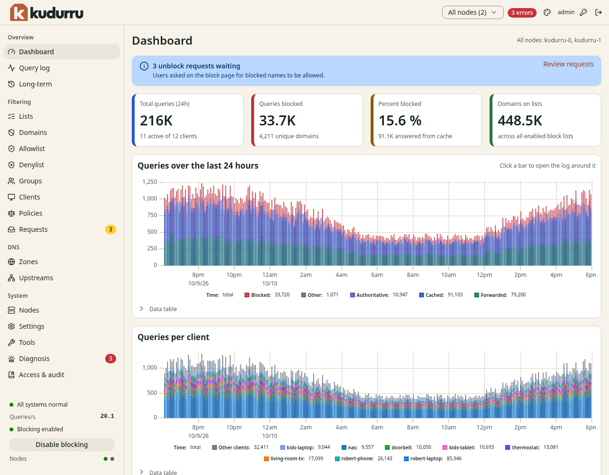

# 1. Overview

This chapter explains the terms of kudurru and the way that it decides what
to do with a query. It also explains the roles and the layout of the
dashboard.

## Terms

| Term | Meaning |
|---|---|
| Node | One running kudurru server. A network can have more than one node. |
| Client | A device that sends queries to kudurru, for example a laptop or a television. |
| Client group | A set of clients. A group matches clients by address, address range, client ID or MAC address. |
| Block list | A list of names that kudurru blocks. |
| Allow list | A list of names that kudurru never blocks. |
| Policy | The rules for one or more client groups: which lists and services apply, how kudurru answers a blocked query, and when. |
| Zone | A part of the DNS name space for which kudurru gives the answers. |
| Record | One DNS entry in a zone, for example an `A` record. |
| Upstream | An external DNS server that kudurru asks when it has no answer. |
| Upstream group | A named set of upstreams with a strategy and a time limit. |
| Block page | A web page that a blocked name can lead to. It explains the block. |
| Request | A message from a user who asks an administrator to allow a blocked name. |

## How kudurru decides

When a client sends a query, kudurru does these steps in this order:

1. It finds the client group of the client. A client that no group claims
   belongs to the group `default`.
2. It finds the policies of the group. If more than one policy is active,
   the policy with the highest priority decides the settings. kudurru
   merges the lists of all the active policies.
3. It answers from your own zone if the name is in one. A block list
   cannot block a name in your own zone.
4. It checks the allow lists. A name on an allow list is never blocked.
5. It checks the block lists and the blocked services. If the name matches,
   kudurru gives the block answer of the policy.
6. It looks in the cache.
7. It asks an upstream group.

kudurru writes each answer to the query log with the reason. Chapter 3 shows
how to read the reason.

## Who manages an object

Every object has one owner. The dashboard shows the owner as a badge. You can change
an object in the dashboard only when its owner is **API**.

| Badge | Meaning | How to change the object |
|---|---|---|
| **API** | You made it in the dashboard, with the command line or with the API. | Use the dashboard. |
| **default** | kudurru made it at the first start. | Use the dashboard. |
| **managed by file** | It comes from a file in the `objects.d` directory. | Change the file. The dashboard is read-only. |
| **managed by Kubernetes** | It is a custom resource in a cluster. | Use `kubectl`. The dashboard is read-only. |

NOTE: A switch or a button for a read-only object is gray. The dashboard
does not hide the object.

## Roles

A role is a set of permissions. An administrator gives a role to each
person. Table 1 shows what each role can do in the dashboard.

| Role | Can read | Can change |
|---|---|---|
| Viewer | Statistics, zones, records, lists, policies, groups, clients, settings | Nothing. A viewer can make API tokens for itself. |
| Auditor | Everything that a viewer reads, and the query log, the access requests and the audit log | Nothing |
| Operator | Everything that an auditor reads, except the audit log | Records, lists, policies, groups, clients, the blocking switch, the cache, the access requests |
| Zone admin | Statistics, and the zones and records in its scope | The zones and records in its scope |
| Admin | Everything | Everything, including settings |

*Table 1. The roles.*

Chapter 9 explains how to give a role to a person.

## The dashboard

Figure 1 shows the dashboard after the first sign-in.

*Figure 1. The dashboard.*

### The navigation list

The navigation list is at the left. It has four sections.

| Section | Pages |
|---|---|
| Overview | **Dashboard**, **Query log**, **Long-term** |
| Filtering | **Lists**, **Domains**, **Allowlist**, **Denylist**, **Groups**, **Clients**, **Policies**, **Requests** |
| DNS | **Zones**, **Upstreams** |
| System | **Nodes**, **Settings**, **Tools**, **Diagnosis**, **License**, **Access**, **Audit Log** |

A number in a red or yellow badge next to a page shows the count of
messages (**Diagnosis**) or of open requests (**Requests**).

The page **License** shows the license of the node. Some pages need a
license key: **Long-term**, **Requests** and the audit log. A page that
needs a key says so. More than one node and more than one policy also need
a key. See [Chapter 13](13-license.md).

### The top bar

The top bar has these items, from left to right:

- **Node scope**: select **All nodes** or one node. The statistics pages
  show the data of the node that you select.
- The message badge, for example **3 errors**. It shows the number of
  diagnosis messages. Click it to open **Diagnosis**.
- The palette icon: open the **Appearance** dialog. It sets the mode, the
  theme and the contrast for this browser.
- Your user name.
- The key icon: change your password.
- The sign-out icon.

### The status area

The status area is at the bottom of the navigation list. It shows:

- **All systems normal**, or a message about a problem
- **Queries/s**: the number of queries in each second
- **Blocking enabled** or **Blocking disabled**, and the button that
  changes it
- **Nodes**: one dot for each node. A green dot means that the node is ready.

### Wizards, pages and dialogs

kudurru uses the same pattern for all the things that you create.

- A **New …** button opens a wizard in a dialog. The wizard has steps. The
  last step is **Review**. kudurru saves nothing until you click the
  button on the **Review** step.
- A **Back** button returns to the step before. Your input stays.
- After you create an object, the dashboard opens the page of the object.
- To change an object later, open its page. Each part of the page has an
  **Edit** button.
- **View as YAML** shows the object as YAML. This is the same text that
  `kudurru apply` accepts.
- **Delete** asks you to confirm before it removes the object.

## Where kudurru keeps its data

| Item | Docker | Kubernetes |
|---|---|---|
| Objects (zones, lists, policies, groups) | `state.db` in the data volume | Custom resources |
| Users, tokens, audit log | `state.db` | Secrets in the cluster |
| Query log | `querylog.db` in the data volume | `querylog.db` on each pod |
| Settings | `kudurru.yaml`, and `settings.yaml` for changes made in the dashboard | ConfigMap |

Chapter 11 explains how to back up this data.
