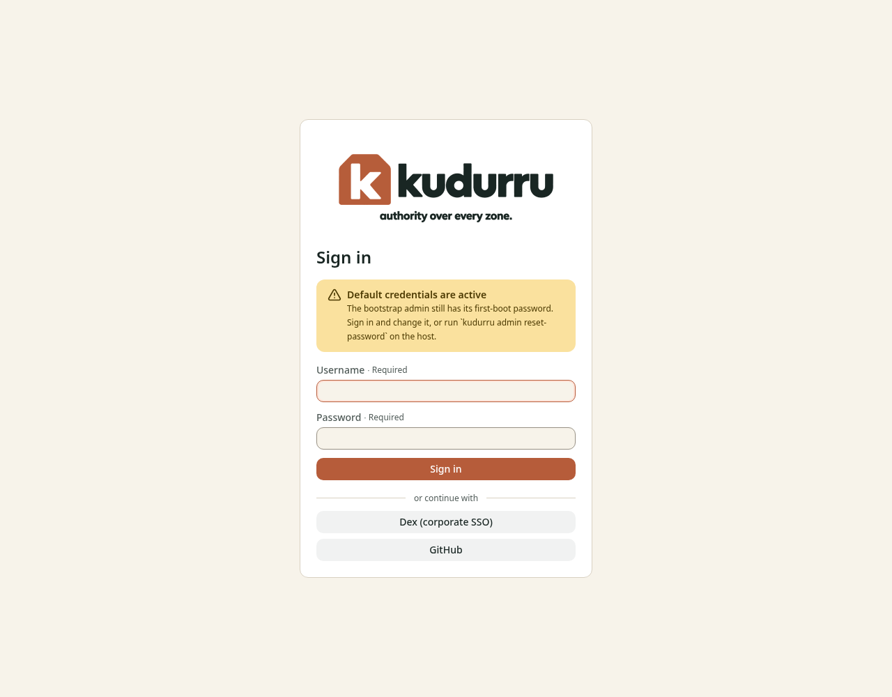
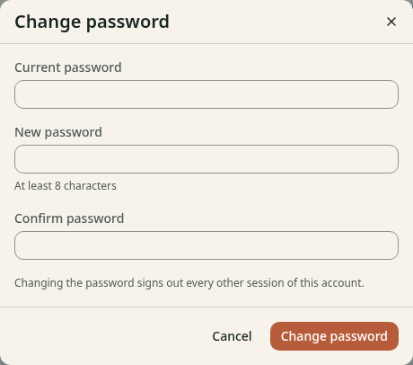
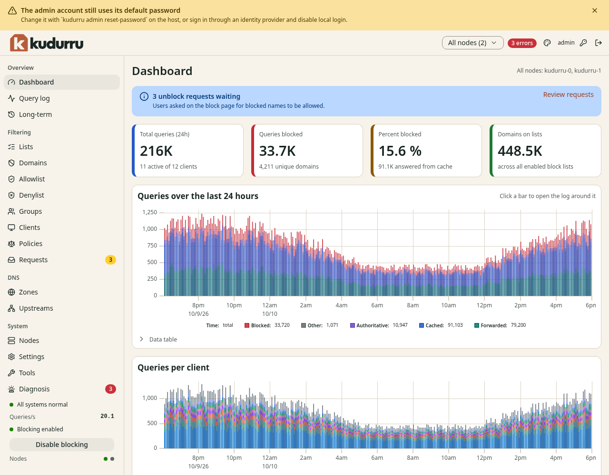

# 2. Install and first sign-in

This chapter shows how to start one kudurru node with Docker and how to sign
in. It also shows how to make the devices on your network use the node.

**Before you start:**

- You have a host with Docker. The host has a fixed IP address.
- Port 53 (UDP and TCP) and port 8080 (TCP) are free on the host.
- You can run commands on the host.

NOTE: This chapter covers the shape with one container. For Kubernetes,
Docker Compose with more than one node, and Linux packages, use the
[deployment guides](../../deploy/README.md). After the node runs, all the
other chapters of this guide apply in the same way.

## Prepare the host

On a host that runs `systemd-resolved`, the stub listener uses port 53.
Turn it off before you start kudurru.

1. Open `/etc/systemd/resolved.conf` in an editor.
2. Set `DNSStubListener=no` in the `[Resolve]` section.
3. Restart the service: `sudo systemctl restart systemd-resolved`.

## Start kudurru

kudurru needs an encryption key. It uses the key to protect sessions and
stored secrets. You also give an initial password for the account `admin`.

1. Make a directory for the secrets:

   ```sh
   mkdir -p kudurru/secrets && cd kudurru
   ```

2. Make the encryption key and the admin password:

   ```sh
   openssl rand -base64 32 > secrets/encryption_key
   openssl rand -base64 18 > secrets/admin_password
   ```

3. Start the container:

   ```sh
   docker run -d --name kudurru --restart unless-stopped \
     -p 53:53/udp -p 53:53/tcp -p 8080:8080 \
     -v kudurru-data:/var/lib/kudurru \
     -v "$PWD/secrets:/run/secrets:ro" \
     -e KUDURRU_ENCRYPTION_KEY_FILE=/run/secrets/encryption_key \
     -e KUDURRU_ADMIN_PASSWORD_FILE=/run/secrets/admin_password \
     ghcr.io/robertherbaugh/kudurru:0.2.0 serve
   ```

4. Make sure that the node is ready:

   ```sh
   docker exec kudurru kudurru health --ready
   ```

5. Ask the node for a name:

   ```sh
   dig @127.0.0.1 example.com
   ```

The command in step 5 shows an answer with the status `NOERROR`.

NOTE: Use the version number of the release that you install. The version
in this guide is an example.

CAUTION: Keep a copy of `secrets/encryption_key` in a safe place. If you
lose the key, kudurru cannot read the secrets that it stored.

NOTE: kudurru runs without a license key. A key unlocks more than one node,
more than one policy and some features. To use a key, add `-e KUDURRU_LICENSE_KEY=<key>` to the
command in step 3. See [Chapter 13](13-license.md).

Without a configuration file, kudurru uses these defaults:

- It listens for plain DNS on port 53.
- It asks the upstreams 1.1.1.1 and 9.9.9.9.
- It blocks the names on the built-in starter list.
- It keeps a query log.

## Use a configuration file

Some settings are for the host only. Examples are the ports and the block
page. You set them in the file `kudurru.yaml`. The container reads the file
at `/etc/kudurru/kudurru.yaml`. Objects that you keep in files go in the
directory `/etc/kudurru/objects.d`.

1. Make the file `kudurru.yaml` in the directory `kudurru`. The file can be
   empty at first.
2. Stop and remove the container:

   ```sh
   docker stop kudurru && docker rm kudurru
   ```

3. Start the container again. Add this line to the command of the section
   [Start kudurru](#start-kudurru), before the image name:

   ```sh
   -v "$PWD/kudurru.yaml:/etc/kudurru/kudurru.yaml:ro" \
   ```

The data is in the volume `kudurru-data`. It stays when you remove the
container. After each change of the file, restart the container with
`docker restart kudurru`.

## Sign in

1. Open `https://<host>:8080/` in a browser. Replace `<host>` with the
   address of the host.
2. If the browser shows a certificate warning, accept it for this visit.
   See the note below.
3. Enter `admin` in **Username**.
4. Enter the content of `secrets/admin_password` in **Password**.
5. Click **Sign in**.

NOTE: kudurru makes a self-signed certificate at the first start. Browsers
warn about it. To remove the warning, set `listeners.api.tls.certFile` and
`listeners.api.tls.keyFile` to your own certificate. You can also turn off
TLS if a reverse proxy in front of kudurru terminates it.

Figure 1 shows the sign-in page.



*Figure 1. The sign-in page.*

The page shows a yellow message **Default credentials are active** when
the account `admin` still has its first password. If the administrator set
up single sign-on, the page also has one button for each identity provider.

If you did not give a password file, kudurru made a password and wrote it
once in the log of the first start. Read it with this command:

```sh
docker logs kudurru 2>&1 | grep -i password
```

## Change the password

The dashboard asks you to change the first password. You can also do it
at any time.

1. Click the key icon at the top right of the page.
2. Enter the **Current password**.
3. Enter a **New password**. Use 8 characters or more.
4. Enter the new password again in **Confirm password**.
5. Click **Change password**.

Figure 2 shows the dialog.



*Figure 2. The dialog Change password.*

The dashboard signs out all the other sessions of the account. kudurru
reads the file `secrets/admin_password` only while no user exists. A change of the
file later has no effect.

## Check the first dashboard

After you sign in, the dashboard shows the page in Figure 3. The yellow bar
at the top shows that the account still has its default password. It
goes away after you change the password.



*Figure 3. The dashboard after the first sign-in.*

A new node has no traffic. The numbers stay at zero until a client uses the
node.

## Point the network at kudurru

Make the devices on your network use kudurru as their DNS server. kudurru
v0.1.0 can also assign IPv4 addresses with its optional DHCPv4 server.
This function needs Linux and works with both stores. It is off by default.
For setup in the dashboard, read the [DHCP walkthrough](../dhcp/README.md).

On Kubernetes, one replica serves DHCP and your router relays DHCP requests
to a LoadBalancer address. Read [Kubernetes](../../deploy/dhcp-kubernetes.md).

For Docker, build a local image from source with the required capabilities.
The published Docker images do not have these capabilities.
For a systemd package, add a service drop-in.
Read [Network and privileges](../../deploy/dhcp-host.md)
before you turn on DHCPv4.

DHCPv6 is not supported. Keep IPv6 router and DNS advertisements on your router.

To keep your current DHCP server, use these steps:

1. Open the settings of your router or DHCP server.
2. Find the setting for the DNS server. It can have the name **DNS server**
   or **Primary DNS**.
3. Enter the IP address of the kudurru host.
4. Save the setting.
5. Restart the network connection on one client, or wait for the DHCP lease
   to renew.

Then test from the client:

```sh
dig @<host> example.com
```

Open the **Query log** page. The queries of the client show in the table.
Chapter 3 explains the page.

## Check the node

The **Tools** page can check the node.

1. Open **System** > **Tools**.
2. Click **Run checks** in the **Doctor** section.

The page lists each check with its result. Chapter 8 explains the checks.

## Next steps

- Chapter 3: [watch the network](03-watch-the-network.md)
- Chapter 4: [add block lists](04-lists-and-domains.md)
- Chapter 5: [make rules for groups of devices](05-groups-clients-policies.md)
