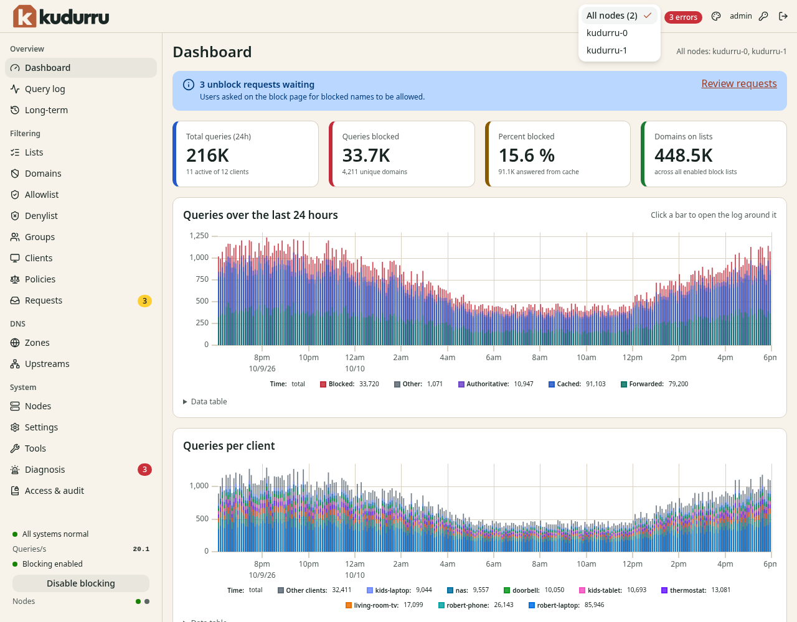
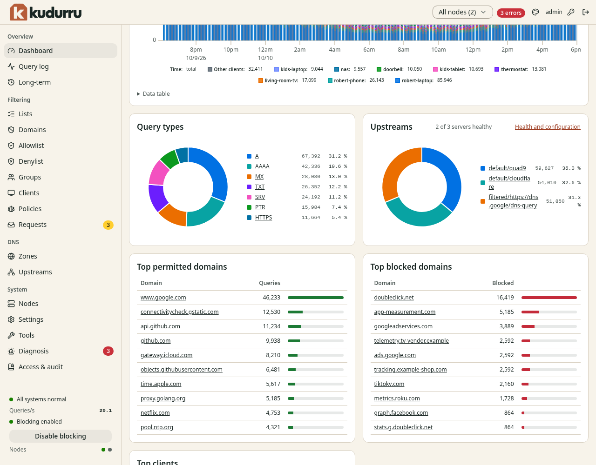
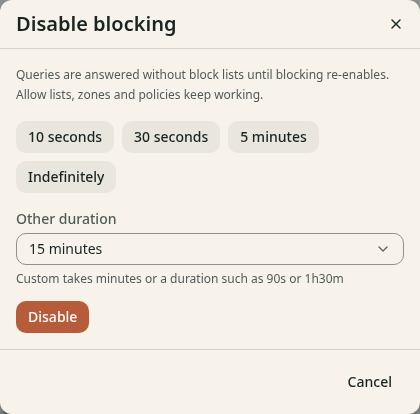
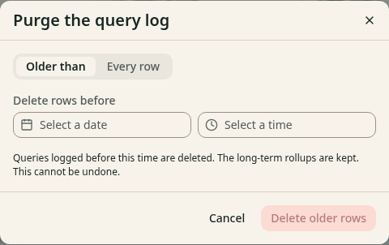
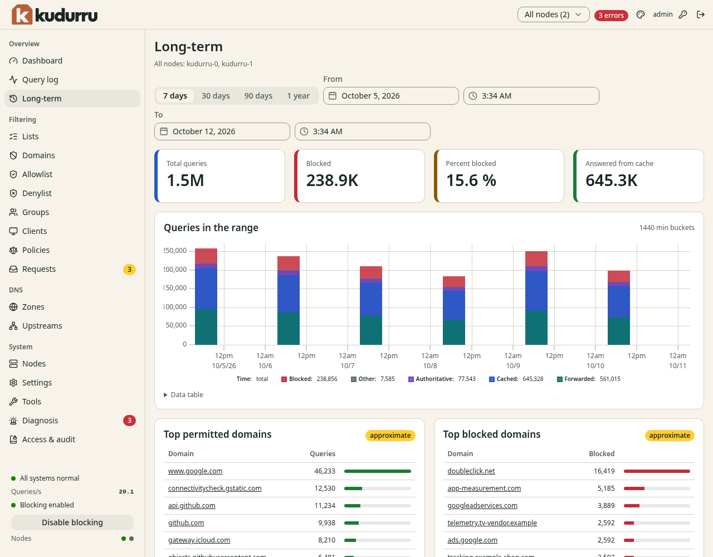

# 3. Watch the network

This chapter shows how to read the statistics. It also shows how to find the
reason for an answer in the query log and how to turn blocking off for a
short time.

**Before you start:** You have the role Viewer or a higher role. The query
log needs the role Auditor, Operator or Admin.

## Use the node scope

A cluster can have more than one node. The pages **Dashboard**,
**Query log**, **Long-term** and **Clients** show the data of the nodes that
you select.

1. Click **Node scope** at the top of the page.
2. Select **All nodes** or the name of one node.

Figure 1 shows the list.

*Figure 1. The node scope list.*

The line at the right of the page title tells you which nodes answered. If a
node does not answer, the line says that the result is partial. The live
tail updates that line when a node disconnects or recovers. If a result is
partial, reload the query log after the node recovers to read its missing
history. Selecting an unavailable node shows an error.

## Read the dashboard

Open **Overview** > **Dashboard**. Figure 2 shows the page.

*Figure 2. The dashboard.*

### The tiles

| Tile | Meaning |
|---|---|
| **Total queries (24h)** | The number of queries in the last 24 hours, and how many clients sent them |
| **Queries blocked** | The number of blocked queries, and how many different names they had |
| **Percent blocked** | The share of blocked queries, and how many kudurru answered from the cache |
| **Domains on lists** | The number of names on all the enabled block lists |

### The notice for requests

A blue notice shows when users wait for an answer. The notice says
**unblock requests waiting**. Click **Review requests** to open the
**Requests** page. Chapter 6 explains how to answer them.

### The charts

- **Queries over the last 24 hours** shows the queries in time. Each
  bar has colors for blocked, authoritative, cached and forwarded queries.
  Click a bar to open the query log around that time.
- **Queries per client** shows which clients send the queries.
- **Data table** below a chart shows the same data as a table.

Scroll down to see more (Figure 3).

*Figure 3. The lower part of the dashboard.*

- **Query types** shows the types of the queries, for example `A` and
  `AAAA`. Click a type to filter the query log.
- **Upstreams** shows which upstream answered how many queries. The text
  next to the title shows how many servers are healthy. Click **Health and
  configuration** to open the **Upstreams** page.
- **Top permitted domains**, **Top blocked domains** and **Top clients** are
  tables. Click a name to open the query log for that name.

## Turn blocking off for a short time

Use this function to find out if a block list causes a problem.

1. Click **Disable blocking** in the status area at the bottom of the
   navigation list.
2. Select a time: **10 seconds**, **30 seconds**, **5 minutes** or
   **Indefinitely**. Or enter another time in **Other duration**, for
   example `90s` or `1h30m`.
3. Click **Disable**.

Figure 4 shows the dialog.

*Figure 4. The dialog Disable blocking.*

While blocking is off, kudurru answers queries without the block lists. The
allow lists, the zones and the policies stay active. The status area shows
**Blocking disabled, re-enables in** and the time that is left. After
**Indefinitely** it shows **Blocking disabled indefinitely**.

To turn blocking on again before the time ends, click **Enable blocking**.

CAUTION: If you select **Indefinitely**, blocking stays off until
someone turns it on. Do not forget it.

The role Operator or a higher role is necessary for this function.

## Use the query log

The query log shows each query that kudurru answered, and the reason for the
answer. Open **Overview** > **Query log**. Figure 5 shows the page.

*Figure 5. The query log.*

The table has these columns:

| Column | Meaning |
|---|---|
| **Time** | The time of the query |
| **Status** | The result, for example `forwarded`, `cached`, `blocked list` or `blocked regex` |
| **Type** | The DNS type of the query, for example `A` |
| **Domain** | The name that the client asked for |
| **Client** | The name or the address of the client |
| **Reply** | The kind of the answer and the time that kudurru needed |
| **Node** | The node that answered |

The line above the table shows how many queries match the filters. It also
shows the time of the oldest query in memory and on disk.

### Filter the query log

1. Enter a value in one or more filter fields. Use `*` as a wildcard in
   **Domain**, for example `*.example.com`.
2. Press **Enter**, or select a value from the list.

You can filter by **Domain**, **Client**, **Status**, **Type**,
**Upstream**, **List** and **Zone**. **Since** and **Until** limit the time.
The values of **Status** are **Permitted**, **Cached**, **Blocked** and
**Errors**. Click **Clear filters** to remove all the filters.

The address of the page holds the filters. You can send the address to
another administrator.

### Find out why a name was blocked

1. Open the **Query log**.
2. Select **Blocked** in **Status**.
3. Enter the name in **Domain**.
4. Click the row of the query.

The row opens and shows the details (Figure 6).

*Figure 6. The details of a blocked query.*

| Detail | Meaning |
|---|---|
| **Status** | The result, for example `blocked list (NOERROR)` |
| **Matched list** | The list that has the name. Click it to open the list. |
| **Rule** | The rule that matched the name, for example `\|\|app-measurement.com^` |
| **Upstream** | The upstream that answered. `none` means that kudurru did not ask one. |
| **Cache** | If the answer came from the cache |
| **DNSSEC** | The result of the DNSSEC check: `secure`, `insecure` or `bogus`. Only recursive upstream groups check DNSSEC (Chapter 7). Other answers show `unknown`. |
| **CNAME chain** | The names that the answer pointed to |
| **Extended DNS error** | A code that tells the client why kudurru blocked the name |
| **Client** | The client and its client group |
| **Protocol** | The transport, for example `udp` |

### Allow or deny a name from the log

Each row has a button at the right.

- On a blocked row, click **Allow** to add the name to the **Allowlist**.
- On other rows, click **Deny** to add the name to the **Denylist**.

kudurru adds an exact entry for all clients. The entry has the origin
`query log`. The role Operator or a higher role is necessary. Chapter 4
explains the lists.

### Follow new queries

Turn on **Live tail** at the top right of the page. New queries show at the
top of the table when they arrive. Turn the switch off to stop.

Select **All** beside the switch to follow every active node, or select a
node to follow only that node. The selector has a search field when the
list is long. A short warning reports how many nodes have partial results.

When query history comes from a central database, turning on **Live tail**
shows only incoming queries. Turning it off returns to refreshed history.

### Delete old rows

The role Admin is necessary for this function.

1. Click **Purge…** at the top right of the page.
2. Select **Older than**, or select **Every row**.
3. If you selected **Older than**, enter the date and the time in
   **Delete rows before**.
4. Click **Delete older rows** or **Delete every row**.

Figure 7 shows the dialog.

*Figure 7. The dialog Purge the query log.*

CAUTION: You cannot undo this action. kudurru keeps the long-term
statistics.

## Read the long-term statistics

Open **Overview** > **Long-term**. The page shows the statistics for a
longer time (Figure 8).

NOTE: Statistics for more than 24 hours need a license key. Without a key,
the page asks for one. kudurru collects the statistics in both cases. See
[Chapter 13](13-license.md).

*Figure 8. The long-term statistics.*

1. Select **7 days**, **30 days**, **90 days** or **1 year**. You can also
   set **From** and **To**.
2. Read the tiles and the chart. The chart has one bar for each time
   bucket. The text at the top right of the chart gives the size of a bucket.

The tables of the top domains have the label **approximate**. The numbers
in these tables are estimates.

## Set the privacy of the query log

The query log can hide the address of a client or the name of a domain. The
setting is `querylog.privacy`. Use the **Settings** page or the file
`kudurru.yaml`. Chapter 8 explains the settings.

NOTE: A privacy mode that hides the client or the name also limits the
reason that the block page can show. It also limits the information on the
**Requests** page.
