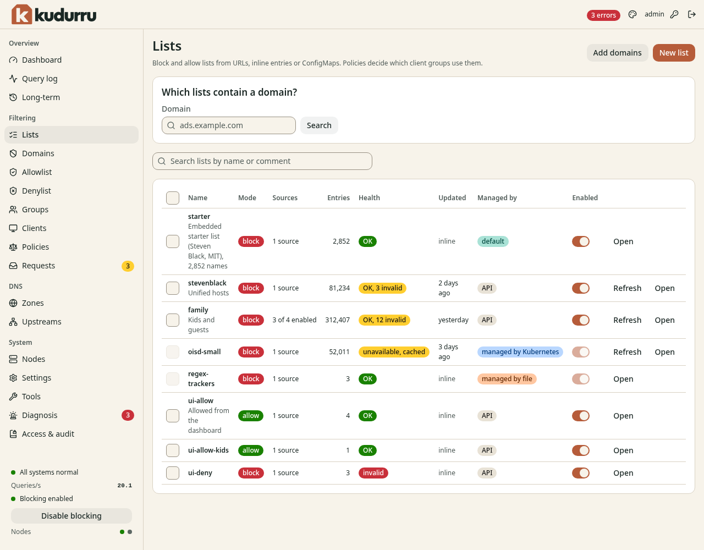
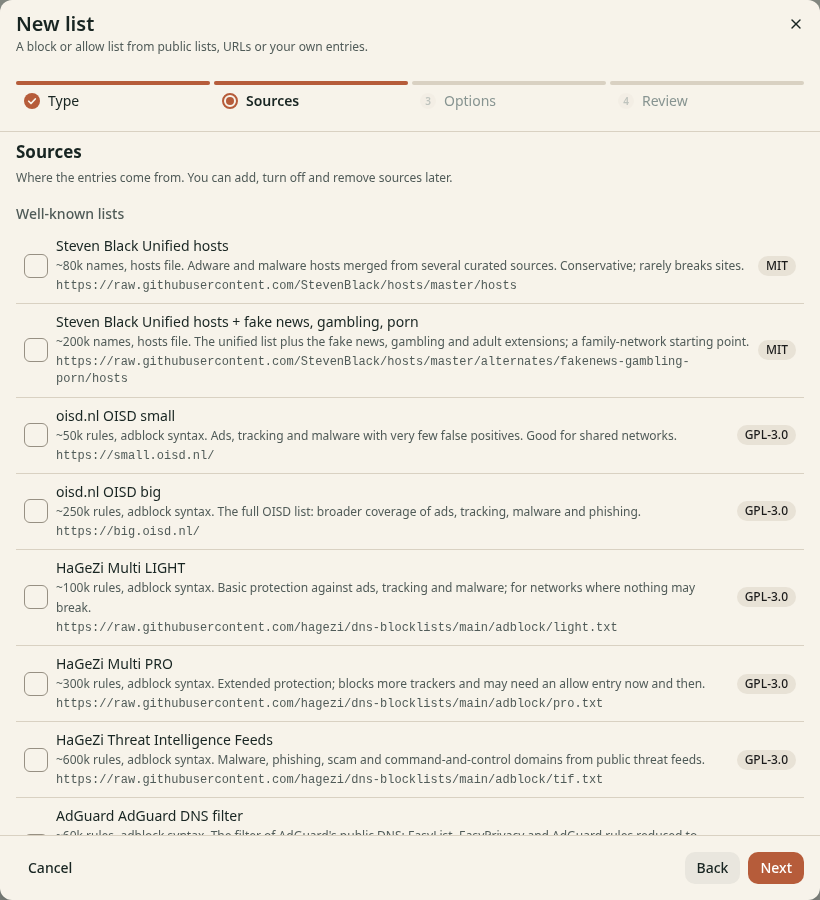
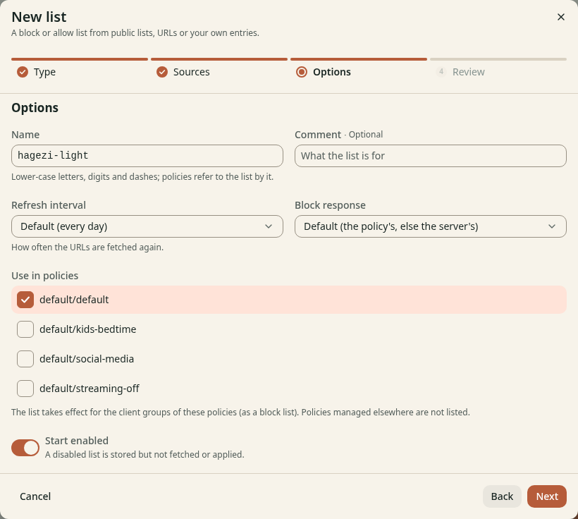
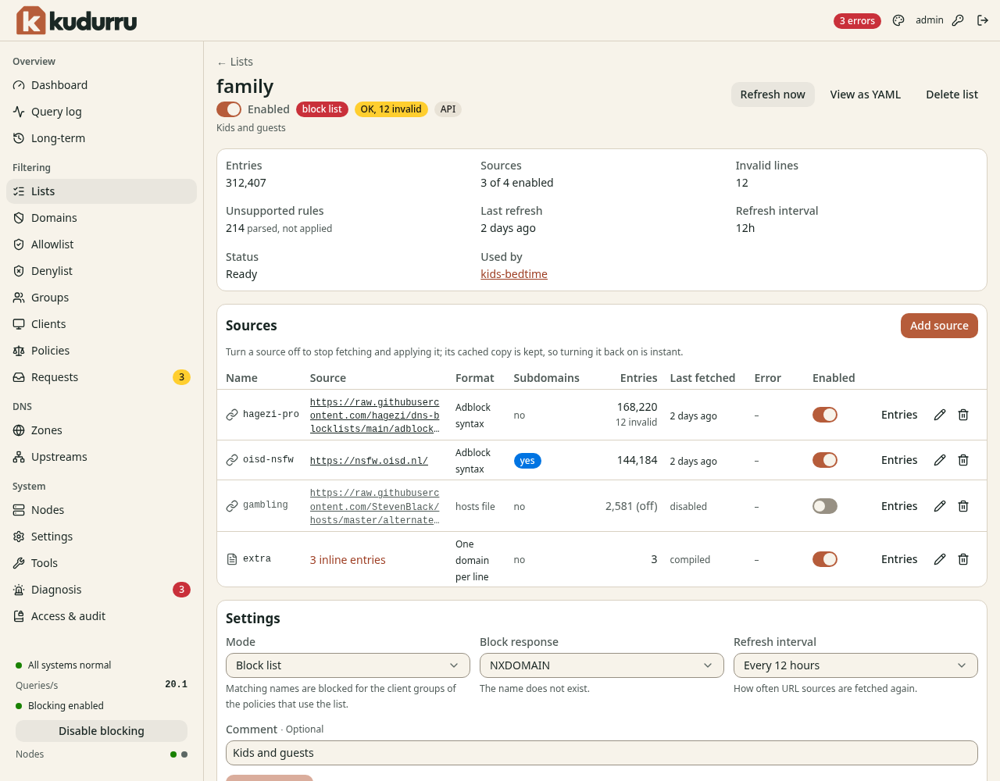
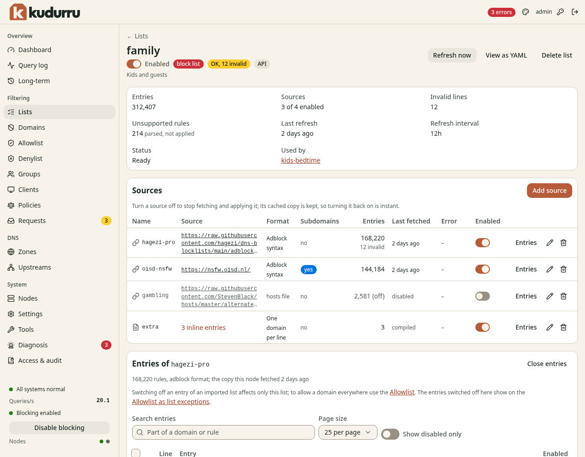
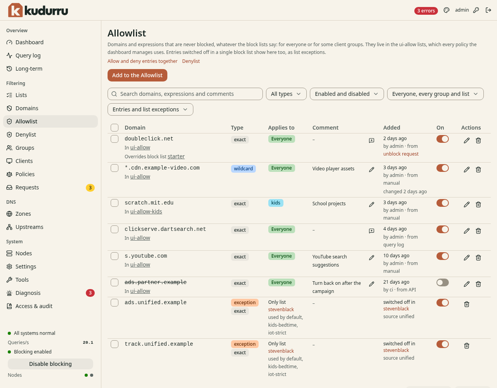
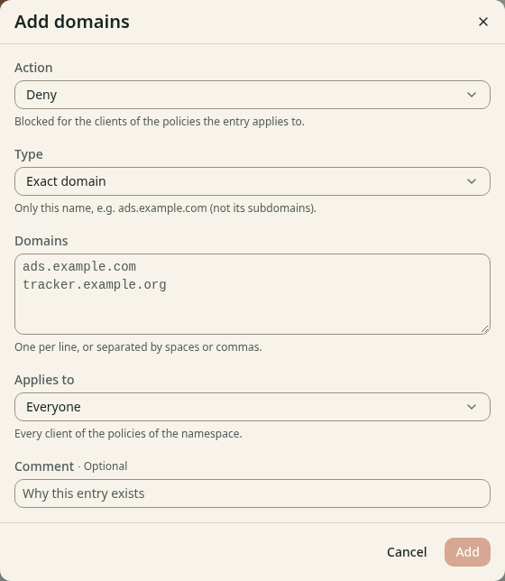

# 4. Block lists and domains

This chapter shows how to make block lists, how to allow and deny single
names, and how to find out which list blocks a name.

**Before you start:** You have the role Operator or Admin. To only read the
pages, the role Viewer is sufficient.

## How lists work

A list is a set of names. A list has a mode.

| Mode | Effect |
|---|---|
| Block list | kudurru blocks the names on the list for the clients of the policies that use the list. |
| Allow list | kudurru never blocks the names on the list. An allow list wins over every block list. |

A list does nothing until a policy uses it. Chapter 5 explains policies.
The wizard that makes a list can add it to policies for you.

A list can have more than one source. A source is one of these:

- a URL that kudurru fetches again at an interval
- a ConfigMap (Kubernetes only)
- entries that you type or paste (an inline source)

kudurru reads these formats:

| Format | Example line |
|---|---|
| hosts file | `0.0.0.0 ads.example.com` |
| One domain per line | `ads.example.com` |
| Adblock syntax | `\|\|ads.example.com^` |
| Regular expressions | `^ads?[0-9]*\.` |
| Detect automatically | kudurru reads the first lines and selects the format |

## See the lists

Open **Filtering** > **Lists**. Figure 1 shows the page.

*Figure 1. The page Lists.*

| Column | Meaning |
|---|---|
| **Name** | The name and the comment of the list |
| **Mode** | `block` or `allow` |
| **Sources** | The number of sources, and how many are on |
| **Entries** | The number of rules that kudurru compiled |
| **Health** | `OK`, `OK, N invalid`, `unavailable, cached` or `invalid` |
| **Updated** | The time of the last refresh, or `inline` |
| **Managed by** | The owner of the list |
| **Enabled** | A switch. When it is off, kudurru does not fetch or apply the list. |

The health `unavailable, cached` means that the last fetch failed. kudurru
uses the copy that it fetched before. Chapter 12 explains what to do.

### Find the lists that contain a name

1. Enter the name in **Domain** in the box **Which lists contain a domain?**.
2. Click **Search**.

The page shows the lists that contain the name. Use this to find which
list blocks a name.

## Create a block list

1. Open **Filtering** > **Lists**.
2. Click **New list**. A wizard opens.
3. On the step **Type**, select **Block list**. Click **Next**.
4. On the step **Sources**, add one or more sources:
   - Select a list in **Well-known lists**. Figure 2 shows the choices.
   - Or click **Add a URL**. Enter the URL. Select the **Format**.
   - Or enter names in **Paste entries**.
5. Click **Next**.
6. On the step **Options**, enter a **Name**. Use lower-case letters, digits
   and dashes.
7. Select the policies in **Use in policies**.
8. Click **Next**.
9. On the step **Review**, read the summary. Click **Create list**.

*Figure 2. The step Sources of the wizard.*

On the step **Options** (Figure 3) you can also set these items:

| Item | Meaning |
|---|---|
| **Comment** | A note for other administrators |
| **Refresh interval** | How often kudurru fetches the URLs again. The default is every day. |
| **Block response** | What a blocked client gets. The default is the response of the policy. |
| **Start enabled** | When this switch is off, kudurru stores the list and does not apply it. |

*Figure 3. The step Options of the wizard.*

If no policy uses the list, the step **Review** shows the warning **No policy
uses this list**. The list exists but has no effect.

The default policy of a new system uses the block list `starter`. It has
about 2,800 names. Add a larger list for more protection.

CAUTION: A large list can block a site that you need. Start with a small
list. Turn off blocking for a short time to test (Chapter 3).

### Block responses

The block response decides what a blocked client gets.

| Response | Meaning |
|---|---|
| **NXDOMAIN** | The name does not exist. |
| **0.0.0.0 / ::** | An address that no device can use. Apps fail fast. |
| **REFUSED** | The server refuses to answer. |
| **Custom IP** | The addresses that you enter, for example a local web server. |
| **Block page** | The client goes to the kudurru block page. Chapter 6 explains it. |

## Change a list

Click **Open** in the row of the list. Figure 4 shows the page of a list.

*Figure 4. The page of a list.*

The page has these functions:

- **Refresh now**: fetch all the URL sources at once.
- **View as YAML**: show the list as YAML.
- **Delete list**: remove the list. A dialog asks you to confirm.
- The switch **Enabled**: turn the whole list on or off.
- **Add source**: add a URL, a ConfigMap, pasted entries or an uploaded file.
- A switch in each row of **Sources**: turn one source on or off. kudurru
  keeps the copy of a source that is off.
- **Edit** and **Delete** in a source row: change or remove the source.
- **Settings**: change the **Mode**, the **Block response**, the **Refresh
  interval** and the **Comment**.

The statistics at the top show the **Entries**, the **Invalid lines**
and the **Unsupported rules**. An unsupported rule is a rule that kudurru
parsed but does not apply.
**Used by** lists the policies that use the list.

NOTE: You cannot change a list whose owner is **managed by file** or
**managed by Kubernetes**. Change the file or the resource instead.

### Turn off one entry of a list

Use this function when a list blocks a name that you need, and you want to
keep the other names of the list.

1. Open the page of the list.
2. Click **Entries** in the row of the source.
3. Enter a part of the name in **Search entries**.
4. Turn off the switch **Enabled** in the row of the entry.

Figure 5 shows the entries of a source.

*Figure 5. The entries of a source.*

The change affects only this list. If another list has the same name, that
list still blocks it. To let a name through everywhere, add it to the
**Allowlist**.

On SQLite, an entry edit is saved in one current authorized transaction. A
successful response confirms the saved change; fresh reads show it after
publication. If an edit conflicts with a newer list version, refresh the list
and review it before submitting again. RPZ feeds must be edited at their origin.

## Allow a name

The **Allowlist** and the **Denylist** hold single names that you decide.
The page **Domains** shows both together.

Open **Filtering** > **Allowlist**. Figure 6 shows the page.

*Figure 6. The page Allowlist.*

The three types of entry are:

| Type | Example | Matches |
|---|---|---|
| Exact domain | `ads.example.com` | The name only |
| Wildcard | `*.example.com` | `example.com` and each name below it |
| Regular expression | `^ads?[0-9]*\.` | Each name that the expression matches |

### Add a name

1. Open **Filtering** > **Allowlist**, **Denylist** or **Domains**.
2. Click **Add to the Allowlist**, **Add to the Denylist** or **Add domains**.
3. In **Action**, select **Allow** or **Deny**. This field shows only on
   the page **Domains**.
4. Select the **Type**.
5. Enter one or more names in **Domains**. Use one line for each name.
6. In **Applies to**, select **Everyone** or **Some client groups**.
7. Enter a **Comment** if you want.
8. Click **Add**.

Figure 7 shows the dialog.

*Figure 7. The dialog Add domains.*

An allow entry wins over every block list of the client and over the
blocked services. A deny entry blocks like a block list, unless an allow
list allows the name.

### Change an entry

Each row of the table has these controls:

- The switch **On** turns the entry on or off. An entry that is off stays on
  the page and does not apply.
- The pencil icon opens a dialog. Use it to change the entry.
- The bin icon deletes the entry.

To change many entries, select the check boxes in the first column. The
bulk actions **Enable**, **Disable** and **Delete** show above the table.

The filters above the table limit the rows. You can filter by type, by the
state of the switch, by the scope, and by **Entries** or **list
exceptions**.

### List exceptions

The page **Allowlist** also shows the entries that you turned off in a
single block list. The label for these rows is **exception**. The row
shows the list and the other lists that still match the name. The switch of
an exception is on while the entry is off in its list.

### Where the entries are stored

kudurru stores the entries in lists with the name `ui-allow` and `ui-deny`.
There is one list for all clients. There is one more list for each client
group that has its own entries, for example `ui-allow-kids`. kudurru adds
these lists to the policies for you.

NOTE: kudurru cannot change a policy that is **managed by file** or
**managed by Kubernetes**. The page **Domains** shows the message **Not
applied for** and the name of the policy. Add the list to the policy in the
file or in the resource.

## Use the command line

| Task | Command |
|---|---|
| List the lists | `kudurru lists list` |
| Find the lists that have a name | `kudurru lists search ads.example.com` |
| Fetch a list now | `kudurru lists refresh <name>` |
| Allow a name | `kudurru lists allow example.com` |
| Deny a name | `kudurru lists deny ads.example.com` |

Chapter 10 explains how to sign in with the command.
