# 5. Groups, clients and policies

This chapter shows how to give different rules to different devices. You
make a client group, you put clients in it, and you make a policy for the
group.

**Before you start:** You have the role Operator or Admin. At least one
block list exists (Chapter 4).

## How the parts work together

- A **client** is a device. kudurru knows a client by the address that it
  sends queries from.
- A **client group** is a set of clients. A client is in a group when one
  of the *matchers* of the group matches it.
- A **policy** says which lists and services apply to which client groups.

A client that no group claims is in the group `default`. The policy
`default` applies to this group.

A client can be in one group only. If more than one group matches, the
most exact matcher wins. An exact address wins over a range. A range wins
over a client ID.

A group can have more than one policy. When more than one policy is
active for a client, kudurru uses these rules:

- The policy with the highest priority decides the block response, the
  upstream group and safe search.
- kudurru merges the lists of all the active policies.

## See the clients

Open **Filtering** > **Clients**. Figure 1 shows the page.

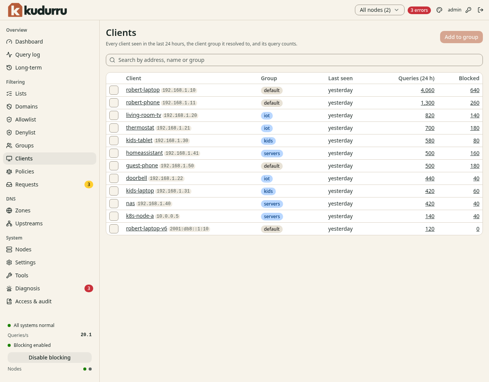

*Figure 1. The page Clients.*

The page lists each client that sent a query in the last 24 hours. Click a
name to open the page of the client. Click a number to open the query log
for that client.

### Read the page of a client

The page of a client (Figure 2) shows what kudurru does for this client.

*Figure 2. The page of a client.*

| Section | Meaning |
|---|---|
| Statistics | The number of queries and blocked queries in the last 24 hours |
| **Groups** | The group of the client and the matcher that matched it |
| **Policy right now** | The policies that apply now. The policy that has the label **decides** sets the block response. |
| **Allow or deny a domain** | Add a name to the **Allowlist** or the **Denylist** |
| **Recent queries** | The latest queries of this client |

Use **Policy right now** when a client gets rules that you did not expect.

## See the groups

Open **Filtering** > **Groups**. Figure 3 shows the page.

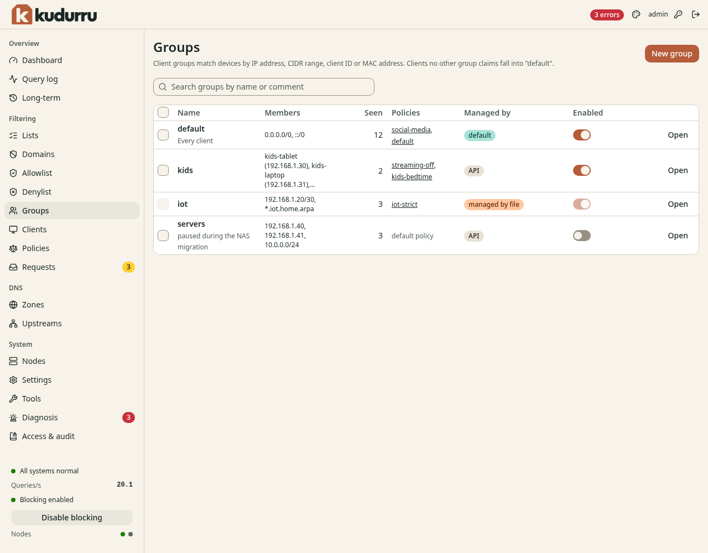

*Figure 3. The page Groups.*

The switch **Enabled** turns a group on or off. The column **Policies**
shows the policies that apply to the group.

## Create a client group

1. Open **Filtering** > **Groups**.
2. Click **New group**. A wizard opens.
3. On the step **Name**, enter a **Name**. Click **Next**.
4. On the step **Members**, add the matchers (see below). Click **Next**.
5. On the step **Policies**, select the policies that apply to the group.
   Click **Next**.
6. On the step **Review**, click **Create group**.

Figure 4 shows the step **Members**.

*Figure 4. The step Members of the wizard.*

A matcher has a kind and a value.

| Kind | Value | Matches |
|---|---|---|
| **IP address** | `192.168.1.30` | One device |
| **CIDR range** | `192.168.1.0/24` | Each address in the range |
| **Client ID** | A name that the device sends | Devices that use DNS over TLS or DNS over HTTPS with a client ID |
| **MAC address** | `aa:bb:cc:dd:ee:ff` | A device, only when the transport gives the MAC address |

To add a client that you already see, click **Add** next to the client in
the list **Seen in the last 24 hours**. To add many values, click **Paste
many**.

CAUTION: A matcher for a MAC address works only when the transport gives
the MAC address. Version 0.1 has no client inventory for this. Use an IP
address or a range.

NOTE: Give a fixed address to each client that you put in a group.
Use a DHCP reservation. If the address changes, the client leaves the group.

### Change a group

Open **Filtering** > **Groups**, and click **Open** in the row of the group.
Figure 5 shows the page of a group.

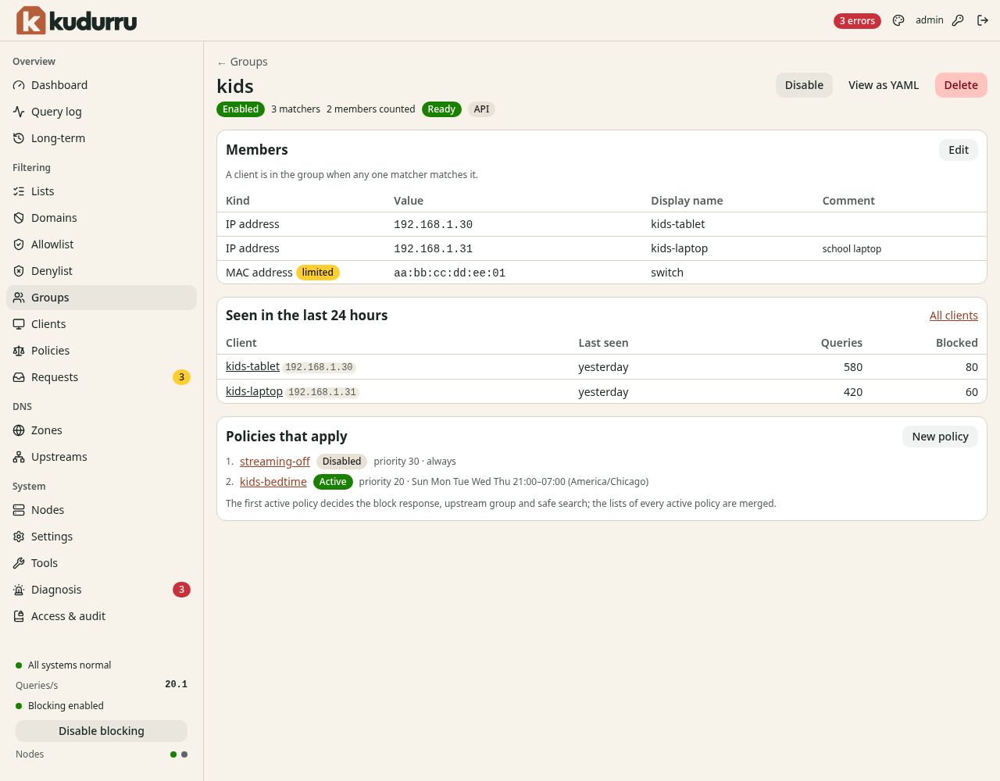

*Figure 5. The page of a group.*

- Click **Edit** in **Members** to change the matchers.
- Click **New policy** in **Policies that apply** to make a policy for this
  group.
- Click **Disable** to stop the group. The clients then fall into other
  groups.
- Click **Delete** to remove the group.

You can also add a client to a group from the page **Clients**. Select
the check box of the client, click **Add to group** and select the group.
On the page of a client, use **Add to group** in the section **Groups**.

## Create a policy

1. Open **Filtering** > **Policies**.
2. Click **New policy**. A wizard opens with six steps.
3. Do the steps that the sections below describe.
4. On the step **Review**, read the summary. Click **Create policy**.

Figure 6 shows the page **Policies**.

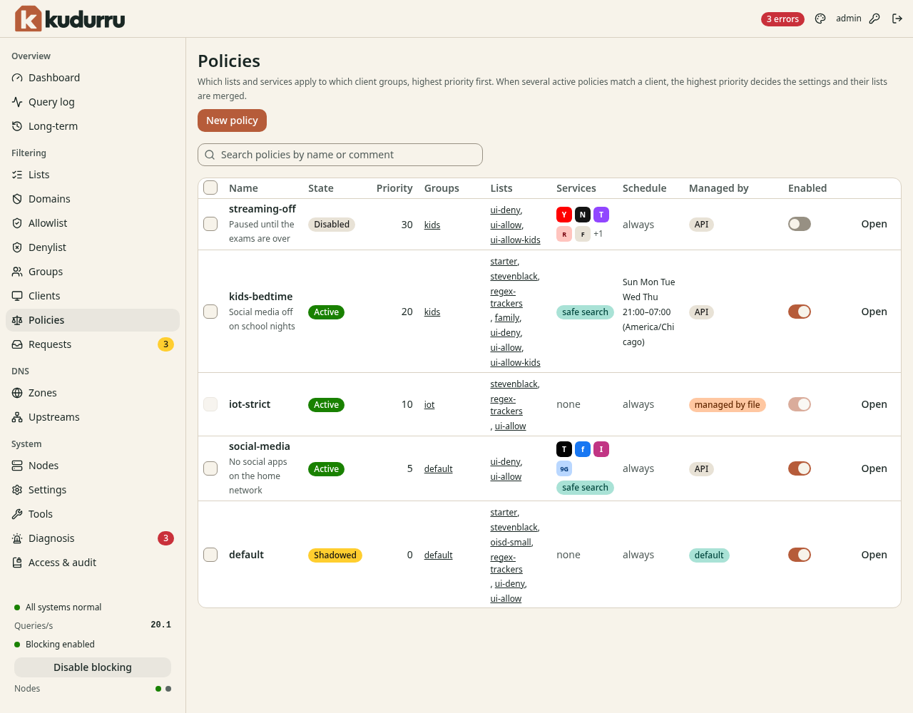

*Figure 6. The page Policies.*

The column **State** has these values:

| State | Meaning |
|---|---|
| **Active** | The policy applies now. |
| **Disabled** | The switch **Enabled** is off. |
| **Shadowed** | The policy is active. A policy with a higher priority takes the settings for the same groups. kudurru still merges the lists. |
| **Scheduled off** | The time window of the policy is not open now. |

### Step 1: Who

1. Enter a **Name**. Use lower-case letters, digits and dashes.
2. Select the **Client groups** that get this policy.
3. Enter a **Priority** from 0 to 100000. The highest number wins.
4. Click **Next**.

CAUTION: A policy with no client group applies to nobody. The wizard
does not let you continue without a group.

Figure 7 shows this step.

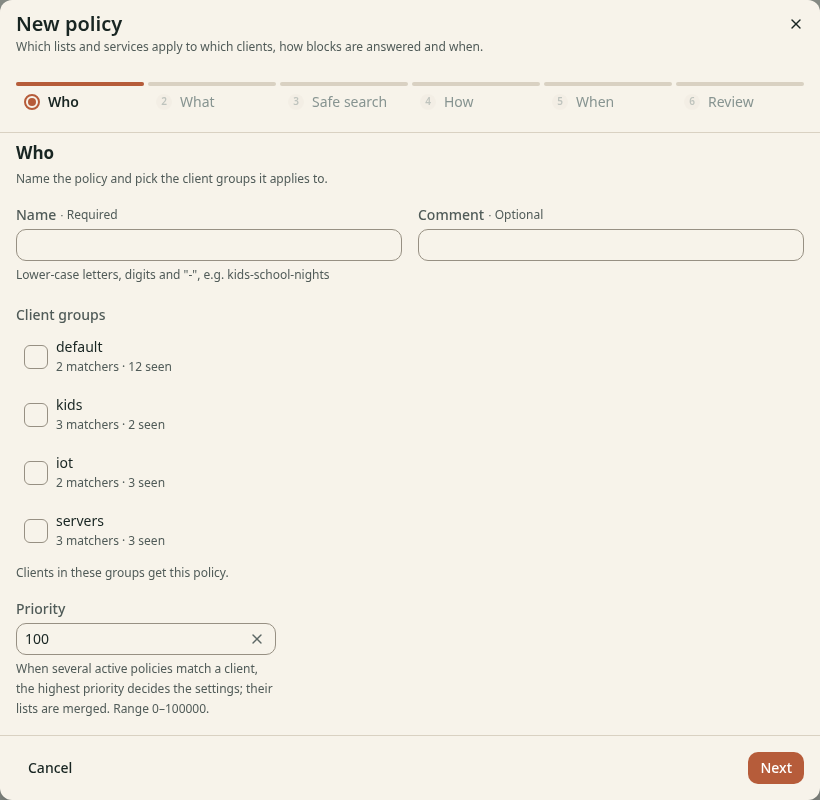

*Figure 7. The step Who of the wizard.*

### Step 2: What

Figure 8 shows this step.

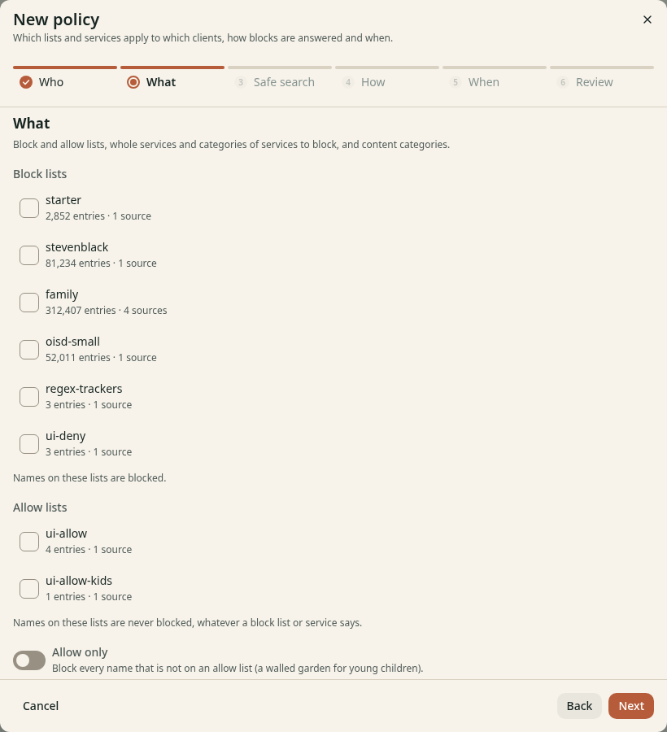

*Figure 8. The step What of the wizard.*

1. Select the **Block lists** that apply.
2. Select the **Allow lists** that apply.
3. To block only the names on allow lists, turn on **Allow only**.
4. Scroll down to select blocked services, categories and content
   categories (see [Block services](#block-services)).
5. Click **Next**.

**Allow only** blocks each name that is not on an allow list. Use it as a
walled garden for young children.

### Step 3: Safe search

This step is optional. Turn on **Enforce safe search** to make the search
engines show safe results. kudurru gives the search engines of Google,
Bing, DuckDuckGo, Brave Search, Yandex and Pixabay the address of their
safe-search service. For YouTube you can select a **Level**.

NOTE: Browsers that use their own secure DNS service, and VPN programs,
do not use kudurru. Then safe search does not work for them.

Figure 9 shows this step.

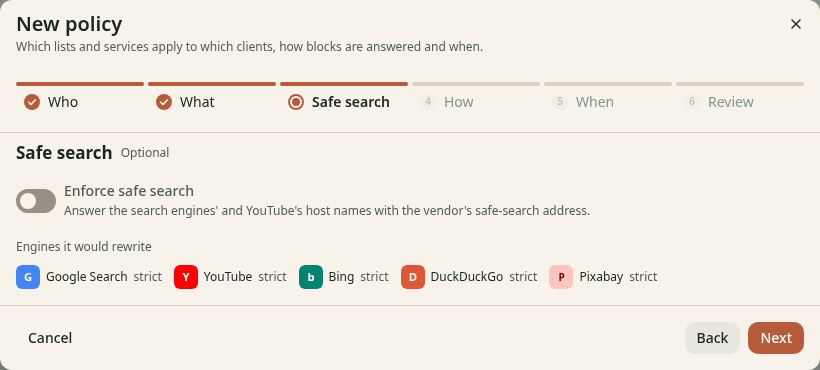

*Figure 9. The step Safe search of the wizard.*

### Step 4: How

This step is optional (Figure 10).

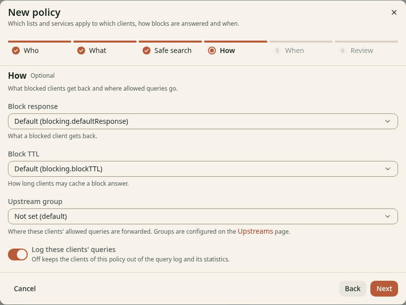

*Figure 10. The step How of the wizard.*

| Field | Meaning |
|---|---|
| **Block response** | What a blocked client gets back. The default is the setting `blocking.defaultResponse`. |
| **Block TTL** | How long a client can keep a block answer |
| **Upstream group** | Where the allowed queries of these clients go |
| **Log these clients' queries** | When this switch is off, the queries of these clients are not in the query log or the statistics. |

### Step 5: When

This step is optional. By default the policy applies at all times.

1. Select **Only during a time window**.
2. Select the days.
3. Enter the **Start** and the **End** time.
4. Select the **Time zone**.

A window can cross midnight. For example, a window from 21:00 to 07:00 on
Sunday to Thursday blocks social media on school nights.

Figure 11 shows this step.

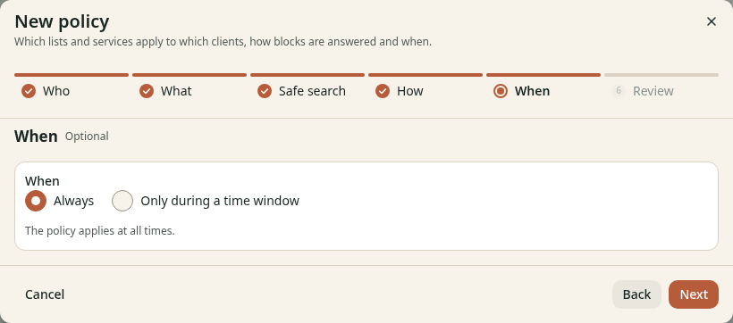

*Figure 11. The step When of the wizard.*

### Step 6: Review

Read the summary. Click **Create policy**. The dashboard opens the page of
the policy.

## Block services

A service is a group of names that belong to one product, for example
YouTube or TikTok. kudurru has a catalogue of services in categories such
as **AI**, **Social media**, **Messaging**, **Video and streaming** and
**Gaming**.

1. Open the page of a policy.
2. Scroll down to **Blocked services**. Figure 12 shows the section.
3. Select a category tab, or use **Search by name or domain**.
4. Click a service tile to block it. Click it again to allow it.
5. To block all the services of a category, turn on **Block the whole
   category**.
6. Click **Save services**.

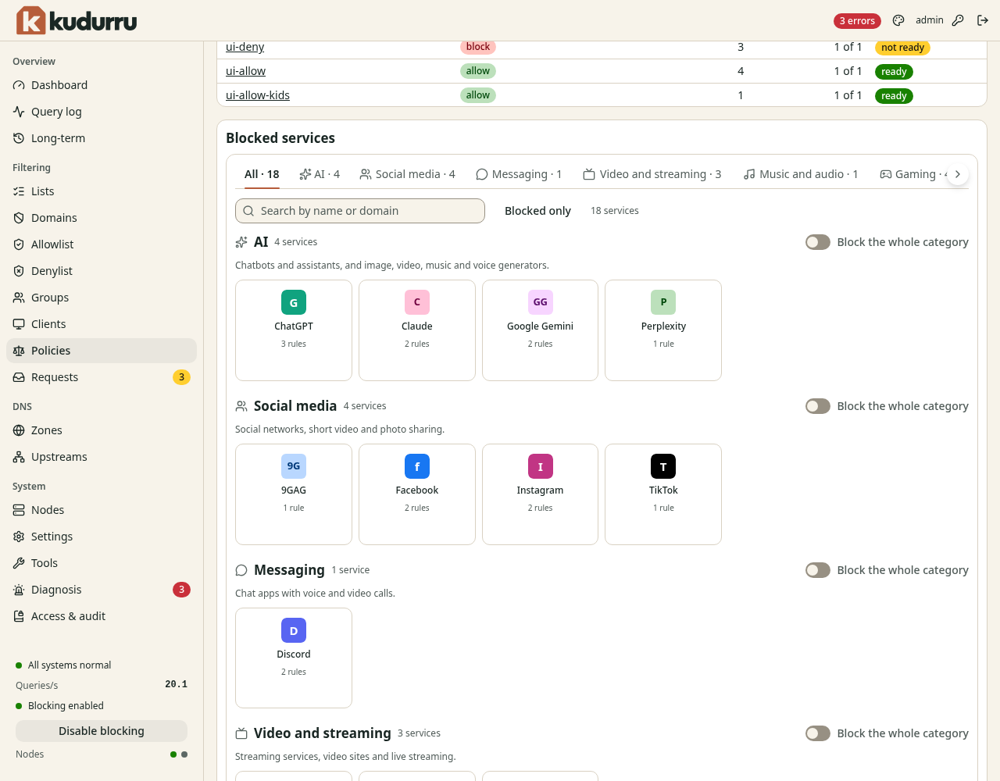

*Figure 12. The section Blocked services.*

A blocked category also blocks the services that a catalogue update adds
to it later. If you click a tile in a blocked category, kudurru makes an
exception for this service.

Some services need another service. For example, Fortnite signs in through
Epic Games. The grid then offers to block both.

An allow list wins over a blocked service. To allow `music.youtube.com` and
block the rest of YouTube, add `music.youtube.com` to an allow list of the
policy.

The step **What** of the wizard also has **Content categories**. These are
large lists by topic, for example **Adult content**, **Gambling**,
**Malware** and **Phishing**. When you turn one on, kudurru downloads the list
from the Block List Project. Some of these lists are large.

CAUTION: The malware list has about 2.6 million names. It needs several
hundred MB of memory on each node.

## Check a policy

Open the page of the policy (Figure 13).

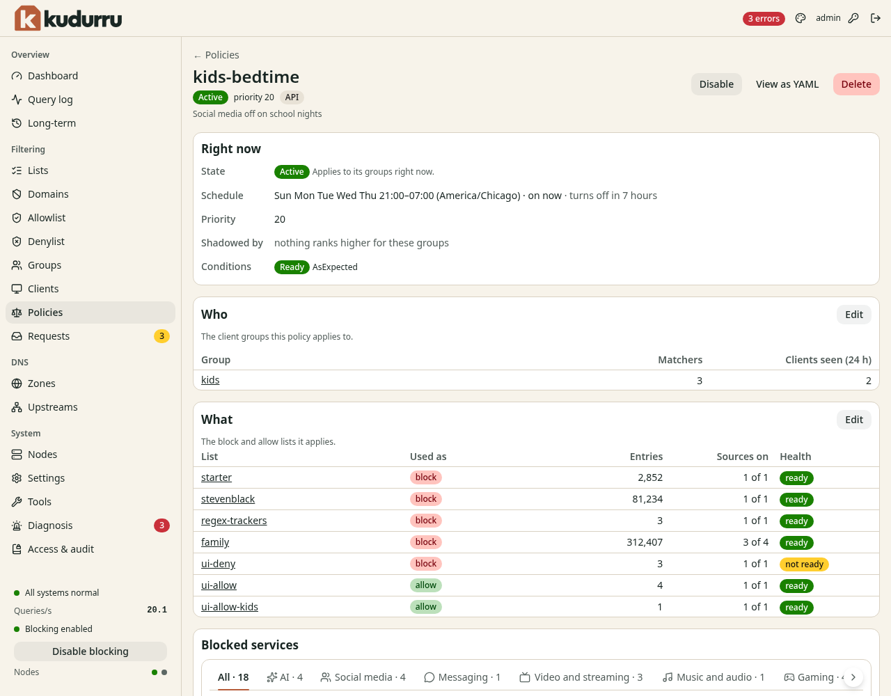

*Figure 13. The page of a policy.*

The section **Right now** shows if the policy applies. **Shadowed by** names
a policy with a higher priority that takes the same groups. Each part of
the page has an **Edit** button. **Disable** turns the policy off.
**Delete** removes it.

To check the result for one client, open the page of the client. **Policy
right now** shows which policy decides. You can also use **Tools** >
**Query (dig)** with the field **As client** (Chapter 8).

## Use the command line

| Task | Command |
|---|---|
| List groups | `kudurru get clientgroups` |
| List policies | `kudurru get policies` |
| Show one policy with its state | `kudurru describe policy <name>` |
| Change objects from a file | `kudurru apply -f policy.yaml` |
| Test a query as a client | `kudurru query ads.example.net --client 192.168.1.23` |
