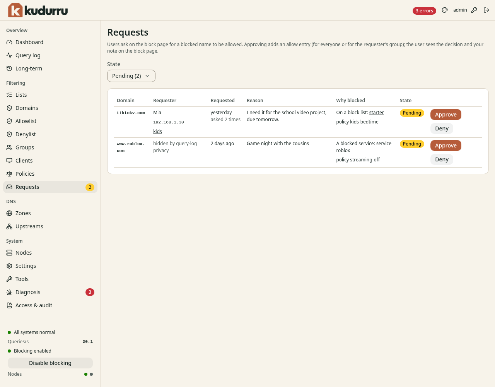
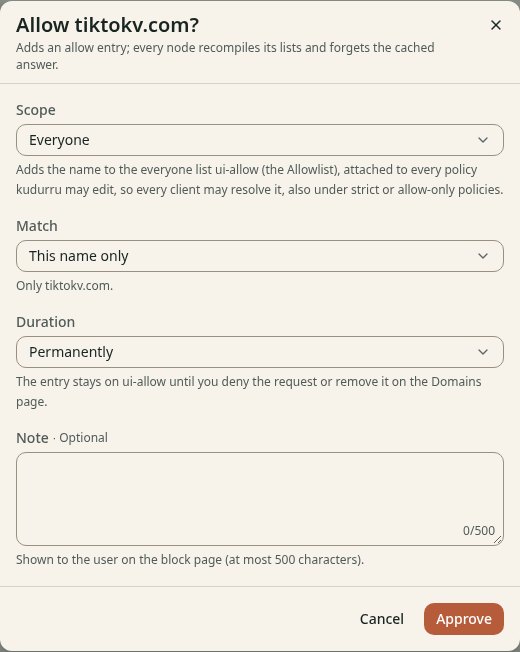

# 6. Access requests

This chapter shows how to turn on the block page, and how to answer the
users who ask for a blocked name.

NOTE: The block page is free. The form that lets a user ask for a name, and
the page **Requests**, need a license key. See [Chapter 13](13-license.md).

**Before you start:**

- You have the role Admin to set up the block page. You have the role
  Operator or Admin to answer requests.
- You can change the file `kudurru.yaml` on the host and restart the node.
- At least one policy blocks names (Chapter 5).

## How it works

By default, kudurru answers a blocked name with an address that does not
work, or with `NXDOMAIN`. The browser shows an error. The user does not know
why.

With the block page, kudurru answers a blocked name with the address of a
small web server on the node. A browser that opens the name gets the
kudurru block page. The page tells the user that the name is blocked and
why. The page has a form that the user can use to ask for access.

1. The user opens a blocked name. The browser gets the block page.
2. The user sends the form. kudurru stores a request.
3. You see the request on the **Requests** page and answer it.
4. If you approve it, kudurru adds the name to an allow list.

## Turn on the block page

1. Choose the address that clients use to reach the block page.
   - On one host, use the LAN address of the host.
   - In Docker, use the address of the host. The address of the container
     does not work for clients.
   - In Kubernetes, use the address of the block page service.
2. Add the lines below to `kudurru.yaml`. Use your own values.

   ```yaml
   blockPage:
     enabled: true
     ipv4: 192.168.1.10
     title: This site is blocked
     message: The administrator of this network has blocked access to this domain.
     contact: it@example.net
     showDetails: true
   blocking:
     defaultResponse: blockPage
   ```

3. In Docker, publish a port for the block page. Add `"80:8090"` to the
   ports of the container. Add this line to `kudurru.yaml`:

   ```yaml
   listeners:
     blockPage:
       http: "0.0.0.0:8090"
   ```

4. Restart the node.
5. Test the setting:

   ```sh
   dig @192.168.1.10 www.ads.example A +short
   ```

   The answer is the block page address. Replace `www.ads.example` with a
   name that a block list blocks.

The settings have these meanings:

| Setting | Meaning |
|---|---|
| `blockPage.enabled` | Turns the block page on. A restart is necessary. |
| `blockPage.ipv4`, `blockPage.ipv6` | The addresses that blocked names get. |
| `blockPage.title`, `blockPage.message` | The title and the message on the page. Use plain text. |
| `blockPage.contact` | An email address or a web address. The page shows it under **Ask your administrator**. |
| `blockPage.showDetails` | When true, the page shows the list, the rule, the service and the policy. |
| `blocking.defaultResponse` | The block response for all policies that do not set their own. |

You can set the block response for one policy or for one list instead. On
the page of a policy, set **Block response** to **Block page**. On the page
of a list, set the **Block response** in **Settings**.

NOTE: kudurru shows the block page for plain HTTP only. For a site that
uses HTTPS, a browser shows a certificate warning or an error. See
the [block page reference](../../deploy/blocking-page.md#https-why-browsers-warn)
for the reason. Do not install the certificate of the block page on the
clients.

CAUTION: Clients and other resolvers keep a block answer for the block TTL.
The default is 10 minutes. Make the block TTL shorter before you change
the block page address.

### Check the block page in the dashboard

The page **Settings** can show the block page with your settings. The
preview uses an example reason. It does not read the query log.

## Turn the request form on or off

The form is on by default. The setting `unblockRequests.enabled` controls
it. These settings limit the requests:

| Setting | Default | Meaning |
|---|---|---|
| `unblockRequests.rateLimit` | 5 | Requests from one client in 1 hour |
| `unblockRequests.maxPending` | 1000 | Pending requests in the whole cluster. After this number the page says that requests are paused. |
| `unblockRequests.pendingExpiry` | 336 h (14 days) | The time after which an undecided request ends |
| `unblockRequests.retention` | 720 h (30 days) | The time after which kudurru deletes decided requests |

## Find the requests

The badge on **Requests** in the navigation list shows the number of
pending requests. The dashboard also shows a blue notice. Click **Review
requests** in the notice, or open **Filtering** > **Requests**.

Figure 1 shows the page.



*Figure 1. The page Requests.*

| Column | Meaning |
|---|---|
| **Domain** | The name that the user asked for |
| **Requester** | The name and the contact that the user entered, the address of the device and its client group |
| **Requested** | The time of the request. The text **asked N times** shows when the user asked again. |
| **Reason** | The text of the user |
| **Why blocked** | The list, the service or the policy that blocks the name. Click a link to open it. |
| **State** | **Pending**, **Approved**, **Denied** or **Expired** |

The filter **State** has the values **Pending**, **Approved**, **Denied**,
**Expired** and **All**.

NOTE: The privacy setting of the query log decides what the page shows about
the requester. The page can show an anonymous network address or the text
**hidden by query-log privacy**.

NOTE: The text in the columns **Requester** and **Reason** comes from the
user. The dashboard shows it as plain text.

## Answer a request

### Approve a request

1. Open **Filtering** > **Requests**.
2. Click **Approve** in the row of the request. A dialog opens.
3. Select the **Scope**:
   - **Everyone**: all clients can use the name.
   - **The requester's group**: only the clients of the group of the
     requester can use it.
4. Select the **Match**: **This name only**, or **This name and its
   subdomains**.
5. Select the **Duration**. **Permanently** is the default. You can select 1
   hour, 8 hours, 1 day or 7 days. You can enter another time.
6. Enter a **Note** if you want. The user sees the note on the block page.
   Use 500 characters at most.
7. Click **Approve**.

Figure 2 shows the dialog.



*Figure 2. The dialog Approve.*

kudurru adds an allow entry to the **Allowlist**. Then each node compiles its
lists again and removes the cached answer. The user can open the site after
a short time.

A time-limited approval ends by itself. kudurru removes the entry when the
approval ends, but only if the approval added it.

CAUTION: kudurru cannot change a policy that is **managed by file** or
**managed by Kubernetes**. It skips these policies, and the answer lists
them. Add the allow list to these policies in the file or the resource.
kudurru refuses an approval for a group when no policy covers the group.

### Deny a request

1. Click **Deny** in the row of the request.
2. Enter a **Note** if you want. The user sees the note.
3. Click **Deny**.

To revoke an approval, find the request with the state **Approved** and
click **Deny**. kudurru removes the allow entry.

### Delete a request

1. Click the name of the request to open its page.
2. Click **Delete**.
3. Click **Delete request**.

If the approval was permanent, the allow entry stays on its list. To remove
an approval that has a time limit, deny it first.

### Read the page of a request

The page of a request shows the request, the decision, the recent queries
of the client for this name, and the history of the decisions. The recent
queries need the permission to read the query log.

## Use the API

An approval, a denial and a deletion write an entry to the audit log. The
roles Operator and Admin can do these actions. The role Auditor can read
requests but cannot decide.

| Task | API call |
|---|---|
| List requests | `GET /api/v1/unblockrequests` |
| Approve | `POST /api/v1/unblockrequests/{namespace}/{name}/approve` |
| Deny | `POST /api/v1/unblockrequests/{namespace}/{name}/deny` |
| Delete | `DELETE /api/v1/unblockrequests/{namespace}/{name}` |

More details are in the [block page reference](../../deploy/blocking-page.md).
