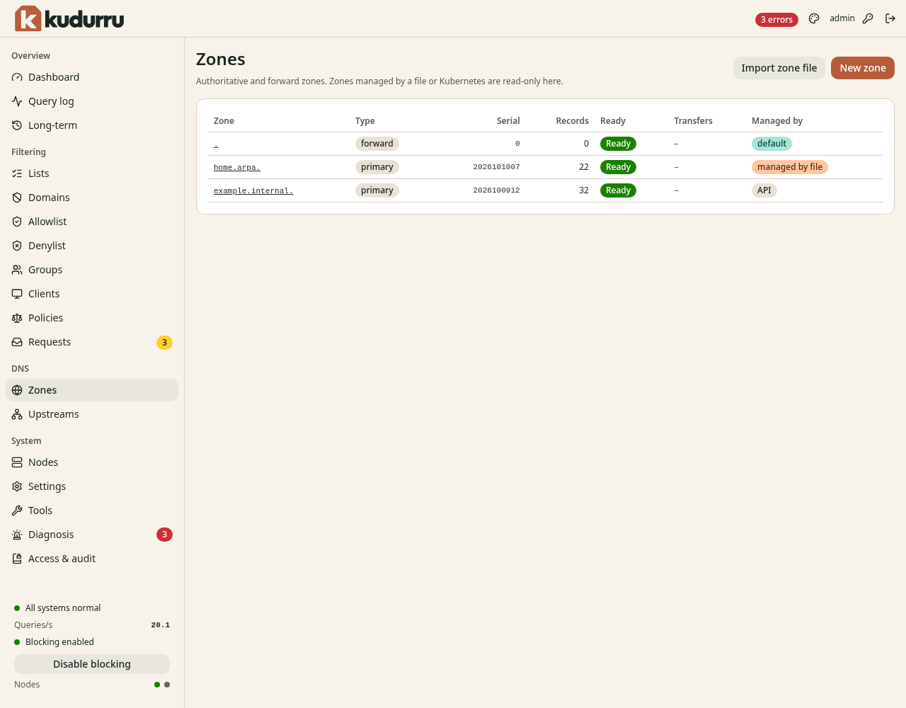
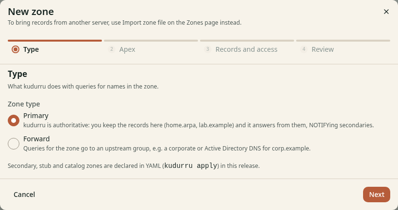
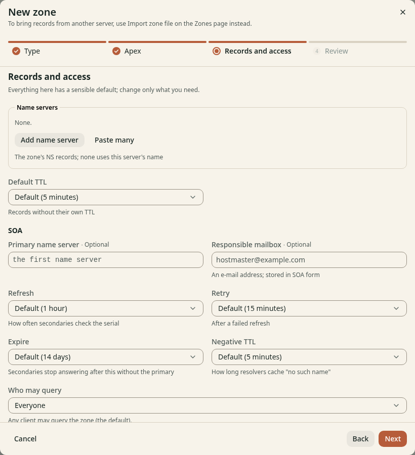
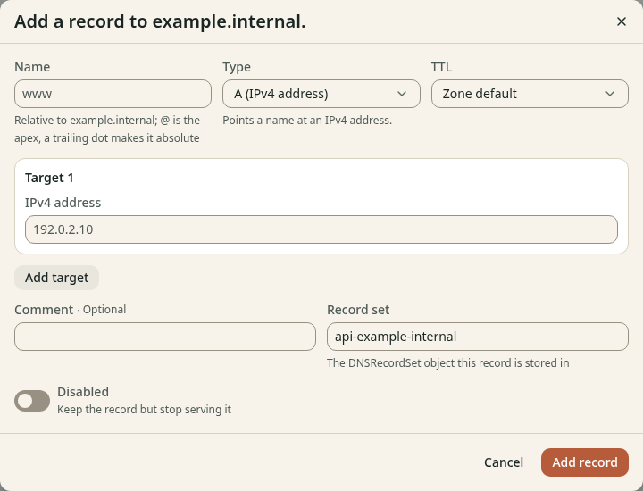
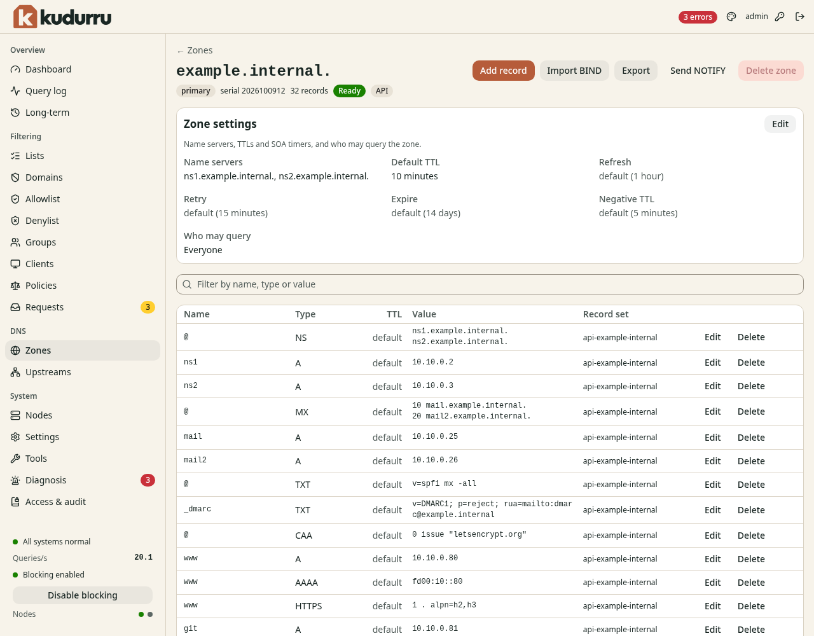
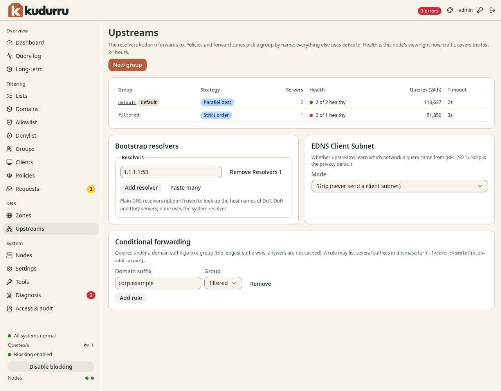
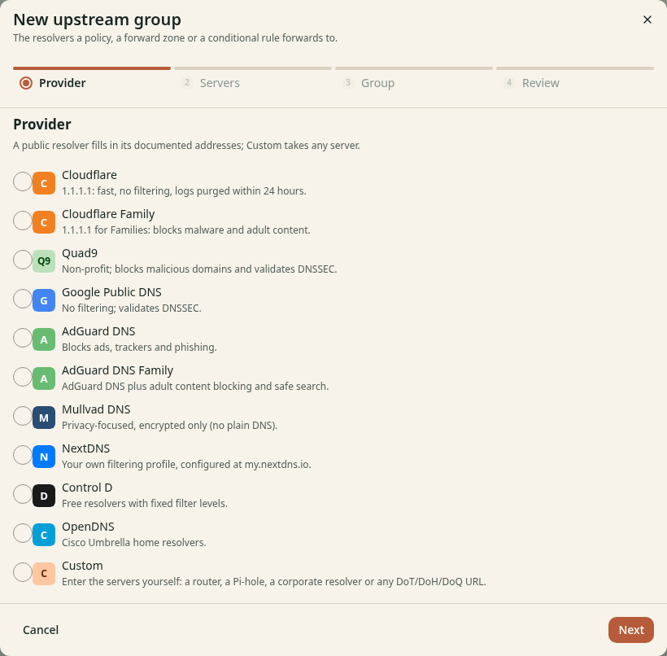
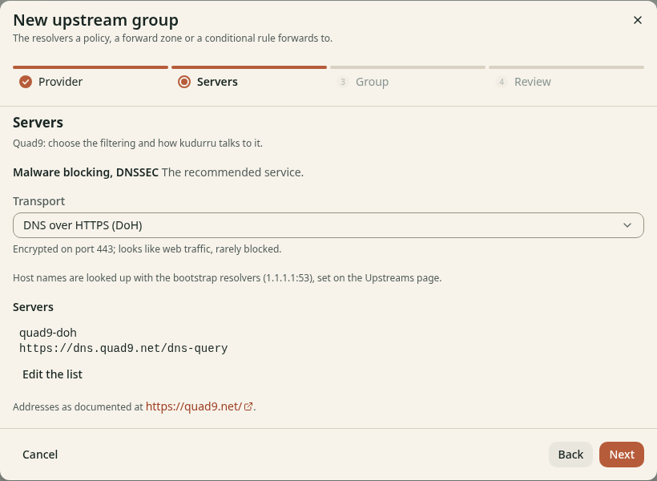
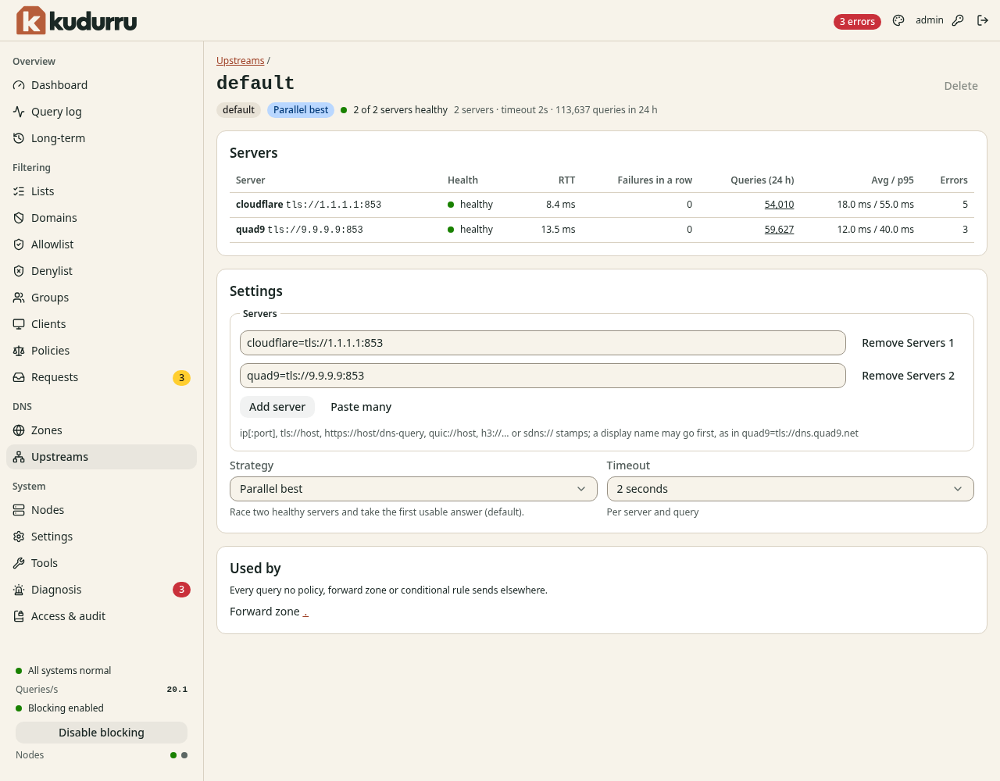

# 7. Zones and upstreams

This chapter shows how to make your own DNS names, and how to set the
external DNS servers that kudurru asks.

**Before you start:**

- To change zones, you have the role Admin. You can also have the role Zone
  admin for one zone.
- To change upstreams, you have the role Admin.

## Zones

A zone is a part of the DNS name space. kudurru serves three types of zone.

| Type | Meaning |
|---|---|
| Primary | kudurru is the authority. You keep the records in kudurru. kudurru answers from these records. |
| Forward | kudurru sends the queries for the zone to an upstream group. Use it for a company or Active Directory zone. |
| Secondary | Every kudurru node copies records from an external primary. Changes belong on that primary. |
| Stub | Each node discovers the zone’s authorities and sends queries directly to them. |

A block list cannot block a name in a primary zone. The records of your own
zone always get an answer.

The wizard creates primary, forward, secondary and stub zones. Catalog zones
are reserved for a later release.

### See the zones

Open **DNS** > **Zones**. Figure 1 shows the page.



*Figure 1. The page Zones.*

The zone `.` is the root zone. It is a forward zone that the system makes.
It sends all other queries to the upstream group `default`.

The column **Serial** shows the SOA serial. kudurru increases it when you
change a primary record. Secondary serials and availability are labeled with
the responding node; different replicas may temporarily report different
copies. Shared Kubernetes status does not assert that every secondary is ready.

### Create a primary zone

1. Open **DNS** > **Zones**.
2. Click **New zone**. A wizard opens.
3. On the step **Type**, select **Primary**. Click **Next**.
4. On the step **Apex**, enter the **Zone name**, for example
   `home.arpa` or `lab.example`. Click **Next**.
5. On the step **Records and access**, change a value only if you need to.
   Click **Next**.
6. On the step **Review**, click **Create zone**.

Figure 2 shows the step **Type**.



*Figure 2. The step Type of the wizard.*

Figure 3 shows the step **Records and access**.



*Figure 3. The step Records and access of the wizard.*

All the fields on this step have a default.

| Field | Meaning |
|---|---|
| **Name servers** | The NS records of the zone. If you add none, kudurru uses its own name. |
| **Default TTL** | The TTL for records that have no TTL of their own |
| **Primary name server**, **Responsible mailbox** | Fields of the SOA record |
| **Refresh**, **Retry**, **Expire**, **Negative TTL** | Times for secondary servers and for caches |
| **Who may query** | The clients that can query the zone (see the table below) |

The choices for **Who may query** are:

| Choice | Meaning |
|---|---|
| **Everyone** | Any client can query the zone. This is the default. |
| **Private networks only** | Only clients with private, loopback or link-local addresses |
| **Clients in the ACL** | Only the clients that the ACL allows |
| **Zone name servers only** | Only the addresses of the NS records of the zone |
| **Name servers and the ACL** | The name servers and the clients that the ACL allows |
| **Nobody** | kudurru refuses all queries. The zone stays defined. |

The **Query ACL** is a list of addresses or ranges. The first match wins.
An exclamation mark in front of an entry denies it, for example
`!192.168.1.66`.

### Override local names and resolve the rest publicly

For a domain you already host publicly, keep your internal records in one
primary zone and enable **Resolve missing names publicly** on **Records and
access**. For an existing zone, use **Zone settings** > **Edit**. Select a
**Fallback upstream group**, or leave **Normal resolver routing** selected
to follow client policies, conditional forwarding and the default group.
The group can forward to a public resolver or use native recursive DNS.

For example, create `herbaugh.network` with this option enabled and add
`auth` as an A record pointing to your internal IP. Queries for
`auth.herbaugh.network` use the local record. Names you have not defined,
such as `www.herbaugh.network`, resolve publicly. You do not need to change
your public Cloudflare records or delegate the zone to kudurru.

Fallback applies to missing names, not missing record types. If `auth` has
only an A record, its AAAA and TXT queries return no data locally instead
of using public records. Wildcard matches follow the same rule. A more
specific zone still takes precedence. Disabling or expiring a local record
removes the override and can expose the public answer again.

The domain apex also resolves publicly for ordinary types until you add a
record named `@`. SOA, NS and ANY queries at the apex remain local. Zone
transfers and NOTIFY are unavailable for zones using fallback. BIND files
carry local records only; use object backups to preserve fallback settings.

Local overrides are unsigned, even when the public zone uses DNSSEC. Clients
that validate DNSSEC themselves can reject these local answers because they
do not match the signed public zone. Public-only answers retain the resolver's
validation result; an answer combining a local alias with a public target
does not claim DNSSEC validation for the whole chain.

The zones list marks these zones as **Public fallback**. A selected
non-default fallback group takes precedence over client policies and
conditional forwarding. Otherwise, routing uses the client's policy group,
then the longest matching conditional rule, then the default group.

For YAML configuration, an empty `fallback` object enables normal routing:

```yaml
apiVersion: kudurru.io/v1alpha1
kind: DNSZone
metadata:
  name: herbaugh-network
spec:
  zoneName: herbaugh.network.
  type: primary
  fallback: {}
```

To select a group, use `fallback: { upstreamGroup: public }`, with `public`
replaced by an existing forwarding or recursive group. Omit `fallback` to
keep normal primary-zone behavior: missing names answer NXDOMAIN.

### Create a forward zone

1. Open **DNS** > **Zones**. Click **New zone**.
2. On the step **Type**, select **Forward**. Click **Next**.
3. On the step **Apex**, enter the **Zone name**. Click **Next**.
4. On the step **Upstream**, select the **Upstream group**.
5. Select **DNSSEC validation**: **Default**, **Validate** or **Do not
   validate**. Click **Next**.
6. On the step **Review**, click **Create zone**.

The upstream group must exist. [Create an upstream
group](#create-an-upstream-group) first if it does not.

NOTE: The per-zone DNSSEC setting is reserved for a later version.
Recursive upstream groups validate DNSSEC with their recursion settings.

### Create a secondary zone

1. Open **DNS** > **Zones** > **New zone** and select **Secondary**.
2. Enter the zone's apex, such as `partner.example.`.
3. Enter one or more primary addresses in preference order. Hostnames and IPs
   are accepted, with port 53 by default: `primary.example`, `192.0.2.53:5300`,
   or `[2001:db8::53]:5300`.
4. If the primary requires TSIG, enter the key name. Configure that key's
   secret in `tsigKeys` on every kudurru node; the form does not store secrets.
5. Review and create the zone. Allow each node's source address through the
   primary's transfer ACL.

The zone detail shows the copy on the responding node: serial, record count,
last confirmation, expiry, next attempt and the latest transfer error. Refresh,
retry, expiry and record TTLs come from the primary's SOA and records. Records
are read-only in kudurru; its local record editor and import are unavailable
for secondaries.

A failed refresh keeps the last good copy until expiry. At expiry, that node
answers SERVFAIL for the zone until it refreshes successfully. Restarting does
not extend the deadline. Keep each node's data directory on persistent storage
to retain copies across restarts; an ephemeral replacement needs a new transfer.
Changes to the secondary configuration or its credentials also require a fresh
transfer. Other zones can continue to answer while this secondary is unavailable.

Primaries may send NOTIFY to any replica's UDP, TCP, or DoT listener. The source
address must match a configured primary, and the configured TSIG key is required
when present. For primary hostnames, address authorization is refreshed every
30 seconds and expires after two minutes if resolution fails. The receiving
replica sends a refresh hint to peers over the authenticated internal listener;
every replica then checks and transfers independently. Lost hints recover at
the next SOA refresh. NOTIFY never extends expiry by itself.

Choose TCP or TLS in the transfer settings. TLS checks the primary certificate
against each node's trust store and requires its hostname or IP in the
certificate; install a private CA in each node's trust store when needed.
The default port is 53 for either transport, so include `:853` for a primary
listening on the standard TLS port. Failed TLS verification never falls back
to plaintext.

Initial copies use AXFR. Later serial changes use IXFR with automatic AXFR
fallback when the primary lacks incremental history. Expired copies and
credential changes require a fresh AXFR. Invalid deltas retain the last-good
copy until its existing expiry. Signed zones are diagnosed as unsupported;
they are not served without their required DNSSEC proofs. Local secondary
export is not available yet.

### Create a stub zone

Choose **Stub** in the new-zone wizard, enter the zone apex, and add one to 16
**Bootstrap servers**. Use hostnames or IP addresses, optionally with a port.
For example, `192.0.2.53` uses UDP port 53, while `tcp://ns.corp.example:5353`
uses TCP port 5353. Use brackets for IPv6 with a port. TLS is not supported.
The discovered servers use the successful bootstrap server's protocol and port.

Each node discovers and refreshes the zone's authorities independently. The
zone page shows **Stub on this node**, including discovered addresses, the last
observed SOA serial, confirmation and expiry. This is a route, so the page has
no editable records, import, export, or NOTIFY controls. Change records at the
external authority; edit bootstrap servers under **Zone settings**.

A failed discovery keeps an unexpired route. Once the route expires, queries
for the zone answer SERVFAIL until discovery succeeds. Restarting preserves
the original deadline. Recursive clients receive a direct authority answer;
non-recursive clients receive the discovered NS/glue referral. Child referrals
are returned without being followed. Stub answers do not assert DNSSEC AD.

### Add a record

1. Open **DNS** > **Zones**.
2. Click the name of the zone.
3. Click **Add record**. A dialog opens (Figure 4).
4. Enter the **Name**. The name is relative to the zone. Use `@` for the
   apex of the zone.
5. Select the **Type**, for example **A (IPv4 address)**.
6. Select the **TTL**, or keep **Zone default**.
7. Enter the value in the field under **Target 1**.
8. Click **Add record**.



*Figure 4. The dialog Add a record.*

To add a second value for the same name and type, click **Add target**.
To keep a record but remove it from the answers, turn on **Disabled**.

The field **Record set** shows the object that stores the record. The
default name is `api-` and the name of the zone.

Figure 5 shows the page of a zone.



*Figure 5. The page of a zone.*

The page has these functions:

- **Filter by name, type or value** limits the rows.
- **Edit** and **Delete** in a row change or remove one record.
- **Import BIND** adds the records of a BIND zone file.
- **Export** downloads the zone in BIND format.
- **Send NOTIFY** tells the secondary servers of the zone to fetch it.

### Import a zone file

1. Open the page of the zone, or the page **Zones**.
2. Click **Import BIND** or **Import zone file**.
3. Select a file, or paste the text of the zone.
4. Click **Import**.

CAUTION: Check the result in the table of records after the import.

### Zones that you cannot change

A zone with the owner **managed by file** or **managed by Kubernetes** is
read-only. The buttons are gray. Change the file or the resource.

## Upstreams

An upstream is an external DNS server. kudurru asks an upstream when the
name is not in a zone and not in the cache. Upstreams are in groups. A group
has a list of servers, a strategy and a time limit. A group can also find
the answers itself, from the root servers. See
[Resolve names from the root servers](#resolve-names-from-the-root-servers).

Open **DNS** > **Upstreams**. Figure 6 shows the page.



*Figure 6. The page Upstreams.*

| Column | Meaning |
|---|---|
| **Group** | The name of the group. The group `default` gets each query that no other rule sends elsewhere. |
| **Strategy** | How kudurru selects a server. A recursive group shows **Recursive**. |
| **Servers** | The number of servers |
| **Health** | How many servers are healthy now, for this node |
| **Queries (24 h)** | The number of queries that the group answered |
| **Timeout** | The time limit for one server |

The strategies are:

| Strategy | Meaning |
|---|---|
| **Parallel best** | kudurru asks two healthy servers at the same time and uses the first good answer. This is the default. |
| **Strict order** | kudurru asks the servers in order. It goes to the next server only after a failure. |
| **Random** | kudurru asks one healthy server, selected at random. |
| **Fastest first** | kudurru selects by the round-trip time, with a random weight. |

### Create an upstream group

1. Open **DNS** > **Upstreams**.
2. Click **New group**. A wizard opens.
3. On the step **Provider**, select a provider, for example **Quad9**, or
   select **Custom**. Click **Next**.
4. On the step **Servers**, select the filtering and the **Transport**. See
   Figure 8. Click **Next**.
5. On the step **Group**, enter a **Name** and select a **Strategy**.
   Click **Next**.
6. On the step **Review**, click **Create group**.

Figure 7 shows the step **Provider**.



*Figure 7. The step Provider of the wizard.*



*Figure 8. The step Servers of the wizard.*

An encrypted transport protects the queries on the way to the upstream.
The choices depend on the provider. You can select plain DNS, DNS over TLS
(DoT) or DNS over HTTPS (DoH).

With **Custom**, enter the servers yourself. Use one of these forms:

| Form | Example |
|---|---|
| Plain DNS | `192.168.1.1:53` |
| DNS over TLS | `tls://dns.quad9.net` |
| DNS over HTTPS | `https://dns.quad9.net/dns-query` |
| DNS over QUIC | `quic://dns.example.net` |
| DNS over HTTP/3 | `h3://dns.example.net/dns-query` |

You can put a display name in front of a server, for example
`quad9=tls://dns.quad9.net`.

To use the group, select it in a policy (Chapter 5) or in a forward zone,
or add a conditional rule (below).

### Set the bootstrap resolvers

kudurru must find the address of an upstream that has a host name, for
example `dns.quad9.net`. For this it uses the bootstrap resolvers.

1. In **Bootstrap resolvers**, click **Add resolver**.
2. Enter a plain DNS server as `address:port`, for example `1.1.1.1:53`.
3. Click **Save**.

If you add none, kudurru uses the resolver of the system.

### Send a domain to a group

A conditional rule sends the queries for one domain suffix to a group. The
longest suffix wins. kudurru does not cache these answers.

1. In **Conditional forwarding**, click **Add rule**.
2. Enter the **Domain suffix**, for example `corp.example`.
3. Select the **Group**.
4. Click **Save rules**.

### Set EDNS Client Subnet

**EDNS Client Subnet** decides if upstreams learn the network of the client.
The default **Strip (never send a client subnet)** protects the privacy of
your clients. Change it only if you know why.

### Resolve names from the root servers

A group has one of two modes. In the mode **Forward** (the default), the
group sends the queries to its servers, for example Quad9. In the mode
**Recursive**, kudurru finds the answer itself. It asks a root server, then
the servers of each zone in the name. It also checks the DNSSEC signatures
of the answers.

Know these points before you use the mode **Recursive**:

- No single provider sees all the names that your network looks up.
- Each authoritative server sees the names in its zone and the public
  address of your network. The root servers see only the last label, for
  example `com` (QNAME minimization).
- The queries to the authoritative servers use plain DNS on port 53. They
  are not encrypted, so your internet provider can see them.
- The node must send UDP and TCP to port 53 of all addresses on the
  internet. Some firewalls and some internet providers block or redirect
  port 53. Then the group gets no answers.
- The first query for a name takes longer, usually 50 to 500 ms. The cache
  answers the next queries for the name.
- kudurru never sends the client subnet in this mode.

To make the group `default` recursive:

1. Open **DNS** > **Upstreams**.
2. Click the group `default`.
3. In **Settings**, select **Recursive** in **Mode**.
4. Keep the **Timeout** at `4s`. In this mode it is the time limit for the
   full search of a name.
5. Click **Save**.

The page of the group shows one server, the recursive resolver. To go back,
select **Forward** and enter the servers again.

You can also set the mode in the configuration file:

```yaml
upstreams:
  groups:
    default: { mode: recursive, timeout: 4s }
    router: { servers: ["192.168.1.1:53"] }
  conditional: { "[/lan/1.168.192.in-addr.arpa/]": router }
```

The panel **Recursion** on the page **Upstreams** applies to all recursive
groups:

| Setting | Meaning |
|---|---|
| **DNSSEC validation** | kudurru checks the signatures. On by default. |
| **QNAME minimization** | Each server gets only the part of the name that it needs. On by default. |
| **IPv6 to name servers** | **Auto** uses IPv6 when the node has an IPv6 route to the root servers. |

The root trust anchors and the root hints are in **Settings**. Keep them
empty. Then kudurru uses the values that it has.

### Keep the names of your router

The root servers do not know the local names of your router, for example
`nas.lan` or `fritz.box`. Send these names to the router with a conditional
rule (see [Send a domain to a group](#send-a-domain-to-a-group)):

1. Make a group `router` in the mode **Forward**, with the address of the
   router.
2. Add a conditional rule for the local domain of the router, for example
   `lan`.
3. Add a conditional rule for the reverse zone of your network, for example
   `1.168.192.in-addr.arpa`.

kudurru answers some names itself and never sends them to the internet.
These are the reverse names of private addresses and the names under
`home.arpa`, `local`, `internal`, `test`, `invalid`, `onion` and `alt`.
The answer is NXDOMAIN, and `localhost` gets `127.0.0.1` and `::1`. A
conditional rule or a forward zone for one of these names comes first.

### Read DNSSEC failures

When a signature is not correct, expired or missing in a signed zone, the
answer is "bogus". kudurru does not give a bogus answer to the client:

- The client gets SERVFAIL.
- The answer has an extended DNS error (EDE) from 6 to 12, for example
  `7 Signature Expired`. The text of the error names the zone that failed.
- The query log shows the status `dnssec_bogus` and the **DNSSEC** state
  `bogus`.

A client that sets the CD bit (it disables the check) gets the data,
without the AD bit. You can use this to find the cause:

```sh
dig @<kudurru> example.com A +cd
```

Usually the owner of the zone made the error, and other resolvers that
check DNSSEC also fail. Tell the owner of the zone. Do not turn off **DNSSEC
validation** for one bad zone. kudurru v0.1.0 has no list of exceptions
(negative trust anchors).

A forwarding group does not check signatures. If its server validates DNSSEC
and sends SERVFAIL with an EDE from 6 to 12, the status is also
`dnssec_bogus`.

### Read the health of a group

Click the name of a group. The page of the group (Figure 9) shows each
server. For each server it shows the health, the round-trip time (**RTT**),
the number of queries and the number of errors.



*Figure 9. The page of an upstream group.*

If a group shows **0 of 1 healthy**, the server does not answer. See
Chapter 12.

### Change or delete a group

1. Open the page of the group.
2. Change the **Mode**, the **Servers**, the **Strategy** or the
   **Timeout** in **Settings**.
3. Click **Save**.

The section **Used by** shows the places that use the group. You cannot
delete a group that is in use, and you cannot delete the group `default`.
Click **Delete** to remove a group that is not in use.

## Use the command line

| Task | Command |
|---|---|
| List zones | `kudurru zones list` |
| List the records of a zone | `kudurru records list <zone>` |
| Add a record | `kudurru records add <zone> nas.home.arpa A 192.168.1.10 --ttl 300` |
| Remove a record | `kudurru records rm <zone> <name> <type>` |
| Import a zone file | `kudurru zones import <zone> -f <file>` |
| Export a zone | `kudurru zones export <zone>` |
| Send NOTIFY | `kudurru zones notify <zone>` |
| Change the upstreams | `kudurru settings set upstreams.bootstrap=9.9.9.9,1.1.1.1` |
