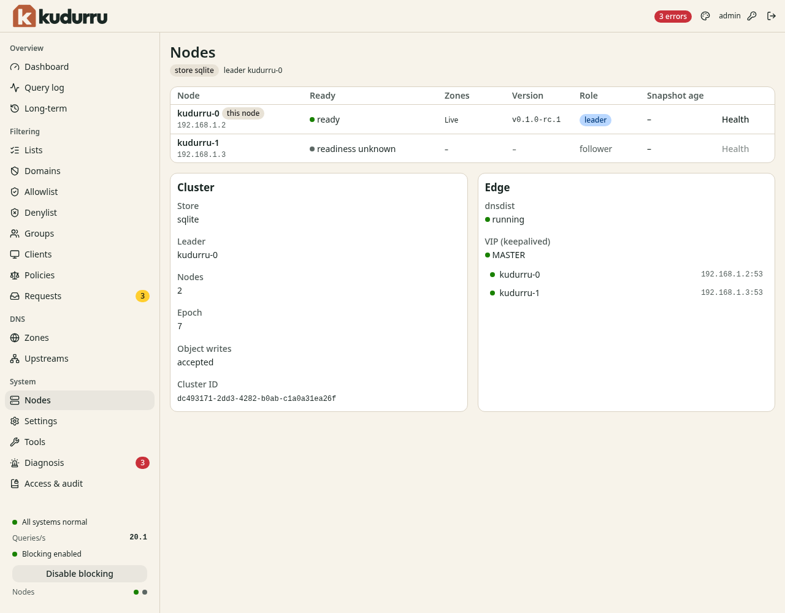
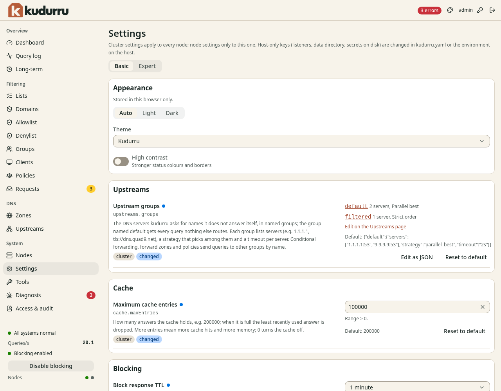
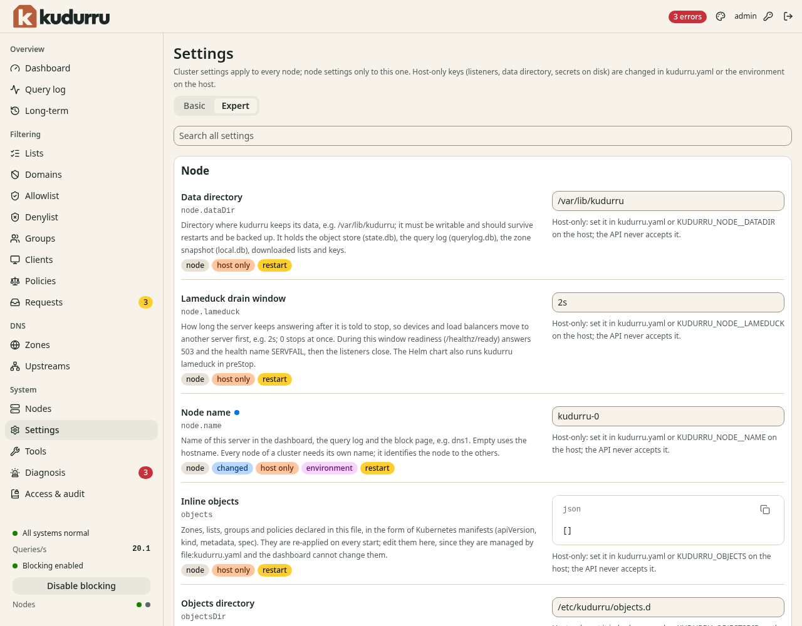
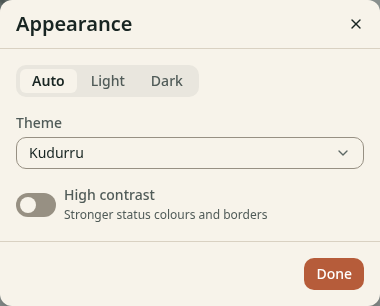
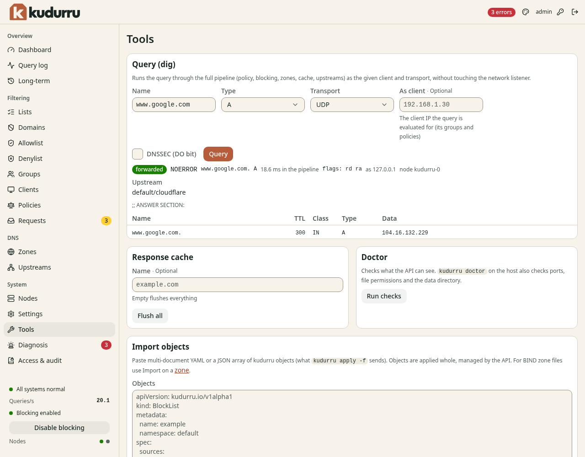
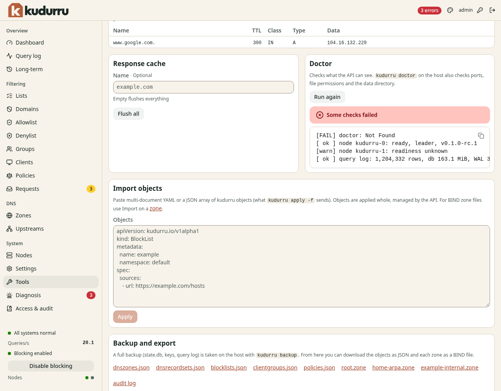
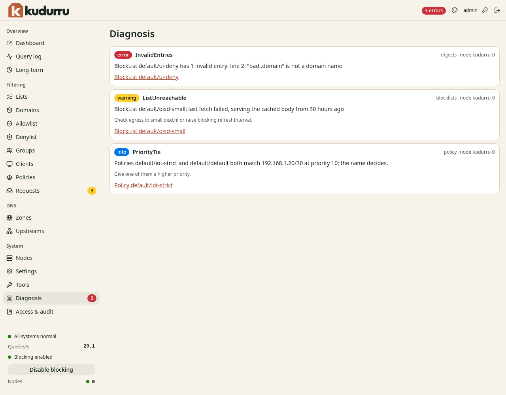

# 8. System pages

This chapter explains the pages of the section **System**: **Nodes**,
**Settings**, **Tools** and **Diagnosis**. Chapter 9 explains **Access &
audit**.

**Before you start:** You have the role Admin for most functions on these
pages. The role Operator can use some tools.

## Nodes

Open **System** > **Nodes**. Only the role Admin can read this page.
Figure 1 shows it.



*Figure 1. The page Nodes.*

The table has one row for each node.

| Column | Meaning |
|---|---|
| **Node** | The name and the address of the node. The label **this node** marks the node that serves your page. |
| **Ready** | If the node is ready to answer queries |
| **Zones** | The state of the zones on the node |
| **Version** | The version of kudurru on the node |
| **Role** | **leader** or **follower** |
| **Snapshot age** | The age of the stored copy of the objects on the node |

One node is the leader. Only the leader does the jobs that must run once,
for example the fetch of block lists. If the leader stops, another node
takes the role.

Click **Health** in a row to see the checks of the node.

The card **Cluster** shows the store (`sqlite` or `kube`), the leader, the
number of nodes, the epoch, and if the cluster accepts **Object writes**. The card
**Edge** shows the state of dnsdist and of the virtual IP address
(keepalived), if you use them. It also lists the backends.

## Settings

A setting is a key and a value. Open **System** > **Settings**. Figure 2
shows the page.



*Figure 2. The page Settings.*

The page has two views. Click **Basic** or **Expert** at the top.

| View | Content |
|---|---|
| **Basic** | The settings that most administrators need, in sections |
| **Expert** | All settings, with a search field |

Figure 3 shows the view **Expert**.



*Figure 3. The view Expert.*

Each setting has a label for each property.

| Label | Meaning |
|---|---|
| `cluster` | The setting applies to all nodes. |
| `node` | The setting applies to this node only. |
| `changed` | You changed the value from the default. |
| `host only` | You cannot change it in the dashboard. Change it in `kudurru.yaml` or with an environment variable on the host. |
| `environment` | An environment variable sets the value. You cannot change it here. |
| `restart` | A change takes effect after a restart of the node. |

### Change a setting

1. Open **System** > **Settings**.
2. Find the setting. In the view **Expert**, enter a part of the name in
   **Search all settings**.
3. Change the value.
4. Click **Save**.

To use a different input form, click **Edit as JSON**. To go back to the
default value, click **Reset to default**.

CAUTION: A banner **Kept in memory only** means that the node has no
settings file. The change is lost at the next restart. Set
`KUDURRU_SETTINGS_FILE` to keep changes.

If a setting needs a restart, the page shows the banner **Restart
required**. Restart the node. For example, run `docker restart kudurru`.

### The appearance

The section **Appearance** is for your browser only. It has the choices
**Auto**, **Light** and **Dark**, a **Theme**, and the switch **High
contrast**. You can also click the palette icon in the top bar. Figure 4
shows the dialog.



*Figure 4. The dialog Appearance.*

### The block page

The page **Settings** shows a preview of the block page with your settings.
Chapter 6 explains the block page.

### All settings

The [settings reference](../../../site/content/reference/configuration.md)
lists each setting with its type, its default value and its limits. On the
host you can print the list:

```sh
kudurru config schema
```

## Tools

Open **System** > **Tools**. The page has several tools. Figure 5 shows
the tool **Query (dig)**.



*Figure 5. The page Tools.*

### Query (dig)

Use this tool to see what kudurru does with a name. The query goes through
the same steps as a real query. It does not use the network port.

1. Enter a name in **Name**.
2. Select the **Type**, for example `A`.
3. Select the **Transport**: **UDP**, **TCP**, **DoT**, **DoH**, **DoQ** or
   **DoH3**.
4. To test the rules of a client, enter its address in **As client**.
5. To ask for DNSSEC data, select **DNSSEC (DO bit)**.
6. Click **Query**.

The result shows the status, for example `forwarded` or `blocked list`, the
status code, the time, the node and the upstream. Below it are the sections
of the answer.

Use **As client** to find out why a device gets a different answer. kudurru
uses the group and the policies of that address.

### Response cache

kudurru keeps answers in a cache. To remove them:

1. Enter a name in **Name** to remove one name. Leave the field empty to
   remove everything.
2. Click **Flush all**. If you gave a name, the button is **Flush name**.

The role Operator or Admin is necessary.

### Doctor

1. Click **Run checks** in the section **Doctor**.
2. Read the list of checks. A line has the result `ok`, `warn` or `FAIL`.

The message **All checks passed** or **Some checks failed** shows at the
top of the list (Figure 6). The checks on this page are the checks that the
API can make. The command `kudurru doctor` on the host also checks the
ports, the file permissions and the data directory.



*Figure 6. The tools Doctor and Import objects.*

### Import objects

Use this tool to load objects from YAML or JSON. It does the same as
`kudurru apply -f`.

1. Paste one or more objects into **Objects**.
2. Click **Apply**.

The page shows the result for each object. kudurru applies each object as
a whole. The owner of the objects is **API**. kudurru refuses an object
that a file or Kubernetes owns.

### Backup and export

The section **Backup and export** has links to download the objects as JSON
files and each zone as a BIND file. It also has a link to the audit log.
These files are not a full backup. Chapter 11 explains how to back up
kudurru.

## Diagnosis

kudurru checks its own setup all the time. It writes a message for each
problem that it finds. Open **System** > **Diagnosis**, or click the
message badge in the top bar. Figure 7 shows the page.



*Figure 7. The page Diagnosis.*

Each message has a level.

| Level | Meaning |
|---|---|
| **error** | Something does not work. Do the action soon. |
| **warning** | Something works, but not as you want. |
| **info** | A notice. Read it. |

A message has a code, for example `ListUnreachable`, and a text that tells
you what is wrong. Often it also has a hint that tells you what to do. The
link at the bottom opens the object.

| Code in the example | Cause | Action |
|---|---|---|
| `InvalidEntries` | A list has an entry that is not a domain name | Open the list and correct the entry |
| `ListUnreachable` | The last fetch of a list failed. kudurru uses the copy that it fetched before. | Check that the node can reach the URL. Or make the refresh interval longer. |
| `PriorityTie` | Two policies match the same clients with the same priority | Give one policy a higher priority |

The messages go away when the cause goes away.
