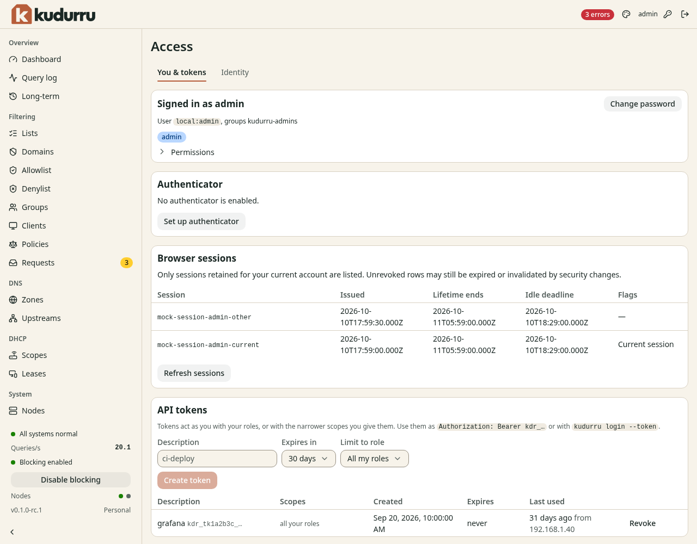
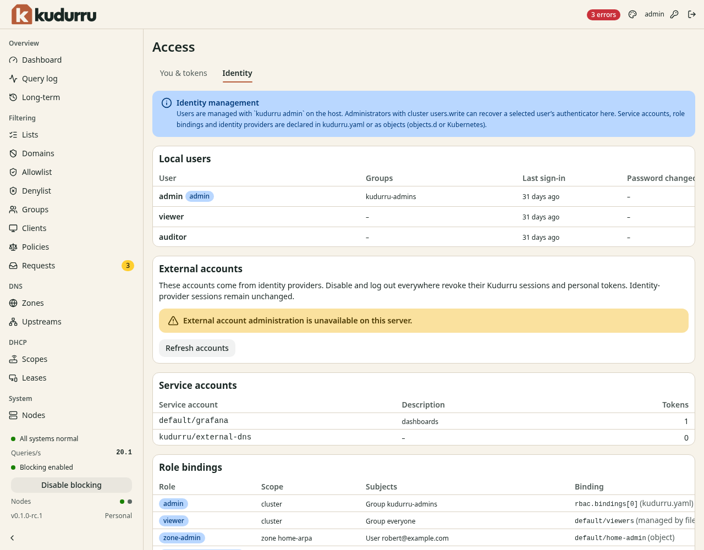
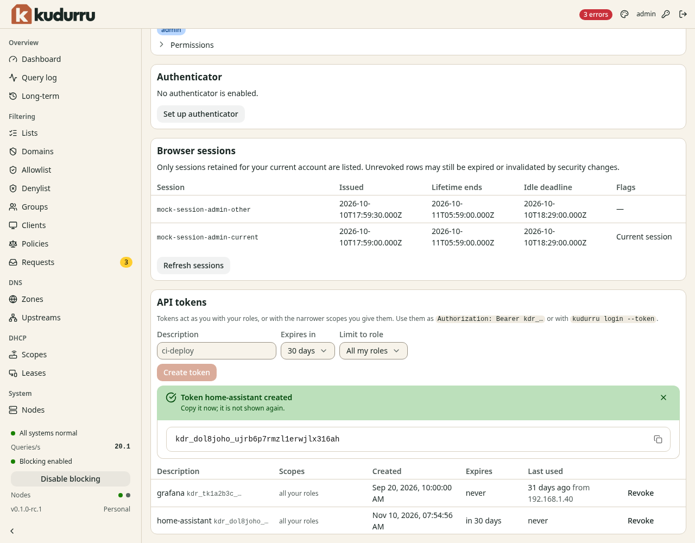
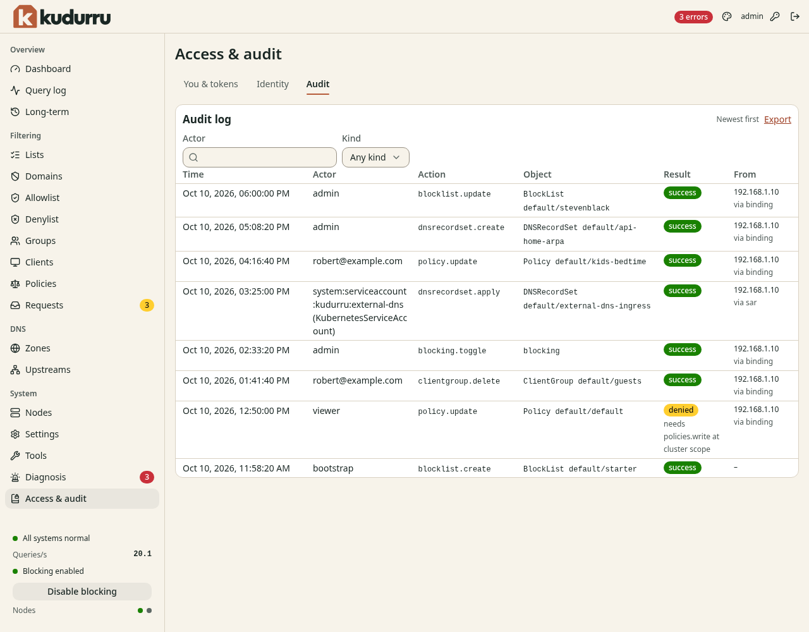

# 9. People, roles and tokens

This chapter explains who can sign in to kudurru, what each person can do,
and how to make API tokens. It also shows the audit log.

**Before you start:** You have the role Admin. The role Viewer is enough to
read your own account and to make your own tokens.

## How access works

Access has two parts.

- **Authentication** finds out who a person is. A person signs in with a
  password or with single sign-on. A program uses a token.
- **Authorization** finds out what the person can do. kudurru gives each
  person one or more *roles*.

A person with no role has no access. kudurru refuses a single sign-on
login if no role binding matches the person. It never gives the role Admin
by default.

## Roles

NOTE: Roles other than the built-in administrator need a license key.
Without a key, only the first-boot administrator has access, and role
bindings give none. The audit log and single sign-on also need a key. See
[Chapter 13](13-license.md).

| Role | Purpose | Can do |
|---|---|---|
| Viewer | Look at the setup and the statistics | Read zones, records, lists, policies, groups, clients, settings and statistics |
| Auditor | Check what happens | Everything that a viewer can do. Also read the query log, the access requests and the audit log, and export them. |
| Operator | Run the daily work | Everything that an auditor can do, except reading the audit log. Also change records, lists, policies, groups and clients. Switch blocking on and off. Flush the cache. Answer access requests. |
| Zone admin | Run one or more zones | Read statistics. Manage the zones and the records in its scope, including transfers. |
| Admin | Run everything | All functions, including settings, upstreams, nodes and purge of the query log |

A role has a scope. The scope is the whole cluster. The role Zone admin
can also have the scope of one zone or of one zone group. Then it works for
that zone, or for the zones of that group, only.

A zone group is a label on the zone: a zone is in the group `prod` when its
object has the label `kudurru.io/zonegroup: prod`. A zone is in one group or
in none. Only an administrator with the scope of the whole cluster can add,
change or remove this label. When the label is removed, the people bound to
the group lose access to the zone at once.

Each page of the dashboard shows only what the role can use. A button that
the role cannot use is gray. A page that the role cannot read shows the
message **Not permitted** with the name of the missing permission.

### See your own roles

1. Open **System** > **Access**.
2. Read the section **Signed in as**. It shows your user name, your groups
   and your roles.
3. Click **Permissions** to see each permission that you have.

Figure 1 shows the page.



*Figure 1. The page Access.*

## Give a role to a person

The dashboard shows role bindings and identity providers but does not
change them. You set them in files, in objects or with the command line.

A role binding gives a role to users, groups or service accounts. Add
bindings in `kudurru.yaml`:

```yaml
rbac:
  bindings:
    - role: operator
      subjects:
        - {kind: Group, name: "dex:network-team"}
    - role: zone-admin
      scope: {kind: zone, name: home-arpa}
      subjects:
        - {kind: User, name: "dex:alice@example.com"}
```

The first binding gives the role Operator to the group `network-team` of the
identity provider `dex`. The second gives the role Zone admin for the zone
`home-arpa` to one user. For all zones of a zone group, use
`scope: {kind: zonegroup, name: prod}`. The name of a user or group starts with the
identifier of the identity provider and a colon.

In Kubernetes, use `RoleBinding` objects. They add to the bindings in the
file.

On a node with SQLite storage, the command `kudurru iam rolebindings` also
makes, changes and deletes `RoleBinding` objects. See
[Reviewed RoleBinding commands](../../deploy/rolebindings.md).

NOTE: A change to `rbac.bindings` needs a restart of the node.

### Single sign-on

kudurru can use an OpenID Connect provider. Examples are Google, Microsoft
Entra ID, Keycloak, Authentik and Dex. Each provider has an entry in
`auth.identityProviders` in `kudurru.yaml`. An entry needs an `id`, an
`issuer`, a `clientID`, a `clientSecretFile` and a `redirectURL`. The
[settings reference](../../../docs-site/content/reference/configuration.md#auth.identityProviders)
lists all the fields.

After you set up a provider, the sign-in page shows one button for it.

### Local accounts

The account `admin` is a local account. kudurru makes it at the first
start. The dashboard shows local users on the tab **Identity**.

The v0.2 SQLite API also accepts `POST /api/v1/iam/users` for an ordinary
API-managed account. An administrator supplies `name`, optional `displayName`
and `password`. The user must change that password on first sign-in. Creation
does not assign a role or enroll an authenticator.

To reset one of these accounts, send `POST /api/v1/iam/users/{name}/password`
with its exact `uid` and `resourceVersion` from the user inventory, plus
`newPassword`. A 409 requires a fresh inventory read before a deliberate new
request. Reset signs out the account and revokes its local personal tokens. It
preserves its authenticator and disabled state, and requires another password
change. Reset does not recover a lost authenticator. Built-in and file-managed
accounts are excluded; Kubernetes returns 503 for these two API commands.

To turn off the local sign-in when all your people use single sign-on, set
`auth.localLogin` to `disabled`. The value `admins-only` allows the built-in
admin only. You cannot lock yourself out: the command `kudurru admin` on
the host always works.

### Limits at sign-in

kudurru protects the sign-in against attacks that try many passwords.

- After 5 failed sign-ins from one address, kudurru refuses sign-in from
  that address for 5 minutes.
- After 10 failed sign-ins for one user name, kudurru refuses sign-in for
  that user for 15 minutes.

A sign-in session ends after 30 minutes without activity, and after 12
hours at the most. You can change these times with
`auth.session.idleTimeout` and `auth.session.lifetime`.

## See the identity data

Click the tab **Identity** on the page **Access**. Figure 2 shows it.



*Figure 2. The tab Identity.*

The tab has five sections.

| Section | Content |
|---|---|
| **Local users** | The local accounts, their groups and the time of the last sign-in. The column **Actions** removes the authenticator of a person. |
| **External accounts** | The accounts of people who signed in with single sign-on. Only a node with SQLite storage has this list. |
| **Service accounts** | Accounts for programs, with the number of tokens |
| **Role bindings** | The role, the scope, the subjects, and where the binding comes from |
| **Identity providers** | The single sign-on providers |

## Change your password

1. Click the key icon at the top right of the page. Or click **Change
   password** on the tab **You & tokens**.
2. Enter the **Current password**.
3. Enter a **New password** of 8 characters or more. Enter it again in
   **Confirm password**.
4. Click **Change password**.

kudurru signs out all the other sessions of the account.

## Use an authenticator

An authenticator is an app that shows a new code of 6 digits every 30
seconds. With an authenticator, kudurru asks for the password and the code
each time that you sign in.

NOTE: Only local accounts on a node with SQLite storage have this function.
A node with Kubernetes storage and a static node do not have it. In a
cluster of SQLite nodes, use the dashboard of the primary.

The section **Authenticator** is on the tab **You & tokens** of the page
**Access**. It shows if an authenticator is enabled.

### Set up an authenticator

1. Open **System** > **Access**.
2. In the section **Authenticator**, click **Set up authenticator**.
3. Enter the **Current password**.
4. Click **Next**. The dialog shows the **Authenticator key**.
5. Add a new account in your authenticator app.
6. Enter the **Authenticator key** as the key of that account.
7. Click **Next**.
8. Enter the **Current password again**.
9. Enter the code from the app in **New authenticator code**.
10. Click **Confirm authenticator**.

kudurru signs out all the browser sessions of the account. The API tokens
of the account continue to work. Sign in again. Enter the password and the
next code from the app in **Authenticator code**.

NOTE: The key is valid for 5 minutes. If you are not ready in that time,
start the procedure again.

The app must use these values: a code that changes with the time, SHA1,
6 digits and 30 seconds. Most apps use them by default.

To move to a different app or telephone, click **Replace authenticator**.
The steps are the same. The dialog also asks for codes from the old
authenticator.

### Remove your authenticator

1. In the section **Authenticator**, click **Disable authenticator**.
2. Enter the **Current password**.
3. Enter the **Current authenticator code**.
4. Click **Disable authenticator**.

kudurru signs out all the browser sessions of the account. Sign in again
with the password only.

### Remove the authenticator of a different person

Use this procedure for a person who lost the authenticator. You must have
the role Admin.

1. Open **System** > **Access**.
2. Click the tab **Identity**.
3. In the table **Local users**, find the row of the person.
4. Click **Recover authenticator…** in that row.
5. Make sure that the dialog shows the correct account.
6. Click **Recover authenticator**.

kudurru removes the authenticator of the account and signs out its browser
sessions. The person signs in with the password only. Then the person can
set up a new authenticator.

NOTE: The column **Actions** is at the right end of the table. In a window
that is not wide, scroll the table to the right to see it.

If you lost the authenticator of the only administrator, use a token from
the host. Chapter 11 has the procedure:
[Recover a lost authenticator](11-maintenance.md#recover-a-lost-authenticator).

## See and end your browser sessions

A browser session starts when you sign in to the dashboard. The section
**Browser sessions** on the tab **You & tokens** lists the sessions of your
account. Use it to end a session on a computer that you do not use now.

NOTE: Only a node with SQLite storage has this function. On a node with
Kubernetes storage, the section shows the message **Session inventory is
unavailable on this server.** In a cluster of SQLite nodes, end a session
on the dashboard of the primary.

| Column | Meaning |
|---|---|
| **Session** | The identifier of the session |
| **Issued** | The time of the sign-in |
| **Lifetime ends** | The time when the session ends at the latest |
| **Idle deadline** | The time when the session ends if you do not use it |
| **Flags** | **Current session** is the session of this browser. **Revoked** is a session that someone ended. |

To end a session:

1. Find the row of the session.
2. Click the button in the column **Actions**. Its name starts with
   **Revoke session**.
3. Make sure that the dialog shows the correct session.
4. Click **Revoke selected session**.
5. Click **Refresh sessions** to see the new state.

For the session of this browser, the button is **Revoke this session**.
After you click it, the browser shows the sign-in page.

NOTE: The column **Actions** is at the right end of the table. In a window
that is not wide, scroll the table to the right to see it.

A change of your password also ends the other sessions of the account.

## API tokens

A token lets a program use the API without a password. The program has the
roles of the person who made the token, or fewer.

### Make a token

1. Open **System** > **Access**. The tab **You & tokens** shows.
2. In **Description**, enter what the token is for, for example
   `home-assistant`.
3. In **Expires in**, select a time. The default is 30 days.
4. If the token needs fewer permissions, select a role in **Limit to
   role**. If you select **Zone admin**, also select the scope **One zone**
   and the **Zone**.
5. Click **Create token**.

The page shows the token one time (Figure 3). Copy it at once.



*Figure 3. A new token.*

CAUTION: kudurru does not show the token again. If you lose it, revoke it
and make a new token.

A token starts with `kdr_`. Use it in one of these ways:

- Send it in the header `Authorization: Bearer kdr_…` of an API request.
- Use it for the command line: `kudurru login --server <url> --token kdr_…`.

The administrator can set the longest life of a token with
`auth.tokens.maxLifetime`. The default of 0 allows tokens that never
expire.

### Revoke a token

1. Open the tab **You & tokens**.
2. Click **Revoke** in the row of the token.

The program that uses the token gets an error from then on.

NOTE: Use one token for each program. Then you can revoke one token without
a change for the others. Select the shortest time that is practical.

### Tokens on the host

If you cannot sign in, you can make a token on the host. See
[Recover a lost admin password](11-maintenance.md#recover-a-lost-admin-password).

## Read the audit log

NOTE: The audit log needs a license key. Without a key, the page asks for one.
See [Chapter 13](13-license.md).

kudurru writes an entry to the audit log for each change that comes
through the API. The role Auditor or Admin can read it.

NOTE: In Kubernetes, kudurru keeps the entries in AuditLog objects. All
replicas show the same entries. An entry can take up to 30 seconds to show
on the other replicas.

1. Open **System** > **Audit Log**. Figure 4 shows the audit table.



*Figure 4. The audit table.*

| Column | Meaning |
|---|---|
| **Time** | The time of the action |
| **Actor** | The person or the program |
| **Action** | What happened, for example `policy.update` |
| **Object** | The kind and the name of the object. API tokens also show their label, owner, expiry and scopes when recorded. |
| **Result** | `success` or `denied`. A `denied` entry shows the permission that was missing. |
| **From** | The address that the request came from, and how kudurru authorized it |

Use **Actor** and **Kind** to filter the rows. **Time order** switches between
newest first and oldest first. Click **Load older events** (or **Load newer
events** when oldest first) to continue through the retained trail. Click a row
or its chevron to expand the request context, before and after documents, and
chain hashes beneath it. Enter or Space toggles the focused row; the arrow
keys move between rows, as in the query table.
Click **Refresh** to retrieve current events or **Export** to download JSON lines.

`apitoken.create` means a token was created; `apitoken.delete` means it was
revoked. Signing in to the dashboard does not create an API token.
Deployment scripts that create temporary tokens and revoke them afterward
produce matching pairs of entries. Select **APIToken** in **Kind** to see
only token events. Older entries can lack token details; the log cannot
recover those details after revocation.

**Verify integrity** checks the complete retained audit store, independent of
the displayed filters. Hash chains detect changed records and broken links;
Kubernetes batch seals are also checked when the cluster key is available.
An integrity failure means changed records, invalid seals or broken links.
If storage cannot be read or verification times out, the page instead shows
**Verification unavailable**. Results are reused for up to 30 seconds; the
reported check time shows when the scan completed.
Keep logs or exports outside the database for an independent record: someone
with full database control could rewrite an unkeyed hash chain.

You can also read the log on the command line:

```sh
kudurru audit --since 24h --actor admin
```
