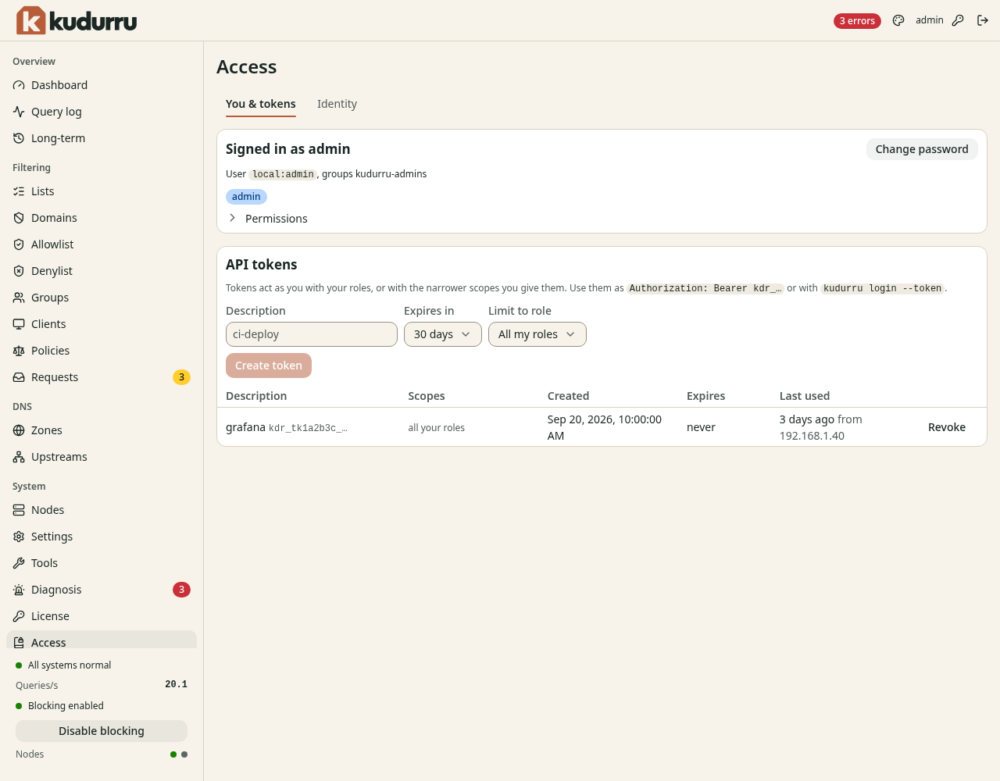
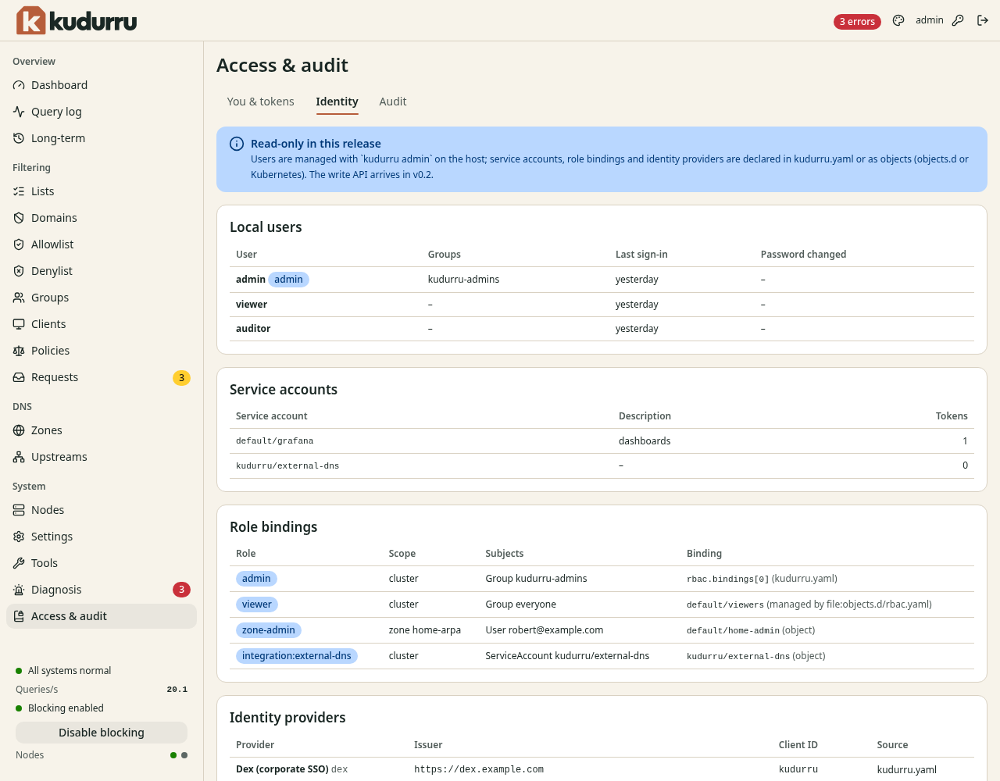
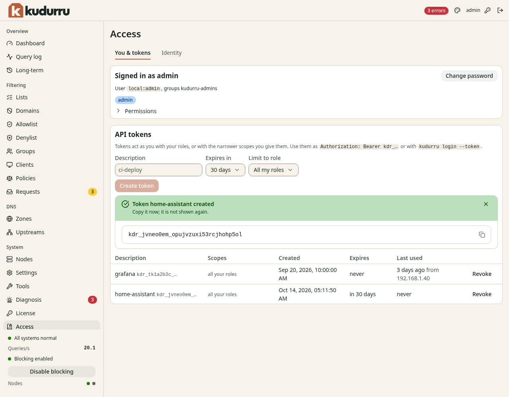

# 9. People, roles and tokens

This chapter explains who can sign in to kudurru, what each person can do,
and how to make API tokens. It also shows the audit log.

**Before you start:** You have the role Admin. The role Viewer is enough to
read your own account and to make your own tokens.

## How access works

Access has two parts.

- **Authentication** finds out who a person is. A person signs in with a
  password or with single sign-on. A program uses a token.
- **Authorization** finds out what the person can do. kudurru gives each
  person one or more *roles*.

A person with no role has no access. kudurru refuses a single sign-on
login if no role binding matches the person. It never gives the role Admin
by default.

## Roles

NOTE: Roles other than the built-in administrator need a license key.
Without a key, only the first-boot administrator has access, and role
bindings give none. The audit log and single sign-on also need a key. See
[Chapter 13](13-license.md).

| Role | Purpose | Can do |
|---|---|---|
| Viewer | Look at the setup and the statistics | Read zones, records, lists, policies, groups, clients, settings and statistics |
| Auditor | Check what happens | Everything that a viewer can do. Also read the query log, the access requests and the audit log, and export them. |
| Operator | Run the daily work | Everything that an auditor can do, except reading the audit log. Also change records, lists, policies, groups and clients. Switch blocking on and off. Flush the cache. Answer access requests. |
| Zone admin | Run one or more zones | Read statistics. Manage the zones and the records in its scope, including transfers. |
| Admin | Run everything | All functions, including settings, upstreams, nodes and purge of the query log |

A role has a scope. The scope is the whole cluster. The role Zone admin
can also have the scope of one zone. Then it works for that zone only.

Each page of the dashboard shows only what the role can use. A button that
the role cannot use is gray. A page that the role cannot read shows the
message **Not permitted** with the name of the missing permission.

### See your own roles

1. Open **System** > **Access & audit**.
2. Read the section **Signed in as**. It shows your user name, your groups
   and your roles.
3. Click **Permissions** to see each permission that you have.

Figure 1 shows the page.



*Figure 1. The page Access & audit.*

## Give a role to a person

In version 0.1, the dashboard shows users, role bindings and identity
providers but does not change them. You set them in files or in
Kubernetes objects. The page shows the label **Read-only in this release**.

A role binding gives a role to users, groups or service accounts. Add
bindings in `kudurru.yaml`:

```yaml
rbac:
  bindings:
    - role: operator
      subjects:
        - {kind: Group, name: "dex:network-team"}
    - role: zone-admin
      scope: {kind: zone, name: home-arpa}
      subjects:
        - {kind: User, name: "dex:alice@example.com"}
```

The first binding gives the role Operator to the group `network-team` of the
identity provider `dex`. The second gives the role Zone admin for the zone
`home-arpa` to one user. The name of a user or group starts with the
identifier of the identity provider and a colon.

In Kubernetes, use `RoleBinding` objects. They add to the bindings in the
file.

NOTE: A change to `rbac.bindings` needs a restart of the node.

### Single sign-on

kudurru can use an OpenID Connect provider. Examples are Google, Microsoft
Entra ID, Keycloak, Authentik and Dex. Each provider has an entry in
`auth.identityProviders` in `kudurru.yaml`. An entry needs an `id`, an
`issuer`, a `clientID`, a `clientSecretFile` and a `redirectURL`. The
[settings reference](../../../site/content/reference/configuration.md#auth.identityProviders)
lists all the fields.

After you set up a provider, the sign-in page shows one button for it.

### Local accounts

The account `admin` is a local account. kudurru makes it at the first
start. You set up other local accounts in files. The dashboard shows
the local users on the tab **Identity**.

To turn off the local sign-in when all your people use single sign-on, set
`auth.localLogin` to `disabled`. The value `admins-only` allows the built-in
admin only. You cannot lock yourself out: the command `kudurru admin` on
the host always works.

### Limits at sign-in

kudurru protects the sign-in against attacks that try many passwords.

- After 5 failed sign-ins from one address, kudurru refuses sign-in from
  that address for 5 minutes.
- After 10 failed sign-ins for one user name, kudurru refuses sign-in for
  that user for 15 minutes.

A sign-in session ends after 30 minutes without activity, and after 12
hours at the most. You can change these times with
`auth.session.idleTimeout` and `auth.session.lifetime`.

## See the identity data

Click the tab **Identity** on the page **Access & audit**. Figure 2 shows it.



*Figure 2. The tab Identity.*

The tab has four tables.

| Table | Content |
|---|---|
| **Local users** | The local accounts, their groups and the time of the last sign-in |
| **Service accounts** | Accounts for programs, with the number of tokens |
| **Role bindings** | The role, the scope, the subjects, and where the binding comes from |
| **Identity providers** | The single sign-on providers |

## Change your password

1. Click the key icon at the top right of the page. Or click **Change
   password** on the tab **You & tokens**.
2. Enter the **Current password**.
3. Enter a **New password** of 8 characters or more. Enter it again in
   **Confirm password**.
4. Click **Change password**.

kudurru signs out all the other sessions of the account.

## API tokens

A token lets a program use the API without a password. The program has the
roles of the person who made the token, or fewer.

### Make a token

1. Open **System** > **Access & audit**. The tab **You & tokens** shows.
2. In **Description**, enter what the token is for, for example
   `home-assistant`.
3. In **Expires in**, select a time. The default is 30 days.
4. If the token needs fewer permissions, select a role in **Limit to
   role**. If you select **Zone admin**, also select the scope **One zone**
   and the **Zone**.
5. Click **Create token**.

The page shows the token one time (Figure 3). Copy it at once.



*Figure 3. A new token.*

CAUTION: kudurru does not show the token again. If you lose it, revoke it
and make a new token.

A token starts with `kdr_`. Use it in one of these ways:

- Send it in the header `Authorization: Bearer kdr_…` of an API request.
- Use it for the command line: `kudurru login --server <url> --token kdr_…`.

The administrator can set the longest life of a token with
`auth.tokens.maxLifetime`. The default of 0 allows tokens that never
expire.

### Revoke a token

1. Open the tab **You & tokens**.
2. Click **Revoke** in the row of the token.

The program that uses the token gets an error from then on.

NOTE: Use one token for each program. Then you can revoke one token without
a change for the others. Select the shortest time that is practical.

### Tokens on the host

If you cannot sign in, you can make a token on the host. See
[Recover a lost admin password](11-maintenance.md#recover-a-lost-admin-password).

## Read the audit log

kudurru writes an entry to the audit log for each change that comes
through the API. The role Auditor or Admin can read it.

NOTE: In Kubernetes, kudurru keeps the entries in AuditLog objects. All
replicas show the same entries. An entry can take up to 30 seconds to show
on the other replicas.

1. Open **System** > **Access & audit**.
2. Click the tab **Audit**. Figure 4 shows it.


*Figure 4. The tab Audit.*

| Column | Meaning |
|---|---|
| **Time** | The time of the action |
| **Actor** | The person or the program |
| **Action** | What happened, for example `policy.update` |
| **Object** | The kind and the name of the object |
| **Result** | `success` or `denied`. A `denied` entry shows the permission that was missing. |
| **From** | The address that the request came from, and how kudurru authorized it |

Use the filters **Actor** and **Kind** to limit the rows. Click **Load older
events** to see more. Click **Export** to download the log as a file of JSON
lines.

You can also read the log on the command line:

```sh
kudurru audit --since 24h --actor admin
```
