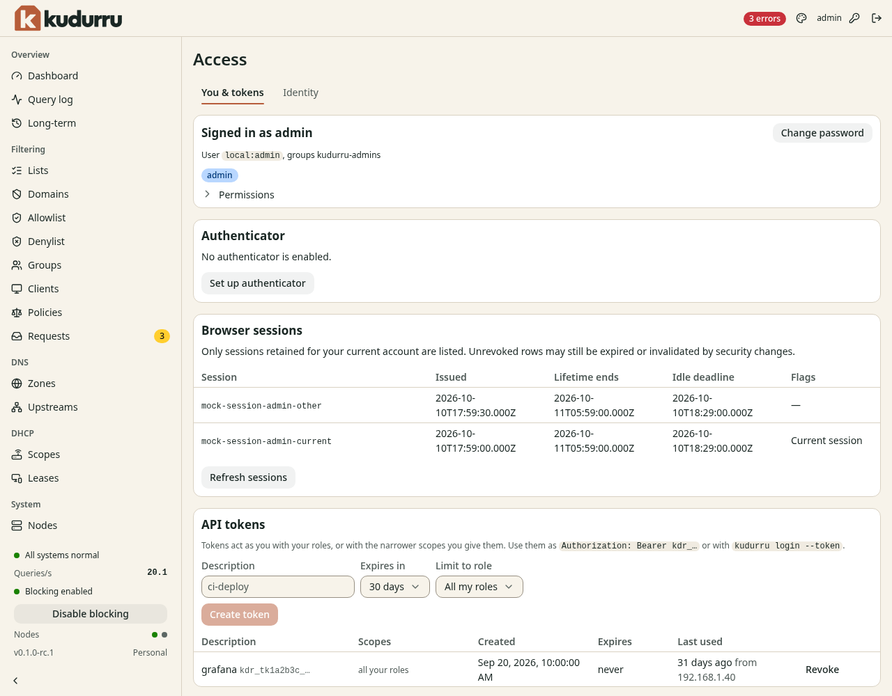

# Manage your account and API tokens

**Before you start**

- Sign in with the account that the program needs to act as.
- You need permission to create your own tokens.

## Check your account

1. Open **System** > **Access**.
2. Select **You & tokens**.
3. Read **Signed in as** and your assigned roles.
4. Click **Permissions** to inspect allowed actions.



*Figure 1. Tokens use your roles or a narrower scope that you select.*

For a local account, use **Change password**.
Enter the current password, the new password and its confirmation, then save.
Changing a password signs out the account's other sessions.

On a node with SQLite storage, the tab has two more sections.
**Authenticator** adds a code from an authenticator app to the sign-in of a local account.
**Browser sessions** lists the sign-in sessions of your account and ends one of them.
See [Use an authenticator](../admin/09-people-and-tokens.md#use-an-authenticator)
and [See and end your browser sessions](../admin/09-people-and-tokens.md#see-and-end-your-browser-sessions).

A node with Kubernetes storage offers no authenticators.
There, **Authenticator** says so and the sign-in page has no code field.
**Identity** also has no authenticator recovery.
Use the second factor of your identity provider instead.

## Create a token for one program

1. Enter the program's purpose in **Description**.
2. Select the shortest practical period in **Expires in**.
3. Select a role in **Limit to role** if the program needs fewer permissions.
4. Select **One zone** and the **Zone** for a zone-scoped role.
5. Click **Create token**.
6. Copy the token into the program's secret configuration.

CAUTION: The token appears only once. Treat it as a password.
If you lose it, revoke it and create another token.

Programs send `Authorization: Bearer <token>` to the API.
Use one token per program so you can revoke access independently.
Click **Revoke** in its row when the program no longer needs access.
Use [Identity](identity.md) to manage users, service accounts and their tokens, role bindings and sign-in providers.

## Check the result

The program can perform its intended operation with the token.
Confirm its scope with a permitted read request before enabling automated changes.
After revocation, requests with that token fail authentication.

### External accounts

On servers with the complete SQLite authentication runtime, the Identity tab
lists persisted external accounts separately from local users. The account's
provider, subject and independent UID distinguish it from other users with the
same display name. Reading requires `users.read`; changes require `users.write`.

- **Disable account** prevents authentication and revokes that account's Kudurru
  sessions and personal tokens.
- **Enable account** permits a new login under the current provider and role
  policy. Previously revoked credentials remain invalid.
- **Log out everywhere** revokes the account's Kudurru sessions and personal
  tokens without disabling it. Identity-provider sessions remain unchanged.

Review the exact account in the confirmation dialog. A conflict means its
reviewed revision changed; refresh and review again. After an uncertain network
result, refresh before choosing another action. The dashboard never retries the
mutation automatically. A successful command can come before its published
read snapshot; refresh to observe the new revision.

The equivalent CLI commands return UID and revision explicitly:

```sh
kudurru iam external-users list
kudurru iam external-users get ACCOUNT_NAME
kudurru iam external-users disable ACCOUNT_NAME --uid REVIEWED_UID --revision REVIEWED_REVISION
kudurru iam external-users enable ACCOUNT_NAME --uid REVIEWED_UID --revision REVIEWED_REVISION
kudurru iam external-users logout ACCOUNT_NAME --uid REVIEWED_UID --revision REVIEWED_REVISION
```

Use a fresh reviewed revision for each action. `list` returns one bounded page;
pass its `continue` value with `--continue` for the next page. If the inventory
changes between pages, restart the read. Unsupported runtimes report that
external account administration is unavailable.

### Command-line sign-in

For OIDC browser sign-in, register a separate public client with S256 PKCE and
set its explicit `cliClientID` on the provider. Register both loopback redirects,
`http://127.0.0.1:8000/callback` and `http://127.0.0.1:18000/callback`, then run:

```sh
kudurru login --server https://dns.example --provider corp
```

The CLI opens the browser and saves the original provider ID token in the normal
credential store. The token retains its original expiry; sign in again when it
expires. No refresh token, Kudurru personal token or browser session is issued
by this public-client flow. Existing local-password and explicit API-token login
remain available.

On a host without a browser, use `--device` if the provider advertises RFC 8628
public-client support. Follow the displayed verification URI and enter the
user code on another device. The CLI polls within the original grant deadline
and stops on cancellation, expiry or refusal. It does not create a replacement
grant automatically.

Both flows require verified HTTPS for the API and provider. Use `--ca-file` for
private API trust and `--oidc-ca-file` for private provider trust; the browser must
also trust the provider certificate. Providers without the required advertised
capability are explicitly unavailable for that flow. The complete SQLite runtime
supports these public-client routes; direct Kubernetes transport does not.
