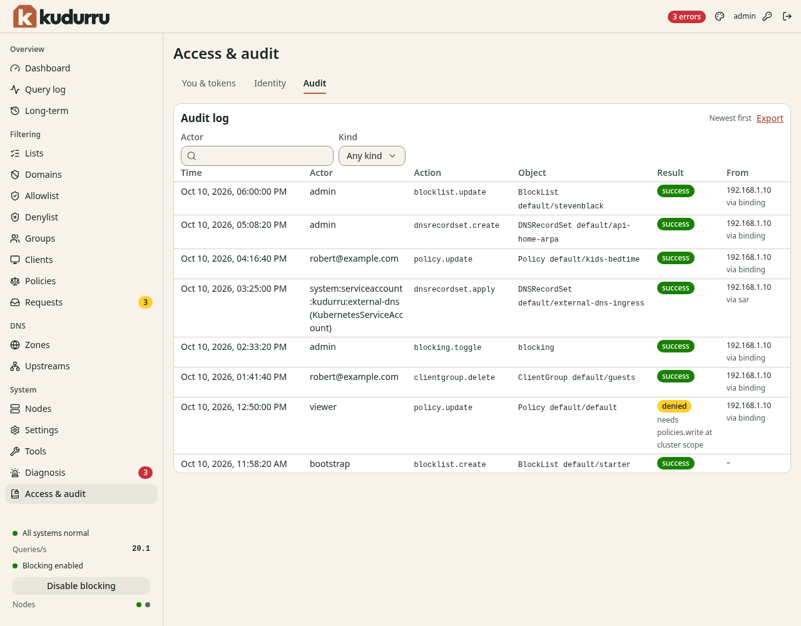

# Trace a configuration change

**Before you start**

- You need the `auditor` or `admin` role and a license key.
- You need the approximate actor, object kind or time of the change.

## Find an event

1. Open **System** > **Audit Log**.
2. Enter the account or program in **Actor**, if known.
3. Select an object **Kind** to narrow the results.
4. Select **Time order**.
5. Click an event row to expand it.
6. Read the action, object, result, request context and before/after documents.

*Figure 1. An event records who changed an object and whether the action succeeded.*

Click **Load older events**, or **Load newer events** in the opposite order,
to continue through retained history. **Refresh** retrieves current events.
In Kubernetes, an event can take up to 30 seconds to appear on another replica.

`apitoken.create` and `apitoken.delete` record token creation and revocation.
Dashboard sign-in does not create an API token.
A `denied` result identifies an action that lacked permission.

## Verify and export

1. Click **Verify integrity**.
2. Read the result and check time.
3. Click **Export** to download JSON lines.
4. Keep the export outside the kudurru database if you need an independent record.

Verification checks the complete retained store, independent of the displayed filters.
**Verification unavailable** means the check could not complete.
An integrity failure means changed records, broken links or invalid seals.
See the [audit reference](../admin/09-people-and-tokens.md#read-the-audit-log) for verification limits.

## Check the result

You can identify the actor, action and result for the change.
Open the exported file to confirm that it contains the events you need.
