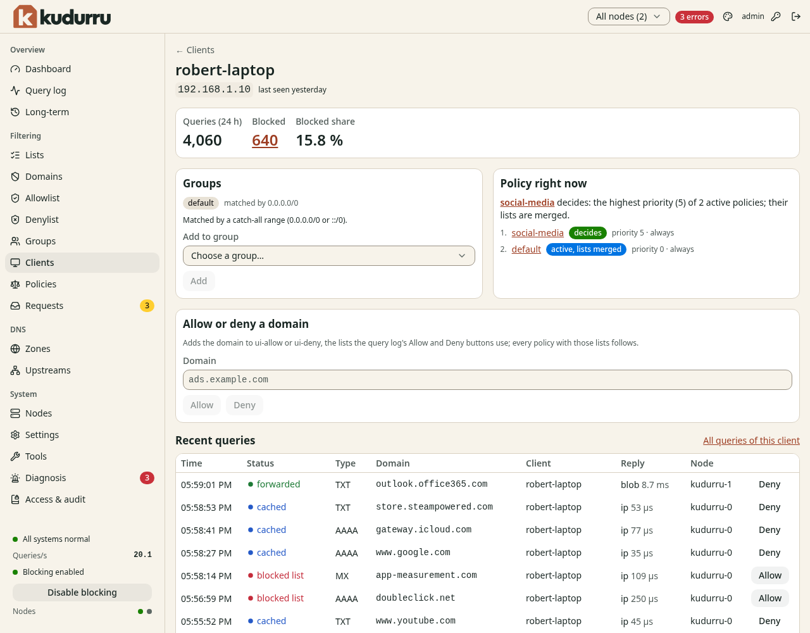

# Find a client and check its rules

**Before you start**

- You need the `viewer` role or a higher role to read clients.
- You need the `operator` or `admin` role to change group membership or domain rules.
- The client needs to send DNS queries to kudurru.

## Inspect a device

1. Open **Filtering** > **Clients**.
2. Select **All nodes** or one node in **Node scope**.
3. Find the device by its name or address.
4. Click its name to open the detail page.
5. Read **Groups** and the matcher that selected the group.
6. Read **Policy right now** to find the policy labeled **decides**.

*Figure 1. The client page explains which rules apply now.*

The client list shows devices seen in the last 24 hours.
Click a query count to open that client's log. Query details need an appropriate role.

## Add the client to a group

1. Click **Add to group** in **Groups**.
2. Select the existing client group.
3. Confirm the addition.

You can also select client rows on **Clients** and use **Add to group**.
Use a [DHCP reservation](../dhcp/reservations.md) to keep an address matcher stable.
Use [Groups](groups.md) to create a group first.

## Check the result

Send another DNS query from the device and reload its page.
Confirm the expected group and deciding policy.
Use [Tools](tools.md) with **As client** to test a specific name.
