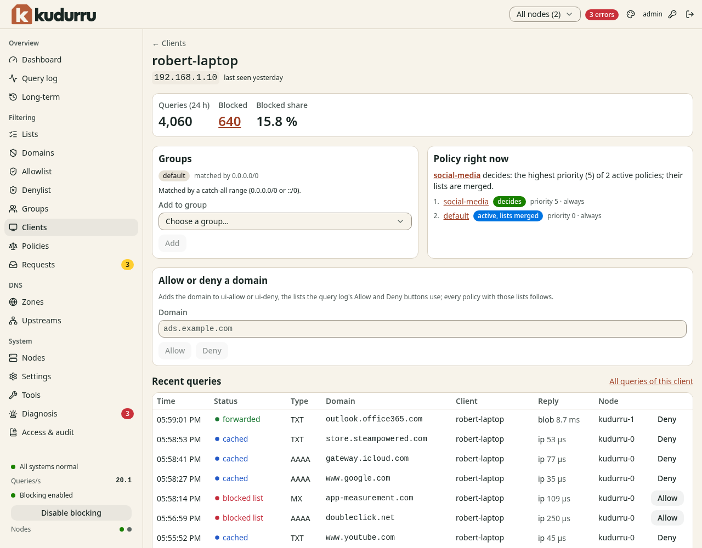

# Find a client and check its rules

**Before you start**

- You need the `viewer` role or a higher role to read clients.
- You need the `operator` or `admin` role to change group membership or domain rules.
- You need the `operator` or `admin` role to block a client at the edge
  (`edgeblocks.write`); the `auditor` role can read the active edge blocks.
- The client needs to send DNS queries to kudurru.

## Inspect a device

1. Open **Filtering** > **Clients**.
2. Select **All nodes** or one node in **Node scope**.
3. Find the device by its name or address.
4. Click its name to open the detail page.
5. Read **Groups** and the matcher that selected the group.
6. Read **Policy right now** to find the policy labeled **decides**.

*Figure 1. The client page explains which rules apply now.*

The client list shows devices seen in the last 24 hours.
Click a query count to open that client's log. Query details need an appropriate role.

## Add the client to a group

1. Click **Add to group** in **Groups**.
2. Select the existing client group.
3. Confirm the addition.

You can also select client rows on **Clients** and use **Add to group**.
Use a [DHCP reservation](../dhcp/reservations.md) to keep an address matcher stable.
Use [Groups](groups.md) to create a group first.

## Block a client at the edge

When kudurru runs behind dnsdist edges, you can drop every query from one
address or prefix at all edges until a time you choose.

1. Click **Block at edge** on the client's row in **Clients**.
   The client page has the same button at the top.
2. Keep the address or enter a prefix. IPv4 prefixes must be /16 or longer
   and IPv6 prefixes /32 or longer.
3. Pick how long the block lasts (one minute to seven days) and, if you like,
   a reason. The reason stays in the list and the audit trail; edges never
   receive it.
4. Click **Block**.

Edges pull the change within seconds and lift the block themselves when it expires.
Queries that reach a kudurru node directly, without an edge, are not affected.
**Edge blocks** under the client list shows every active block with its expiry, reason and author.
Click **Revoke** to lift a block early.

A client known only by a client ID has no **Block at edge** action, because edges see addresses.
On an enrolled follower the actions are disabled; open the dashboard on the primary.
Sometimes the dashboard cannot tell whether a block or a revoke happened.
It then says **Outcome unknown** and does not send the command again.
Check **Edge blocks** before you try once more.
The CLI commands are `kudurru edge block`, `kudurru edge blocks` and `kudurru edge unblock`.

## Check the result

Send another DNS query from the device and reload its page.
Confirm the expected group and deciding policy.
Use [Tools](tools.md) with **As client** to test a specific name.
