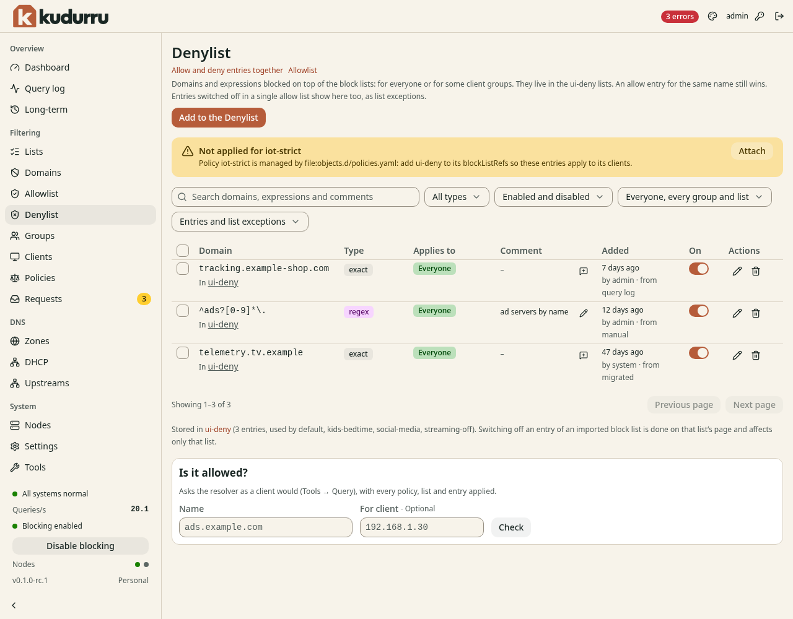

# Block a domain

**Before you start**

- You need the `operator` or `admin` role.
- You need the DNS name and the clients that need the rule.

## Add a deny entry

1. Open **Filtering** > **Denylist**.
2. Click **Add to the Denylist**.
3. Select the exact domain type in **Type**.
4. Enter the DNS name in **Domains**.
5. Select **Everyone** or **Some client groups** in **Applies to**.
6. Enter a reason in **Comment**.
7. Click **Add**.

*Figure 1. An allow entry still wins over a deny entry for the same name.*

Use an exact entry first. A wildcard affects subdomains; a regular expression
can affect many unrelated names.
Use **Search** to find an existing entry and its enabled switch to pause it.
Use its edit action to change the name, scope or comment.

## Check the result

Use **Is it allowed?** with the name and test client address.
Confirm a blocked answer in [Query log](query-log.md).
If the answer stays permitted, check the Allowlist and the client's policy.
If **Not applied for** names a managed policy, update that policy at its source.
