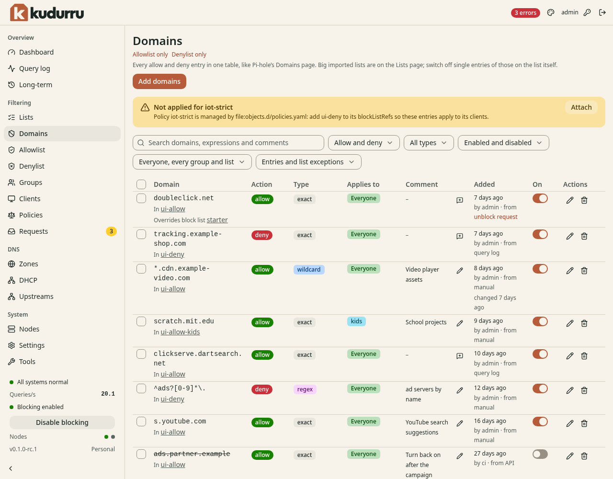

# Find and test domain rules

**Before you start**

- You need the `viewer` role to read rules.
- You need the `operator` or `admin` role to change them.

## Find a rule

1. Open **Filtering** > **Domains**.
2. Enter a domain in **Search**.
3. Select **Action** to show allow rules, deny rules or both.
4. Use **Applies to** to narrow the client group or list.
5. Read the rule's type, scope, comment and enabled state.

*Figure 1. Domains combines Allowlist and Denylist entries.*

**Allowlist only** and **Denylist only** open the separate pages.
Large imported lists stay on **Lists**. A list exception affects only its named list.

## Test the effective answer

1. Find **Is it allowed?** below the table.
2. Enter the DNS name in **Name**.
3. Enter the test client's address in **For client**.
4. Click **Check**.

The check uses the client's actual policies and lists.
Use **Add domains** to create a rule, or follow
[Allow a blocked site](../filtering/allow-site.md) and [Block a domain](denylist.md).

## Check the result

The test reports the answer for the selected client.
If **Not applied for** names a policy, update its list references at the policy's source.
See [Domain ownership](../admin/04-lists-and-domains.md#where-the-entries-are-stored).
