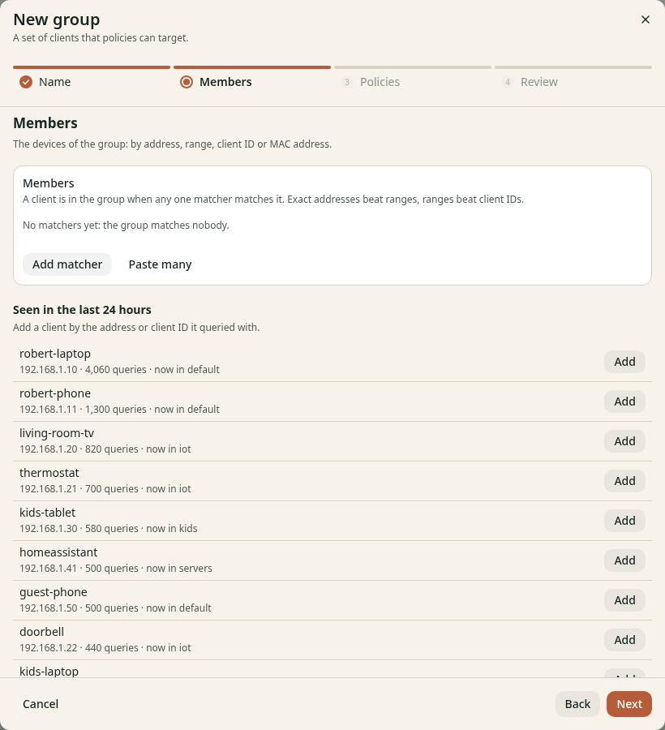

# Group devices and assign policies

**Before you start**

- You need the `operator` or `admin` role.
- You need stable client addresses or a client subnet.
- Use DHCP reservations for individual devices with address matchers.

## Create a client group

1. Open **Filtering** > **Groups**.
2. Click **New group**.
3. Enter a **Name** on **Name**.
4. Click **Next** to open **Members**.
5. Click **Add matcher**.
6. Select **IP address** for one device or **CIDR range** for a subnet.
7. Enter the device address or network prefix.
8. Click **Next** to open **Policies**.
9. Select the policies that apply to these clients.
10. Click **Next** to open **Review**.
11. Click **Create group**.

*Figure 1. Use an IP address or CIDR range for device matching.*

You can click **Add** beside a recently seen client instead of entering its address.
The DNS listeners in v0.1.0 do not receive client IDs or MAC addresses.
Use IP or CIDR matchers. Clients with no matching group use `default`.

## Change membership

1. Open **Filtering** > **Groups**.
2. Click **Open** for the group.
3. Click **Edit** in **Members**.
4. Change the matchers.
5. Save the changes.

The detail page lists observed clients and policies that apply.
**Disable** stops the group from matching; affected clients can fall into another group.
File-managed and Kubernetes-managed groups need edits at their source.

## Check the result

Generate a query from the device, then open its [client details](clients.md).
Confirm the expected **Groups** and **Policy right now**.
If every client appears as the router, give clients the kudurru DNS address directly.
